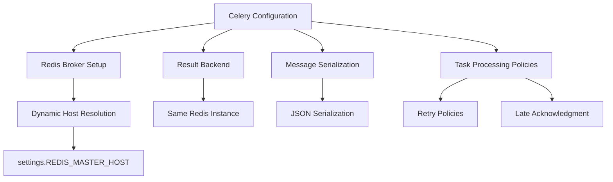
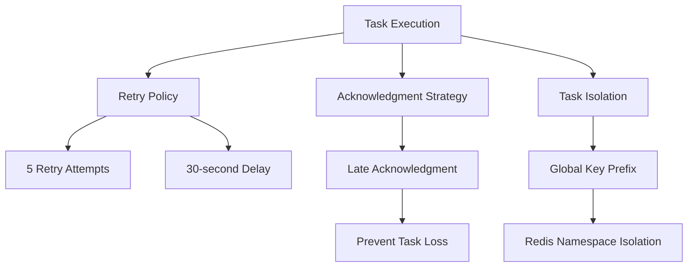
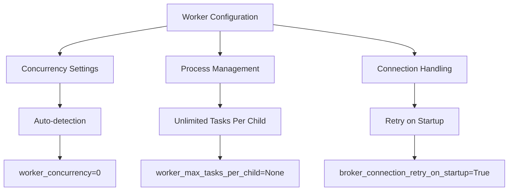
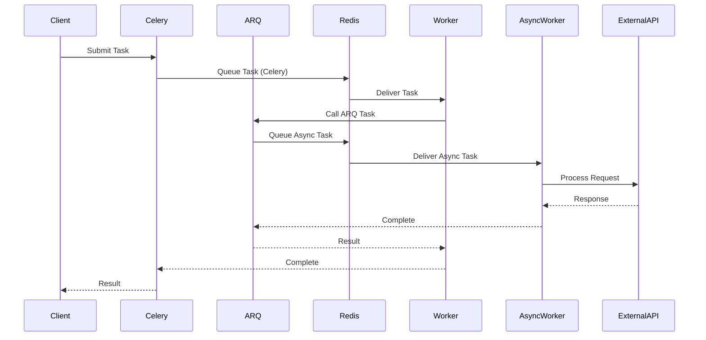
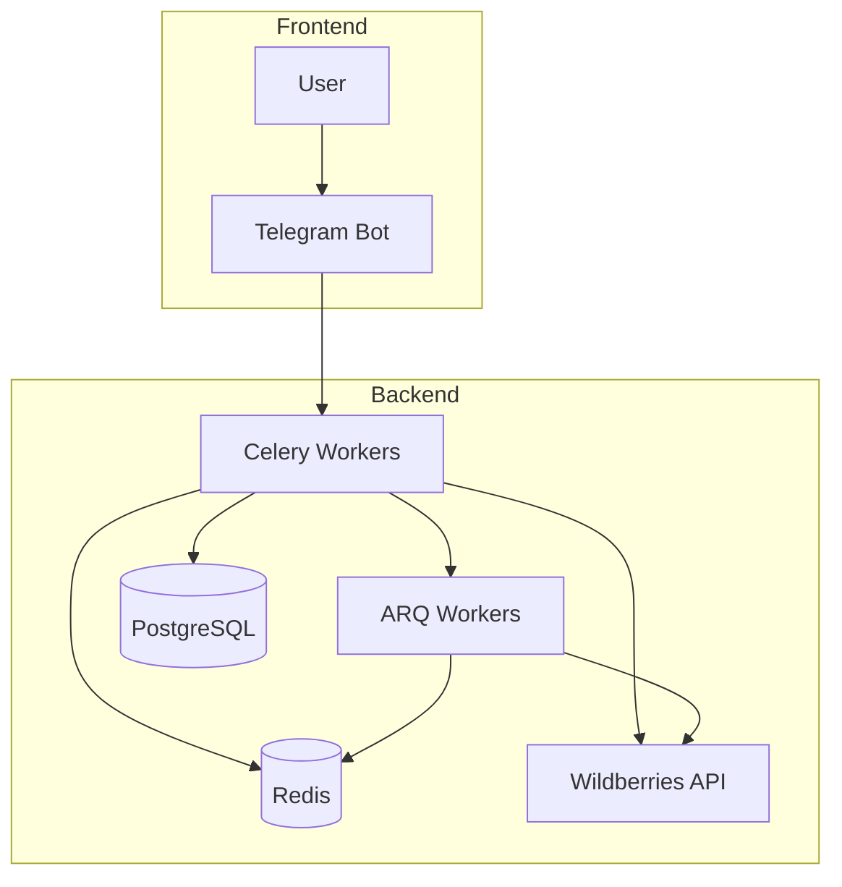

# Production Setup

<cite>
**Referenced Files in This Document**   
- [celeryconfig.py](file://celeryconfig.py)
- [settings_master.py](file://app/settings/settings_master.py)
- [tasks.py](file://app/modules/adv_creator/backend/tasks.py)
- [workers.py](file://app/arq_workers/workers.py)
- [arq_redis_settings.py](file://app/arq_workers/arq_redis_settings.py)
</cite>

## Table of Contents
1. [Introduction](#introduction)
2. [Celery Configuration](#celery-configuration)
3. [Task Configuration and Execution](#task-configuration-and-execution)
4. [Worker Configuration and Scaling](#worker-configuration-and-scaling)
5. [Integration with ARQ Background Tasks](#integration-with-arq-background-tasks)
6. [System Architecture Integration](#system-architecture-integration)
7. [High Availability and Security](#high-availability-and-security)
8. [Troubleshooting Guide](#troubleshooting-guide)
9. [Performance Monitoring and Optimization](#performance-monitoring-and-optimization)

## Introduction
This document provides comprehensive guidance for configuring the backend infrastructure of the adv-bot system in a production environment. The focus is on the Celery configuration for distributed task processing, which plays a critical role in handling background operations for the advertising automation platform. The system integrates Celery for task queuing and processing with ARQ for async background tasks, both utilizing Redis as the message broker. This setup enables reliable, scalable processing of advertising campaign creation and management operations while ensuring fault tolerance and data consistency.

## Celery Configuration

The Celery configuration in celeryconfig.py establishes the foundation for the distributed task processing system. The configuration leverages dynamic host resolution from the application settings to ensure environment-specific deployment flexibility.

**Diagram sources**
- [celeryconfig.py](file://celeryconfig.py#L1-L37)

**Section sources**
- [celeryconfig.py](file://celeryconfig.py#L1-L37)
- [settings_master.py](file://app/settings/settings_master.py#L1-L375)

### Redis Broker Setup with Dynamic Host Resolution
The Celery configuration implements dynamic Redis broker setup by retrieving the Redis master host from the application settings. This approach allows for environment-specific configuration without code changes. The broker URL is constructed using the REDIS_MASTER_HOST setting from the settings module, connecting to Redis on port 6379 with database 1. This dynamic resolution enables seamless deployment across development, staging, and production environments by simply changing environment variables.

### Result Backend Configuration
The result backend is configured to use the same Redis instance as the broker, ensuring consistency in task result storage and retrieval. By using identical connection strings for both broker_url and result_backend, the system maintains a unified data store for task queuing and result persistence. This configuration simplifies infrastructure management while providing reliable access to task execution results for monitoring and debugging purposes.

### Message Serialization Using JSON
The system employs JSON as the serialization format for all task messages, ensuring compatibility and readability. The configuration specifies task_serializer, result_serializer, and accept_content all as JSON, creating a consistent message format throughout the system. This choice of JSON provides several advantages: human-readable messages for debugging, broad language compatibility for potential future integrations, and efficient parsing performance. The uniform serialization format reduces complexity in message handling and improves system maintainability.

## Task Configuration and Execution

The task configuration in the Celery setup defines critical policies for reliable task execution and fault tolerance. These settings ensure that background operations are processed reliably even in the face of transient failures.

**Diagram sources**
- [celeryconfig.py](file://celeryconfig.py#L25-L37)

**Section sources**
- [celeryconfig.py](file://celeryconfig.py#L25-L37)
- [tasks.py](file://app/modules/adv_creator/backend/tasks.py#L1-L109)

### Task Retry Policies
The system implements robust task retry policies to handle transient failures during task execution. Each task is configured to attempt execution up to 5 times (task_retries=5) with a 30-second delay between attempts (task_retry_delay=30). This configuration balances reliability with system responsiveness, allowing temporary issues like network glitches or service unavailability to resolve without permanent task failure. The retry mechanism is particularly important for operations involving external APIs, such as Wildberries advertising services, where temporary connectivity issues are common.

### Late Acknowledgment to Prevent Task Loss
The configuration enables late acknowledgment (task_acks_late=True), ensuring tasks are only acknowledged after successful completion. This prevents task loss in scenarios where a worker process crashes during execution. Without late acknowledgment, tasks could be marked as complete before actual processing finishes, leading to lost operations. With late acknowledgment, if a worker fails, the task remains in the queue and can be reassigned to another worker, guaranteeing at-least-once delivery semantics critical for financial and advertising operations.

### Task Module Inclusion and Redis Isolation
The Celery configuration explicitly includes the task module app.modules.adv_creator.backend.tasks, defining the available background operations. Additionally, the system implements Redis namespace isolation through a global key prefix configured via broker_transport_options. The prefix is dynamically set from settings.CELERY_PREFIX, allowing multiple instances of the application to share the same Redis server without interference. This isolation is essential in multi-tenant or staging/production co-location scenarios, preventing cross-environment task contamination.

## Worker Configuration and Scaling

The worker configuration balances automatic resource utilization with explicit control over processing capacity. The settings enable efficient use of system resources while maintaining stability under varying load conditions.

**Diagram sources**
- [celeryconfig.py](file://celeryconfig.py#L20-L25)

**Section sources**
- [celeryconfig.py](file://celeryconfig.py#L20-L25)

### Worker Concurrency Settings
Worker concurrency is set to auto-detection (worker_concurrency=0), allowing Celery to automatically determine the optimal number of worker processes based on the available CPU cores. This configuration maximizes resource utilization by creating one worker process per CPU core, enabling parallel task processing without overloading the system. The auto-detection feature ensures the configuration remains optimal when deployed on different hardware configurations, from development laptops to production servers with multiple CPU cores.

### Process Management and Connection Handling
The configuration sets worker_max_tasks_per_child to None, indicating no limit on the number of tasks processed by each worker child process before recycling. This optimizes performance by avoiding the overhead of frequent process recreation while relying on Python's garbage collection to manage memory. Additionally, broker_connection_retry_on_startup is enabled, ensuring workers automatically attempt to reconnect to the Redis broker if the connection is not available when starting. This enhances system resilience during deployment sequences where Redis might start after worker processes.

## Integration with ARQ Background Tasks

The system integrates Celery with ARQ for async background task processing, creating a comprehensive background job ecosystem. Both systems share the same Redis infrastructure but serve different processing needs within the application architecture.

**Diagram sources**
- [workers.py](file://app/arq_workers/workers.py#L1-L49)
- [arq_redis_settings.py](file://app/arq_workers/arq_redis_settings.py#L1-L7)

**Section sources**
- [workers.py](file://app/arq_workers/workers.py#L1-L49)
- [arq_redis_settings.py](file://app/arq_workers/arq_redis_settings.py#L1-L7)

### Shared Redis Infrastructure
Both Celery and ARQ utilize the same Redis master host for message brokering, as evidenced by both systems retrieving REDIS_MASTER_HOST from the shared settings module. This consolidated approach reduces infrastructure complexity and operational overhead. The systems are isolated through different queue names and key prefixes, preventing interference while maximizing resource utilization. The shared Redis instance serves as a central nervous system for all background processing in the application.

### Complementary Task Processing
Celery and ARQ serve complementary roles in the system architecture. Celery handles the primary task queue for advertising campaign operations, while ARQ manages async background tasks that require different processing characteristics. The integration is demonstrated in the worker startup process, where ARQ workers initialize the Telegram bot instance that may be used by Celery tasks. This architecture allows for specialized optimization of each system for its specific use case while maintaining seamless interaction.

## System Architecture Integration

The Celery configuration is deeply integrated with the overall system architecture, connecting with Telegram bots and other components to deliver a cohesive advertising automation platform.

**Diagram sources**
- [celeryconfig.py](file://celeryconfig.py#L1-L37)
- [workers.py](file://app/arq_workers/workers.py#L1-L49)

**Section sources**
- [celeryconfig.py](file://celeryconfig.py#L1-L37)
- [workers.py](file://app/arq_workers/workers.py#L1-L49)
- [tasks.py](file://app/modules/adv_creator/backend/tasks.py#L1-L109)

### Interaction with Telegram Bots
The background task system is tightly integrated with Telegram bot functionality, enabling users to initiate complex advertising operations through chat commands. When a user requests campaign creation via Telegram, the request is converted into a Celery task that processes the operation asynchronously. The task system can then send progress updates and completion notifications back to the user through the same Telegram interface, creating a responsive user experience despite the long-running nature of advertising operations.

### Timezone and Encoding Configuration
The system standardizes on UTC timezone (timezone="UTC") with UTC enabled (enable_utc=True), ensuring consistent time handling across distributed components. All task messages use JSON encoding, providing a standardized format that is both human-readable and machine-efficient. This consistency is critical for debugging, monitoring, and ensuring reliable operation across different system components and potential future microservices.

## High Availability and Security

The production setup includes configurations that support high availability and secure operations, addressing critical requirements for a production-grade advertising platform.

### Redis High Availability Configuration
While the current configuration connects to a single Redis master host, the system is designed to support high availability through configuration. The use of settings.REDIS_MASTER_HOST and settings.REDIS_REPLICA_HOST in the settings module indicates support for Redis replication. In a high-availability setup, Redis persistence should be configured with both RDB snapshots and AOF (Append Only File) logging to prevent data loss. The Redis database should be monitored for memory usage, with appropriate maxmemory policies and eviction strategies configured based on workload characteristics.

### Securing Broker Connections
To secure broker connections in production, several measures should be implemented. Redis should be configured with authentication using strong passwords, and connections should be encrypted with TLS/SSL where possible. The Redis server should be deployed in a private network segment, accessible only to authorized application servers. Environment variables containing sensitive information like Redis credentials should be managed through secure secrets management systems rather than plain text files. Network-level security groups or firewalls should restrict access to the Redis port (6379) to only the application servers that require it.

## Troubleshooting Guide

This section provides guidance for diagnosing and resolving common issues encountered in the production environment.

**Section sources**
- [celeryconfig.py](file://celeryconfig.py#L1-L37)
- [workers.py](file://app/arq_workers/workers.py#L1-L49)
- [tasks.py](file://app/modules/adv_creator/backend/tasks.py#L1-L109)

### Broker Connection Failures
Broker connection failures typically manifest as worker startup errors or task submission failures. To diagnose, first verify Redis server availability and network connectivity. Check that the REDIS_MASTER_HOST environment variable is correctly set and resolvable. Use Redis CLI tools to test connectivity and authentication. Monitor Redis memory usage, as a full server may reject new connections. Implement connection pooling and retry logic in client applications to handle transient network issues.

### Task Serialization Errors
Task serialization errors occur when task arguments cannot be properly converted to JSON. Ensure all task parameters are JSON-serializable types (strings, numbers, lists, dictionaries). Avoid passing complex objects or database models directly to tasks; instead, pass identifiers and retrieve the full objects within the task. Validate data types before task submission, and implement comprehensive error handling with informative logging to aid in debugging serialization issues.

### Worker Starvation
Worker starvation occurs when tasks accumulate in the queue without being processed. Monitor queue lengths and worker utilization metrics. Check worker process status and logs for crashes or resource exhaustion. Ensure adequate system resources (CPU, memory) are available. Consider scaling worker count horizontally by adding more worker instances, or vertically by increasing resources on existing instances. Review task execution times and optimize long-running tasks to prevent blocking.

## Performance Monitoring and Optimization

Effective monitoring and optimization are essential for maintaining system performance and reliability in production.

### Monitoring Metrics
Implement comprehensive monitoring of key metrics including queue length, task processing rate, worker utilization, and task execution times. Monitor Redis memory usage and eviction statistics. Track error rates and retry counts for tasks. Use distributed tracing to identify performance bottlenecks in task execution chains. Set up alerts for abnormal conditions such as growing queue backlogs or high error rates.

### Optimization Strategies
Optimize performance by tuning worker concurrency based on actual workload patterns and system resources. Implement task prioritization for critical operations. Consider using different Redis databases or instances for different types of tasks to prevent resource contention. Optimize task granularity - balance between too many small tasks (high overhead) and too few large tasks (poor parallelization). Implement efficient error handling to minimize retry storms during system degradation.

### Scaling Worker Processes
Scale worker processes based on workload requirements and system capacity. For CPU-intensive tasks, scale horizontally by adding more worker instances across multiple servers. For I/O-bound tasks, increase worker concurrency on existing servers. Use container orchestration platforms like Kubernetes to automate scaling based on queue metrics. Implement graceful shutdown procedures to prevent task loss during scaling operations. Monitor system resource utilization to identify optimal scaling points.