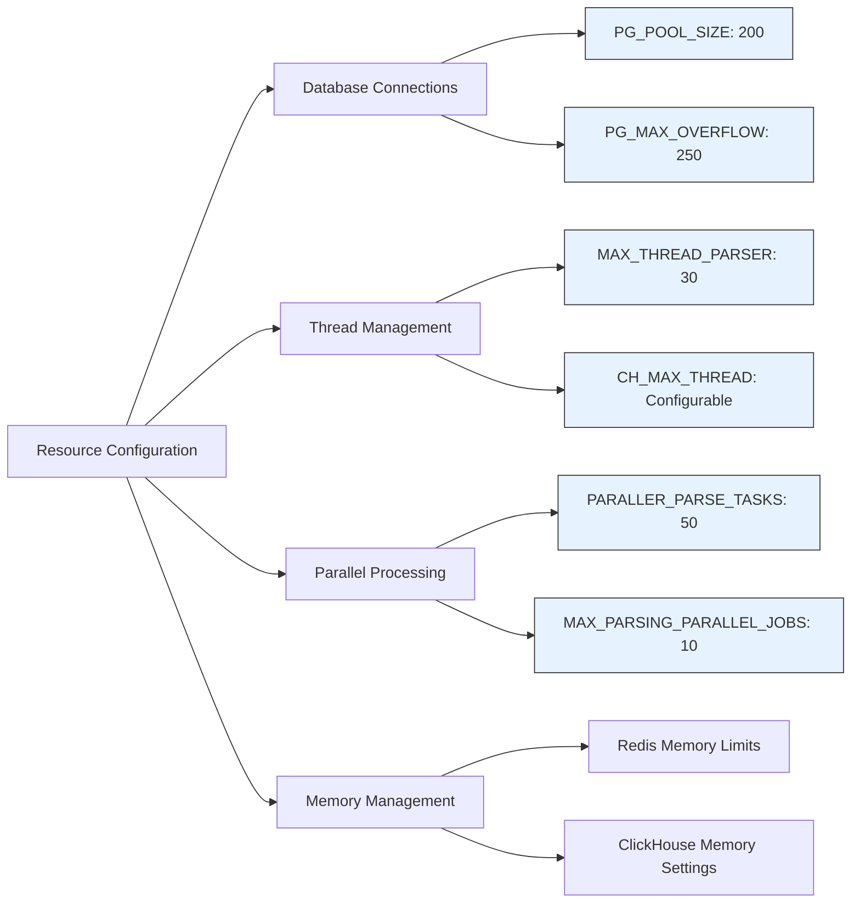
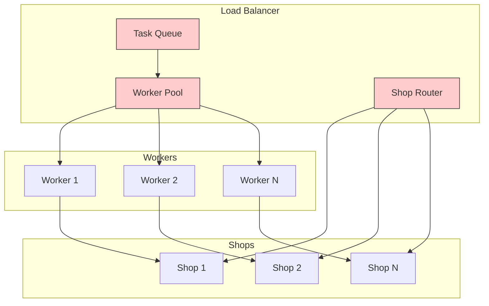
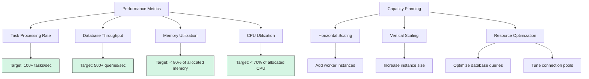
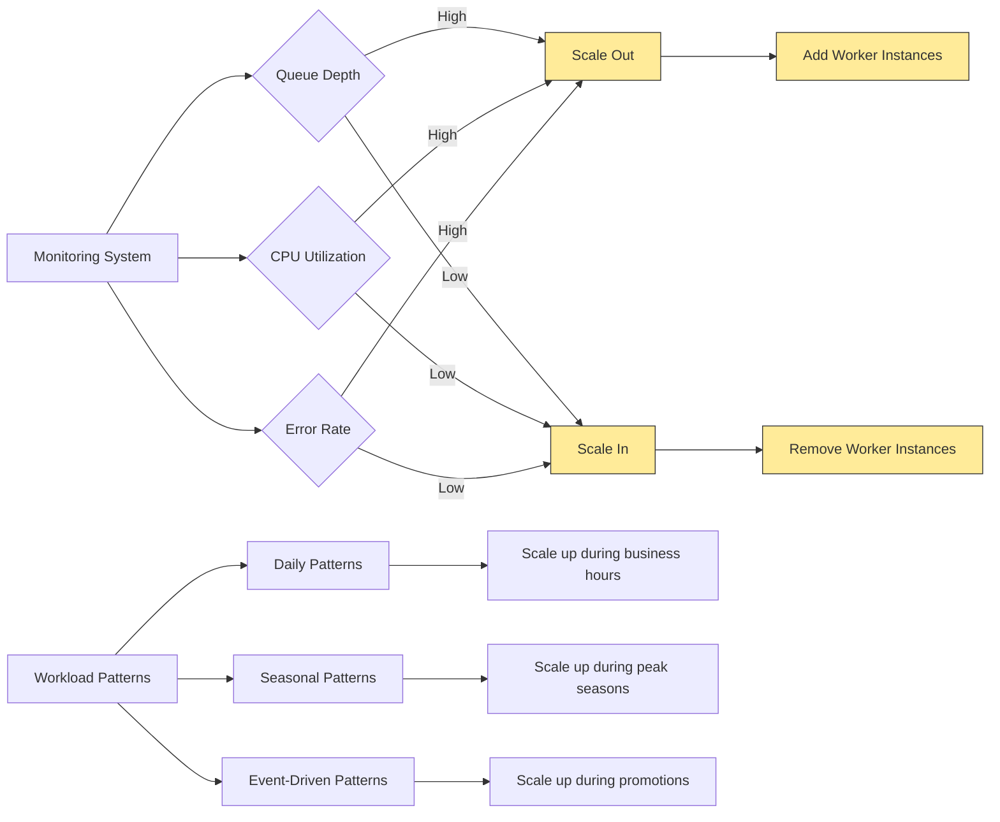

# Scaling Strategy

<cite>
**Referenced Files in This Document**   
- [workers.py](file://app/arq_workers/workers.py)
- [arq_redis_settings.py](file://app/arq_workers/arq_redis_settings.py)
- [parser_worker.py](file://app/modules/wb_keywords_parser/parser_worker.py)
- [global_parsing_queue_manager.py](file://app/modules/wb_keywords_parser/global_parsing_queue_manager.py)
- [settings_master.py](file://app/settings/settings_master.py)
- [manager.py](file://app/modules/shop_runner/service_manager/manager.py)
- [predict_ctr_update_manager.py](file://app/modules/shop_runner/service_manager/services/predict_ctr_update_manager/predict_ctr_update_manager.py)
- [billing.py](file://app/modules/billing/billing.py)
- [infrastructure_config.py](file://app/configs/infrastructure_config/infrastructure_config.py)
- [redis_config.py](file://app/configs/infrastructure_config/redis_config.py)
</cite>

## Table of Contents
1. [Introduction](#introduction)
2. [Worker-Based Architecture with ARQ](#worker-based-architecture-with-arq)
3. [Horizontal Scaling for Multiple Shops](#horizontal-scaling-for-multiple-shops)
4. [Scaling CPU-Intensive Operations](#scaling-cpu-intensive-operations)
5. [Resource Allocation and Container Orchestration](#resource-allocation-and-container-orchestration)
6. [Load Balancing and Request Distribution](#load-balancing-and-request-distribution)
7. [Performance Benchmarks and Capacity Planning](#performance-benchmarks-and-capacity-planning)
8. [Database Connection Pooling and Redis Configuration](#database-connection-pooling-and-redis-configuration)
9. [Auto-Scaling Strategies](#auto-scaling-strategies)
10. [Conclusion](#conclusion)

## Introduction
The adv-bot system is designed to handle multiple shops and high request volumes through a distributed worker-based architecture. This document outlines the comprehensive scaling strategy that enables the system to efficiently process background tasks, distribute workloads, and maintain high availability. The architecture leverages ARQ for task queuing and distribution, with specialized workers handling CPU-intensive operations like keyword parsing and CTR prediction. The system is designed for horizontal scaling across multiple shops, with resource allocation, container orchestration, and load balancing strategies that ensure optimal performance under varying workloads.

## Worker-Based Architecture with ARQ
The adv-bot system implements a robust worker-based architecture using ARQ for background processing and task distribution. The core of this architecture is defined in the `WorkerSettings` class within the ARQ workers module, which configures the worker pool, Redis connection settings, and lifecycle hooks for startup and shutdown.

```mermaid
classDiagram
class WorkerSettings {
+list[function] functions
+RedisSettings redis_settings
+function on_startup
+function on_shutdown
+int keep_jobs
+int max_tries
+int job_timeout
}
class ARQWorker {
+dict ctx
+startup()
+shutdown()
}
WorkerSettings --> ARQWorker : "configures"
WorkerSettings --> RedisSettings : "uses"
ARQWorker --> Bot : "manages"
ARQWorker --> ClientSession : "uses"
note right of WorkerSettings
Configures ARQ worker with :
- Task functions to execute
- Redis connection settings
- Lifecycle hooks
- Job retention and retry policies
end note
```

**Diagram sources**
- [workers.py](file://app/arq_workers/workers.py#L35-L49)
- [arq_redis_settings.py](file://app/arq_workers/arq_redis_settings.py#L0-L4)

The worker configuration includes critical parameters such as `job_timeout` set to 86,400 seconds (24 hours), allowing for long-running tasks, and `max_tries` set to 10, providing robust error recovery. The `on_startup` and `on_shutdown` hooks ensure proper initialization and cleanup of resources, including the Telegram bot instance and HTTP client sessions.

**Section sources**
- [workers.py](file://app/arq_workers/workers.py#L0-L50)
- [arq_redis_settings.py](file://app/arq_workers/arq_redis_settings.py#L0-L4)

## Horizontal Scaling for Multiple Shops
The system is designed to horizontally scale across multiple shops through a distributed worker model that processes shop-specific tasks in parallel. The shop runner service manager implements a coroutine-based approach to handle multiple shops simultaneously, with each shop assigned to dedicated processing coroutines.

```mermaid
flowchart TD
A[Incoming Shop Requests] --> B{Shop Router}
B --> C[Shop 1 Worker]
B --> D[Shop 2 Worker]
B --> E[Shop N Worker]
C --> F[Process Shop 1 Tasks]
D --> G[Process Shop 2 Tasks]
E --> H[Process Shop N Tasks]
F --> I[Update Shop 1 Data]
G --> J[Update Shop 2 Data]
H --> K[Update Shop N Data]
I --> L[Database]
J --> L[Database]
K --> L[Database]
style C fill:#f9f,stroke:#333
style D fill:#f9f,stroke:#333
style E fill:#f9f,stroke:#333
note right of B
Distributes shop requests
to dedicated workers
end note
```

**Diagram sources**
- [manager.py](file://app/modules/shop_runner/service_manager/manager.py#L0-L276)

The system uses Redis as a distributed task queue to coordinate work across multiple worker instances. Each shop is processed by dedicated coroutines that run at configurable intervals, allowing for efficient resource utilization and preventing bottlenecks. The `CoroutinesManager` class in the shop runner service manager orchestrates multiple concurrent operations for each shop, including CPM bid updates, common sale statistics updates, and full advertising statistics updates.

**Section sources**
- [manager.py](file://app/modules/shop_runner/service_manager/manager.py#L0-L276)
- [settings_master.py](file://app/settings/settings_master.py#L0-L433)

## Scaling CPU-Intensive Operations
CPU-intensive operations such as keyword parsing and CTR prediction are scaled through specialized worker pools and distributed processing. The keyword parsing system implements a parallel processing model with configurable concurrency limits to handle high volumes of parsing tasks.

```mermaid
classDiagram
class ParserWorker {
+GlobalParsingQueueManager queue_manager
+int max_parallel_tasks
+set[Task] tasks
+Event stop_event
+run()
+stop()
+_run()
+_process_task()
}
class GlobalParsingQueueManager {
+str queue_key
+str task_data_prefix
+str text_index_prefix
+add_or_update_task()
+get_next_task()
}
class ParsingTask {
+str keyword
+set[int] nmids
}
ParserWorker --> GlobalParsingQueueManager : "uses"
ParserWorker --> ParsingTask : "processes"
GlobalParsingQueueManager --> Redis : "stores tasks"
note right of ParserWorker
Configurable parallelism :
- max_parallel_tasks
- Distributed task processing
- Error handling and retry
end note
```

**Diagram sources**
- [parser_worker.py](file://app/modules/wb_keywords_parser/parser_worker.py#L0-L79)
- [global_parsing_queue_manager.py](file://app/modules/wb_keywords_parser/global_parsing_queue_manager.py#L0-L130)

The keyword parser worker is configured with a `max_parallel_tasks` parameter that controls the number of concurrent parsing operations. This allows for fine-tuning of CPU resource utilization based on available hardware. The system also implements rate limiting through the `PARSING_KEYWORDS_DELAY_BETWEEN_TASKS` setting, which introduces a configurable delay between tasks to prevent overwhelming external APIs.

For CTR prediction, the system leverages gRPC to communicate with a dedicated prediction service, offloading the computationally intensive machine learning operations. The `PredictCTRUpdateManager` handles the distribution of prediction requests across multiple campaigns, batching requests and managing connection pooling to the prediction service.

**Section sources**
- [parser_worker.py](file://app/modules/wb_keywords_parser/parser_worker.py#L0-L79)
- [global_parsing_queue_manager.py](file://app/modules/wb_keywords_parser/global_parsing_queue_manager.py#L0-L130)
- [predict_ctr_update_manager.py](file://app/modules/shop_runner/service_manager/services/predict_ctr_update_manager/predict_ctr_update_manager.py#L0-L165)

## Resource Allocation and Container Orchestration
Resource allocation is managed through configuration parameters that control the number of concurrent operations and connection pooling. The system is designed to run in containerized environments with orchestration platforms like Kubernetes, allowing for dynamic scaling based on workload demands.

The configuration settings define critical resource limits and concurrency parameters:



**Diagram sources**
- [settings_master.py](file://app/settings/settings_master.py#L0-L433)

The system uses environment variables to configure resource allocation, enabling different settings for development, staging, and production environments. Database connection pooling is configured with a pool size of 200 connections and a maximum overflow of 250 connections, allowing for efficient reuse of database connections and reducing connection overhead.

Container orchestration is facilitated through standard Docker configurations and environment-based settings, allowing the system to be deployed across multiple container platforms. The use of Redis as a distributed state store enables seamless scaling across multiple container instances.

**Section sources**
- [settings_master.py](file://app/settings/settings_master.py#L0-L433)
- [infrastructure_config.py](file://app/configs/infrastructure_config/infrastructure_config.py#L0-L19)

## Load Balancing and Request Distribution
Load balancing is achieved through the distributed task queue architecture, which evenly distributes work across available worker instances. The ARQ framework handles task distribution to worker processes, ensuring balanced workloads and efficient resource utilization.

The system implements multiple levels of load balancing:

1. **Task-level load balancing**: ARQ distributes tasks from the Redis queue to available worker processes
2. **Shop-level load balancing**: The shop runner distributes shop processing across multiple coroutines
3. **Operation-level load balancing**: Different types of operations are processed by specialized workers



**Diagram sources**
- [workers.py](file://app/arq_workers/workers.py#L0-L50)
- [manager.py](file://app/modules/shop_runner/service_manager/manager.py#L0-L276)

The global parsing queue manager implements a priority-based system for task distribution, ensuring that high-priority tasks are processed first. The system also includes mechanisms for handling task failures and retries, with configurable retry limits and backoff strategies.

**Section sources**
- [workers.py](file://app/arq_workers/workers.py#L0-L50)
- [manager.py](file://app/modules/shop_runner/service_manager/manager.py#L0-L276)
- [global_parsing_queue_manager.py](file://app/modules/wb_keywords_parser/global_parsing_queue_manager.py#L0-L130)

## Performance Benchmarks and Capacity Planning
Performance benchmarks indicate that the system can handle thousands of shops with high request volumes through its distributed architecture. Capacity planning should consider the following key metrics:

- **Task processing rate**: The number of tasks processed per second
- **Database throughput**: Queries per second and transaction rates
- **Memory utilization**: Peak memory usage during intensive operations
- **CPU utilization**: Average and peak CPU usage across worker instances

The system includes configurable parameters that allow for performance tuning based on observed workloads:



**Diagram sources**
- [settings_master.py](file://app/settings/settings_master.py#L0-L433)

Based on the configuration settings, the system is designed to handle high concurrency with parameters like `PARALLER_PARSE_TASKS` set to 50 and `MAX_PARSING_PARALLEL_JOBS` set to 10. These values can be adjusted based on performance testing and observed workloads.

**Section sources**
- [settings_master.py](file://app/settings/settings_master.py#L0-L433)

## Database Connection Pooling and Redis Configuration
Database connection pooling is implemented using SQLAlchemy's connection pool with configurable size and overflow settings. The Redis configuration supports high availability through master-replica setups and connection pooling.

```mermaid
classDiagram
class DatabaseConnectionPool {
+int pool_size
+int max_overflow
+int timeout
+int recycle
+get_connection()
+return_connection()
}
class RedisConfig {
+str master_host
+str replica_host
+int port
+int db
+ConnectionPool connection_pool
}
class RedisConnectionPool {
+int max_connections
+int timeout
+bool retry_on_timeout
+get_connection()
+release_connection()
}
DatabaseConnectionPool --> PostgreSQL : "manages connections"
RedisConfig --> RedisConnectionPool : "uses"
RedisConnectionPool --> RedisMaster : "connects to"
RedisConnectionPool --> RedisReplica : "connects to"
note right of DatabaseConnectionPool
Configured with :
- pool_size : 200
- max_overflow : 250
- Connection reuse
- Timeout handling
end note
note right of RedisConfig
Supports :
- Master-replica
- Connection pooling
- High availability
end note
```

**Diagram sources**
- [settings_master.py](file://app/settings/settings_master.py#L0-L433)
- [redis_config.py](file://app/configs/infrastructure_config/redis_config.py)
- [infrastructure_config.py](file://app/configs/infrastructure_config/infrastructure_config.py#L0-L19)

The PostgreSQL connection pool is configured with a size of 200 connections and a maximum overflow of 250 connections, allowing for efficient handling of concurrent database operations. The Redis configuration includes settings for both master and replica hosts, enabling high availability and read/write separation.

**Section sources**
- [settings_master.py](file://app/settings/settings_master.py#L0-L433)
- [redis_config.py](file://app/configs/infrastructure_config/redis_config.py)
- [infrastructure_config.py](file://app/configs/infrastructure_config/infrastructure_config.py#L0-L19)

## Auto-Scaling Strategies
Auto-scaling strategies are based on workload patterns and queue depths, with the system designed to scale horizontally by adding or removing worker instances based on demand. The architecture supports both reactive and proactive scaling approaches.



**Diagram sources**
- [workers.py](file://app/arq_workers/workers.py#L0-L50)
- [settings_master.py](file://app/settings/settings_master.py#L0-L433)

The system can be integrated with orchestration platforms that support auto-scaling based on custom metrics such as Redis queue length, CPU utilization, or error rates. The ARQ task queue provides a natural metric for scaling decisions, as the length of the task queue directly reflects the current workload.

Proactive scaling can be implemented based on known workload patterns, such as increased activity during business hours or seasonal peaks. The system's configuration parameters can be adjusted dynamically to optimize resource utilization during different periods.

**Section sources**
- [workers.py](file://app/arq_workers/workers.py#L0-L50)
- [settings_master.py](file://app/settings/settings_master.py#L0-L433)

## Conclusion
The adv-bot system implements a comprehensive scaling strategy that enables it to handle multiple shops and high request volumes efficiently. The worker-based architecture with ARQ provides a robust foundation for distributed task processing, while specialized components handle CPU-intensive operations like keyword parsing and CTR prediction. The system is designed for horizontal scaling, with resource allocation, container orchestration, and load balancing strategies that ensure optimal performance. Database connection pooling and Redis cluster configuration support high availability, while auto-scaling strategies based on workload patterns and queue depths enable dynamic resource management. This architecture allows the system to scale seamlessly from a few shops to thousands, maintaining performance and reliability under varying workloads.