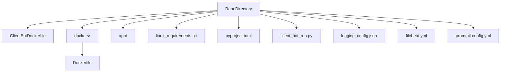
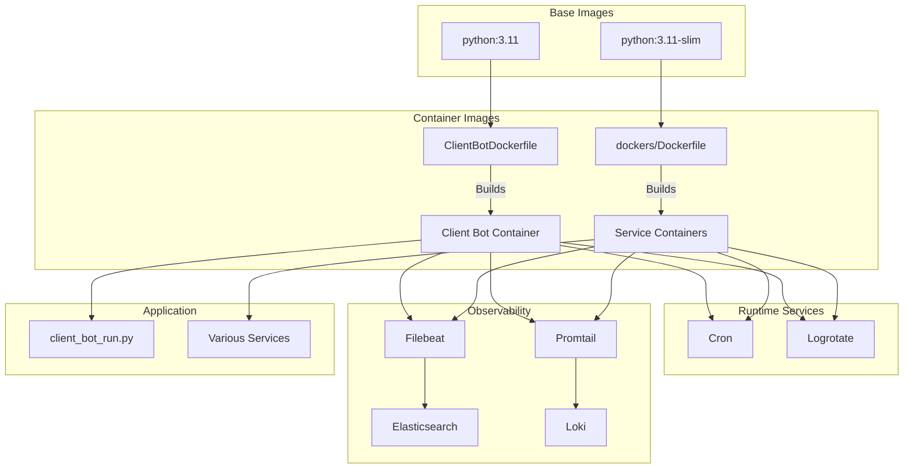
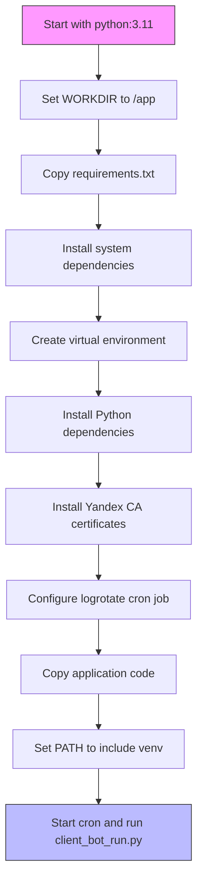
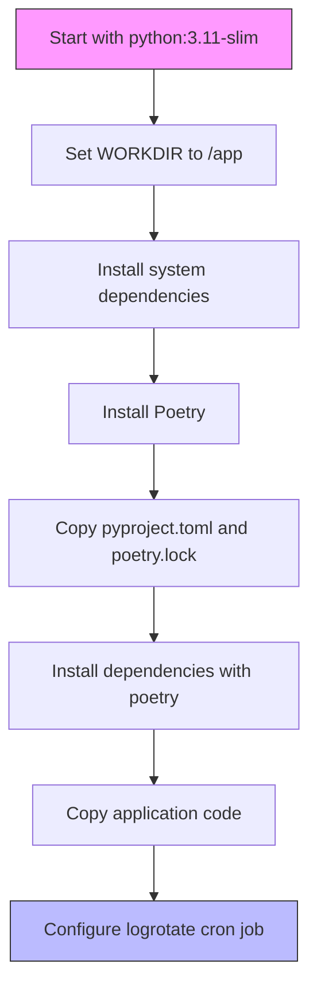
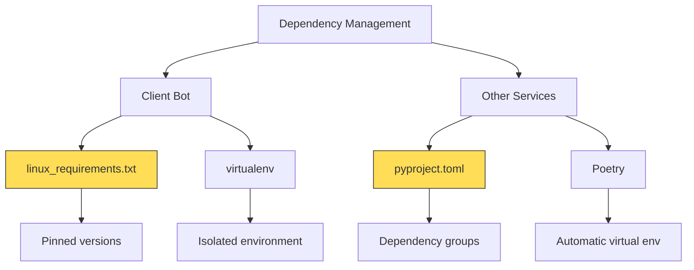
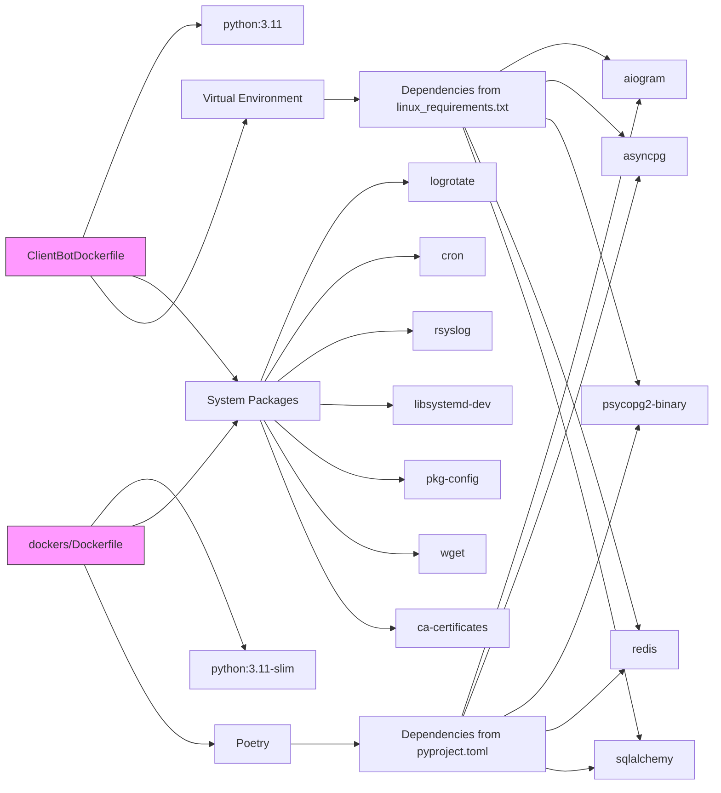

# Containerization Strategy

<cite>
**Referenced Files in This Document**   
- [ClientBotDockerfile](file://ClientBotDockerfile)
- [dockers/Dockerfile](file://dockers/Dockerfile)
- [linux_requirements.txt](file://linux_requirements.txt)
- [pyproject.toml](file://pyproject.toml)
- [client_bot_run.py](file://client_bot_run.py)
- [logging_config.json](file://logging_config.json)
- [filebeat.yml](file://filebeat.yml)
- [promtail-config.yml](file://promtail-config.yml)
</cite>

## Table of Contents
1. [Introduction](#introduction)
2. [Project Structure](#project-structure)
3. [Core Components](#core-components)
4. [Architecture Overview](#architecture-overview)
5. [Detailed Component Analysis](#detailed-component-analysis)
6. [Dependency Analysis](#dependency-analysis)
7. [Performance Considerations](#performance-considerations)
8. [Troubleshooting Guide](#troubleshooting-guide)
9. [Conclusion](#conclusion)

## Introduction
The adv-bot system employs a dual Dockerfile strategy to support different deployment scenarios and environments. This documentation details the containerization approach, focusing on the two Dockerfiles: `ClientBotDockerfile` for the client-facing bot component and `dockers/Dockerfile` as the base for other services. The strategy emphasizes security, performance, and maintainability through proper dependency management, environment configuration, and logging infrastructure.

**Section sources**
- [ClientBotDockerfile](file://ClientBotDockerfile#L1-L55)
- [dockers/Dockerfile](file://dockers/Dockerfile#L1-L36)

## Project Structure
The project follows a modular structure with clear separation of concerns. The main application code resides in the `app/` directory, while containerization assets are located at the root (`ClientBotDockerfile`) and in the `dockers/` directory. Configuration files for logging, monitoring, and dependency management are placed at the root level, enabling centralized management of cross-cutting concerns.

The containerization strategy supports both development and production workflows, with different Dockerfiles serving distinct purposes in the deployment pipeline. The `linux_requirements.txt` file contains the complete list of Python dependencies, while `pyproject.toml` manages Poetry-based dependencies for certain components.

**Diagram sources**
- [ClientBotDockerfile](file://ClientBotDockerfile#L1-L55)
- [dockers/Dockerfile](file://dockers/Dockerfile#L1-L36)
- [linux_requirements.txt](file://linux_requirements.txt#L1-L147)

**Section sources**
- [ClientBotDockerfile](file://ClientBotDockerfile#L1-L55)
- [dockers/Dockerfile](file://dockers/Dockerfile#L1-L36)

## Core Components
The containerization strategy revolves around two primary Dockerfiles that serve different roles in the deployment pipeline. The `ClientBotDockerfile` is specifically designed for the client-facing Telegram bot, while the `dockers/Dockerfile` serves as a standardized base for other services in the ecosystem.

Both Dockerfiles implement best practices for container security and performance, including minimal base images, proper dependency isolation, and optimized layer caching. The build process incorporates system-level dependencies required for the application's functionality, such as logrotate and cron for log management and rotation.

**Section sources**
- [ClientBotDockerfile](file://ClientBotDockerfile#L1-L55)
- [dockers/Dockerfile](file://dockers/Dockerfile#L1-L36)

## Architecture Overview
The containerization architecture follows a multi-stage approach with specialized Dockerfiles for different components. The client bot container is built from `ClientBotDockerfile`, which uses the standard Python 3.11 image and implements a virtual environment for dependency isolation. Other services utilize the `dockers/Dockerfile`, which is based on the slim Python 3.11-slim image and uses Poetry for dependency management.

The architecture integrates comprehensive logging and monitoring capabilities through Filebeat and Promtail configurations, enabling centralized log collection and analysis. The containers are designed to work within a larger observability ecosystem, sending logs to Elasticsearch and metrics to Loki for monitoring and troubleshooting.

**Diagram sources**
- [ClientBotDockerfile](file://ClientBotDockerfile#L1-L55)
- [dockers/Dockerfile](file://dockers/Dockerfile#L1-L36)
- [filebeat.yml](file://filebeat.yml#L1-L9)
- [promtail-config.yml](file://promtail-config.yml#L1-L28)

## Detailed Component Analysis

### ClientBotDockerfile Analysis
The `ClientBotDockerfile` is specifically tailored for the client-facing Telegram bot component. It uses the standard `python:3.11` base image, providing a full-featured Python environment with all necessary build tools and libraries.

The Dockerfile implements a virtual environment workflow, creating an isolated Python environment at `/app/venv` and configuring the PATH to prioritize this environment. This approach ensures dependency isolation and prevents conflicts between system and application packages.

A key security feature is the installation of Yandex Cloud CA certificates, enabling secure connections to Yandex PostgreSQL databases with SSL verification. The container also configures logrotate and cron services to manage application logs and ensure proper rotation to prevent disk space issues.

The build process follows Docker best practices by copying the requirements file first to leverage layer caching, only rebuilding dependencies when the requirements change. The final step copies the entire application codebase into the container.

**Diagram sources**
- [ClientBotDockerfile](file://ClientBotDockerfile#L1-L55)

**Section sources**
- [ClientBotDockerfile](file://ClientBotDockerfile#L1-L55)
- [client_bot_run.py](file://client_bot_run.py#L1-L150)

### dockers/Dockerfile Analysis
The `dockers/Dockerfile` serves as a standardized base for various services within the adv-bot ecosystem. It uses the `python:3.11-slim` base image, which provides a minimal Python environment with reduced attack surface and smaller image size compared to the full Python image.

This Dockerfile implements Poetry-based dependency management, setting up Poetry with specific configuration options including `POETRY_VIRTUALENVS_IN_PROJECT=true` to store the virtual environment within the project directory. The build process copies `pyproject.toml` and `poetry.lock` before installing dependencies, leveraging Docker layer caching to optimize build times.

The container installs the same system-level utilities as the client bot (logrotate, cron, rsyslog) but uses a more streamlined approach by removing package lists after installation to reduce image size. Dependencies are installed without development packages using `--without dev`, ensuring production environments don't include unnecessary tools.

**Diagram sources**
- [dockers/Dockerfile](file://dockers/Dockerfile#L1-L36)
- [pyproject.toml](file://pyproject.toml#L1-L171)

**Section sources**
- [dockers/Dockerfile](file://dockers/Dockerfile#L1-L36)
- [pyproject.toml](file://pyproject.toml#L1-L171)

### Dependency Management Analysis
The project employs a hybrid dependency management strategy, using both traditional requirements files and modern Poetry-based management. The `linux_requirements.txt` file contains the complete list of pinned dependencies with specific versions, ensuring reproducible builds for the client bot.

The `pyproject.toml` file defines dependencies using Poetry's format, providing a more structured approach to dependency management with support for dependency groups (such as dev dependencies). This dual approach allows different components to use the most appropriate dependency management system for their needs.

Both Dockerfiles implement best practices for dependency installation, including upgrading pip before installing packages and using appropriate flags to optimize the installation process. The client bot Dockerfile uses a virtual environment, while the Poetry-based Dockerfile relies on Poetry's built-in virtual environment management.

**Diagram sources**
- [linux_requirements.txt](file://linux_requirements.txt#L1-L147)
- [pyproject.toml](file://pyproject.toml#L1-L171)

**Section sources**
- [linux_requirements.txt](file://linux_requirements.txt#L1-L147)
- [pyproject.toml](file://pyproject.toml#L1-L171)

## Dependency Analysis
The containerization strategy reveals a clear dependency hierarchy within the adv-bot system. The client bot has direct dependencies on Telegram API libraries (aiogram), database connectors (asyncpg, psycopg2-binary), and various utility packages for data processing and machine learning.

The system dependencies installed in both Dockerfiles (logrotate, cron, rsyslog) indicate a focus on operational reliability and monitoring. The inclusion of systemd-related packages (libsystemd-dev, systemd-logging) suggests integration with system-level services and logging infrastructure.

The dependency management approach shows a transition from traditional pip-based requirements to more modern Poetry-based management, reflecting an evolution in the project's tooling strategy. This hybrid approach allows for gradual migration while maintaining compatibility with existing components.

**Diagram sources**
- [ClientBotDockerfile](file://ClientBotDockerfile#L1-L55)
- [dockers/Dockerfile](file://dockers/Dockerfile#L1-L36)
- [linux_requirements.txt](file://linux_requirements.txt#L1-L147)
- [pyproject.toml](file://pyproject.toml#L1-L171)

**Section sources**
- [ClientBotDockerfile](file://ClientBotDockerfile#L1-L55)
- [dockers/Dockerfile](file://dockers/Dockerfile#L1-L36)
- [linux_requirements.txt](file://linux_requirements.txt#L1-L147)
- [pyproject.toml](file://pyproject.toml#L1-L171)

## Performance Considerations
The containerization strategy incorporates several performance optimizations. The use of the slim base image for non-client services reduces image size and attack surface, leading to faster deployment times and reduced resource consumption.

Both Dockerfiles implement layer caching best practices by ordering instructions to maximize cache reuse. Dependencies are installed before application code, meaning that dependency layers are only rebuilt when the dependency files change, not when application code is modified.

The virtual environment in the client bot Dockerfile provides dependency isolation without the overhead of multiple Python installations, while Poetry's virtual environment management in the other services offers similar benefits with more advanced dependency resolution.

The inclusion of logrotate with a cron job running every 5 minutes ensures that log files are regularly rotated, preventing unbounded log growth that could impact disk performance and availability.

## Troubleshooting Guide
When troubleshooting containerization issues, consider the following common problems and solutions:

1. **Dependency conflicts**: The hybrid dependency management system (requirements.txt and pyproject.toml) may lead to version conflicts. Ensure that versions in both files are compatible, or consider migrating fully to Poetry for consistent dependency management.

2. **Certificate issues**: The client bot requires Yandex Cloud CA certificates for database connectivity. If experiencing SSL/TLS errors, verify that the certificate download URLs are accessible and that the certificates are properly installed in the container.

3. **Log rotation failures**: If logs are not rotating as expected, check that the cron service is running properly and that the logrotate configuration is correctly set up. Verify that the cron job has appropriate permissions to execute logrotate.

4. **Large image sizes**: The client bot image may become large due to the full Python base image and numerous dependencies. Consider using multi-stage builds to reduce the final image size, or explore using the slim image with manually installed build dependencies.

5. **Build cache inefficiency**: Ensure that the Docker build process is properly caching layers by maintaining consistent file ordering and only copying dependency files before application code.

6. **Observability integration**: If logs are not appearing in Elasticsearch or Loki, verify the Filebeat and Promtail configurations, check network connectivity between containers, and ensure that the output endpoints are correctly configured.

**Section sources**
- [ClientBotDockerfile](file://ClientBotDockerfile#L1-L55)
- [dockers/Dockerfile](file://dockers/Dockerfile#L1-L36)
- [filebeat.yml](file://filebeat.yml#L1-L9)
- [promtail-config.yml](file://promtail-config.yml#L1-L28)
- [logging_config.json](file://logging_config.json#L1-L33)