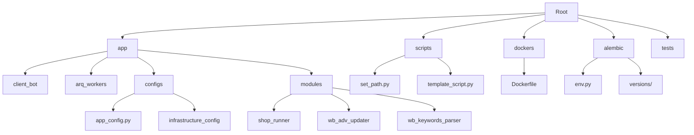
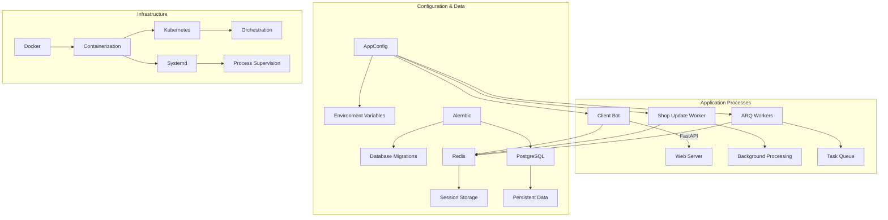
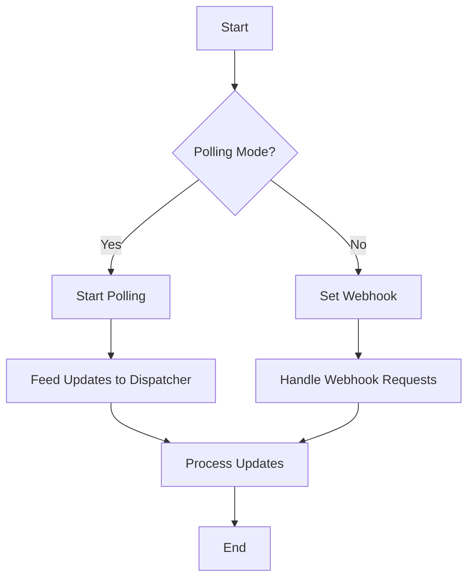
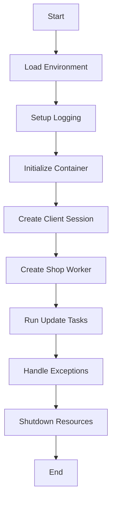
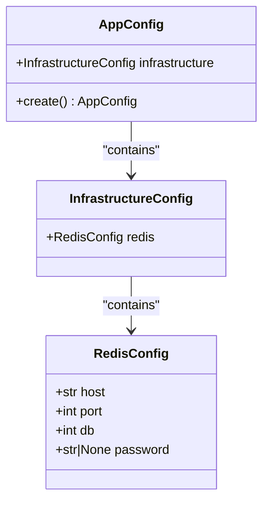
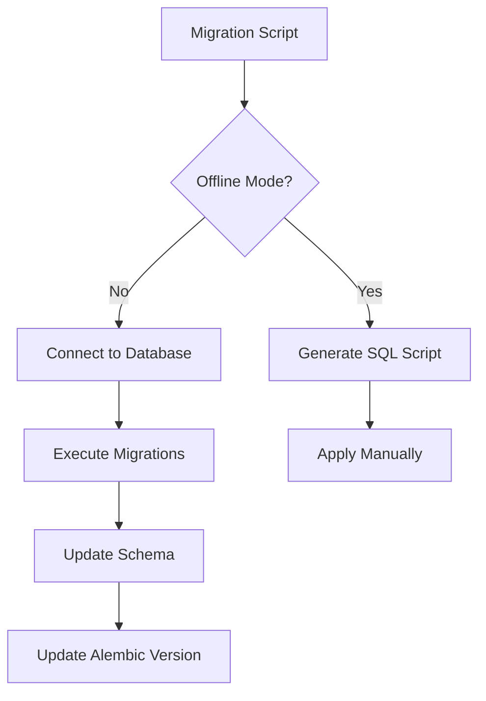
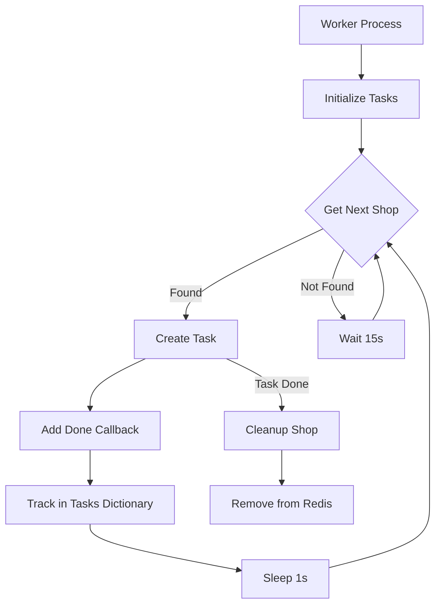
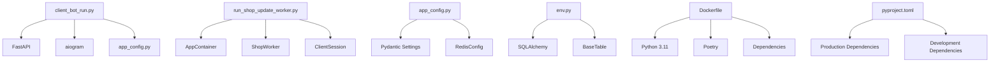

# Deployment Workflows

<cite>
**Referenced Files in This Document**   
- [client_bot_run.py](file://client_bot_run.py)
- [run_shop_update_worker.py](file://run_shop_update_worker.py)
- [app_config.py](file://app/configs/app_config.py)
- [infrastructure_config.py](file://app/configs/infrastructure_config/infrastructure_config.py)
- [redis_config.py](file://app/configs/infrastructure_config/redis_config.py)
- [env.py](file://alembic/env.py)
- [Dockerfile](file://dockers/Dockerfile)
- [pyproject.toml](file://pyproject.toml)
- [worker.py](file://app/modules/shop_runner/shop_run_worker/worker/worker.py)
- [manager.py](file://app/modules/shop_runner/service_manager/manager.py)
- [run_process_func.py](file://app/modules/shop_runner/run_process_func.py)
- [scripts/README.md](file://scripts/README.md)
</cite>

## Table of Contents
1. [Introduction](#introduction)
2. [Project Structure](#project-structure)
3. [Core Components](#core-components)
4. [Architecture Overview](#architecture-overview)
5. [Detailed Component Analysis](#detailed-component-analysis)
6. [Dependency Analysis](#dependency-analysis)
7. [Performance Considerations](#performance-considerations)
8. [Troubleshooting Guide](#troubleshooting-guide)
9. [Conclusion](#conclusion)

## Introduction
This document provides a comprehensive overview of the deployment workflows for the advertising bot application across development, staging, and production environments. It details the entry point scripts, process supervision mechanisms, configuration management, database migration strategies, CI/CD considerations, and background worker scaling and monitoring.

## Project Structure

The project follows a modular structure with clear separation of concerns:

**Diagram sources**
- [project structure](file://.)

**Section sources**
- [project structure](file://.)

## Core Components

The deployment system revolves around several key components:
- Entry point scripts for different application processes
- Configuration management via AppConfig and Pydantic settings
- Database migration system using Alembic
- Background worker processes for asynchronous tasks
- Process supervision and lifecycle management

These components work together to ensure reliable deployment and operation across different environments.

**Section sources**
- [client_bot_run.py](file://client_bot_run.py)
- [run_shop_update_worker.py](file://run_shop_update_worker.py)
- [app_config.py](file://app/configs/app_config.py)

## Architecture Overview

The deployment architecture consists of multiple interconnected components:

**Diagram sources**
- [client_bot_run.py](file://client_bot_run.py)
- [run_shop_update_worker.py](file://run_shop_update_worker.py)
- [app_config.py](file://app/configs/app_config.py)
- [env.py](file://alembic/env.py)

## Detailed Component Analysis

### Entry Point Scripts

The system utilizes specialized entry point scripts for different application processes:

#### Client Bot Entry Point
The `client_bot_run.py` script serves as the main entry point for the client-facing Telegram bot. It supports both webhook and polling modes, with FastAPI handling health checks and webhook endpoints.

**Diagram sources**
- [client_bot_run.py](file://client_bot_run.py)

#### Shop Update Worker
The `run_shop_update_worker.py` script manages background processing for shop updates. It initializes dependency injection containers and manages the lifecycle of shop update tasks.

**Diagram sources**
- [run_shop_update_worker.py](file://run_shop_update_worker.py)
- [worker.py](file://app/modules/shop_runner/shop_run_worker/worker/worker.py)

### Configuration Management

The application uses a hierarchical configuration system based on Pydantic settings:

**Diagram sources**
- [app_config.py](file://app/configs/app_config.py)
- [infrastructure_config.py](file://app/configs/infrastructure_config/infrastructure_config.py)
- [redis_config.py](file://app/configs/infrastructure_config/redis_config.py)

### Database Migrations

The Alembic migration system manages database schema changes:

**Diagram sources**
- [env.py](file://alembic/env.py)

### Process Supervision

Background workers are managed through a supervision system that ensures continuous operation:

**Diagram sources**
- [worker.py](file://app/modules/shop_runner/shop_run_worker/worker/worker.py)
- [run_process_func.py](file://app/modules/shop_runner/run_process_func.py)

## Dependency Analysis

The deployment system has several critical dependencies:

**Diagram sources**
- [pyproject.toml](file://pyproject.toml)
- [Dockerfile](file://dockers/Dockerfile)
- [client_bot_run.py](file://client_bot_run.py)
- [run_shop_update_worker.py](file://run_shop_update_worker.py)
- [app_config.py](file://app/configs/app_config.py)
- [env.py](file://alembic/env.py)

## Performance Considerations

The deployment architecture includes several performance optimizations:

- **Connection pooling**: Reuses database and HTTP connections
- **Asynchronous processing**: Uses asyncio for non-blocking operations
- **Task batching**: Groups operations to reduce overhead
- **Caching**: Utilizes Redis for frequently accessed data
- **Rate limiting**: Implements delays between operations to avoid rate limits

The system is designed to handle multiple concurrent shop updates while maintaining responsiveness and avoiding resource exhaustion.

## Troubleshooting Guide

Common deployment issues and their solutions:

**Section sources**
- [client_bot_run.py](file://client_bot_run.py#L100-L150)
- [run_shop_update_worker.py](file://run_shop_update_worker.py#L20-L35)
- [worker.py](file://app/modules/shop_runner/shop_run_worker/worker/worker.py#L50-L70)

## Conclusion

The deployment workflows for this application are designed for reliability, scalability, and maintainability. The combination of entry point scripts, configuration management, database migrations, and process supervision ensures consistent operation across different environments. The use of modern Python tools and frameworks enables efficient development and deployment processes.