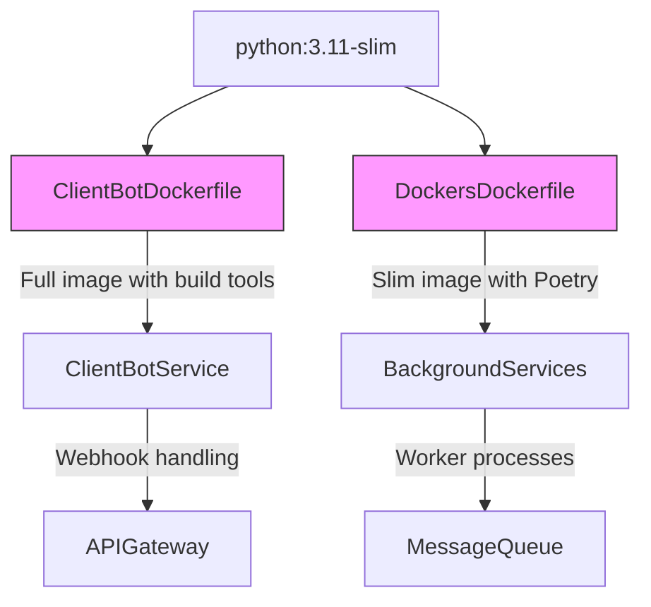
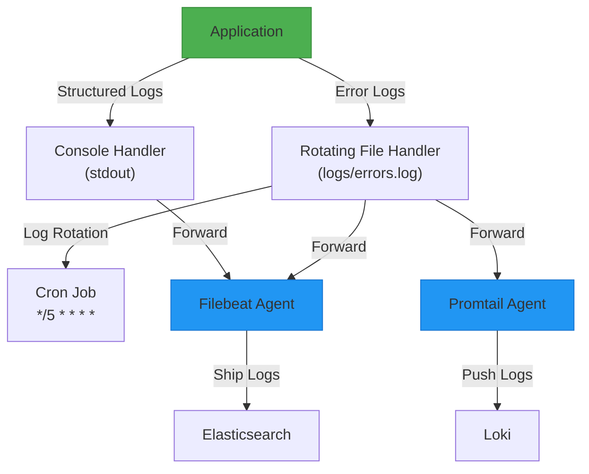
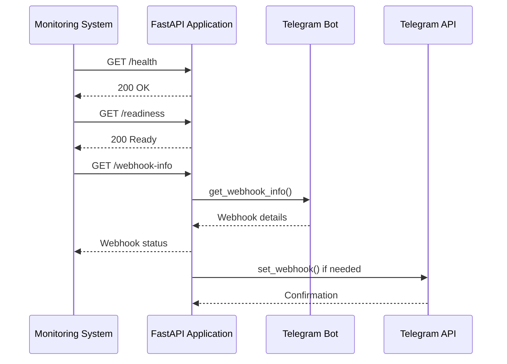

# Deployment and Operations

<cite>
**Referenced Files in This Document**   
- [ClientBotDockerfile](file://ClientBotDockerfile)
- [dockers/Dockerfile](file://dockers/Dockerfile)
- [logging_config.json](file://logging_config.json)
- [filebeat.yml](file://filebeat.yml)
- [promtail-config.yml](file://promtail-config.yml)
- [run_shop_update_worker.py](file://run_shop_update_worker.py)
- [client_bot_run.py](file://client_bot_run.py)
</cite>

## Table of Contents
1. [Introduction](#introduction)
2. [Containerization Strategy](#containerization-strategy)
3. [Runtime Configuration](#runtime-configuration)
4. [Logging and Monitoring](#logging-and-monitoring)
5. [Deployment Workflows](#deployment-workflows)
6. [Health Checks and Alerting](#health-checks-and-alerting)
7. [Backup and Recovery](#backup-and-recovery)
8. [Operational Runbook](#operational-runbook)
9. [Conclusion](#conclusion)

## Introduction
This document provides comprehensive guidance on the deployment and operational practices for the advertising bot system. It covers containerization, runtime configuration, logging, monitoring, and operational procedures necessary for maintaining a reliable production environment. The system consists of multiple components including a client bot, shop update workers, and various background services that interact with external APIs and databases.

**Section sources**
- [ClientBotDockerfile](file://ClientBotDockerfile#L1-L55)
- [dockers/Dockerfile](file://dockers/Dockerfile#L1-L36)

## Containerization Strategy

The application employs a multi-stage containerization approach with two distinct Dockerfiles for different components. The main client bot uses `ClientBotDockerfile` while other services utilize the Dockerfile in the `dockers` directory.

**Diagram sources**
- [ClientBotDockerfile](file://ClientBotDockerfile#L1-L55)
- [dockers/Dockerfile](file://dockers/Dockerfile#L1-L36)

The `ClientBotDockerfile` is designed for the main client bot application and includes several key features:
- Based on Python 3.11 full image to support compilation of native extensions
- Installation of system packages including logrotate, cron, and rsyslog for log management
- Virtual environment creation using venv for dependency isolation
- Yandex Cloud certificate installation for secure PostgreSQL connections
- Cron configuration for periodic log rotation

The `dockers/Dockerfile` follows a more streamlined approach:
- Uses python:3.11-slim base image for reduced attack surface and smaller footprint
- Implements Poetry for dependency management with virtual environments in project
- Multi-stage build pattern to optimize layer caching
- Focus on minimal dependencies for background worker services

Both Dockerfiles implement best practices for container security and maintainability, including proper layer ordering to maximize cache utilization during builds.

**Section sources**
- [ClientBotDockerfile](file://ClientBotDockerfile#L1-L55)
- [dockers/Dockerfile](file://dockers/Dockerfile#L1-L36)

## Runtime Configuration

The system relies on environment variables and mounted volumes for runtime configuration, enabling flexibility across different deployment environments. Configuration is primarily managed through dotenv files and settings modules.

Key configuration aspects include:
- Webhook settings for Telegram bot integration (WEBHOOK_URL, WEBHOOK_PATH, WEBHOOK_SECRET)
- Polling mode configuration to switch between webhook and long-polling operation
- Database connection parameters for PostgreSQL backend
- Various service endpoints and API credentials

The containerization strategy includes mounting volumes for:
- Log files to enable external log aggregation
- Configuration files for environment-specific settings
- Certificate storage for secure database connections
- Persistent data storage for critical application state

Environment-specific configurations are supported through the settings management system, allowing different values for development, staging, and production environments without code changes.

**Section sources**
- [client_bot_run.py](file://client_bot_run.py#L1-L150)
- [run_shop_update_worker.py](file://run_shop_update_worker.py#L1-L34)

## Logging and Monitoring

The application implements a comprehensive logging strategy with centralized log aggregation using Filebeat and Promtail for observability.

### Logging Configuration
The `logging_config.json` file defines a structured logging configuration with:
- Custom formatter including service name, timestamp, file path, line number, log level, and message
- Console handler for real-time debugging output
- Rotating file handler for error logs with 10MB size limit and 5 backup files
- Root logger configured at DEBUG level to capture detailed diagnostic information

**Diagram sources**
- [logging_config.json](file://logging_config.json#L1-L34)
- [filebeat.yml](file://filebeat.yml#L1-L10)
- [promtail-config.yml](file://promtail-config.yml#L1-L29)

### Log Aggregation
Two log shippers are configured for different monitoring backends:

**Filebeat Configuration** (`filebeat.yml`):
- Collects logs from Docker container JSON files
- Ships logs to Elasticsearch at specified host with authentication
- Uses default Docker input to capture container logs

**Promtail Configuration** (`promtail-config.yml`):
- Exposes HTTP server on port 9080 for metrics and health checks
- Tracks file positions in `/tmp/positions.yaml`
- Sends logs to Loki service at `http://loki:3100`
- Extracts structured fields (log, level, logger, service) from JSON logs
- Adds labels for job identification and routing

This dual-aggregation approach enables both full-text search capabilities in Elasticsearch and metric-based log querying in Loki, providing comprehensive observability.

**Section sources**
- [logging_config.json](file://logging_config.json#L1-L34)
- [filebeat.yml](file://filebeat.yml#L1-L10)
- [promtail-config.yml](file://promtail-config.yml#L1-L29)

## Deployment Workflows

The deployment strategy supports multiple environments with consistent practices across development, staging, and production.

### Environment-Specific Deployment
Each environment follows a standardized deployment workflow:
1. Build Docker image from appropriate Dockerfile
2. Configure environment variables via mounted secrets or config maps
3. Deploy containers with proper resource limits and health checks
4. Verify service readiness through health check endpoints
5. Monitor logs and metrics for successful operation

For the client bot service, deployment differs based on operation mode:
- **Webhook Mode**: Deploy with public endpoint exposure and SSL termination
- **Polling Mode**: Deploy without public endpoint, relying on direct Telegram API connections

### CI/CD Integration
The containerization strategy supports automated CI/CD pipelines with:
- Layer caching to speed up build times
- Deterministic builds through pinned Python version
- Security scanning enabled by minimal base images
- Configuration validation through structured logging setup

### Blue-Green Deployment Support
The application design supports blue-green deployment patterns through:
- Externalized configuration allowing runtime changes
- Health check endpoints for traffic routing decisions
- Stateless design where possible, with state stored externally
- Graceful shutdown procedures in the application lifecycle

**Section sources**
- [ClientBotDockerfile](file://ClientBotDockerfile#L1-L55)
- [dockers/Dockerfile](file://dockers/Dockerfile#L1-L36)
- [client_bot_run.py](file://client_bot_run.py#L1-L150)

## Health Checks and Alerting

The system implements comprehensive health checking to ensure service reliability and enable automated recovery.

### Health Check Endpoints
The FastAPI application exposes multiple health check endpoints:
- `/health`: Basic liveness check returning HTTP 200 when service is running
- `/readiness`: Readiness check indicating when service can accept traffic
- `/webhook-info`: Detailed Telegram webhook status including error information

**Diagram sources**
- [client_bot_run.py](file://client_bot_run.py#L1-L150)

### Alerting Configuration
While specific alerting rules are not defined in the codebase, the logging and monitoring setup enables effective alerting through:
- Error log collection and indexing in Elasticsearch
- Structured log fields that can be queried for specific error patterns
- Metrics exposure through FastAPI and potential integration with Prometheus
- Centralized log storage in Loki for correlation across services

Recommended alerting rules include:
- High error rates in application logs
- Failed webhook delivery attempts
- Degraded response times for health checks
- Unexpected container restarts
- Resource utilization thresholds

**Section sources**
- [client_bot_run.py](file://client_bot_run.py#L1-L150)

## Backup and Recovery

The system relies on external data stores that require proper backup and recovery procedures.

### Critical Data Stores
The primary data persistence occurs in:
- PostgreSQL database for application state and user data
- Redis for caching and temporary data
- ClickHouse for analytics and historical data

### Backup Procedures
Recommended backup strategies include:
- **PostgreSQL**: Regular pg_dump backups with WAL archiving for point-in-time recovery
- **Redis**: Configured with RDB snapshots and AOF persistence, backed up to object storage
- **ClickHouse**: Native backup tools or volume-level snapshots for data protection

The Alembic configuration (`alembic.ini`) indicates the use of database migrations, which should be incorporated into backup validation procedures to ensure schema compatibility during recovery.

### Recovery Testing
Regular recovery testing should include:
- Restoration of database backups to staging environment
- Verification of application functionality with restored data
- Testing of migration scripts on restored databases
- Validation of data consistency across all storage systems

**Section sources**
- [alembic.ini](file://alembic.ini#L1-L110)

## Operational Runbook

This section provides guidance for common operational tasks and procedures.

### Worker Management
The `run_shop_update_worker.py` script serves as the entry point for the shop update worker process:
- Uses asyncio for asynchronous operation
- Initializes dependency injection container
- Creates HTTP session for external API calls
- Manages worker lifecycle with proper startup and shutdown procedures

To restart workers:
1. Gracefully terminate the process to allow completion of current tasks
2. Verify shutdown through application logs
3. Restart the container or process
4. Monitor logs for successful initialization

### Queue Management
The system uses ARQ workers for task queuing (inferred from arq_workers directory). To clear queues:
1. Access Redis management interface
2. Identify queue keys (typically prefixed with arq:)
3. Remove or rename queue keys to prevent processing of old tasks
4. Restart worker processes to ensure clean state

### Configuration Changes
To apply configuration changes:
1. Update environment variables or configuration files
2. For webhook mode: Restart service to re-register webhook
3. Verify new configuration through application logs
4. Test functionality with sample requests

### Supervision Requirements
Critical processes require supervision to ensure high availability:
- Client bot process should be monitored for crashes
- Worker processes should be automatically restarted on failure
- Health checks should trigger alerts for non-responsive services
- Log monitoring should detect recurring errors or exceptions

The containerization strategy with Docker provides built-in process supervision, but additional monitoring at the orchestration layer (Kubernetes, Docker Swarm, etc.) is recommended for production deployments.

**Section sources**
- [run_shop_update_worker.py](file://run_shop_update_worker.py#L1-L34)
- [client_bot_run.py](file://client_bot_run.py#L1-L150)

## Conclusion
The deployment and operational framework for this advertising bot system demonstrates a mature approach to containerized application management. The dual Dockerfile strategy appropriately balances functionality and security across different service types. Comprehensive logging with multiple aggregation targets ensures excellent observability. The health check implementation supports reliable service orchestration, while the operational runbook provides clear guidance for maintaining system stability. By following these documented practices, operations teams can ensure reliable, observable, and maintainable deployments across all environments.