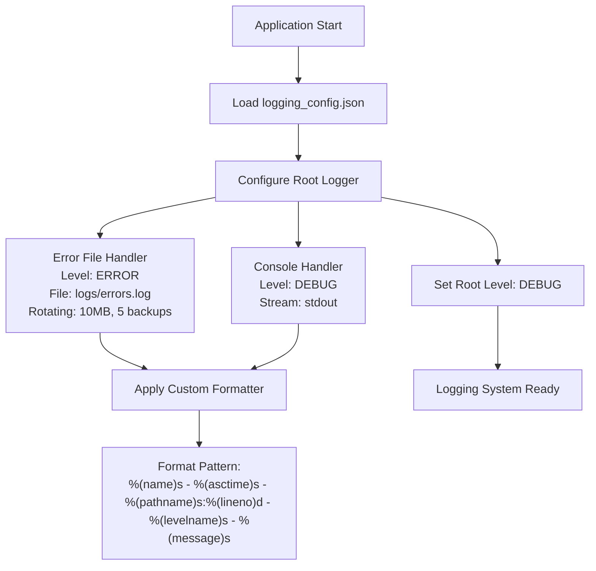
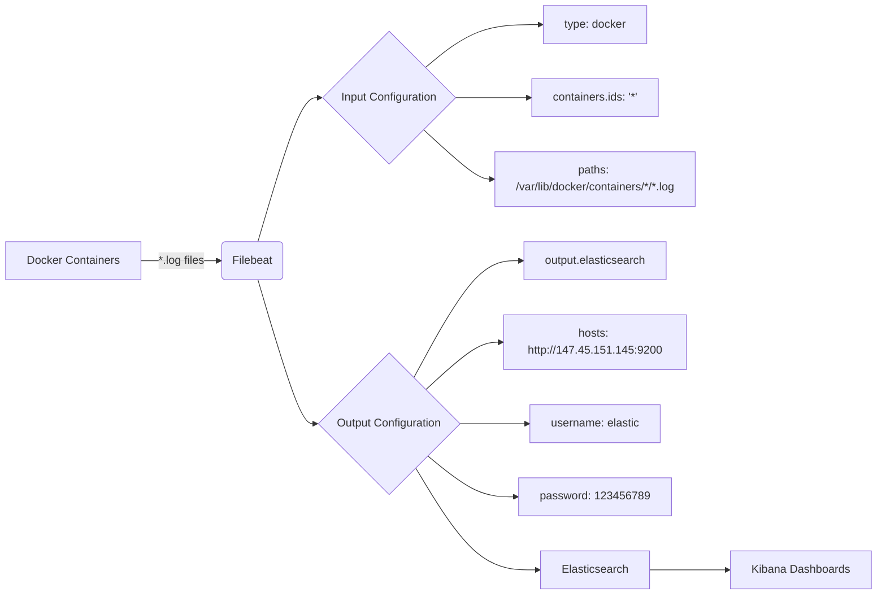
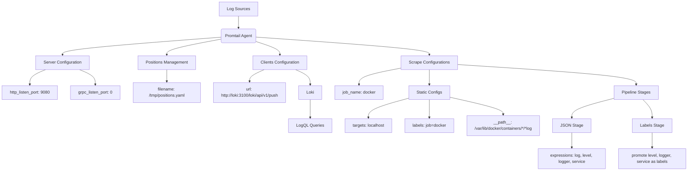
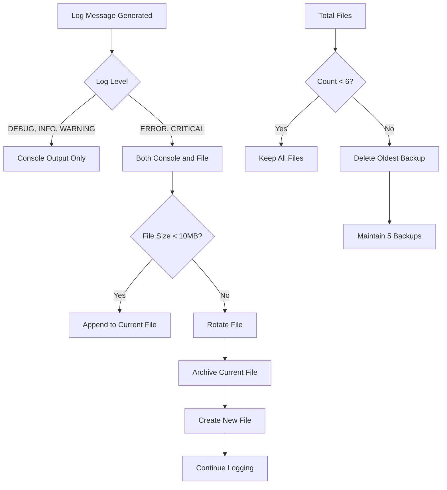

# Logging and Monitoring

<cite>
**Referenced Files in This Document**   
- [logging_config.json](file://logging_config.json)
- [filebeat.yml](file://filebeat.yml)
- [promtail-config.yml](file://promtail-config.yml)
- [my_log_handler.py](file://my_log_handler.py)
- [python_modules/logger.py](file://python_modules/logger.py)
- [app/settings/settings_master.py](file://app/settings/settings_master.py)
</cite>

## Table of Contents
1. [Introduction](#introduction)
2. [Logging Configuration](#logging-configuration)
3. [Filebeat Integration](#filebeat-integration)
4. [Promtail Configuration](#promtail-configuration)
5. [Custom Logging Handlers](#custom-logging-handlers)
6. [Structured Logging Practices](#structured-logging-practices)
7. [Log Rotation and Performance](#log-rotation-and-performance)
8. [Troubleshooting Guide](#troubleshooting-guide)
9. [Monitoring Recommendations](#monitoring-recommendations)

## Introduction
This document provides comprehensive documentation for the logging and monitoring infrastructure of the adv-bot application. It covers the configuration and usage of logging systems, log shipping tools, and monitoring solutions. The system is designed to provide comprehensive visibility into application behavior, facilitate troubleshooting, and enable proactive monitoring of system health and performance.

**Section sources**
- [logging_config.json](file://logging_config.json#L1-L32)
- [filebeat.yml](file://filebeat.yml#L1-L10)
- [promtail-config.yml](file://promtail-config.yml#L1-L29)

## Logging Configuration

The logging infrastructure is configured through the `logging_config.json` file, which defines the logging hierarchy, formatters, handlers, and root logger settings. The configuration follows Python's standard logging module structure and enables flexible log management across the application components.

The logging system uses a custom formatter that includes essential context information in each log entry:
- Logger name (`%(name)s`)
- Timestamp in ISO format (`%(asctime)s`)
- Source file path and line number (`%(pathname)s:%(lineno)d`)
- Log level (`%(levelname)s`)
- Log message (`%(message)s`)

Two primary handlers are configured:
1. **Console Handler**: Outputs all log messages to stdout with DEBUG level and above, using the custom formatter
2. **Error File Handler**: Captures ERROR level and above messages to a rotating file (`logs/errors.log`)

The root logger is configured with DEBUG level and utilizes both handlers, ensuring comprehensive logging while maintaining error-specific file capture for easier troubleshooting.

The log level can be dynamically controlled through the `LOG_LEVEL` environment variable defined in `settings_master.py`, which defaults to "ERROR" if not specified.



**Diagram sources**
- [logging_config.json](file://logging_config.json#L1-L32)
- [python_modules/logger.py](file://python_modules/logger.py#L1-L32)

**Section sources**
- [logging_config.json](file://logging_config.json#L1-L32)
- [python_modules/logger.py](file://python_modules/logger.py#L1-L32)
- [app/settings/settings_master.py](file://app/settings/settings_master.py#L350-L356)

## Filebeat Integration

Filebeat is configured as the log shipping agent to collect and forward logs from Docker containers to Elasticsearch. The configuration in `filebeat.yml` is optimized for containerized environments and follows the Elastic Stack integration pattern.

Key configuration elements:
- **Input Type**: Docker containers with all container IDs (`containers.ids: '*'`)
- **Log Path**: Standard Docker container log path (`/var/lib/docker/containers/*/*.log`)
- **Output**: Direct to Elasticsearch at `http://147.45.151.145:9200`
- **Authentication**: Basic auth with username "elastic" and password "123456789"

The configuration enables automatic discovery of Docker containers and their log files, making it suitable for dynamic container environments where containers are frequently created and destroyed.



**Diagram sources**
- [filebeat.yml](file://filebeat.yml#L1-L10)

**Section sources**
- [filebeat.yml](file://filebeat.yml#L1-L10)

## Promtail Configuration

Promtail is configured to collect logs and send them to Loki for structured log storage and querying. The configuration in `promtail-config.yml` defines the server settings, position tracking, client endpoints, and scraping configurations.

Key components of the Promtail configuration:
- **Server**: HTTP server on port 9080 for metrics and health checks
- **Positions**: Tracks read positions in `/tmp/positions.yaml`
- **Clients**: Sends logs to Loki at `http://loki:3100/loki/api/v1/push`
- **Scrape Configurations**: 
  - Job name: docker
  - Targets: localhost
  - Labels: job=docker, with dynamic labels for log level, logger, and service
  - Pipeline stages: Extracts JSON fields (log, level, logger, service) and promotes them as labels

The pipeline processing extracts structured fields from JSON-formatted logs and converts them into Prometheus-style labels, enabling powerful querying capabilities in Loki.



**Diagram sources**
- [promtail-config.yml](file://promtail-config.yml#L1-L29)

**Section sources**
- [promtail-config.yml](file://promtail-config.yml#L1-L29)

## Custom Logging Handlers

The system includes a custom logging handler implementation in `my_log_handler.py` that extends Python's logging.Handler class. This custom handler provides the capability to execute scripts or actions in response to log events, enabling reactive monitoring and automated responses to specific log conditions.

The `ScriptHandler` class implements the `emit` method to process log records:
- Formats the log record using the configured formatter
- Provides a framework for executing external scripts based on log content
- Currently contains commented code suggesting integration with a script execution function

This custom handler pattern allows for extensibility in the logging system, where specific log events can trigger automated responses, notifications, or remediation actions.

```mermaid
classDiagram
class logging.Handler {
<<abstract>>
+emit(record)
+format(record)
+setFormatter(formatter)
+setLevel(level)
}
class ScriptHandler {
-emit(record)
-format(record)
+execute_script(log_message)
}
ScriptHandler --|> logging.Handler : inherits
note right of ScriptHandler
Custom handler that can trigger
external scripts based on log events
Current implementation provides
framework for script execution
end
```

**Diagram sources**
- [my_log_handler.py](file://my_log_handler.py#L1-L9)

**Section sources**
- [my_log_handler.py](file://my_log_handler.py#L1-L9)
- [python_modules/logger.py](file://python_modules/logger.py#L1-L32)

## Structured Logging Practices

The application implements structured logging practices to ensure log data is consistent, searchable, and machine-readable. The logging configuration enforces a standardized format across all components, with key contextual information included in every log entry.

The structured format includes:
- **Logger Name**: Identifies the source module or component
- **Timestamp**: ISO-formatted timestamp for chronological analysis
- **File Path and Line Number**: Enables precise location of log statements in code
- **Log Level**: Standard levels (DEBUG, INFO, WARNING, ERROR, CRITICAL)
- **Message Content**: Descriptive log message with relevant context

The system also supports environment variable configuration through `settings_master.py`, allowing runtime adjustment of log levels without code changes. This flexibility enables detailed debugging in development and staging environments while maintaining appropriate verbosity in production.

Additional structured logging considerations:
- The custom formatter in `logger.py` provides an alternative string-based format
- Environment variables control various system behaviors that may affect logging
- The configuration supports both console and file output for different use cases

**Section sources**
- [logging_config.json](file://logging_config.json#L1-L32)
- [python_modules/logger.py](file://python_modules/logger.py#L1-L32)
- [app/settings/settings_master.py](file://app/settings/settings_master.py#L350-L356)

## Log Rotation and Performance

The logging infrastructure implements log rotation strategies to manage disk space and ensure system performance is not impacted by unbounded log growth.

Key rotation configuration:
- **RotatingFileHandler**: Used for error logs with size-based rotation
- **Max Bytes**: 10,485,760 bytes (10MB) per file
- **Backup Count**: 5 rotated files retained
- **File Mode**: Append mode ("a") to preserve existing content

This rotation strategy ensures that:
1. No single log file grows beyond 10MB
2. Up to 60MB of error log history is preserved (5 backups + current file)
3. Old logs are automatically archived and new files created
4. Disk space usage is predictable and bounded

Performance considerations:
- The root logger is set to DEBUG level, which may impact performance in high-throughput scenarios
- Only error-level messages are written to disk, reducing I/O overhead for less severe log levels
- Console output goes to stdout, which can be redirected or piped as needed
- The custom formatter includes file path and line number, which adds minimal overhead

For production environments, it's recommended to adjust the root logger level to WARNING or ERROR to reduce the volume of logged messages and minimize performance impact.



**Diagram sources**
- [logging_config.json](file://logging_config.json#L1-L32)

**Section sources**
- [logging_config.json](file://logging_config.json#L1-L32)

## Troubleshooting Guide

This section provides guidance for troubleshooting common issues with the logging and monitoring infrastructure.

### Common Issues and Solutions

**Issue: Logs not appearing in Elasticsearch**
- Verify Filebeat is running: `systemctl status filebeat`
- Check Filebeat configuration syntax: `filebeat test config`
- Test output connection: `filebeat test output`
- Verify network connectivity to Elasticsearch host
- Check firewall rules for port 9200

**Issue: High disk usage from log files**
- Verify rotation is working: check file sizes in logs directory
- Adjust maxBytes parameter in logging_config.json
- Reduce log level in production environments
- Implement additional log cleanup scripts if needed

**Issue: Promtail not sending logs to Loki**
- Verify Promtail service status
- Check network connectivity to Loki on port 3100
- Verify Loki endpoint URL in promtail-config.yml
- Check positions file permissions at /tmp/positions.yaml
- Validate pipeline stage configurations

**Issue: Environment variables not affecting log levels**
- Verify LOG_LEVEL environment variable is set correctly
- Check that settings_master.py is properly loading environment variables
- Ensure the setup_logging function is being called at application startup
- Verify no other logging configuration is overriding the settings

**Issue: Missing contextual information in logs**
- Verify custom formatter is properly applied to all handlers
- Check that log messages include sufficient context
- Ensure all modules are using the standard logging.getLogger(__name__)
- Validate that line numbers and file paths are being included

### Diagnostic Commands

```bash
# Test Filebeat configuration
filebeat test config
filebeat test output

# View Filebeat logs
journalctl -u filebeat -f

# Check log file sizes
du -h logs/

# Monitor log file changes
tail -f logs/errors.log

# Verify Promtail connectivity
curl -v http://loki:3100/ready
```

**Section sources**
- [logging_config.json](file://logging_config.json#L1-L32)
- [filebeat.yml](file://filebeat.yml#L1-L10)
- [promtail-config.yml](file://promtail-config.yml#L1-L29)
- [app/settings/settings_master.py](file://app/settings/settings_master.py#L350-L356)

## Monitoring Recommendations

Based on the logging and monitoring infrastructure, the following recommendations are provided for effective system monitoring and observability.

### Dashboard Recommendations

**Elasticsearch/Kibana Dashboards:**
- Error Rate Over Time: Visualize ERROR and CRITICAL log frequency
- Log Volume by Component: Break down log volume by logger name
- Error Type Distribution: Categorize errors by message content
- Response Time Analysis: Correlate log timestamps to identify performance bottlenecks

**Loki/Grafana Dashboards:**
- Log Volume by Level: Track log volume by severity level
- Service Health: Monitor logs by service label
- Error Patterns: Identify recurring error messages
- Throughput Metrics: Track log ingestion rates

### Alerting Strategies

**Critical Alerts:**
- High error rate threshold (e.g., >10 errors/minute)
- Specific critical error patterns (e.g., database connection failures)
- Log system failures (Filebeat or Promtail process down)

**Warning Alerts:**
- Warning level log spikes
- Slow log processing
- Disk space approaching limits on log volumes

### Best Practices

1. **Environment-Specific Configuration:**
   - Use DEBUG level in development and staging
   - Use WARNING or ERROR level in production
   - Adjust log retention based on environment

2. **Structured Log Enrichment:**
   - Include request IDs in logs for tracing
   - Add user/session context when available
   - Include performance metrics in relevant logs

3. **Regular Maintenance:**
   - Monitor log storage usage
   - Review and refine log patterns quarterly
   - Update dashboard queries as application evolves

4. **Security Considerations:**
   - Protect log shipping credentials
   - Restrict access to log data
   - Mask sensitive information in log messages

The integrated logging and monitoring infrastructure provides a solid foundation for observability, enabling effective troubleshooting, performance analysis, and proactive system management.

**Section sources**
- [logging_config.json](file://logging_config.json#L1-L32)
- [filebeat.yml](file://filebeat.yml#L1-L10)
- [promtail-config.yml](file://promtail-config.yml#L1-L29)