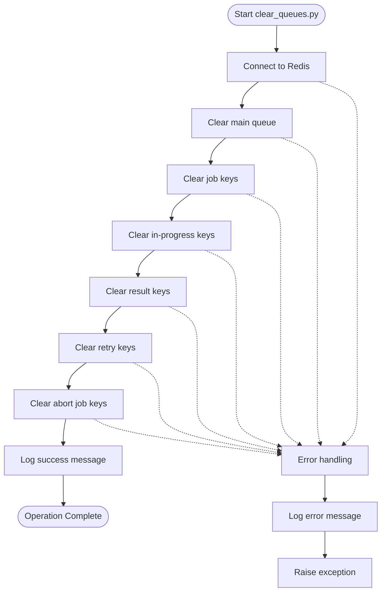
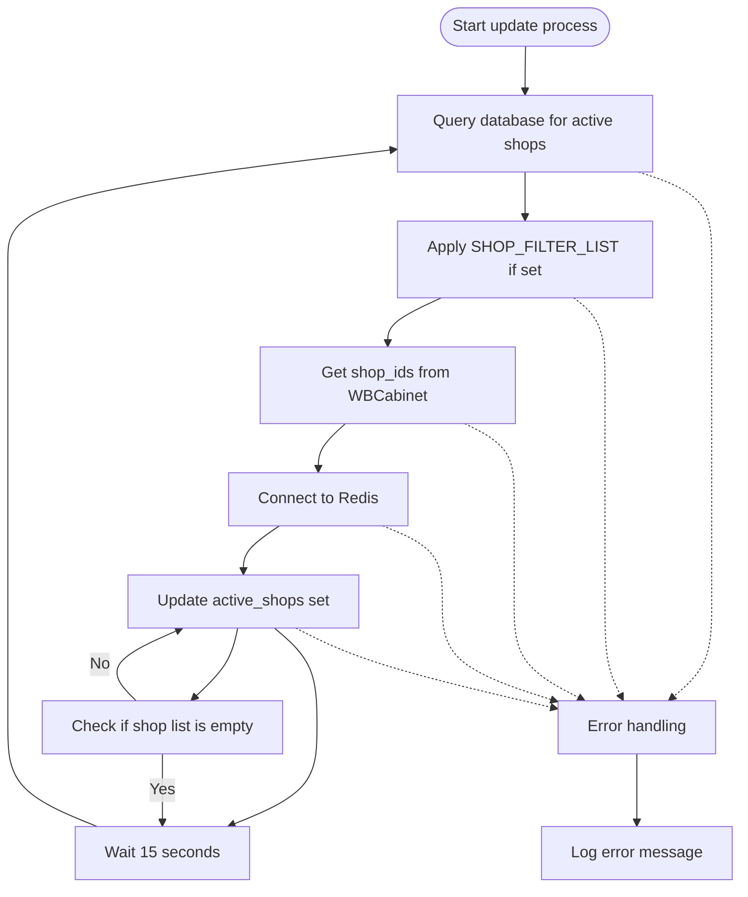
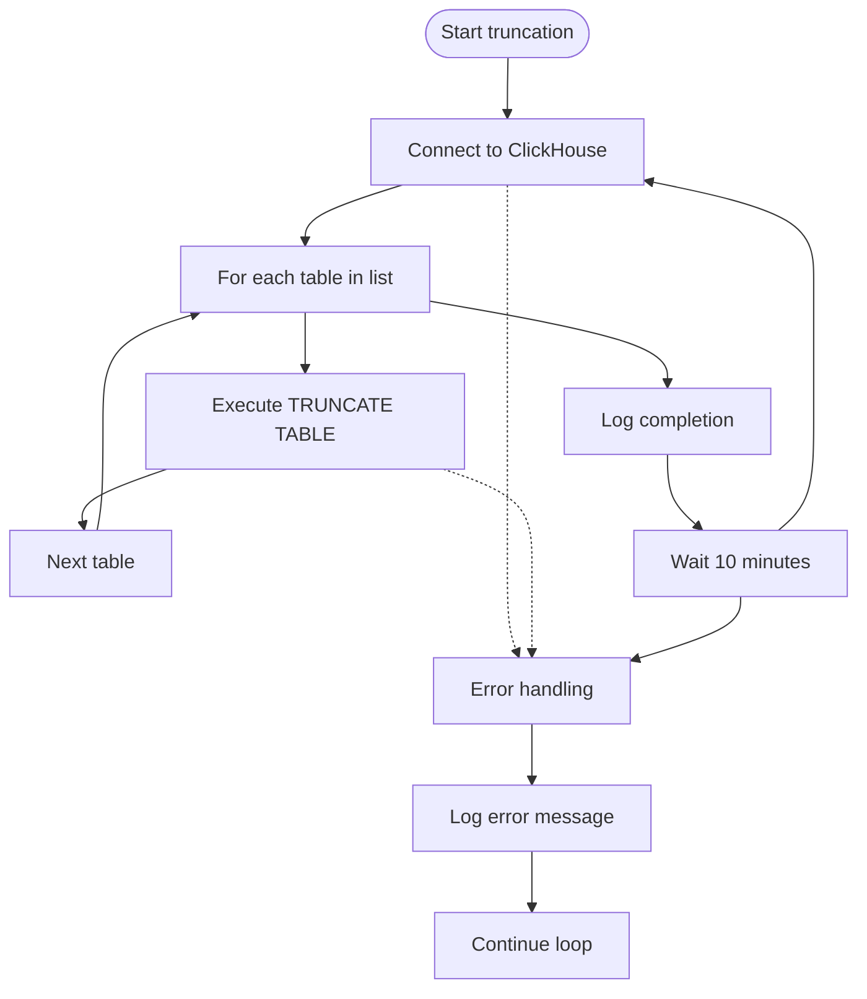
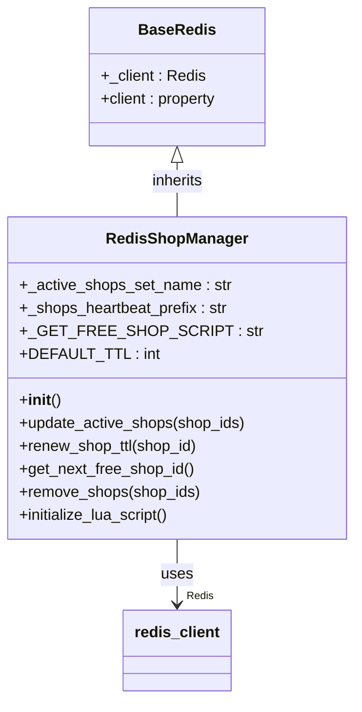

# Operations Runbook

<cite>
**Referenced Files in This Document**   
- [clear_queues.py](file://app/arq_workers/clear_queues.py)
- [run_update_active_shop_ids.py](file://run_update_active_shop_ids.py)
- [trunc_system_log_in_clickhouse.py](file://trunc_system_log_in_clickhouse.py)
- [update_active_shop_ids_in_redis.py](file://app/modules/shop_runner/shop_run_worker/update_active_shop_ids_in_redis.py)
- [redis_manager.py](file://app/modules/shop_runner/shop_run_worker/redis_manager/redis_manager.py)
- [base_redis_manager.py](file://app/core/redis_manager/base_redis_manager.py)
- [redis_client.py](file://app/core/redis_manager/redis_client.py)
- [redis_config.py](file://app/configs/infrastructure_config/redis_config.py)
- [infrastructure_config.py](file://app/configs/infrastructure_config/infrastructure_config.py)
- [app_config.py](file://app/configs/app_config.py)
</cite>

## Table of Contents
1. [Introduction](#introduction)
2. [Core Operational Procedures](#core-operational-procedures)
   - [Clearing ARQ Job Queues](#clearing-arq-job-queues)
   - [Updating Active Shop IDs in Redis](#updating-active-shop-ids-in-redis)
   - [Maintaining ClickHouse Logs](#maintaining-clickhouse-logs)
3. [System Health and Monitoring](#system-health-and-monitoring)
4. [Worker Management and Restart Procedures](#worker-management-and-restart-procedures)
5. [Cache Invalidation Strategies](#cache-invalidation-strategies)
6. [Monitoring Metrics and Alerting](#monitoring-metrics-and-alerting)
7. [Safety Guidelines](#safety-guidelines)
8. [Troubleshooting](#troubleshooting)
9. [Conclusion](#conclusion)

## Introduction
This operations runbook provides comprehensive guidance for day-to-day system management of the advertising bot platform. The document details critical administrative procedures, including queue management, cache updates, and log maintenance. It outlines pre-checks, execution steps, expected outcomes, and rollback procedures for each operation. The system leverages Redis for distributed task queuing (ARQ), shop state management, and caching, while ClickHouse serves as the analytical database for system metrics and logs.

**Section sources**
- [clear_queues.py](file://app/arq_workers/clear_queues.py#L1-L75)
- [run_update_active_shop_ids.py](file://run_update_active_shop_ids.py#L1-L22)
- [trunc_system_log_in_clickhouse.py](file://trunc_system_log_in_clickhouse.py#L1-L44)

## Core Operational Procedures

### Clearing ARQ Job Queues
The ARQ job queue clearing procedure is used to reset the distributed task processing system when jobs become stuck or corrupted.

**Pre-checks**
- Verify no critical batch jobs are currently running
- Check current queue length using Redis monitoring tools
- Ensure all worker processes are stopped to prevent race conditions
- Confirm backup of critical Redis data if required by organizational policy

**Execution Steps**
1. Execute the clear_queues.py script:
```bash
python app/arq_workers/clear_queues.py
```
2. The script connects to Redis using configured settings
3. It systematically clears all ARQ-related keys:
   - Main queue
   - Job keys
   - In-progress job keys
   - Result keys
   - Retry keys
   - Abort job keys

**Expected Outcomes**
- All ARQ queues are emptied
- No pending or in-progress jobs remain
- System logging indicates successful completion
- Subsequent job submissions start from a clean state

**Rollback Procedures**
- If unexpected issues occur, restart ARQ workers to resume normal processing
- Monitor for job re-submission from upstream systems
- Validate system functionality through health checks



**Diagram sources**
- [clear_queues.py](file://app/arq_workers/clear_queues.py#L1-L75)

**Section sources**
- [clear_queues.py](file://app/arq_workers/clear_queues.py#L1-L75)
- [arq_redis_settings.py](file://app/arq_workers/arq_redis_settings.py#L1-L10)

### Updating Active Shop IDs in Redis
This procedure updates the set of active shops in Redis based on database configurations.

**Pre-checks**
- Verify database connectivity
- Confirm Redis availability
- Check current active shop count in Redis
- Review SHOP_FILTER_LIST configuration if set

**Execution Steps**
1. The run_update_active_shop_ids.py script is executed:
```bash
python run_update_active_shop_ids.py
```
2. The system queries the database for shops with active advertising settings
3. Results are filtered by SHOP_FILTER_LIST if configured
4. Redis set "active_shops" is updated with current shop IDs
5. Process runs continuously with 15-second intervals

**Expected Outcomes**
- Redis "active_shops" set contains only shops with active bot settings
- Each shop ID in the set corresponds to a valid WBCabinet with AdvSetting.bot_active = True
- System workers can reliably retrieve active shops for processing
- Heartbeat mechanism maintains shop availability status

**Rollback Procedures**
- Stop the update process if incorrect shops are detected
- Manually correct database settings if needed
- Restart the process after configuration fixes
- Monitor worker behavior to confirm proper shop selection



**Diagram sources**
- [run_update_active_shop_ids.py](file://run_update_active_shop_ids.py#L1-L22)
- [update_active_shop_ids_in_redis.py](file://app/modules/shop_runner/shop_run_worker/update_active_shop_ids_in_redis.py#L1-L44)

**Section sources**
- [run_update_active_shop_ids.py](file://run_update_active_shop_ids.py#L1-L22)
- [update_active_shop_ids_in_redis.py](file://app/modules/shop_runner/shop_run_worker/update_active_shop_ids_in_redis.py#L1-L44)
- [redis_manager.py](file://app/modules/shop_runner/shop_run_worker/redis_manager/redis_manager.py#L1-L79)

### Maintaining ClickHouse Logs
Regular maintenance of ClickHouse system logs prevents storage bloat and ensures optimal performance.

**Pre-checks**
- Verify sufficient disk space for operation
- Check current log table sizes
- Ensure no critical analytics queries are running
- Confirm ClickHouse server availability

**Execution Steps**
1. Execute the truncation script:
```bash
python trunc_system_log_in_clickhouse.py
```
2. The script connects to ClickHouse using configured client
3. It truncates the following system tables:
   - system.processors_profile_log
   - system.metric_log
   - system.query_log
   - system.text_log
   - system.asynchronous_metric_log
   - system.query_metric_log
   - system.part_log
   - system.trace_log
   - system.error_log
4. Process runs in a loop with 10-minute intervals

**Expected Outcomes**
- All specified ClickHouse system tables are truncated
- Disk space is reclaimed
- System logging continues with empty tables
- Performance metrics collection resumes from zero

**Rollback Procedures**
- No rollback needed as system logs are ephemeral
- If issues occur, restart the script after addressing root cause
- Monitor ClickHouse health and log generation



**Diagram sources**
- [trunc_system_log_in_clickhouse.py](file://trunc_system_log_in_clickhouse.py#L1-L44)

**Section sources**
- [trunc_system_log_in_clickhouse.py](file://trunc_system_log_in_clickhouse.py#L1-L44)
- [client.py](file://app/utils/click_house/client.py#L1-L20)

## System Health and Monitoring
The system exposes several health indicators through its components:

**Health Check Endpoints**
- Redis connectivity: Monitored through base_redis_manager
- Database connectivity: Verified during shop ID updates
- ClickHouse connectivity: Checked in truncation script
- Worker liveness: Tracked via shop heartbeat mechanism

**Key Health Indicators**
- Redis memory usage and connection count
- ClickHouse disk space and query performance
- ARQ queue length and job processing rate
- Shop heartbeat TTL and active shop count
- Error rates in application logs

**Section sources**
- [base_redis_manager.py](file://app/core/redis_manager/base_redis_manager.py#L1-L21)
- [redis_client.py](file://app/core/redis_manager/redis_client.py#L1-L9)
- [redis_config.py](file://app/configs/infrastructure_config/redis_config.py#L1-L16)

## Worker Management and Restart Procedures
Worker processes are managed through a combination of ARQ and custom shop runners.

**Restart Procedures**
1. Gracefully terminate worker processes
2. Clear ARQ queues if necessary
3. Restart workers in proper dependency order
4. Monitor initialization logs for errors

**Worker Dependencies**
- ARQ workers depend on Redis connectivity
- Shop runners require database access
- ClickHouse maintenance script needs database connection
- All components rely on proper environment configuration

**Section sources**
- [workers.py](file://app/arq_workers/workers.py#L1-L50)
- [update_active_shop_ids_in_redis.py](file://app/modules/shop_runner/shop_run_worker/update_active_shop_ids_in_redis.py#L1-L44)

## Cache Invalidation Strategies
The system employs several cache management patterns:

**Active Shops Cache**
- Maintained as a Redis set ("active_shops")
- Updated every 15 seconds from database source
- Used by workers to determine processing targets

**Shop Heartbeat Mechanism**
- Each active shop has a TTL-based heartbeat key
- Workers renew TTL when processing shops
- Expired heartbeats indicate inactive workers

**Lua Script Optimization**
- GET_FREE_SHOP_SCRIPT uses atomic operations
- Prevents race conditions in shop selection
- Ensures single worker processes each shop



**Diagram sources**
- [redis_manager.py](file://app/modules/shop_runner/shop_run_worker/redis_manager/redis_manager.py#L1-L79)
- [base_redis_manager.py](file://app/core/redis_manager/base_redis_manager.py#L1-L21)

**Section sources**
- [redis_manager.py](file://app/modules/shop_runner/shop_run_worker/redis_manager/redis_manager.py#L1-L79)
- [base_redis_manager.py](file://app/core/redis_manager/base_redis_manager.py#L1-L21)

## Monitoring Metrics and Alerting
Critical metrics to monitor during operations:

**Queue Metrics**
- ARQ queue length
- Job processing rate
- Failed job count
- Retry queue size

**Redis Metrics**
- Memory usage
- Connection count
- Active shops count
- Heartbeat key count

**ClickHouse Metrics**
- Disk space usage
- Query execution time
- System log table sizes
- Ingestion rate

**Alert Thresholds**
- ARQ queue length > 1000: Warning
- ARQ queue length > 5000: Critical
- Redis memory usage > 80%: Warning
- Redis memory usage > 90%: Critical
- ClickHouse disk usage > 85%: Warning
- ClickHouse disk usage > 95%: Critical
- No shop heartbeats for > 2 minutes: Critical

**Escalation Paths**
1. On-call engineer: Initial response
2. Senior operations team: If unresolved in 30 minutes
3. Development team: If issue requires code changes
4. Management: For extended service disruptions

**Section sources**
- [clear_queues.py](file://app/arq_workers/clear_queues.py#L1-L75)
- [redis_manager.py](file://app/modules/shop_runner/shop_run_worker/redis_manager/redis_manager.py#L1-L79)
- [trunc_system_log_in_clickhouse.py](file://trunc_system_log_in_clickhouse.py#L1-L44)

## Safety Guidelines
Follow these guidelines to prevent data loss or service disruption:

**General Principles**
- Always perform pre-checks before executing operations
- Execute changes during maintenance windows when possible
- Document all manual interventions
- Verify backups before major operations

**Queue Management Safety**
- Never clear queues while workers are running
- Confirm queue state before and after clearing
- Monitor for job re-submission after queue clearance
- Have rollback plan for critical job loss

**Cache Update Safety**
- Verify database consistency before cache updates
- Monitor worker behavior after cache changes
- Ensure proper filtering when SHOP_FILTER_LIST is used
- Validate that only intended shops are marked active

**Log Maintenance Safety**
- Ensure sufficient disk space before truncation
- Verify ClickHouse availability before operation
- Monitor log generation after truncation
- Confirm no critical debugging information will be lost

**Section sources**
- [clear_queues.py](file://app/arq_workers/clear_queues.py#L1-L75)
- [update_active_shop_ids_in_redis.py](file://app/modules/shop_runner/shop_run_worker/update_active_shop_ids_in_redis.py#L1-L44)
- [trunc_system_log_in_clickhouse.py](file://trunc_system_log_in_clickhouse.py#L1-L44)

## Troubleshooting
Common issues and resolution steps:

**Redis Connection Issues**
- Verify REDIS_HOST environment variable
- Check Redis server availability
- Validate network connectivity
- Review authentication settings

**Database Query Failures**
- Confirm database connectivity
- Verify table schemas
- Check SQL query syntax
- Validate user permissions

**ClickHouse Access Problems**
- Ensure ClickHouse server is running
- Verify connection credentials
- Check network accessibility
- Review firewall rules

**Worker Stuck Issues**
- Clear ARQ queues if jobs are stuck
- Restart worker processes
- Check for resource constraints
- Review error logs for specific failures

**Section sources**
- [redis_client.py](file://app/core/redis_manager/redis_client.py#L1-L9)
- [redis_config.py](file://app/configs/infrastructure_config/redis_config.py#L1-L16)
- [infrastructure_config.py](file://app/configs/infrastructure_config/infrastructure_config.py#L1-L16)
- [app_config.py](file://app/configs/app_config.py#L1-L21)

## Conclusion
This operations runbook provides comprehensive guidance for managing the advertising bot platform. The documented procedures cover critical administrative tasks including ARQ queue management, active shop cache updates, and ClickHouse log maintenance. Each operation includes pre-checks, execution steps, expected outcomes, and rollback procedures. The system relies heavily on Redis for distributed coordination and state management, with ClickHouse providing analytical capabilities. Following the safety guidelines and monitoring recommendations will help ensure reliable system operation and prevent service disruptions.