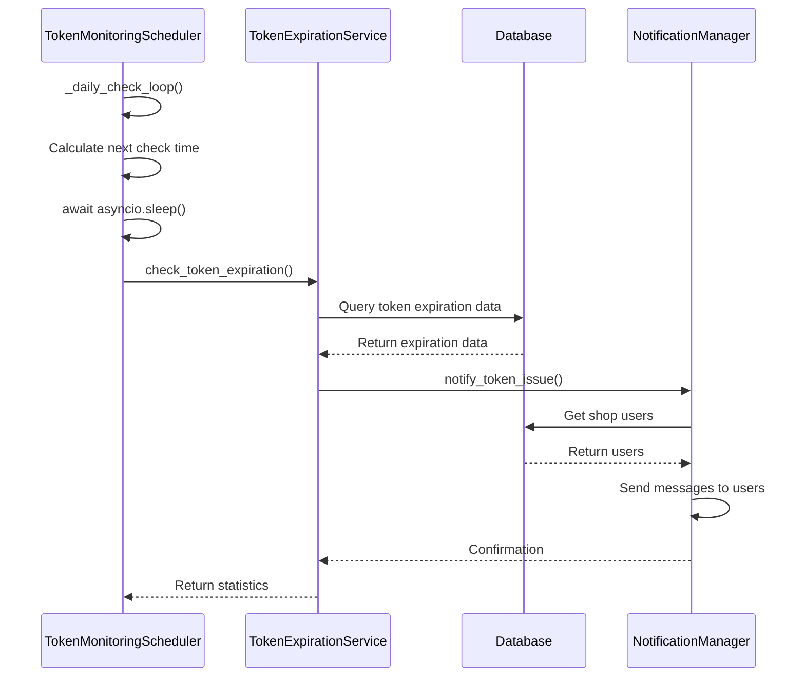
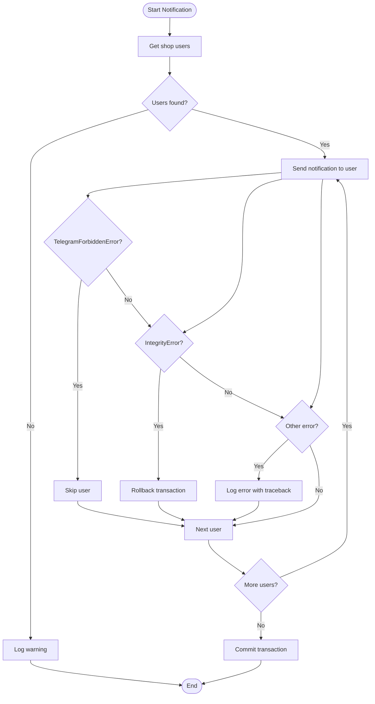

# Coding Standards and Quality

<cite>
**Referenced Files in This Document**   
- [pyproject.toml](file://pyproject.toml)
- [mypy.ini](file://mypy.ini)
- [pytest.ini](file://pytest.ini)
- [ruff-report.json](file://ruff-report.json)
- [app/client_bot/bot.py](file://app/client_bot/bot.py)
- [app/modules/shop_runner/service_manager/old_modules/auto_updater_target_place/auto_updater_target_place.py](file://app/modules/shop_runner/service_manager/old_modules/auto_updater_target_place/auto_updater_target_place.py)
- [app/modules/shop_runner/service_manager/old_modules/setting_auto_updater/setting_auto_updater.py](file://app/modules/shop_runner/service_manager/old_modules/setting_auto_updater/setting_auto_updater.py)
- [app/modules/common_slaves/wildberries/data_classes/adv.py](file://app/modules/common_slaves/wildberries/data_classes/adv.py)
- [app/modules/billing/models.py](file://app/modules/billing/models.py)
- [app/modules/sales_plan_settings/telegram/main_handler.py](file://app/modules/sales_plan_settings/telegram/main_handler.py)
- [app/modules/token_monitoring/services/notification_manager.py](file://app/modules/token_monitoring/services/notification_manager.py)
- [app/modules/token_monitoring/models.py](file://app/modules/token_monitoring/models.py)
- [app/modules/token_monitoring/scheduler.py](file://app/modules/token_monitoring/scheduler.py)
</cite>

## Table of Contents
1. [Introduction](#introduction)
2. [Code Formatting with Ruff](#code-formatting-with-ruff)
3. [Type Checking with MyPy](#type-checking-with-mypy)
4. [Testing Configuration with Pytest](#testing-configuration-with-pytest)
5. [Linting Issues Analysis](#linting-issues-analysis)
6. [Code Structure and Design Patterns](#code-structure-and-design-patterns)
7. [Async/Await Patterns](#asyncawait-patterns)
8. [Dependency Injection Usage](#dependency-injection-usage)
9. [Error Handling Practices](#error-handling-practices)
10. [Type-Safe Code Guidelines](#type-safe-code-guidelines)
11. [Python 3.11+ Features](#python-311-features)
12. [Pre-commit Hooks Configuration](#pre-commit-hooks-configuration)
13. [Conclusion](#conclusion)

## Introduction
The adv-bot project enforces strict coding standards and quality controls through a comprehensive suite of tools including Ruff for code formatting, MyPy for type checking, and Pytest for testing. This document details the configuration and usage of these tools, analyzes common linting issues, and provides guidance on proper code structure, async patterns, dependency injection, and error handling throughout the codebase.

## Code Formatting with Ruff

The project uses Ruff as its primary code formatter and linter, configured through the `pyproject.toml` file. The configuration enforces a line length limit of 88 characters, which is consistent with modern Python formatting standards.

Ruff is configured to exclude certain directories from linting, including generated API clients and Alembic migration scripts, to prevent unnecessary warnings in auto-generated code. The tool checks for various code quality issues including line length violations, import placement, and whitespace usage.

The configuration ensures consistent code style across the project, with particular attention to import organization and line length constraints. This helps maintain readability and prevents common formatting issues that can arise in collaborative development environments.

**Section sources**
- [pyproject.toml](file://pyproject.toml)

## Type Checking with MyPy

MyPy is configured through the `mypy.ini` file to enforce strict type checking across the codebase. The configuration sets `strict = True`, which enables all optional error checks, ensuring comprehensive type validation.

The project enforces `disallow_untyped_defs = True`, requiring all function definitions to have type annotations. This promotes type safety and makes the code more maintainable by clearly documenting the expected types for function parameters and return values.

Certain modules have relaxed type checking requirements where appropriate, such as test modules and specific third-party integrations. For example, the configuration includes exceptions for SQLAlchemy and Aiogram modules where type stubs may be incomplete or where dynamic typing is inherent to the framework's design.

The type checking configuration also handles circular dependencies and module duplication issues by selectively disabling strict checks for specific modules that are known to have these characteristics.

**Section sources**
- [mypy.ini](file://mypy.ini)

## Testing Configuration with Pytest

Pytest is configured through the `pytest.ini` file to support the project's testing needs. The configuration sets `asyncio_mode = auto`, enabling seamless testing of asynchronous code without requiring explicit event loop management.

Test discovery is configured to search in both the `tests` and `app` directories, allowing tests to be colocated with the code they test when appropriate. The configuration recognizes test files with patterns `test_*.py`, `*_test.py`, and `tests.py`, providing flexibility in test file naming conventions.

The project uses various markers to categorize tests, including `asyncio` for asynchronous tests, `unit` and `integration` for test type classification, and `slow` for tests that take longer to execute. This allows for selective test execution based on the development context.

Additional configuration includes verbose output (`-v`) and short traceback format (`--tb=short`) to provide clear and concise test results during development.

**Section sources**
- [pytest.ini](file://pytest.ini)

## Linting Issues Analysis

The `ruff-report.json` file contains a comprehensive list of linting issues detected across the codebase. The most common issues are line length violations (E501) and import placement issues (E402).

Line length violations (E501) are prevalent throughout the codebase, particularly in files like `add_to_shop_balance.py` and various Alembic migration scripts. These violations occur when lines exceed the 88-character limit enforced by Ruff. The issues are typically found in long import statements, function calls with many parameters, or complex expressions.

Import placement issues (E402) are detected in the `app/arq_workers/workers.py` file, where module-level imports are not at the top of the file. This violates Python's convention of placing all imports at the beginning of the file, which improves code readability and makes dependencies explicit.

Other issues include whitespace on blank lines (W293), which can cause formatting inconsistencies across different editors and platforms.

These linting issues highlight areas where code formatting can be improved to meet the project's quality standards. Addressing these issues would enhance code readability and maintainability.

**Section sources**
- [ruff-report.json](file://ruff-report.json)

## Code Structure and Design Patterns

The codebase follows a modular structure with clear separation of concerns. Core functionality is organized into packages such as `app/modules`, `app/core`, and `app/client_bot`, each containing related functionality.

The project employs object-oriented design patterns extensively, with classes used to encapsulate related data and behavior. For example, the `NotificationManager` class in the token monitoring module encapsulates the logic for sending notifications to users, while the `TokenMonitoringScheduler` class manages the scheduling of periodic tasks.

Data classes are used to represent structured data, such as the `FactData` and `PlanData` classes in the setting auto-updater module. These classes provide a clear and type-safe way to pass data between functions and modules.

The codebase also uses abstract base classes (ABC) to define interfaces and enforce implementation of specific methods. For example, the `Adv` class in the advertising module is an abstract base class that requires subclasses to implement the `cpm` property.

**Section sources**
- [app/modules/shop_runner/service_manager/old_modules/setting_auto_updater/setting_auto_updater.py](file://app/modules/shop_runner/service_manager/old_modules/setting_auto_updater/setting_auto_updater.py)
- [app/modules/token_monitoring/services/notification_manager.py](file://app/modules/token_monitoring/services/notification_manager.py)
- [app/modules/token_monitoring/scheduler.py](file://app/modules/token_monitoring/scheduler.py)
- [app/modules/common_slaves/wildberries/data_classes/adv.py](file://app/modules/common_slaves/wildberries/data_classes/adv.py)

## Async/Await Patterns

The project extensively uses Python's async/await syntax for handling asynchronous operations, particularly for I/O-bound tasks such as database operations and API calls.

Functions that perform database operations are typically defined as coroutines using the `async` keyword, allowing them to await the completion of database queries without blocking the event loop. For example, the `notify_token_issue` method in the `NotificationManager` class awaits database operations when retrieving user information and recording notifications.

The codebase follows the pattern of using `async with` statements for resource management, particularly when working with database sessions. This ensures that resources are properly cleaned up even if an exception occurs during execution.

The `scheduler.py` module demonstrates a sophisticated use of async/await patterns, with the `_daily_check_loop` method using `asyncio.sleep()` to pause execution until the next scheduled check time, allowing other tasks to run on the event loop in the meantime.

**Diagram sources**
- [app/modules/token_monitoring/scheduler.py](file://app/modules/token_monitoring/scheduler.py)
- [app/modules/token_monitoring/services/token_expiration_service.py](file://app/modules/token_monitoring/services/token_expiration_service.py)
- [app/modules/token_monitoring/services/notification_manager.py](file://app/modules/token_monitoring/services/notification_manager.py)

**Section sources**
- [app/modules/token_monitoring/scheduler.py](file://app/modules/token_monitoring/scheduler.py)
- [app/modules/token_monitoring/services/notification_manager.py](file://app/modules/token_monitoring/services/notification_manager.py)

## Dependency Injection Usage

The project uses dependency injection to manage dependencies between components, promoting loose coupling and testability. The `NotificationManager` class demonstrates this pattern by accepting optional dependencies in its constructor, such as the `Bot` instance and session maker.

This approach allows for easy substitution of dependencies during testing, where mock objects can be injected instead of real services. It also enables configuration of the dependency injection system to provide different implementations based on the environment.

The `get_bot()` function in the client bot module serves as a simple dependency injection mechanism, providing access to the shared bot instance without requiring direct imports or global variables.

The pattern of using properties with lazy loading, as seen in the `bot` property of the `NotificationManager` class, further enhances the dependency injection approach by deferring the creation of dependencies until they are actually needed.

**Section sources**
- [app/client_bot/bot.py](file://app/client_bot/bot.py)
- [app/modules/token_monitoring/services/notification_manager.py](file://app/modules/token_monitoring/services/notification_manager.py)

## Error Handling Practices

The project employs comprehensive error handling strategies to ensure robustness and provide meaningful feedback when issues occur.

Exceptions are used to handle error conditions, with specific exception types defined for different error scenarios. For example, the `AutoUpdateTargetPlaceError` exception is raised when there are issues with updating target places in advertising campaigns.

The codebase uses try-except blocks to catch and handle exceptions at appropriate levels of abstraction. In the `NotificationManager` class, different types of exceptions are handled differently: `TelegramForbiddenError` is handled by silently skipping notifications to users who have blocked the bot, while `IntegrityError` is handled by rolling back the transaction and preventing duplicate notifications.

Logging is used extensively to record error conditions and provide diagnostic information. The `logging` module is used to record messages at different severity levels, from informational messages to error and exception traces.

The project also uses assertions to validate assumptions about data and program state, helping to catch bugs early in development.

**Diagram sources**
- [app/modules/token_monitoring/services/notification_manager.py](file://app/modules/token_monitoring/services/notification_manager.py)

**Section sources**
- [app/modules/token_monitoring/services/notification_manager.py](file://app/modules/token_monitoring/services/notification_manager.py)
- [app/modules/shop_runner/service_manager/old_modules/auto_updater_target_place/auto_updater_target_place.py](file://app/modules/shop_runner/service_manager/old_modules/auto_updater_target_place/auto_updater_target_place.py)

## Type-Safe Code Guidelines

The project emphasizes type safety through comprehensive type annotations and strict MyPy configuration. All function parameters and return values are annotated with their expected types, making the code more self-documenting and easier to understand.

Union types are used where a variable can have multiple possible types, such as `datetime.datetime | None` for optional datetime values. This helps prevent null pointer errors by making it explicit when a value might be None.

The codebase uses type aliases and generic types where appropriate to improve code clarity and reusability. For example, the `Awaitable` type is used to indicate that a function parameter should be a coroutine that returns a list of calculated keywords.

Type checking is particularly important in the database models, where SQLAlchemy's ORM is used. The models use type hints to specify the expected types of database columns, helping to catch type-related errors before they reach the database layer.

The project also uses `typing.TYPE_CHECKING` to handle circular import dependencies in type annotations, allowing type hints to reference classes that would otherwise create import cycles.

**Section sources**
- [app/modules/billing/models.py](file://app/modules/billing/models.py)
- [app/modules/shop_runner/service_manager/old_modules/setting_auto_updater/setting_auto_updater.py](file://app/modules/shop_runner/service_manager/old_modules/setting_auto_updater/setting_auto_updater.py)
- [app/modules/token_monitoring/models.py](file://app/modules/token_monitoring/models.py)

## Python 3.11+ Features

The project targets Python 3.11 and above, taking advantage of modern Python features and performance improvements. The `pyproject.toml` file specifies `python = ">=3.11,<3.12"`, ensuring compatibility with Python 3.11 features while preventing accidental use of newer Python versions.

The codebase uses modern Python syntax and features, such as the `|` operator for union types (e.g., `datetime.datetime | None`), which was introduced in Python 3.10. This syntax is more concise and readable than the older `Union[Type1, Type2]` syntax.

The project also uses f-strings for string formatting, which provide better performance and readability compared to older string formatting methods. F-strings are used extensively in log messages and user notifications.

The use of `async` and `await` syntax for asynchronous programming is another modern Python feature that is used throughout the codebase, enabling efficient handling of I/O-bound operations without blocking the event loop.

The project leverages the improved error messages and performance optimizations in Python 3.11, which can result in significant speed improvements for CPU-bound tasks.

**Section sources**
- [pyproject.toml](file://pyproject.toml)
- [app/modules/token_monitoring/models.py](file://app/modules/token_monitoring/models.py)
- [app/modules/token_monitoring/services/notification_manager.py](file://app/modules/token_monitoring/services/notification_manager.py)

## Pre-commit Hooks Configuration

While the pre-commit hook configuration is not explicitly shown in the provided files, the project's quality enforcement tools are designed to be used in a pre-commit workflow. Ruff, MyPy, and Pytest can all be configured as pre-commit hooks to automatically check code quality before commits are made.

A typical pre-commit configuration would run Ruff to check for formatting issues and linting violations, MyPy to verify type correctness, and Pytest to ensure that tests pass. This prevents low-quality code from entering the codebase and helps maintain consistent code quality across all contributions.

The configuration would likely include checks for the most critical issues, such as type errors, test failures, and severe linting violations, while potentially allowing less critical issues to be addressed later.

The use of pre-commit hooks would be particularly valuable for enforcing the line length limit and import ordering rules enforced by Ruff, as these are the most common issues identified in the ruff-report.json file.

**Section sources**
- [pyproject.toml](file://pyproject.toml)
- [mypy.ini](file://mypy.ini)
- [pytest.ini](file://pytest.ini)
- [ruff-report.json](file://ruff-report.json)

## Conclusion
The adv-bot project maintains high code quality through a comprehensive suite of tools and practices. Ruff enforces consistent code formatting with a focus on line length and import organization. MyPy ensures type safety through strict type checking and comprehensive type annotations. Pytest provides a robust testing framework with support for asynchronous code.

The codebase demonstrates good design patterns, including modular organization, object-oriented design, and dependency injection. Async/await patterns are used effectively for handling I/O-bound operations, and error handling is comprehensive and thoughtful.

To further improve code quality, the team should address the linting issues identified in the ruff-report.json file, particularly the line length violations and import placement issues. Implementing pre-commit hooks would help prevent these issues from recurring in the future.

Overall, the project demonstrates a strong commitment to code quality and maintainability, which will serve it well as it continues to evolve and grow.