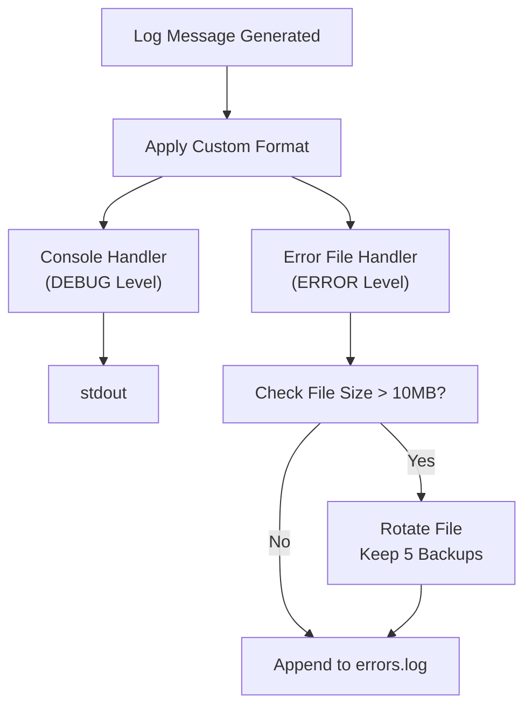
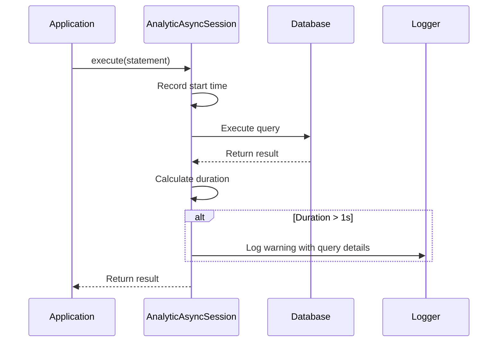
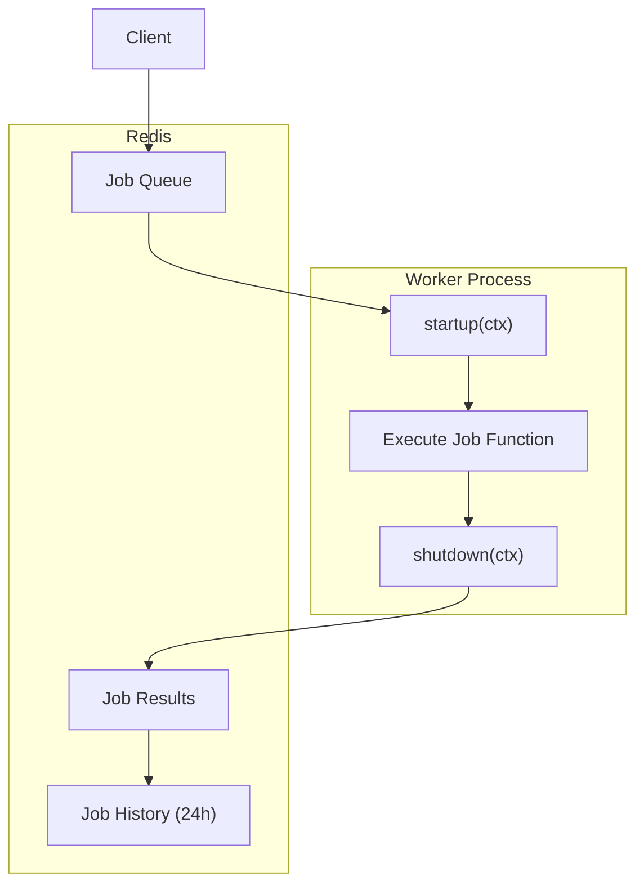
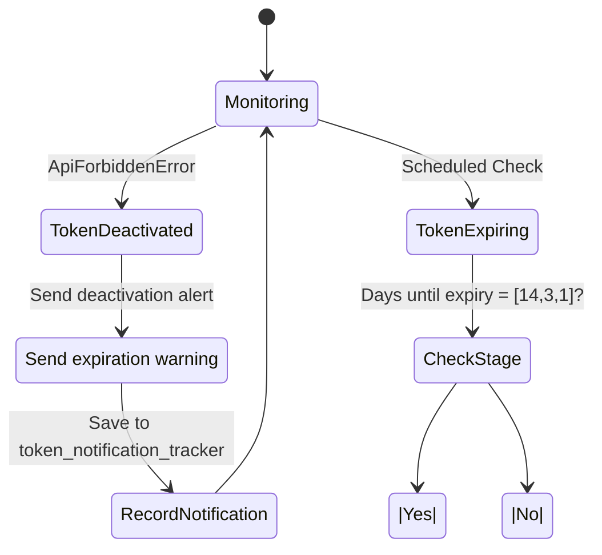
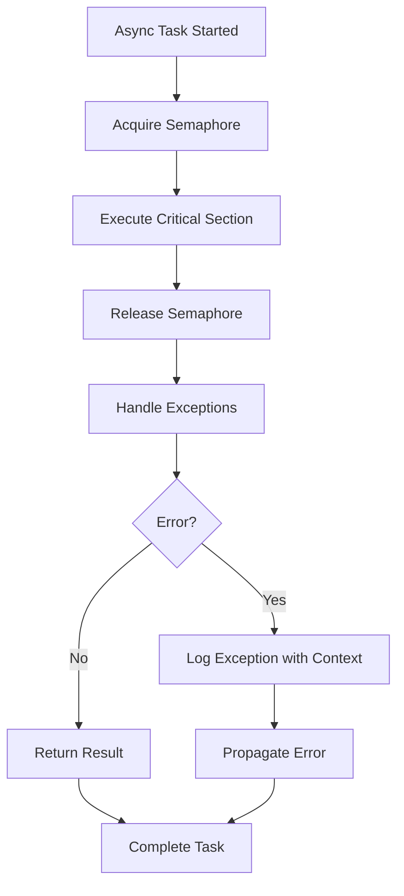
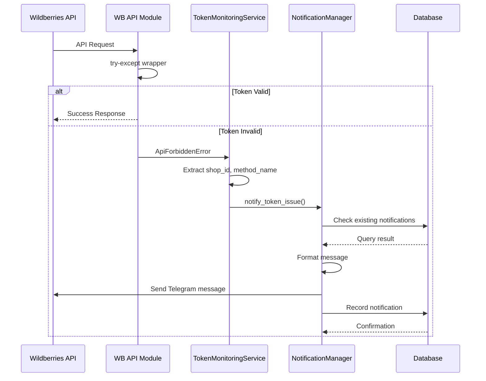
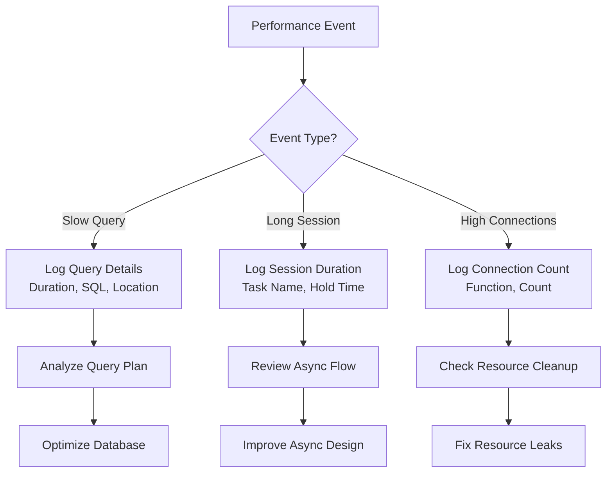

# Debugging and Profiling

<cite>
**Referenced Files in This Document**   
- [logging_config.json](file://logging_config.json)
- [session_maker.py](file://app/utils/db/session_maker.py)
- [workers.py](file://app/arq_workers/workers.py)
- [token_monitoring_service.py](file://app/modules/token_monitoring/services/token_monitoring_service.py)
- [token_expiration_service.py](file://app/modules/token_monitoring/services/token_expiration_service.py)
- [notification_manager.py](file://app/modules/token_monitoring/services/notification_manager.py)
- [scheduler.py](file://app/modules/token_monitoring/scheduler.py)
- [startup.py](file://app/modules/token_monitoring/startup.py)
- [integration.py](file://app/modules/token_monitoring/integration.py)
- [my_log_handler.py](file://my_log_handler.py)
</cite>

## Table of Contents
1. [Introduction](#introduction)
2. [Logging Configuration](#logging-configuration)
3. [Database Query Inspection](#database-query-inspection)
4. [Distributed Component Debugging](#distributed-component-debugging)
5. [Token Expiration and Race Condition Debugging](#token-expiration-and-race-condition-debugging)
6. [Async Code Debugging](#async-code-debugging)
7. [Request Flow Tracing](#request-flow-tracing)
8. [Performance Profiling](#performance-profiling)
9. [Conclusion](#conclusion)

## Introduction
This document provides comprehensive guidance on debugging and profiling techniques for the adv-bot project. The system is a complex, distributed application with multiple components including Telegram bots, ARQ workers, Redis-based state management, and Wildberries API integrations. The debugging and profiling strategies outlined here address the unique challenges of this architecture, focusing on remote debugging, logging, database query optimization, distributed component monitoring, and handling asynchronous code issues.

## Logging Configuration

The adv-bot project uses a structured logging configuration through the `logging_config.json` file, which defines formatters, handlers, and log levels for different components of the application. The logging system is designed to provide detailed diagnostic information while maintaining performance.

The custom formatter includes essential context for debugging:
- Logger name
- Timestamp with millisecond precision
- Full file path and line number
- Log level
- Message content

Two primary handlers are configured:
1. Console handler for real-time debugging during development
2. Rotating file handler for error logging in production, with 10MB size limit and 5 backup files

**Diagram sources**
- [logging_config.json](file://logging_config.json)

**Section sources**
- [logging_config.json](file://logging_config.json)

## Database Query Inspection

The `session_maker.py` file implements a sophisticated database session management system with built-in query inspection and performance monitoring capabilities. The `AnalyticAsyncSession` class extends SQLAlchemy's `AsyncSession` to provide automatic detection of slow queries and long-held database sessions.

Key features include:
- Automatic detection of queries taking longer than 1 second
- Warning logs with query details, execution time, and calling location
- Detection of database sessions held for excessive durations
- Integration with application settings for connection pooling

The session maker uses a global semaphore to limit concurrent database connections, preventing resource exhaustion. When a slow query is detected, the system logs a warning with the SQL statement, execution time, and stack trace information to help identify performance bottlenecks.

**Diagram sources**
- [session_maker.py](file://app/utils/db/session_maker.py)

**Section sources**
- [session_maker.py](file://app/utils/db/session_maker.py)

## Distributed Component Debugging

The adv-bot project uses ARQ workers for distributed task processing, with Redis serving as the message broker and state management system. The `workers.py` file contains the configuration for ARQ workers, including startup and shutdown hooks that initialize and clean up resources.

Key debugging considerations for distributed components:
- Worker lifecycle management through `startup` and `shutdown` functions
- Context preservation between job executions
- Error handling with retry mechanisms (max_tries=10)
- Job timeout management (24-hour maximum)

The system maintains jobs in Redis for 24 hours after completion, allowing for post-execution analysis of task performance and outcomes. This retention period facilitates debugging of intermittent issues that may not be reproducible in development environments.

**Diagram sources**
- [workers.py](file://app/arq_workers/workers.py)

**Section sources**
- [workers.py](file://app/arq_workers/workers.py)

## Token Expiration and Race Condition Debugging

The token monitoring system in the `token_monitoring` module addresses the critical issue of token expiration and race conditions in API access. The system consists of multiple components that work together to detect, notify, and resolve token-related issues.

The `TokenMonitoringService` wraps the HTTP request decorator to detect `ApiForbiddenError` exceptions, which typically indicate token deactivation. When such an error occurs, the service asynchronously notifies affected users through the `NotificationManager`, preventing notification delays from impacting API response times.

The `TokenExpirationService` proactively monitors token expiration dates and sends advance warnings at 14, 3, and 1 day intervals before expiration. This prevents service disruptions by giving users ample time to update their tokens.

**Diagram sources**
- [token_monitoring_service.py](file://app/modules/token_monitoring/services/token_monitoring_service.py)
- [token_expiration_service.py](file://app/modules/token_monitoring/services/token_expiration_service.py)
- [notification_manager.py](file://app/modules/token_monitoring/services/notification_manager.py)

**Section sources**
- [token_monitoring_service.py](file://app/modules/token_monitoring/services/token_monitoring_service.py)
- [token_expiration_service.py](file://app/modules/token_monitoring/services/token_expiration_service.py)
- [notification_manager.py](file://app/modules/token_monitoring/services/notification_manager.py)

## Async Code Debugging

Debugging asynchronous code in the adv-bot project requires special consideration due to the concurrent nature of operations. The system uses asyncio extensively for handling multiple API requests, database operations, and message processing.

Key challenges and solutions:
- **Task isolation**: Each database session is protected by a semaphore to prevent connection pool exhaustion
- **Error propagation**: Exceptions in async tasks are properly logged with full stack traces
- **Resource cleanup**: Context managers ensure proper cleanup of resources like HTTP sessions
- **Deadlock prevention**: Careful management of await points to prevent circular dependencies

The token monitoring scheduler demonstrates proper async pattern implementation, using `asyncio.create_task()` to run background operations without blocking the main event loop. The scheduler also handles cancellation properly, ensuring graceful shutdown of long-running tasks.

**Section sources**
- [scheduler.py](file://app/modules/token_monitoring/scheduler.py)
- [startup.py](file://app/modules/token_monitoring/startup.py)

## Request Flow Tracing

Tracing request flows across multiple modules and workers is essential for debugging complex interactions in the adv-bot system. The application uses several techniques to maintain traceability:

1. **Structured logging**: Each log entry includes the file path and line number, enabling precise location of execution points
2. **Context preservation**: ARQ workers maintain context between startup, execution, and shutdown phases
3. **Database session tracking**: Long-held sessions are logged with the owning task name
4. **Error reporting**: Exception traces are filtered to show only application code (files containing "app")

The token monitoring integration demonstrates effective request flow tracing by capturing the calling function name when a token deactivation is detected. This information is included in notifications, helping users understand which specific functionality was affected.

**Diagram sources**
- [integration.py](file://app/modules/token_monitoring/integration.py)
- [token_monitoring_service.py](file://app/modules/token_monitoring/services/token_monitoring_service.py)

**Section sources**
- [integration.py](file://app/modules/token_monitoring/integration.py)
- [token_monitoring_service.py](file://app/modules/token_monitoring/services/token_monitoring_service.py)

## Performance Profiling

The adv-bot project incorporates several performance profiling mechanisms to identify and address bottlenecks:

1. **Database query profiling**: Automatic detection of queries taking longer than 1 second
2. **Session duration monitoring**: Warnings for database sessions held longer than 1 second
3. **Connection counting**: Debug logging of active database connections
4. **ClickHouse client monitoring**: Connection counting for specific functions

The system uses a combination of proactive monitoring (detecting issues before they impact users) and reactive diagnostics (providing detailed information when issues occur). The logging configuration ensures that performance warnings are captured in both console output and persistent logs.

For memory profiling, while the `memory-profiler` package is not explicitly referenced in the codebase, the design patterns support memory leak detection through:
- Proper resource cleanup in async context managers
- Limited job retention in ARQ workers
- Regular cleanup of resolved notifications
- Connection pooling with defined limits

**Section sources**
- [session_maker.py](file://app/utils/db/session_maker.py)
- [client.py](file://app/utils/click_house/client.py)

## Conclusion

The adv-bot project employs a comprehensive approach to debugging and profiling, addressing the challenges of a distributed, asynchronous application. The logging configuration provides detailed diagnostic information, while the database session management includes built-in performance monitoring. The token monitoring system effectively handles a critical failure mode (token expiration) through proactive detection and user notification.

For effective debugging in this environment, developers should:
1. Utilize the structured logging system to trace execution flow
2. Monitor database performance through the built-in query and session duration warnings
3. Understand the distributed nature of ARQ workers and their lifecycle
4. Leverage the token monitoring system to diagnose API access issues
5. Apply async debugging best practices to avoid common pitfalls

The combination of these techniques provides a robust foundation for maintaining and improving the reliability and performance of the adv-bot system.