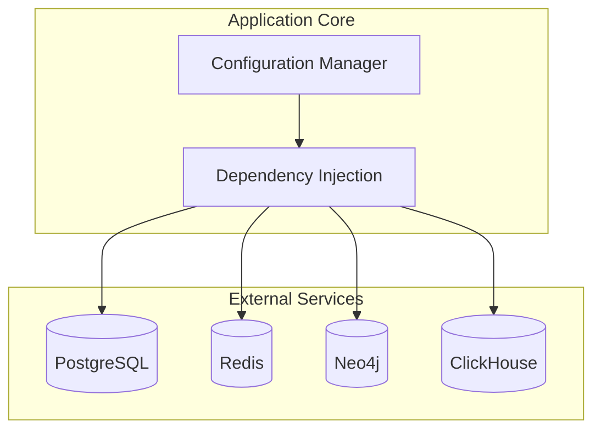
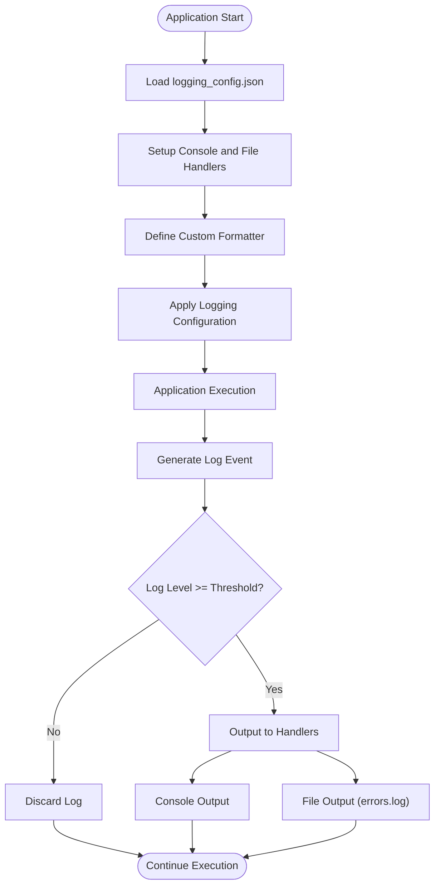
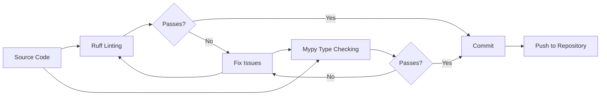
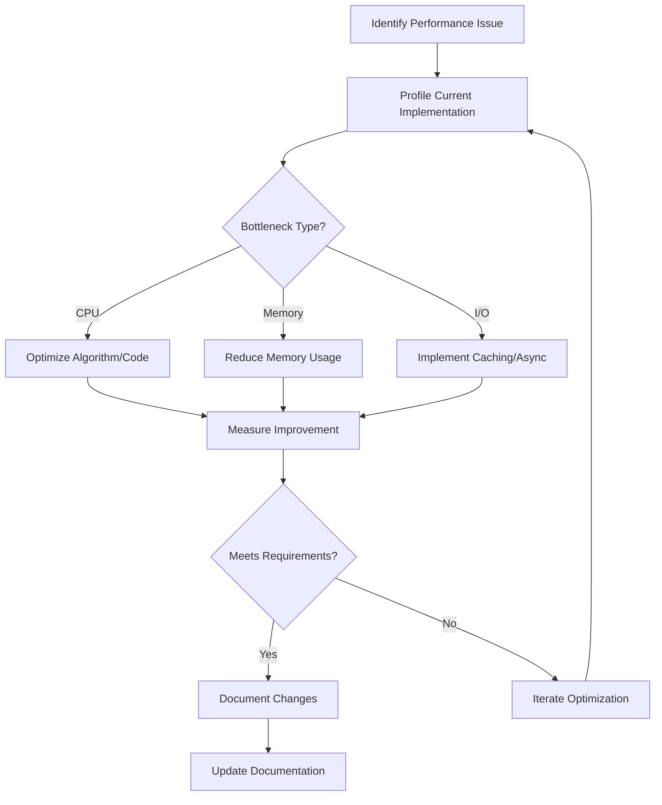

# Developer Guide

<cite>
**Referenced Files in This Document**   
- [pyproject.toml](file://pyproject.toml)
- [scripts/template_script.py](file://scripts/template_script.py)
- [logging_config.json](file://logging_config.json)
- [mypy.ini](file://mypy.ini)
- [ruff-report.json](file://ruff-report.json)
- [run_update_predict_ctr.py](file://run_update_predict_ctr.py)
- [run_shop_update_worker.py](file://run_shop_update_worker.py)
- [run_keywords_parsing.py](file://run_keywords_parsing.py)
- [run_update_model.py](file://run_update_model.py)
- [run_grpc_services.py](file://run_grpc_services.py)
- [run_update_keyword_vectors_in_redis.py](file://run_update_keyword_vectors_in_redis.py)
- [run_update_minus_kw_on_wb.py](file://run_update_minus_kw_on_wb.py)
- [run_update_cards_data_in_neo4j.py](file://run_update_cards_data_in_neo4j.py)
- [run_update_active_shop_ids.py](file://run_update_active_shop_ids.py)
- [client_bot_run.py](file://client_bot_run.py)
- [updater.py](file://updater.py)
- [app/core/di/app_container.py](file://app/core/di/app_container.py)
- [app/configs/infrastructure_config/neo4j_config.py](file://app/configs/infrastructure_config/neo4j_config.py)
- [app/configs/infrastructure_config/redis_config.py](file://app/configs/infrastructure_config/redis_config.py)
- [app/configs/infrastructure_config/wb_config.py](file://app/configs/infrastructure_config/wb_config.py)
</cite>

## Table of Contents
1. [Development Environment Setup](#development-environment-setup)
2. [Service Configuration](#service-configuration)
3. [Feature Development Guidelines](#feature-development-guidelines)
4. [Debugging and Logging](#debugging-and-logging)
5. [Code Quality Standards](#code-quality-standards)
6. [Script Development](#script-development)
7. [Contribution and Code Review](#contribution-and-code-review)
8. [Performance Profiling and Optimization](#performance-profiling-and-optimization)

## Development Environment Setup

The adv-bot project requires a specific development environment to ensure compatibility and consistent behavior across different systems. The project is built on Python 3.11 and uses Poetry for dependency management.

To set up the development environment:
1. Install Python 3.11 (required version as specified in pyproject.toml)
2. Install Poetry using the official installation script
3. Clone the repository and navigate to the project root directory
4. Run `poetry install` to install all dependencies from pyproject.toml
5. Activate the virtual environment with `poetry shell`

The project uses a modular architecture with dependencies managed through Poetry groups. The main dependencies are listed in the [tool.poetry.dependencies] section of pyproject.toml, while development dependencies including testing and code quality tools are in the [tool.poetry.group.dev.dependencies] section.

**Section sources**
- [pyproject.toml](file://pyproject.toml#L1-L185)

## Service Configuration

The adv-bot application relies on several external services that must be properly configured and running for the system to function correctly. These services include PostgreSQL, Redis, Neo4j, and ClickHouse.

PostgreSQL serves as the primary relational database for persistent data storage. The database configuration is managed through SQLAlchemy with Alembic for migrations. Database connection settings are typically stored in environment variables and accessed through the application's configuration system.

Redis is used for caching and message queuing, particularly with the ARQ task queue system. The Redis configuration is located in app/configs/infrastructure_config/redis_config.py and includes settings for connection pooling and cache expiration policies.

Neo4j functions as the graph database for storing complex relationships between entities such as keywords, products, and advertising campaigns. The Neo4j configuration is defined in app/configs/infrastructure_config/neo4j_config.py and includes authentication credentials and connection parameters.

ClickHouse provides high-performance analytics capabilities for processing large volumes of advertising statistics. The ClickHouse client is configured in app/utils/click_house/client.py and is used for storing and querying historical performance data.

All service configurations are managed through a dependency injection system implemented in app/core/di, which allows for easy testing and configuration swapping between environments.

**Diagram sources**
- [app/configs/infrastructure_config/neo4j_config.py](file://app/configs/infrastructure_config/neo4j_config.py)
- [app/configs/infrastructure_config/redis_config.py](file://app/configs/infrastructure_config/redis_config.py)
- [app/configs/infrastructure_config/wb_config.py](file://app/configs/infrastructure_config/wb_config.py)
- [app/core/di/app_container.py](file://app/core/di/app_container.py)

**Section sources**
- [app/configs/infrastructure_config/neo4j_config.py](file://app/configs/infrastructure_config/neo4j_config.py)
- [app/configs/infrastructure_config/redis_config.py](file://app/configs/infrastructure_config/redis_config.py)
- [app/configs/infrastructure_config/wb_config.py](file://app/configs/infrastructure_config/wb_config.py)

## Feature Development Guidelines

When adding new features to the adv-bot project, developers should follow the existing architectural patterns and organizational structure. The application follows a modular design with clear separation of concerns.

New features should be implemented in the app/modules directory, with each module representing a distinct functional area. The module structure should include:
- Backend logic in a backend subdirectory
- Telegram interface components in a telegram subdirectory
- Data models and classes in appropriate locations
- Integration with the dependency injection system

When implementing new functionality, developers should:
1. Identify the appropriate module or create a new one if necessary
2. Follow the existing naming conventions and directory structure
3. Implement business logic in backend components
4. Create Telegram handlers and message templates in the interface layer
5. Ensure proper integration with the dependency injection container
6. Add appropriate logging statements for monitoring and debugging

For features that involve complex data processing or machine learning, follow the patterns established in existing modules like wb_adv_updater and wb_keywords_parser. These modules demonstrate how to structure long-running processes and integrate with external services.

**Section sources**
- [app/modules/wb_adv_updater](file://app/modules/wb_adv_updater)
- [app/modules/wb_keywords_parser](file://app/modules/wb_keywords_parser)
- [app/core/di](file://app/core/di)

## Debugging and Logging

The adv-bot project provides comprehensive debugging and logging capabilities to assist developers in troubleshooting issues and understanding system behavior.

For debugging, the project includes debugpy in the development dependencies, allowing for remote debugging with compatible IDEs. To enable debugging, configure your IDE to connect to the debug server and set breakpoints in the code. The application can be run in debug mode by starting it with the appropriate debugpy configuration.

Logging is configured through the logging_config.json file, which defines a structured logging format with both console and file output. The logging configuration includes:
- Custom formatter with module name, timestamp, file path, line number, log level, and message
- Console handler for real-time monitoring during development
- Rotating file handler for error logging with size-based rotation and backup retention

Log messages are generated throughout the codebase using Python's standard logging module. Developers should use appropriate log levels (DEBUG, INFO, WARNING, ERROR, CRITICAL) and include relevant context information in log messages. The logging configuration ensures that all log entries include the source file and line number for easy tracing.

**Diagram sources**
- [logging_config.json](file://logging_config.json#L1-L34)

**Section sources**
- [logging_config.json](file://logging_config.json#L1-L34)
- [python_modules/logger.py](file://python_modules/logger.py)

## Code Quality Standards

The adv-bot project enforces strict code quality standards using ruff and mypy to ensure code consistency, type safety, and maintainability.

Ruff is configured as the primary linter and code formatter, replacing traditional tools like flake8, isort, and black. The ruff configuration in pyproject.toml excludes certain directories such as migration scripts and generated code. Developers should run ruff locally before committing code to catch style violations and potential bugs.

Mypy is used for static type checking with a strict configuration defined in mypy.ini. The configuration enables strict mode and disallows untyped function definitions by default. Certain modules have relaxed type checking where appropriate, such as third-party integrations and test code. Developers should ensure all new code is properly typed and passes mypy validation.

The project also uses other quality tools:
- pytest for unit and integration testing
- alembic for database migration management
- poetry-types for type checking of Poetry dependencies

All code should be thoroughly tested, with test files located in the tests directory following the same structure as the application code. Test coverage should be maintained at a high level, particularly for critical business logic.

**Diagram sources**
- [pyproject.toml](file://pyproject.toml#L150-L155)
- [mypy.ini](file://mypy.ini#L1-L59)

**Section sources**
- [pyproject.toml](file://pyproject.toml#L150-L155)
- [mypy.ini](file://mypy.ini#L1-L59)
- [ruff-report.json](file://ruff-report.json)

## Script Development

The project includes a collection of utility scripts in the scripts directory that follow a consistent pattern for execution and configuration. New scripts should be created following the template_script.py pattern.

The script template includes:
- Path configuration to ensure proper module imports
- Environment variable loading through python-dotenv
- Clear main function structure
- Proper execution guard

Scripts should be designed to be idempotent and safe to run multiple times. They should include appropriate error handling and logging to facilitate debugging. Long-running scripts should implement proper resource cleanup and graceful shutdown handling.

When creating new scripts, place them in the scripts directory and follow the naming convention of using underscores to separate words. Scripts that perform similar functions should be grouped together or share common utility functions.

The project includes various example scripts that demonstrate different patterns:
- run_update_predict_ctr.py: Machine learning model update
- run_shop_update_worker.py: Background worker for shop updates
- run_keywords_parsing.py: Parser worker with parallel task management
- run_update_model.py: Continuous model update process

**Section sources**
- [scripts/template_script.py](file://scripts/template_script.py#L1-L45)
- [run_update_predict_ctr.py](file://run_update_predict_ctr.py)
- [run_shop_update_worker.py](file://run_shop_update_worker.py)
- [run_keywords_parsing.py](file://run_keywords_parsing.py)

## Contribution and Code Review

Contributions to the adv-bot project should follow a structured process to ensure code quality and maintainability. All changes should be made through pull requests with comprehensive code reviews.

The contribution workflow includes:
1. Create a new branch from the main branch
2. Implement the feature or fix following coding standards
3. Write appropriate tests to cover the new functionality
4. Run all quality checks (ruff, mypy, tests)
5. Commit changes with clear, descriptive messages
6. Push the branch and create a pull request
7. Address review feedback and make necessary changes
8. Merge after approval

Code reviews should focus on:
- Correctness of the implementation
- Adherence to architectural patterns
- Code quality and style
- Test coverage and quality
- Documentation and comments
- Performance implications
- Security considerations

Reviewers should verify that new code integrates properly with existing systems and doesn't introduce regressions. Automated tests should pass, and any performance-critical code should be profiled to ensure it meets requirements.

**Section sources**
- [pyproject.toml](file://pyproject.toml)
- [pytest.ini](file://pytest.ini)
- [tests](file://tests)

## Performance Profiling and Optimization

The adv-bot project includes tools and techniques for performance profiling and optimization to ensure efficient execution of resource-intensive operations.

The memory-profiler package is included in the dependencies for monitoring memory usage of Python processes. Developers can use this tool to identify memory leaks and optimize memory consumption in long-running processes such as background workers and data processing pipelines.

For CPU-intensive operations, particularly in machine learning and data processing modules, developers should:
1. Use appropriate data structures and algorithms
2. Implement caching for expensive computations
3. Optimize database queries and use indexing appropriately
4. Process data in batches when possible
5. Use asynchronous programming for I/O-bound operations

The project architecture already incorporates several optimization strategies:
- Redis caching for frequently accessed data
- Asynchronous execution for I/O operations
- Parallel processing for independent tasks
- Connection pooling for database and service connections

When optimizing performance, developers should:
1. Profile the current implementation to identify bottlenecks
2. Implement targeted optimizations
3. Measure the impact of changes
4. Ensure optimizations don't compromise code readability or maintainability

For machine learning components, optimization should focus on:
- Model efficiency and inference speed
- Feature engineering and dimensionality reduction
- Batch processing of predictions
- Caching of model outputs when appropriate

**Diagram sources**
- [run_update_predict_ctr.py](file://run_update_predict_ctr.py)
- [run_update_model.py](file://run_update_model.py)
- [run_update_keyword_vectors_in_redis.py](file://run_update_keyword_vectors_in_redis.py)
- [run_update_minus_kw_on_wb.py](file://run_update_minus_kw_on_wb.py)
- [run_update_cards_data_in_neo4j.py](file://run_update_cards_data_in_neo4j.py)
- [run_update_active_shop_ids.py](file://run_update_active_shop_ids.py)

**Section sources**
- [memory-profiler](file://pyproject.toml#L100)
- [run_update_predict_ctr.py](file://run_update_predict_ctr.py)
- [run_update_model.py](file://run_update_model.py)