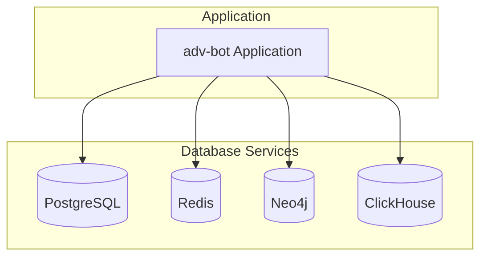
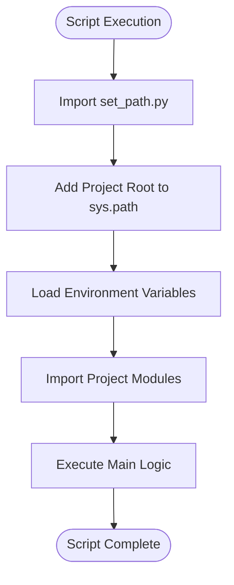

# Development Environment Setup

<cite>
**Referenced Files in This Document**   
- [pyproject.toml](file://pyproject.toml)
- [README.md](file://README.md)
- [scripts/template_script.py](file://scripts/template_script.py)
- [scripts/set_path.py](file://scripts/set_path.py)
- [dockers/Dockerfile](file://dockers/Dockerfile)
- [dockers/neo4j/Dockerfile](file://dockers/neo4j/Dockerfile)
- [app/settings/settings_master.py](file://app/settings/settings_master.py)
- [app/configs/app_config.py](file://app/configs/app_config.py)
- [app/configs/infrastructure_config/infrastructure_config.py](file://app/configs/infrastructure_config/infrastructure_config.py)
- [app/configs/infrastructure_config/neo4j_config.py](file://app/configs/infrastructure_config/neo4j_config.py)
- [app/configs/infrastructure_config/redis_config.py](file://app/configs/infrastructure_config/redis_config.py)
- [app/configs/infrastructure_config/wb_config.py](file://app/configs/infrastructure_config/wb_config.py)
</cite>

## Table of Contents
1. [Python and Poetry Setup](#python-and-poetry-setup)
2. [Dependency Installation](#dependency-installation)
3. [Service Configuration with Docker](#service-configuration-with-docker)
4. [Environment Variables Setup](#environment-variables-setup)
5. [IDE Configuration](#ide-configuration)
6. [Script Execution Context](#script-execution-context)
7. [Troubleshooting Common Issues](#troubleshooting-common-issues)

## Python and Poetry Setup

The adv-bot project requires Python 3.11 for compatibility with all dependencies. The project uses Poetry for dependency management, which ensures consistent package versions across development environments.

To set up the Python environment:
1. Install Python 3.11 from the official Python website or using a version manager like pyenv
2. Verify the installation with `python --version` or `python3 --version`
3. Install Poetry by following the official installation guide at python-poetry.org
4. Confirm Poetry installation with `poetry --version`

The project's `pyproject.toml` file specifies the Python version constraint `>=3.11,<3.12`, ensuring compatibility with Python 3.11 while preventing use of incompatible future versions.

**Section sources**
- [pyproject.toml](file://pyproject.toml#L4-L5)

## Dependency Installation

After setting up Python and Poetry, install the project dependencies using Poetry's virtual environment management.

To install dependencies:
1. Navigate to the project root directory
2. Run `poetry install` to install all dependencies specified in `pyproject.toml`
3. Activate the virtual environment with `poetry shell`

The `pyproject.toml` file contains both main dependencies and development dependencies. Main dependencies include essential packages like aiogram, asyncpg, redis, neo4j, and clickhouse-connect for database interactions. Development dependencies include testing tools (pytest, pytest-asyncio), code quality tools (ruff, mypy), and debugging tools (debugpy).

Poetry creates a virtual environment in the project directory (`.venv`) as specified in the Dockerfile with `POETRY_VIRTUALENVS_IN_PROJECT=true`, ensuring the virtual environment is contained within the project.

**Section sources**
- [pyproject.toml](file://pyproject.toml#L7-L184)
- [dockers/Dockerfile](file://dockers/Dockerfile#L4-L7)

## Service Configuration with Docker

The project requires several services that are configured using Docker. The repository contains Dockerfiles for the main application and Neo4j database, but lacks a docker-compose.yml file for orchestration.

### PostgreSQL Setup
PostgreSQL is used as the primary relational database. Configure it with the following environment variables:
- POSTGRES_HOST: Database host address
- POSTGRES_PORT: Database port (typically 5432)
- POSTGRES_USER: Database username
- POSTGRES_PASSWORD: Database password
- POSTGRES_DBNAME: Database name

### Redis Setup
Redis serves as a caching and message broker service. The configuration is managed through environment variables with the REDIS_ prefix:
- REDIS_MASTER_HOST: Master Redis server host
- REDIS_REPLICA_HOST: Replica Redis server host
- REDIS_PORT: Redis server port (typically 6379)

### Neo4j Setup
Neo4j is configured through a dedicated Dockerfile in the dockers/neo4j directory. The container:
- Uses the neo4j:2025.07.1 base image
- Installs APOC and Graph Data Science plugins
- Exposes ports 7474 (HTTP), 7473 (HTTPS), and 7687 (Bolt)

The Neo4j configuration is defined in `Neo4jConfig` class with environment variables prefixed by NEO4J_.

### ClickHouse Setup
ClickHouse is used for analytics and time-series data storage. Configure it with:
- CLICK_HOUSE_HOST: ClickHouse server host
- CLICK_HOUSE_PORT: ClickHouse server port (typically 8123)
- CLICK_HOUSE_USER: ClickHouse username
- CLICK_HOUSE_PASSWORD: ClickHouse password



**Diagram sources**
- [app/configs/infrastructure_config/neo4j_config.py](file://app/configs/infrastructure_config/neo4j_config.py#L1-L17)
- [app/configs/infrastructure_config/redis_config.py](file://app/configs/infrastructure_config/redis_config.py#L1-L15)
- [app/settings/settings_master.py](file://app/settings/settings_master.py#L134-L178)

**Section sources**
- [dockers/Dockerfile](file://dockers/Dockerfile#L1-L37)
- [dockers/neo4j/Dockerfile](file://dockers/neo4j/Dockerfile#L1-L15)
- [app/settings/settings_master.py](file://app/settings/settings_master.py#L134-L178)

## Environment Variables Setup

The project uses python-dotenv for environment variable management, loading configuration from a .env file.

### Configuration Architecture
The configuration system is hierarchical:
1. `AppConfig` - Main application configuration
2. `InfrastructureConfig` - Container for all infrastructure services
3. Service-specific configs (Neo4jConfig, RedisConfig, WBConfig)

Each configuration class uses Pydantic's BaseSettings with environment file support, automatically loading variables from the .env file.

### Required Environment Variables
Create a .env file in the project root with the following variables:

```env
# PostgreSQL Configuration
POSTGRES_HOST=localhost
POSTGRES_PORT=5432
POSTGRES_USER=advbot
POSTGRES_PASSWORD=your_password
POSTGRES_DBNAME=advbot_db
POSTGRES_SSL_MODE=disable

# Redis Configuration
REDIS_MASTER_HOST=localhost
REDIS_REPLICA_HOST=localhost
REDIS_PORT=6379
REDIS_DB=0

# Neo4j Configuration
NEO4J_URI=bolt://localhost:7687
NEO4J_NAME=neo4j
NEO4J_PASSWORD=your_neo4j_password
NEO4J_PORT=7687

# ClickHouse Configuration
CLICK_HOUSE_HOST=localhost
CLICK_HOUSE_PORT=8123
CLICK_HOUSE_USER=default
CLICK_HOUSE_PASSWORD=your_clickhouse_password

# Application Settings
TELEGRAM_WEB_PORT=8000
CH_MAX_THREAD=10
BIDDER_STEP_RUB=1
```

The configuration system validates required variables and raises ValueError if critical variables are missing, such as TELEGRAM_WEB_PORT or CLICKHOUSE_PORT.

**Section sources**
- [app/configs/app_config.py](file://app/configs/app_config.py#L1-L23)
- [app/configs/infrastructure_config/infrastructure_config.py](file://app/configs/infrastructure_config/infrastructure_config.py#L1-L20)
- [app/settings/settings_master.py](file://app/settings/settings_master.py#L1-L199)

## IDE Configuration

For optimal development experience, configure your IDE with proper interpreter and debugging setup.

### Interpreter Setup
1. Ensure your IDE uses the Poetry-managed virtual environment
2. Set the Python interpreter to the one created by Poetry (typically in .venv/bin/python)
3. Configure the project root as the working directory

### Debugging with debugpy
The project includes debugpy in development dependencies for debugging support. To configure debugging:

1. Install debugpy: `poetry add --group dev debugpy`
2. Configure your IDE to use debugpy for debugging
3. Set breakpoints in your code
4. Run the application in debug mode

For VS Code, create a launch.json configuration:
```json
{
    "version": "0.2.0",
    "configurations": [
        {
            "name": "Python: adv-bot",
            "type": "python",
            "request": "launch",
            "program": "client_bot_run.py",
            "console": "integratedTerminal",
            "envFile": "${workspaceFolder}/.env"
        }
    ]
}
```

Ensure the debugger loads environment variables from the .env file for proper service connectivity during debugging sessions.

**Section sources**
- [pyproject.toml](file://pyproject.toml#L170-L171)

## Script Execution Context

Scripts in the project require proper path configuration to access modules and resources. The scripts directory contains utilities to handle path resolution.

### Path Management
The `set_path.py` module provides functions to configure Python path:
- `add_project_root_to_path()`: Adds project root to sys.path
- `get_project_path(relative_path)`: Gets absolute path from project root

These functions ensure scripts can import modules from the app directory regardless of execution context.

### Template Script Structure
The `template_script.py` provides a standard structure for new scripts:
1. Import path management utilities
2. Add project root to path
3. Load environment variables with python-dotenv
4. Implement main functionality

When creating new scripts, follow this pattern to ensure consistent behavior and proper module resolution.



**Diagram sources**
- [scripts/template_script.py](file://scripts/template_script.py#L1-L45)
- [scripts/set_path.py](file://scripts/set_path.py#L1-L45)

**Section sources**
- [scripts/template_script.py](file://scripts/template_script.py#L1-L45)
- [scripts/set_path.py](file://scripts/set_path.py#L1-L45)

## Troubleshooting Common Issues

### Dependency Conflicts
If encountering dependency conflicts:
1. Clear Poetry cache: `poetry cache clear pypi --all`
2. Remove poetry.lock file and regenerate: `rm poetry.lock && poetry install`
3. Check for version conflicts in pyproject.toml
4. Update Poetry to the latest version

For persistent issues, try creating a fresh virtual environment: `poetry env remove python && poetry install`

### Service Connectivity Problems
When services are unreachable:
1. Verify Docker containers are running: `docker ps`
2. Check service-specific environment variables in .env file
3. Test connectivity with simple scripts
4. Verify port mappings and firewall settings

Common connectivity issues include:
- Incorrect hostnames (use localhost for local development)
- Port conflicts with other services
- Authentication failures due to incorrect passwords
- Network configuration issues in Docker

### Path Configuration Issues
If encountering import errors:
1. Ensure add_project_root_to_path() is called before imports
2. Verify the script is executed from the correct directory
3. Check sys.path contains the project root
4. Use get_project_path() for file operations

For scripts outside the scripts directory, manually add the project root to sys.path or use the path management utilities.

### Configuration Validation
The application validates critical environment variables and raises descriptive errors. When encountering configuration errors:
1. Check the error message for the missing variable
2. Verify the variable exists in .env file
3. Ensure the variable name matches the expected format
4. Restart the application after making changes

Pay special attention to required variables like TELEGRAM_WEB_PORT, CLICKHOUSE_PORT, and REDIS_MASTER_HOST which have validation checks in the Settings class.

**Section sources**
- [app/settings/settings_master.py](file://app/settings/settings_master.py#L1-L199)
- [app/configs/infrastructure_config/neo4j_config.py](file://app/configs/infrastructure_config/neo4j_config.py#L1-L17)
- [app/configs/infrastructure_config/redis_config.py](file://app/configs/infrastructure_config/redis_config.py#L1-L15)