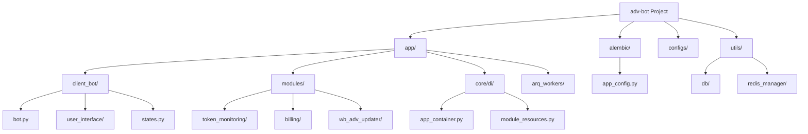
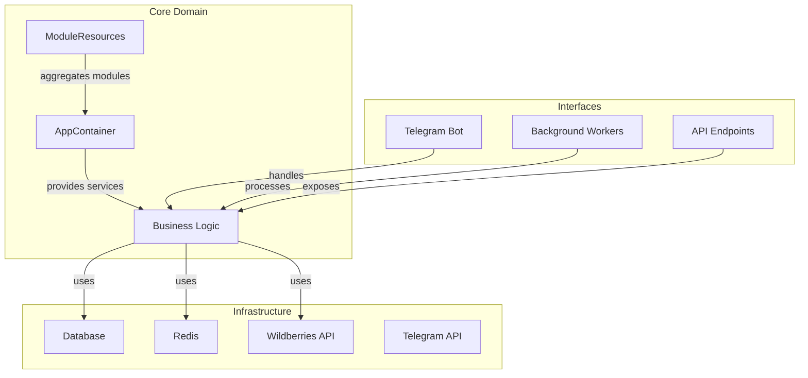
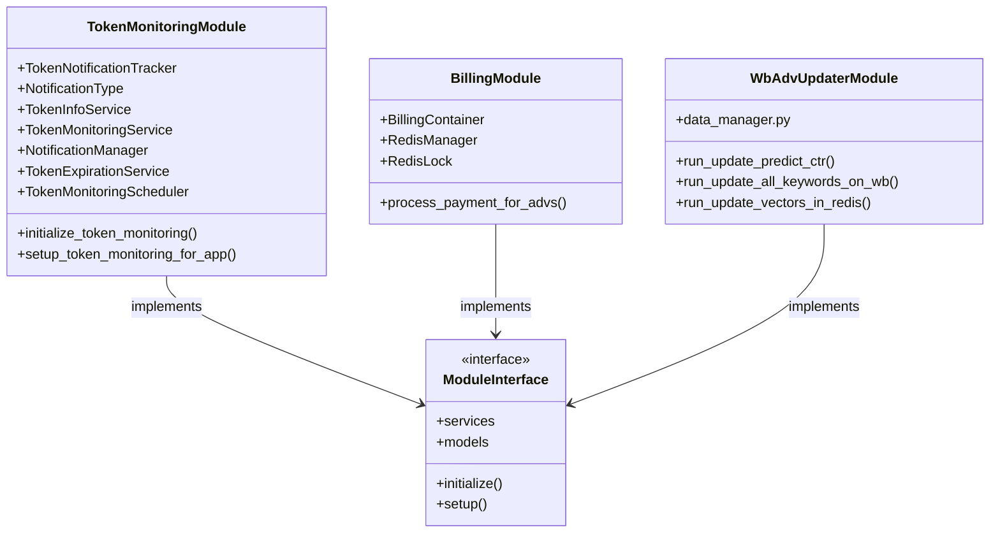
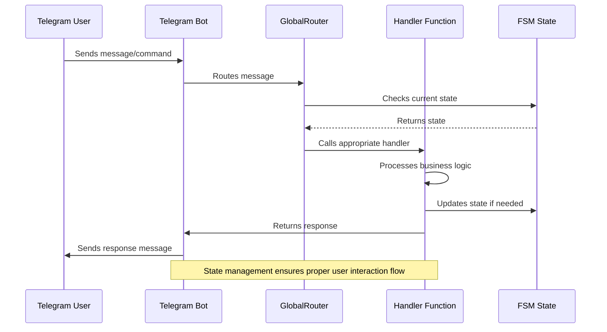
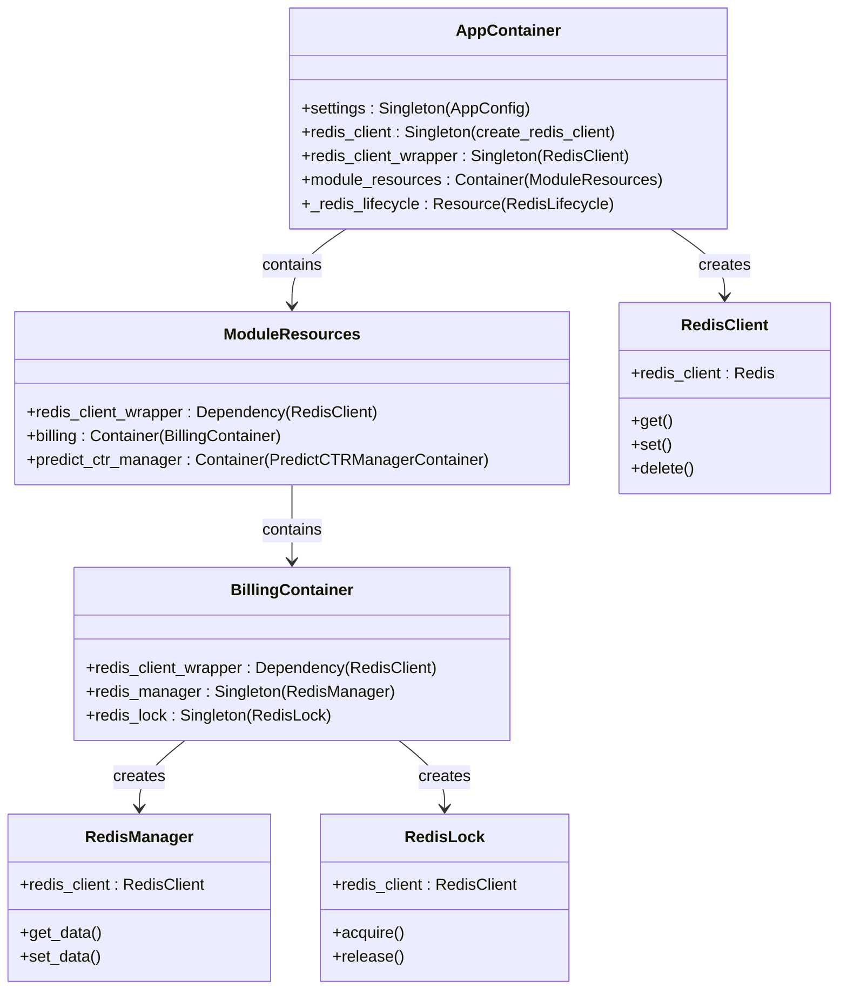
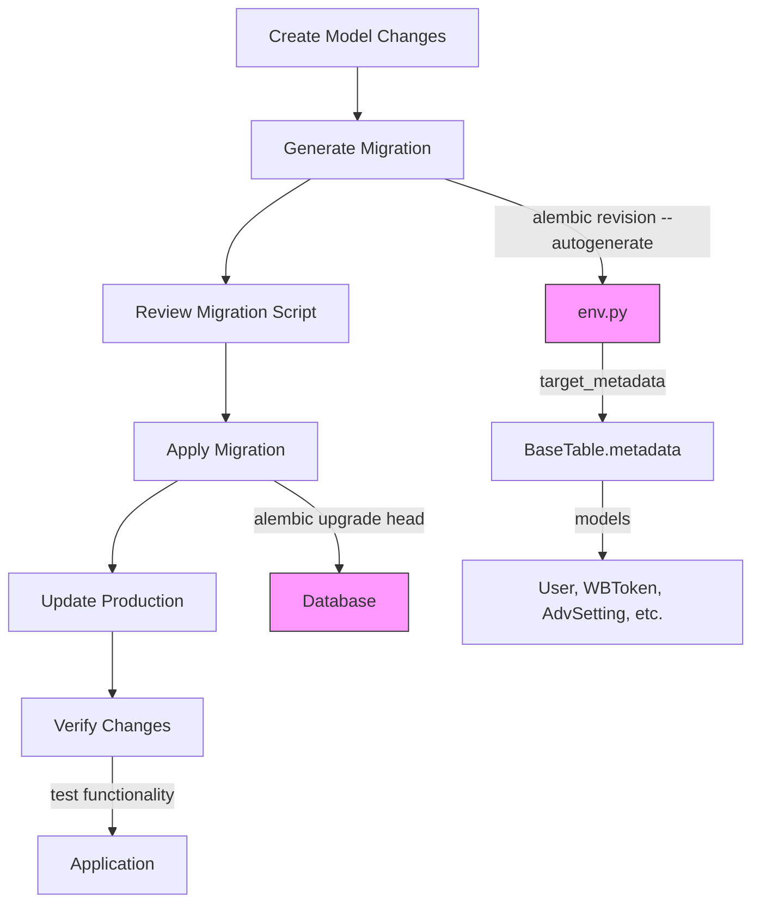
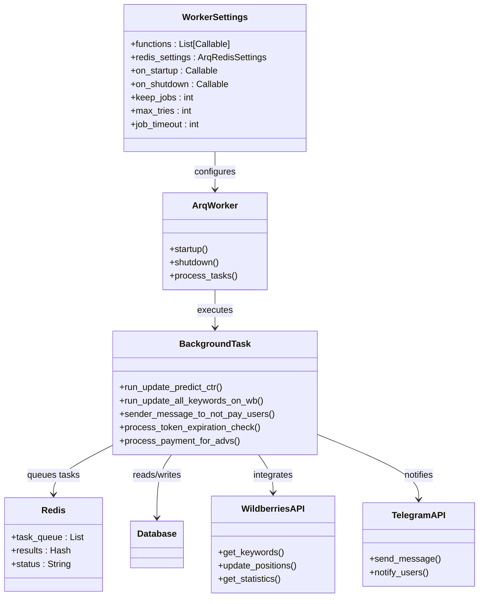
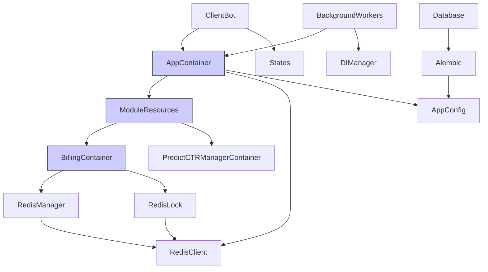

# Feature Development Workflow

<cite>
**Referenced Files in This Document**   
- [app_container.py](file://app/core/di/app_container.py)
- [bot.py](file://app/client_bot/bot.py)
- [states.py](file://app/client_bot/user_interface/states.py)
- [module_resources.py](file://app/core/di/module_resources.py)
- [di.py](file://app/modules/billing/di.py)
- [token_monitoring/__init__.py](file://app/modules/token_monitoring/__init__.py)
- [models.py](file://app/utils/db/models.py)
- [env.py](file://alembic/env.py)
- [workers.py](file://app/arq_workers/workers.py)
- [runner.py](file://app/modules/wb_adv_updater/runner.py)
- [data_manager.py](file://app/modules/wb_adv_updater/data_manager.py)
- [base_adv.py](file://app/core/wb_api/data_classes/advs/base_adv.py)
</cite>

## Table of Contents
1. [Introduction](#introduction)
2. [Project Structure](#project-structure)
3. [Core Components](#core-components)
4. [Architecture Overview](#architecture-overview)
5. [Detailed Component Analysis](#detailed-component-analysis)
6. [Dependency Analysis](#dependency-analysis)
7. [Performance Considerations](#performance-considerations)
8. [Troubleshooting Guide](#troubleshooting-guide)
9. [Conclusion](#conclusion)

## Introduction
This document provides comprehensive guidance for developing new features in the adv-bot project. It covers the modular architecture, dependency injection system, Telegram bot handler implementation, database migration procedures, and best practices for implementing new functionality while adhering to architectural patterns like Hexagonal Architecture and Dependency Injection.

## Project Structure

The adv-bot project follows a modular architecture with clear separation of concerns. The main components are organized into distinct directories:

- **app/**: Core application code
  - **client_bot/**: Telegram bot interface and handlers
  - **modules/**: Feature modules (token_monitoring, billing, wb_adv_updater, etc.)
  - **core/di/**: Dependency injection system
  - **arq_workers/**: Background task workers
- **alembic/**: Database migration system
- **configs/**: Application configuration
- **utils/**: Shared utilities and helpers

**Diagram sources**
- [app_container.py](file://app/core/di/app_container.py)
- [bot.py](file://app/client_bot/bot.py)
- [models.py](file://app/utils/db/models.py)

**Section sources**
- [app_container.py](file://app/core/di/app_container.py#L1-L50)
- [bot.py](file://app/client_bot/bot.py#L1-L16)
- [models.py](file://app/utils/db/models.py#L1-L51)

## Core Components

The adv-bot project is built around several core components that enable its functionality:

1. **Dependency Injection System**: Centralized service management using Dependency Injector
2. **Telegram Bot Interface**: Client interaction through Telegram with state management
3. **Background Workers**: Asynchronous task processing using Arq
4. **Database Migration System**: Schema management using Alembic
5. **Module System**: Feature-based organization with isolated functionality

The system follows Hexagonal Architecture principles, with the core domain logic separated from external concerns like databases, APIs, and user interfaces.

**Section sources**
- [app_container.py](file://app/core/di/app_container.py#L1-L50)
- [workers.py](file://app/arq_workers/workers.py#L1-L51)
- [env.py](file://alembic/env.py#L1-L90)

## Architecture Overview

The adv-bot project implements a modular architecture with dependency injection and separation of concerns. The system is designed around the Hexagonal Architecture pattern, where the core business logic is isolated from external dependencies.

**Diagram sources**
- [app_container.py](file://app/core/di/app_container.py#L1-L50)
- [module_resources.py](file://app/core/di/module_resources.py#L1-L35)
- [runner.py](file://app/modules/wb_adv_updater/runner.py#L1-L145)

## Detailed Component Analysis

### Module Architecture and Creation

The adv-bot project uses a modular architecture where each feature is implemented as a self-contained module. The token_monitoring module serves as an excellent example of the module pattern.

**Diagram sources**
- [token_monitoring/__init__.py](file://app/modules/token_monitoring/__init__.py#L1-L63)
- [di.py](file://app/modules/billing/di.py#L1-L43)
- [runner.py](file://app/modules/wb_adv_updater/runner.py#L1-L145)

**Section sources**
- [token_monitoring/__init__.py](file://app/modules/token_monitoring/__init__.py#L1-L63)
- [di.py](file://app/modules/billing/di.py#L1-L43)

### Telegram Bot Handler Implementation

The client_bot structure handles Telegram interactions with a clear routing and state management system.

**Diagram sources**
- [bot.py](file://app/client_bot/bot.py#L1-L16)
- [states.py](file://app/client_bot/user_interface/states.py#L1-L79)
- [global_router.py](file://app/client_bot/global_router.py)

**Section sources**
- [bot.py](file://app/client_bot/bot.py#L1-L16)
- [states.py](file://app/client_bot/user_interface/states.py#L1-L79)

### Dependency Injection System

The AppContainer class implements a comprehensive dependency injection system using the Dependency Injector library.

**Diagram sources**
- [app_container.py](file://app/core/di/app_container.py#L1-L50)
- [module_resources.py](file://app/core/di/module_resources.py#L1-L35)
- [di.py](file://app/modules/billing/di.py#L1-L43)

**Section sources**
- [app_container.py](file://app/core/di/app_container.py#L1-L50)
- [module_resources.py](file://app/core/di/module_resources.py#L1-L35)
- [di.py](file://app/modules/billing/di.py#L1-L43)

### Database Migration Procedures

The Alembic system manages database schema migrations with version control.

**Diagram sources**
- [env.py](file://alembic/env.py#L1-L90)
- [models.py](file://app/utils/db/models.py#L1-L51)

**Section sources**
- [env.py](file://alembic/env.py#L1-L90)
- [models.py](file://app/utils/db/models.py#L1-L51)

### Background Workers and API Integrations

The arq_workers system handles background processing and API integrations.

**Diagram sources**
- [workers.py](file://app/arq_workers/workers.py#L1-L51)
- [runner.py](file://app/modules/wb_adv_updater/runner.py#L1-L145)
- [data_manager.py](file://app/modules/wb_adv_updater/data_manager.py#L1-L799)

**Section sources**
- [workers.py](file://app/arq_workers/workers.py#L1-L51)
- [runner.py](file://app/modules/wb_adv_updater/runner.py#L1-L145)

## Dependency Analysis

The adv-bot project has a well-defined dependency structure that follows the Dependency Inversion Principle.

**Diagram sources**
- [app_container.py](file://app/core/di/app_container.py#L1-L50)
- [module_resources.py](file://app/core/di/module_resources.py#L1-L35)
- [di.py](file://app/modules/billing/di.py#L1-L43)

**Section sources**
- [app_container.py](file://app/core/di/app_container.py#L1-L50)
- [module_resources.py](file://app/core/di/module_resources.py#L1-L35)
- [di.py](file://app/modules/billing/di.py#L1-L43)

## Performance Considerations

The system is designed with performance in mind, using caching, background processing, and efficient database queries.

Key performance considerations:
- Redis caching for frequently accessed data
- Background workers for long-running tasks
- Database connection pooling
- Efficient query patterns with proper indexing
- Asynchronous processing throughout the system

The DI system ensures that services are properly instantiated and reused, minimizing resource overhead.

## Troubleshooting Guide

Common issues and their solutions:

1. **Dependency Injection Issues**: Ensure all dependencies are properly registered in the AppContainer and ModuleResources
2. **Database Migration Conflicts**: Use alembic revision --autogenerate carefully and review generated scripts
3. **State Management Problems**: Verify state transitions in the client_bot handlers
4. **Background Worker Failures**: Check Redis connection and task queue status
5. **API Integration Errors**: Validate API credentials and rate limiting

**Section sources**
- [app_container.py](file://app/core/di/app_container.py#L1-L50)
- [env.py](file://alembic/env.py#L1-L90)
- [workers.py](file://app/arq_workers/workers.py#L1-L51)

## Conclusion

The adv-bot project provides a robust foundation for feature development with its modular architecture, dependency injection system, and clear separation of concerns. By following the patterns demonstrated in existing modules like token_monitoring and billing, developers can create new features that integrate seamlessly with the existing system. The combination of Hexagonal Architecture and Dependency Injection ensures that the codebase remains maintainable and testable as it grows.