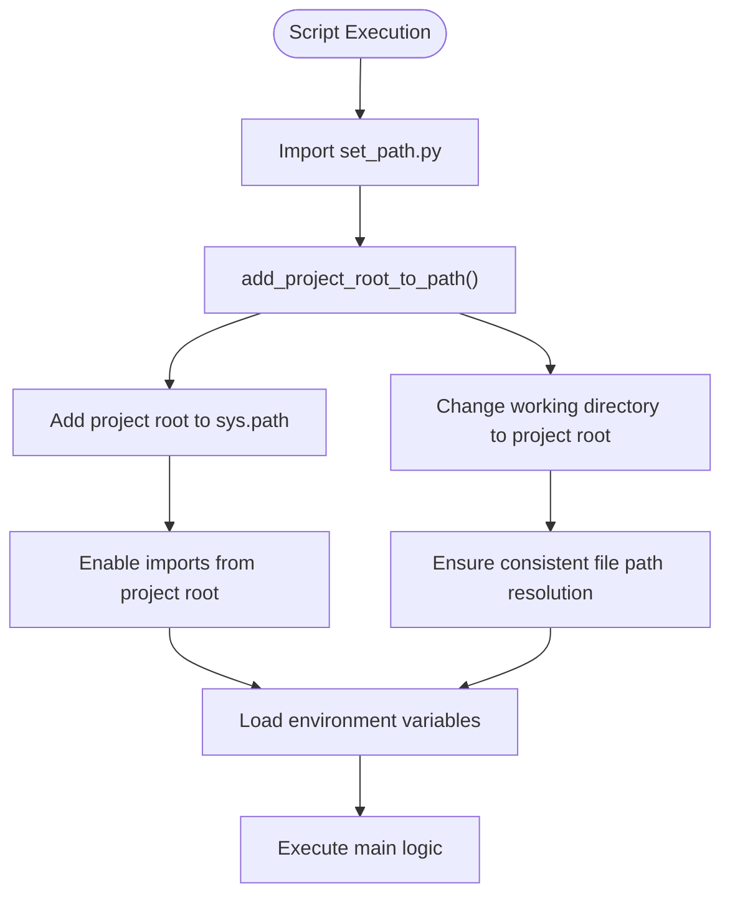
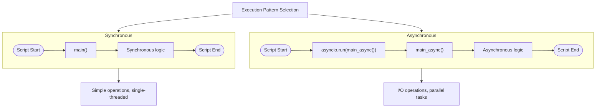
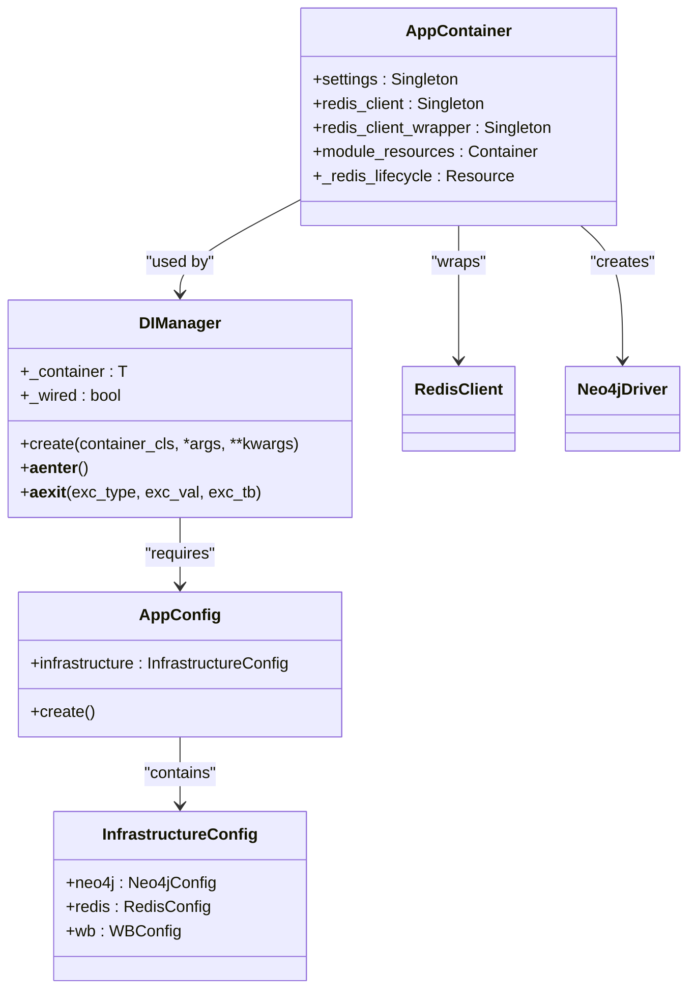

# Script Creation Guidelines

<cite>
**Referenced Files in This Document**   
- [template_script.py](file://scripts/template_script.py)
- [set_path.py](file://scripts/set_path.py)
- [find_keyword_positions.py](file://scripts/find_keyword_positions.py)
- [set_relevant_if_white_phrase.py](file://scripts/set_relevant_if_white_phrase.py)
- [set_shop_id_for_all_wbtokens.py](file://scripts/set_shop_id_for_all_wbtokens.py)
- [test_path.py](file://scripts/test_path.py)
- [README.md](file://scripts/README.md)
- [app_container.py](file://app/core/di/app_container.py)
- [di_manager.py](file://app/core/di/di_manager.py)
- [app_config.py](file://app/configs/app_config.py)
</cite>

## Table of Contents
1. [Introduction](#introduction)
2. [Project Structure and Script Location](#project-structure-and-script-location)
3. [Path Configuration and Environment Setup](#path-configuration-and-environment-setup)
4. [Script Execution Patterns](#script-execution-patterns)
5. [Common Script Types](#common-script-types)
6. [Best Practices for Script Development](#best-practices-for-script-development)
7. [Leveraging Project Components in Scripts](#leveraging-project-components-in-scripts)
8. [Script Testing and Validation](#script-testing-and-validation)
9. [Conclusion](#conclusion)

## Introduction
This document provides comprehensive guidelines for creating new scripts within the adv-bot project. It covers the established patterns for script structure, path configuration, environment loading, and execution patterns. The documentation explains how to properly use the template_script.py as a reference for new script development, ensuring consistency across the codebase. It also details the purpose of set_path.py in resolving project root paths and enabling consistent imports across different execution contexts.

**Section sources**
- [template_script.py](file://scripts/template_script.py)
- [README.md](file://scripts/README.md)

## Project Structure and Script Location
The adv-bot project organizes standalone scripts in the `scripts/` directory at the project root. This directory contains various utility scripts that can be executed independently of the main application. The scripts directory includes examples of different script types, including data migration scripts, diagnostic tools, and batch processing utilities. Each script in this directory follows a consistent pattern for path configuration and environment setup, ensuring they can be executed from different contexts while maintaining access to project resources and modules.

**Section sources**
- [template_script.py](file://scripts/template_script.py)
- [set_path.py](file://scripts/set_path.py)

## Path Configuration and Environment Setup
The set_path.py module is essential for resolving project root paths and ensuring consistent imports across different execution contexts. This module provides two key functions: `add_project_root_to_path()` and `get_project_path()`. The `add_project_root_to_path()` function adds the project root to Python's sys.path, allowing scripts to import modules from the project root regardless of the current working directory. It also changes the current working directory to the project root, ensuring consistent file path resolution. The `get_project_path()` function enables scripts to obtain absolute paths to files relative to the project root, which is particularly useful for accessing configuration files and data resources.

**Diagram sources**
- [set_path.py](file://scripts/set_path.py#L1-L45)
- [template_script.py](file://scripts/template_script.py#L1-L45)

**Section sources**
- [set_path.py](file://scripts/set_path.py#L1-L45)
- [template_script.py](file://scripts/template_script.py#L1-L45)
- [test_path.py](file://scripts/test_path.py#L1-L69)

## Script Execution Patterns
The adv-bot project supports both synchronous and asynchronous script execution patterns. Synchronous scripts use a simple function call pattern in the main block, while asynchronous scripts leverage Python's asyncio library. The template_script.py demonstrates both patterns, with commented code showing how to use asyncio.run() for asynchronous execution. Scripts that perform I/O operations, such as database queries or API calls, typically use the asynchronous pattern to improve performance. The find_keyword_positions.py script is an example of an asynchronous script that uses aiohttp for HTTP requests to Wildberries search API. In contrast, simpler scripts like set_relevant_if_white_phrase.py use synchronous execution for straightforward database operations.

**Diagram sources**
- [template_script.py](file://scripts/template_script.py#L1-L45)
- [find_keyword_positions.py](file://scripts/find_keyword_positions.py#L1-L225)
- [set_relevant_if_white_phrase.py](file://scripts/set_relevant_if_white_phrase.py#L1-L22)

**Section sources**
- [template_script.py](file://scripts/template_script.py#L1-L45)
- [find_keyword_positions.py](file://scripts/find_keyword_positions.py#L1-L225)
- [set_relevant_if_white_phrase.py](file://scripts/set_relevant_if_white_phrase.py#L1-L22)

## Common Script Types
The adv-bot project includes several common types of scripts, each serving a specific purpose. Data migration scripts, such as set_shop_id_for_all_wbtokens.py, update database records and ensure data consistency across the system. These scripts typically use SQLAlchemy for database operations and follow a pattern of retrieving data, processing it, and committing changes. Batch processing scripts, like the keyword position finder, perform operations on large datasets or execute periodic tasks. Diagnostic tools, exemplified by test_path.py, verify system configuration and help troubleshoot issues. The find_keyword_positions.py script demonstrates a specialized utility that queries external APIs to gather information about product placements on Wildberries.

**Section sources**
- [set_shop_id_for_all_wbtokens.py](file://scripts/set_shop_id_for_all_wbtokens.py#L1-L65)
- [find_keyword_positions.py](file://scripts/find_keyword_positions.py#L1-L225)
- [test_path.py](file://scripts/test_path.py#L1-L69)

## Best Practices for Script Development
When creating new scripts for the adv-bot project, several best practices should be followed. First, always use template_script.py as a starting point to ensure consistent structure and path configuration. Include proper error handling to manage exceptions gracefully, particularly when dealing with external services or database operations. Use argparse for script arguments to provide a clear interface and support for command-line options, as demonstrated in find_keyword_positions.py. Implement logging to track script execution and aid in debugging. For scripts that modify data, include confirmation prompts or dry-run modes when appropriate. Follow the principle of single responsibility, ensuring each script performs one specific task well. Finally, include comprehensive docstrings and comments to explain the script's purpose and functionality.

**Section sources**
- [template_script.py](file://scripts/template_script.py#L1-L45)
- [find_keyword_positions.py](file://scripts/find_keyword_positions.py#L1-L225)
- [set_shop_id_for_all_wbtokens.py](file://scripts/set_shop_id_for_all_wbtokens.py#L1-L65)

## Leveraging Project Components in Scripts
Standalone scripts can leverage existing project components such as the DI container and database connections. The DI (Dependency Injection) system, implemented through the AppContainer in app_container.py, allows scripts to access configured services and resources. Scripts can use the DIManager to initialize the container and inject dependencies, providing access to Redis, Neo4j, and other configured services. Database connections are managed through the session_maker module, which provides async session factories for SQLAlchemy operations. Configuration is handled through the AppConfig class, which loads settings from environment variables and configuration files. This integration allows scripts to reuse the same infrastructure components as the main application, ensuring consistency and reducing code duplication.

**Diagram sources**
- [app_container.py](file://app/core/di/app_container.py#L1-L50)
- [di_manager.py](file://app/core/di/di_manager.py#L1-L32)
- [app_config.py](file://app/configs/app_config.py#L1-L23)

**Section sources**
- [app_container.py](file://app/core/di/app_container.py#L1-L50)
- [di_manager.py](file://app/core/di/di_manager.py#L1-L32)
- [app_config.py](file://app/configs/app_config.py#L1-L23)

## Script Testing and Validation
Testing and validation are critical aspects of script development in the adv-bot project. The test_path.py script serves as a diagnostic tool to verify path configuration and import resolution, ensuring that scripts can access required modules and files. When creating new scripts, it's essential to test them in different execution contexts (from the scripts directory and from the project root) to confirm that path resolution works correctly. Unit tests should be created for complex logic, while integration tests can verify interactions with databases and external services. The project's existing scripts demonstrate various testing approaches, from simple print statements for debugging to structured error handling and result reporting. For scripts that modify data, testing should include verification of the expected changes and rollback procedures in case of errors.

**Section sources**
- [test_path.py](file://scripts/test_path.py#L1-L69)
- [set_shop_id_for_all_wbtokens.py](file://scripts/set_shop_id_for_all_wbtokens.py#L1-L65)

## Conclusion
Creating new scripts for the adv-bot project requires following established patterns for path configuration, environment loading, and execution. By using template_script.py as a reference, developers can ensure consistency across the codebase. The set_path.py module plays a crucial role in resolving project root paths and enabling consistent imports across different execution contexts. Understanding the difference between synchronous and asynchronous execution patterns allows developers to choose the appropriate approach based on the script's requirements. Leveraging existing project components through the DI container and database connections promotes code reuse and maintains system consistency. Following best practices for arguments, error handling, and logging results in robust, maintainable scripts that integrate seamlessly with the adv-bot ecosystem.