# Testing Practices

<cite>
**Referenced Files in This Document**   
- [pytest.ini](file://pytest.ini)
- [conftest.py](file://conftest.py)
- [conftest_token_tests.py](file://tests/conftest_token_tests.py)
- [test_circular_imports.py](file://tests/test_circular_imports.py)
- [run_circular_imports_test.py](file://tests/run_circular_imports_test.py)
- [test_billing.py](file://tests/modules/billing/test_billing.py)
- [test_billing_parallel.py](file://tests/modules/billing/test_billing_parallel.py)
- [test_token_monitoring_service.py](file://tests/token_monitoring/test_token_monitoring_service.py)
- [test_shop_menu_token_loading.py](file://tests/modules/shop_menu/test_shop_menu_token_loading.py)
- [test_runner_token_integration.py](file://tests/modules/wb_adv_updater/test_runner_token_integration.py)
- [test_runner_token_integration_isolated.py](file://tests/modules/wb_adv_updater/test_runner_token_integration_isolated.py)
- [test_entry_points_integration.py](file://tests/tests_entry_points/test_entry_points_integration.py)
- [test_updater.py](file://tests/tests_entry_points/test_updater.py)
</cite>

## Table of Contents
1. [Introduction](#introduction)
2. [Project Structure](#project-structure)
3. [Core Components](#core-components)
4. [Architecture Overview](#architecture-overview)
5. [Detailed Component Analysis](#detailed-component-analysis)
6. [Dependency Analysis](#dependency-analysis)
7. [Performance Considerations](#performance-considerations)
8. [Troubleshooting Guide](#troubleshooting-guide)
9. [Conclusion](#conclusion)
10. [Appendices](#appendices)

## Introduction
The adv-bot project implements a comprehensive testing strategy to ensure code quality, maintainability, and reliability. This document details the testing practices employed throughout the codebase, focusing on pytest configuration, test organization, fixture management, and various testing methodologies. The testing framework supports unit, integration, and end-to-end testing with specialized markers for different test types. The project emphasizes clean architecture through circular import detection and employs sophisticated mocking strategies for external dependencies like the Wildberries API and Redis. The test suite covers both synchronous and asynchronous code, with particular attention to complex business logic and critical workflows.

## Project Structure
The tests directory is organized to mirror the application's modular structure while maintaining clear separation between different types of tests. The main tests directory contains subdirectories for core functionality, modules, and entry points, with additional specialized test files at the root level. This organization allows for targeted testing of specific components while maintaining an overview of the entire system's behavior.

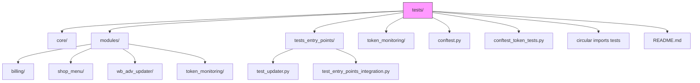

**Diagram sources**
- [pytest.ini](file://pytest.ini)
- [conftest.py](file://conftest.py)

**Section sources**
- [pytest.ini](file://pytest.ini)
- [conftest.py](file://conftest.py)

## Core Components
The testing framework in the adv-bot project is built around several core components that work together to provide comprehensive test coverage. These include pytest configuration with custom markers, shared fixtures in conftest.py, specialized test files for circular import detection, and integration tests for entry points. The framework supports both unit and integration testing with appropriate mocking strategies for external dependencies. The test suite is designed to handle asynchronous code through pytest-asyncio and includes specialized tests for critical workflows and business logic.

**Section sources**
- [pytest.ini](file://pytest.ini)
- [conftest.py](file://conftest.py)
- [test_circular_imports.py](file://tests/test_circular_imports.py)

## Architecture Overview
The testing architecture in the adv-bot project follows a layered approach with clear separation between different types of tests. At the foundation is the pytest configuration, which defines markers and test discovery rules. Above this layer are the shared fixtures and configuration in conftest.py, which provide consistent test setup across the codebase. The next layer consists of unit tests that verify isolated components, followed by integration tests that validate interactions between modules. At the top level are end-to-end tests that verify critical workflows and system entry points.

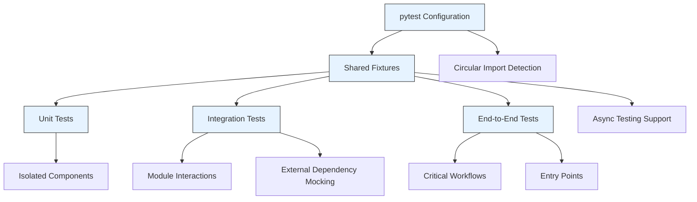

**Diagram sources**
- [pytest.ini](file://pytest.ini)
- [conftest.py](file://conftest.py)
- [test_circular_imports.py](file://tests/test_circular_imports.py)

## Detailed Component Analysis

### Pytest Configuration and Markers
The pytest configuration in the adv-bot project is defined in pytest.ini and includes several custom markers to categorize different types of tests. The configuration specifies test discovery paths, file patterns, and command-line options to ensure consistent test execution. The markers enable selective test execution based on type, which is particularly useful for running fast unit tests during development and more comprehensive integration tests in CI/CD pipelines.

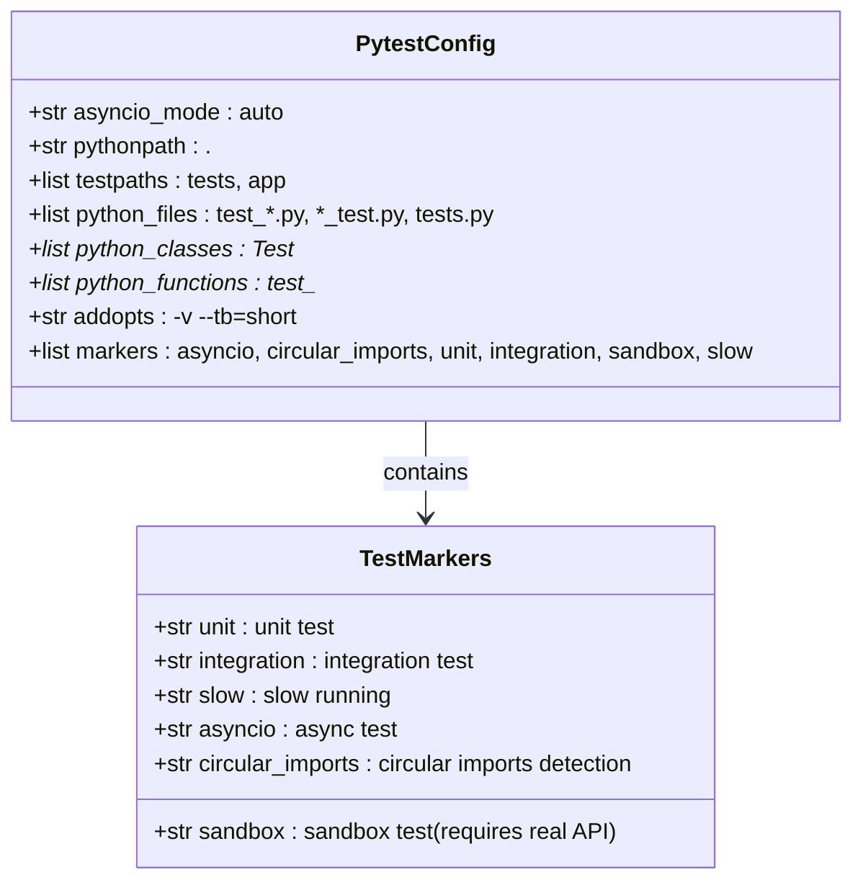

**Diagram sources**
- [pytest.ini](file://pytest.ini)

**Section sources**
- [pytest.ini](file://pytest.ini)

### Conftest.py and Test Fixtures
The conftest.py file serves as the central location for shared test configuration and fixtures in the adv-bot project. It defines environment variables to prevent import errors during test collection and provides mock objects for database models and services. The file includes fixtures for common test dependencies such as tokens, cabinet access, and session objects, which can be reused across multiple test files. This approach promotes consistency and reduces duplication in test setup code.

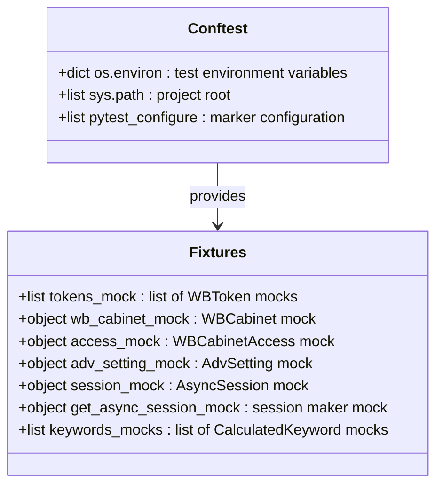

**Diagram sources**
- [conftest.py](file://conftest.py)

**Section sources**
- [conftest.py](file://conftest.py)

### Unit Testing Strategies
Unit tests in the adv-bot project focus on isolated components and verify their behavior in controlled environments. These tests use mocking to replace external dependencies and ensure that each test only evaluates the functionality of a single component. The billing module provides an example of unit testing with test_billing.py, which verifies the logic for processing cabinet payments under various conditions such as sufficient funds, insufficient funds, and zero pricing.

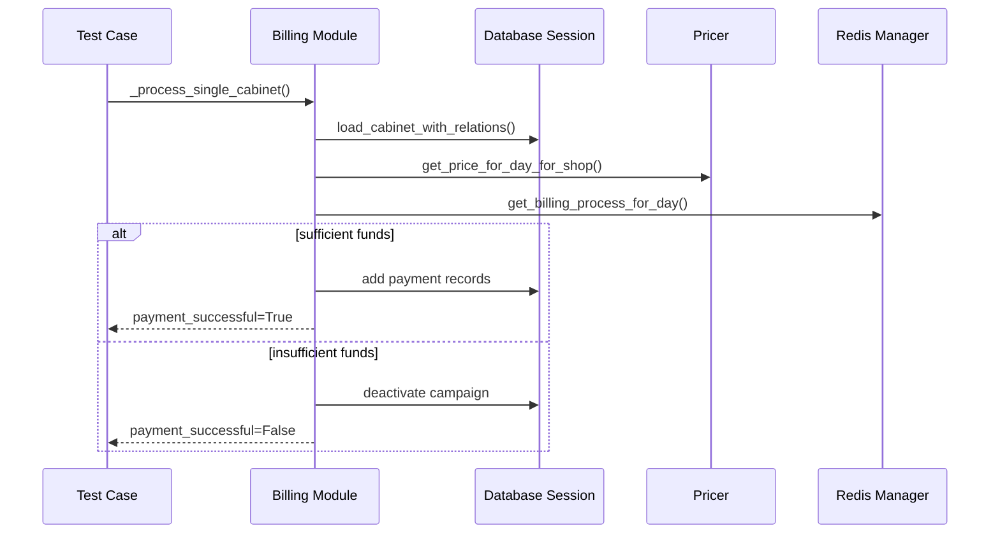

**Diagram sources**
- [test_billing.py](file://tests/modules/billing/test_billing.py)

**Section sources**
- [test_billing.py](file://tests/modules/billing/test_billing.py)

### Integration Testing
Integration tests in the adv-bot project verify the interactions between multiple components and modules. These tests ensure that different parts of the system work together as expected and that data flows correctly between components. The test_entry_points_integration.py file contains integration tests that verify the importability and basic functionality of all entry points, ensuring that the application can start without errors.

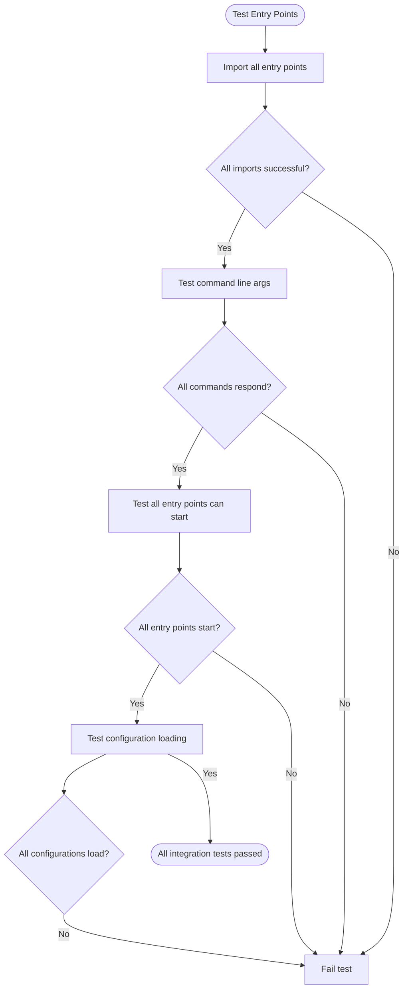

**Diagram sources**
- [test_entry_points_integration.py](file://tests/tests_entry_points/test_entry_points_integration.py)

**Section sources**
- [test_entry_points_integration.py](file://tests/tests_entry_points/test_entry_points_integration.py)

### End-to-End Testing
End-to-end tests in the adv-bot project verify critical workflows and ensure that the system functions correctly from start to finish. These tests often involve multiple modules and simulate real user interactions or system processes. The test_shop_menu_token_loading.py file contains end-to-end tests that verify the ShopMenu component correctly loads token status information and displays it in the user interface.

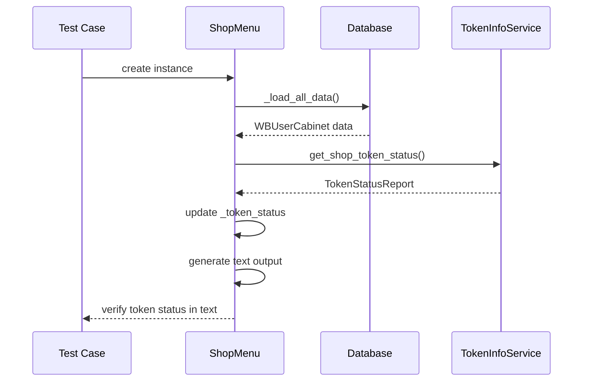

**Diagram sources**
- [test_shop_menu_token_loading.py](file://tests/modules/shop_menu/test_shop_menu_token_loading.py)

**Section sources**
- [test_shop_menu_token_loading.py](file://tests/modules/shop_menu/test_shop_menu_token_loading.py)

### Testing Async Code with pytest-asyncio
The adv-bot project extensively uses asynchronous code, and the test suite is designed to handle this through pytest-asyncio. Tests that involve async functions are marked with the @pytest.mark.asyncio decorator, allowing them to use await syntax within the test body. The framework uses AsyncMock objects to mock async methods and coroutines, ensuring that asynchronous behavior can be properly tested and verified.

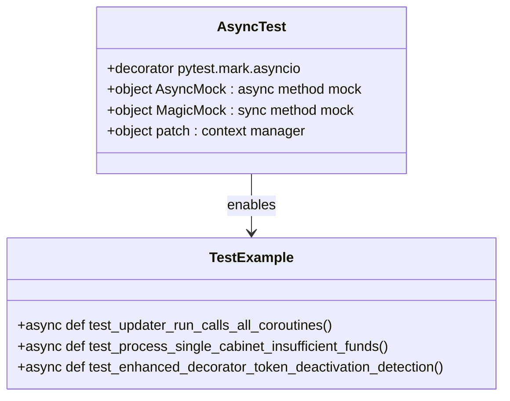

**Diagram sources**
- [test_updater.py](file://tests/tests_entry_points/test_updater.py)
- [test_billing.py](file://tests/modules/billing/test_billing.py)
- [test_token_monitoring_service.py](file://tests/token_monitoring/test_token_monitoring_service.py)

**Section sources**
- [test_updater.py](file://tests/tests_entry_points/test_updater.py)
- [test_billing.py](file://tests/modules/billing/test_billing.py)
- [test_token_monitoring_service.py](file://tests/token_monitoring/test_token_monitoring_service.py)

### Circular Imports Detection
The adv-bot project includes a specialized test for detecting circular imports, which helps maintain a clean and modular architecture. The test_circular_imports.py file uses the pycycle tool to analyze entry points and detect any circular dependencies between modules. This test is crucial for preventing architectural degradation and ensuring that the codebase remains maintainable as it grows.

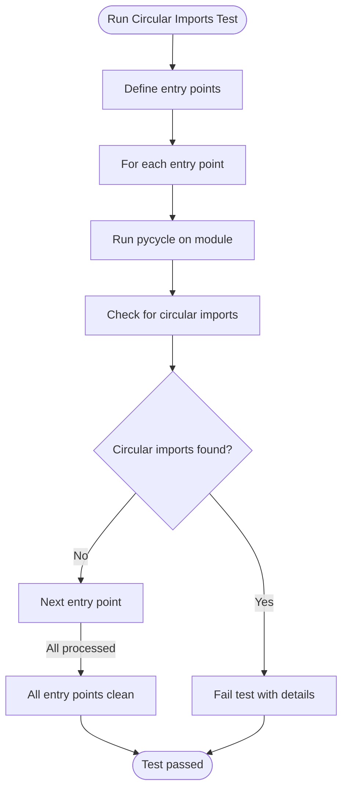

**Diagram sources**
- [test_circular_imports.py](file://tests/test_circular_imports.py)
- [run_circular_imports_test.py](file://tests/run_circular_imports_test.py)

**Section sources**
- [test_circular_imports.py](file://tests/test_circular_imports.py)
- [run_circular_imports_test.py](file://tests/run_circular_imports_test.py)

### Mocking External Dependencies
The adv-bot project employs sophisticated mocking strategies to isolate tests from external dependencies such as the Wildberries API and Redis. The conftest.py file provides mock objects for these dependencies, and specific test files use patch decorators to replace real implementations with mocks. This approach allows tests to run reliably without requiring access to external services and enables testing of error conditions that would be difficult to reproduce with real dependencies.

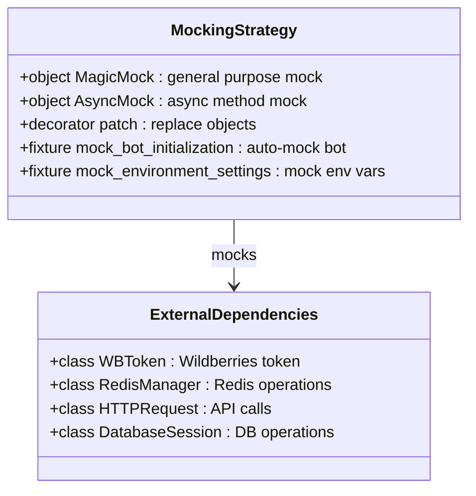

**Diagram sources**
- [conftest.py](file://conftest.py)
- [conftest_token_tests.py](file://tests/conftest_token_tests.py)

**Section sources**
- [conftest.py](file://conftest.py)
- [conftest_token_tests.py](file://tests/conftest_token_tests.py)

### Test Data Management
Test data management in the adv-bot project involves creating mock objects with realistic data to simulate various scenarios. The test_billing.py file demonstrates this approach by creating mock cabinets with different balance and bonus amounts to test payment processing under various conditions. The test_shop_menu_token_loading.py file uses sample token status reports to verify that the ShopMenu component correctly displays token information to users.

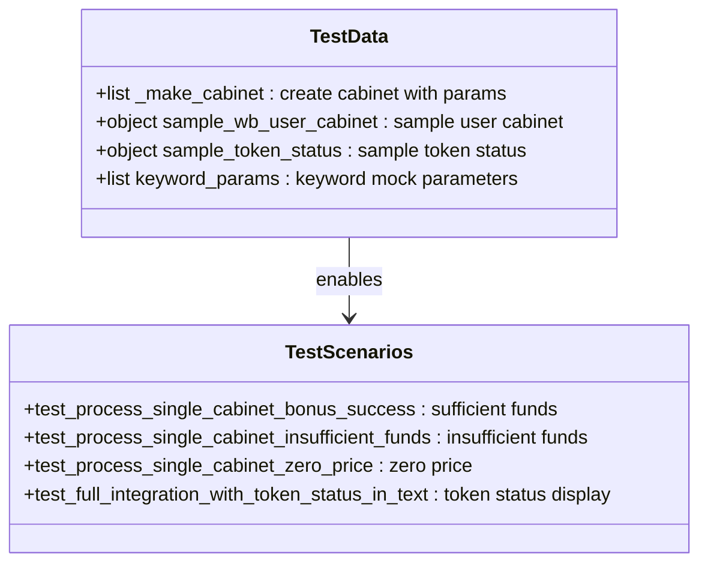

**Diagram sources**
- [test_billing.py](file://tests/modules/billing/test_billing.py)
- [test_shop_menu_token_loading.py](file://tests/modules/shop_menu/test_shop_menu_token_loading.py)

**Section sources**
- [test_billing.py](file://tests/modules/billing/test_billing.py)
- [test_shop_menu_token_loading.py](file://tests/modules/shop_menu/test_shop_menu_token_loading.py)

### Performance Testing
Performance testing in the adv-bot project focuses on critical workflows and system entry points to ensure they can handle expected loads. The test_entry_points_integration.py file includes tests that verify entry points can start without errors, which indirectly tests their performance by ensuring they don't hang or timeout. The framework also includes slow markers for tests that take longer to execute, allowing them to be selectively run in appropriate environments.

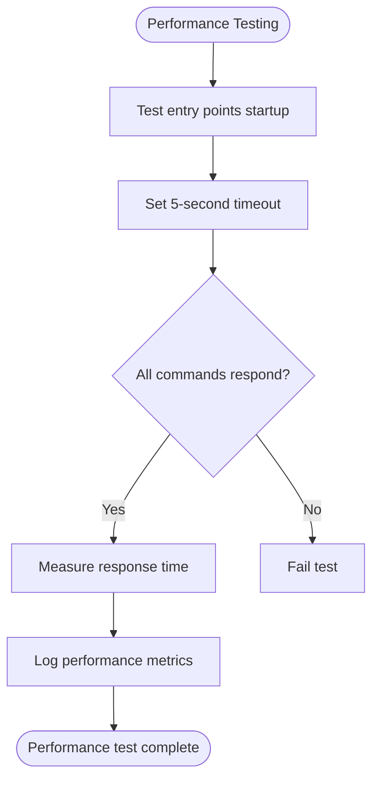

**Diagram sources**
- [test_entry_points_integration.py](file://tests/tests_entry_points/test_entry_points_integration.py)

**Section sources**
- [test_entry_points_integration.py](file://tests/tests_entry_points/test_entry_points_integration.py)

### Testing Complex Business Logic
The adv-bot project includes comprehensive tests for complex business logic, particularly in modules like billing and token monitoring. The test_billing.py file verifies the logic for processing daily charges for advertising campaigns, including scenarios with sufficient funds, insufficient funds, and zero pricing. The test_token_monitoring_service.py file tests the logic for detecting token deactivation and sending notifications, which is critical for maintaining service reliability.

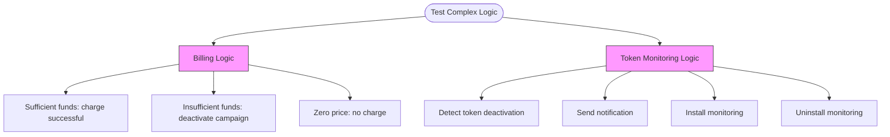

**Diagram sources**
- [test_billing.py](file://tests/modules/billing/test_billing.py)
- [test_token_monitoring_service.py](file://tests/token_monitoring/test_token_monitoring_service.py)

**Section sources**
- [test_billing.py](file://tests/modules/billing/test_billing.py)
- [test_token_monitoring_service.py](file://tests/token_monitoring/test_token_monitoring_service.py)

## Dependency Analysis
The testing framework in the adv-bot project has a well-defined dependency structure that enables comprehensive test coverage while maintaining isolation between test types. The core dependencies include pytest for test discovery and execution, pytest-asyncio for handling asynchronous code, and unittest.mock for creating mock objects. The test suite also depends on external tools like pycycle for detecting circular imports, which helps maintain architectural integrity.

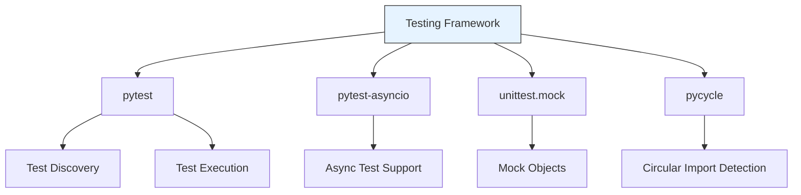

**Diagram sources**
- [pytest.ini](file://pytest.ini)
- [conftest.py](file://conftest.py)
- [test_circular_imports.py](file://tests/test_circular_imports.py)

**Section sources**
- [pytest.ini](file://pytest.ini)
- [conftest.py](file://conftest.py)
- [test_circular_imports.py](file://tests/test_circular_imports.py)

## Performance Considerations
The testing practices in the adv-bot project consider performance through the use of markers to categorize slow-running tests and by optimizing test execution through parallelization. The framework avoids unnecessary I/O operations by using mocks for external dependencies and minimizes test setup time through shared fixtures in conftest.py. The circular import detection test runs as a separate process to avoid interfering with other tests, ensuring that the overall test suite remains efficient.

[No sources needed since this section provides general guidance]

## Troubleshooting Guide
When troubleshooting test failures in the adv-bot project, start by identifying the test type and its dependencies. For unit test failures, verify that the mock objects are correctly configured and that the test is properly isolated from external dependencies. For integration test failures, check that all required services are available and that the test environment variables are correctly set. For circular import detection failures, examine the import statements in the affected modules and refactor to eliminate circular dependencies.

**Section sources**
- [test_circular_imports.py](file://tests/test_circular_imports.py)
- [conftest.py](file://conftest.py)
- [test_entry_points_integration.py](file://tests/tests_entry_points/test_entry_points_integration.py)

## Conclusion
The adv-bot project demonstrates a comprehensive and well-structured approach to testing that ensures code quality and maintainability. The testing framework combines unit, integration, and end-to-end tests with specialized tools for detecting architectural issues like circular imports. The use of pytest with custom markers and shared fixtures enables efficient test organization and execution, while sophisticated mocking strategies allow for reliable testing of complex business logic. The framework's support for asynchronous code and its focus on critical workflows ensure that the application remains robust and reliable in production environments.

[No sources needed since this section summarizes without analyzing specific files]