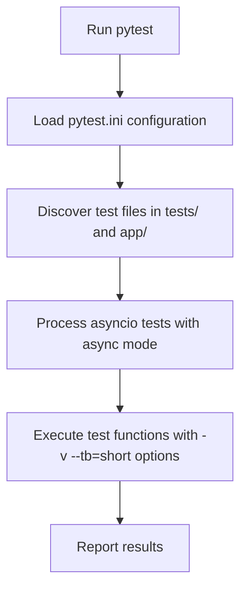

# Development Guide

<cite>
**Referenced Files in This Document**   
- [requirements.txt](file://requirements.txt)
- [pytest.ini](file://pytest.ini)
- [client_bot_run.py](file://client_bot_run.py)
- [app/client_bot/bot.py](file://app/client_bot/bot.py)
- [app/settings/settings_master.py](file://app/settings/settings_master.py)
- [app/arq_workers/workers.py](file://app/arq_workers/workers.py)
- [tests/tests_entry_points/test_client_bot.py](file://tests/tests_entry_points/test_client_bot.py)
</cite>

## Table of Contents
1. [Environment Setup](#environment-setup)
2. [Running the Application](#running-the-application)
3. [Testing Strategy](#testing-strategy)
4. [Contributing Guidelines](#contributing-guidelines)
5. [Development Practices](#development-practices)
6. [Common Development Issues](#common-development-issues)
7. [Advanced Topics](#advanced-topics)

## Environment Setup

To contribute to the adv-bot codebase, set up your development environment with the following requirements:

### Python Version
The project requires Python 3.9 or higher. Verify your Python version with:
```bash
python --version
```

### Dependency Installation
Install project dependencies using pip from the requirements file:
```bash
pip install -r requirements.txt
```

The requirements.txt file contains all necessary packages including:
- aiogram==3.4.1 for Telegram bot functionality
- SQLAlchemy==2.0.28 for database operations
- redis==5.1.0b4 for Redis caching
- alembic==1.13.1 for database migrations
- pytest==8.0.2 for testing
- fastapi==0.110.0 and uvicorn for API services
- clickhouse-connect==0.7.18 for ClickHouse integration

### Service Configuration
Configure the following services by setting environment variables in a .env file:

**PostgreSQL Configuration**
```
POSTGRES_MASTER_HOST=localhost
POSTGRES_REPLICA_HOST=localhost
POSTGRES_USER=your_username
POSTGRES_PASSWORD=your_password
POSTGRES_DBNAME=adv_bot
POSTGRES_PORT=5432
POSTGRES_SSL_MODE=disable
```

**Redis Configuration**
```
REDIS_MASTER_HOST=localhost
REDIS_REPLICA_HOST=localhost
```

**ClickHouse Configuration**
```
CLICK_HOUSE_HOST=localhost
CLICK_HOUSE_USER=default
CLICK_HOUSE_PASSWORD=your_password
CLICKHOUSE_PORT=8123
```

**Telegram Bot Configuration**
```
TELEGRAM_BOT_TOKEN=your_bot_token
WEBHOOK_URL=https://your-domain.com
WEBHOOK_PATH=/webhook
POLLING_MODE=false
```

The settings are managed through the Settings class in app/settings/settings_master.py, which retrieves values from environment variables with appropriate type conversion and defaults.

**Section sources**
- [requirements.txt](file://requirements.txt)
- [app/settings/settings_master.py](file://app/settings/settings_master.py)

## Running the Application

### Local Development
Run the client bot application using the main entry point:

```bash
python client_bot_run.py
```

The application supports two operational modes controlled by the POLLING_MODE environment variable:

**Webhook Mode (Default)**
When POLLING_MODE=false, the application runs as a FastAPI server that receives updates via webhook:
```python
# In webhook mode, FastAPI handles incoming updates
uvicorn.run(app, host="0.0.0.0", port=8080)
```

**Polling Mode**
When POLLING_MODE=true, the bot uses long polling to receive updates directly from Telegram:
```python
await dp.start_polling(bot)
```

The client_bot_run.py file implements a FastAPI application with health check endpoints and proper lifecycle management through the lifespan context manager.

### Running Background Workers
The application uses Arq for background task processing. Start the worker with:
```bash
arq app.arq_workers.workers.WorkerSettings
```

The worker configuration in app/arq_workers/workers.py sets up:
- Redis connection via arq_redis_settings
- Bot instance initialization in startup
- Proper cleanup in shutdown
- Task functions like create_complex_advs
- Job retention and retry policies

### Running Database Migrations
Apply database migrations using Alembic:
```bash
alembic upgrade head
```

Migration scripts are located in the alembic/versions directory and manage schema changes for the PostgreSQL database.

**Section sources**
- [client_bot_run.py](file://client_bot_run.py)
- [app/arq_workers/workers.py](file://app/arq_workers/workers.py)
- [app/client_bot/bot.py](file://app/client_bot/bot.py)

## Testing Strategy

### PyTest Configuration
The project uses PyTest with the following configuration in pytest.ini:

```ini
[pytest]
asyncio_mode = auto
pythonpath = .
testpaths = tests app
python_files = test_*.py *_test.py tests.py
python_classes = Test*
python_functions = test_*
addopts = -v --tb=short
norecursedirs = tests/tests_entry_points
asyncio_default_fixture_loop_scope = function
markers =
    asyncio: mark test as async
    circular_imports: tests for circular imports detection
```

Key configuration options:
- asyncio_mode = auto: Enables async test support
- testpaths: Specifies where to look for tests
- addopts: Sets default command-line options
- asyncio_default_fixture_loop_scope: Controls event loop scope

### Test Structure
Tests are organized in the tests/ directory with:
- Integration tests in tests_entry_points/
- Unit tests in unit/
- Specialized test scripts for specific concerns

### Example Test Cases
The test_client_bot.py file demonstrates testing patterns for the bot application:

```python
@pytest.mark.asyncio
async def test_client_bot_setup_registers_all_handlers():
    """
    Test verifies that setup_bot registers all necessary handlers
    """
    bot_mock = MagicMock(spec=Bot)
    dp_mock = MagicMock(spec=Dispatcher)
    dp_mock.message.register = MagicMock()
    dp_mock.callback_query.register = MagicMock()
    
    setup_bot(bot_mock, dp_mock)
    
    assert dp_mock.message.register.call_count >= 1
    assert dp_mock.callback_query.register.call_count >= 1
```

This test uses mocking to verify that the bot setup process correctly registers message and callback query handlers without making actual API calls.

### Running Tests
Execute tests with:
```bash
pytest
```

Or run specific test files:
```bash
pytest tests/tests_entry_points/test_client_bot.py
```

The configuration supports async tests and provides verbose output with short tracebacks.

**Diagram sources**


**Section sources**
- [pytest.ini](file://pytest.ini)
- [tests/tests_entry_points/test_client_bot.py](file://tests/tests_entry_points/test_client_bot.py)

## Contributing Guidelines

### Code Style
Follow PEP 8 guidelines for Python code style with the following project-specific rules:

- Use 4 spaces for indentation
- Limit line length to 88 characters
- Use descriptive variable and function names
- Include type hints for all function parameters and return values
- Write comprehensive docstrings using Google style

Example of proper code style:
```python
def get_bot() -> Bot:
    """Create and return a Bot instance with configured token.
    
    Returns:
        Configured Bot instance for Telegram API communication
    """
    return bot
```

### Commit Message Conventions
Use conventional commit messages with the following format:
```
<type>(<scope>): <subject>
```

Allowed types:
- feat: A new feature
- fix: A bug fix
- docs: Documentation changes
- style: Code style changes (formatting, etc.)
- refactor: Code refactoring
- test: Adding missing tests
- chore: Maintenance tasks

Example commit messages:
```
feat(client_bot): add webhook secret token validation
fix(settings): correct type conversion for boolean values
refactor(arq_workers): improve worker startup sequence
```

### Pull Request Workflow
1. Create a feature branch from main
2. Implement your changes with proper tests
3. Ensure all tests pass locally
4. Push your branch and create a pull request
5. Request review from team members
6. Address feedback and make necessary changes
7. Merge after approval

Include in your pull request:
- Description of changes and motivation
- Related issue number if applicable
- Screenshots for UI changes
- Performance impact analysis if relevant

**Section sources**
- [app/client_bot/bot.py](file://app/client_bot/bot.py)
- [app/settings/settings_master.py](file://app/settings/settings_master.py)

## Development Practices

### Writing New Handlers
To create new Telegram bot handlers:

1. Create a new module in app/client_bot/user_interface/handlers/
2. Import necessary dependencies and define handler functions
3. Register handlers with the router

Example handler structure:
```python
# In app/client_bot/user_interface/handlers/new_feature.py
from aiogram import Router, types

router = Router()

@router.message(lambda m: m.text == "New Feature")
async def new_feature_handler(message: types.Message):
    await message.answer("New feature response")
```

Register the handler in the appropriate router:
```python
# In app/client_bot/global_router.py
from .user_interface.handlers.new_feature import router as new_feature_router

main_router.include_router(new_feature_router)
```

### Adding Database Migrations
Create new database migrations using Alembic:

1. Generate a new migration file:
```bash
alembic revision -m "add_new_column_to_table"
```

2. Edit the generated file in alembic/versions/ to define the migration:

```python
def upgrade():
    op.add_column('table_name', sa.Column('new_column', sa.String()))

def downgrade():
    op.drop_column('table_name', 'new_column')
```

3. Apply the migration:
```bash
alembic upgrade head
```

### Creating Background Workers
To add new background workers:

1. Define the async task function:
```python
# In app/modules/new_module/tasks.py
async def process_data(ctx: dict[str, Any]):
    """Process data in the background."""
    bot = ctx["bot"]
    client_session = ctx["client_session"]
    # Implementation here
```

2. Register the task in the worker settings:
```python
# In app/arq_workers/workers.py
from app.modules.new_module.tasks import process_data

class WorkerSettings:
    functions = [
        create_complex_advs,
        process_data,  # Add new function
    ]
    # Other settings...
```

**Section sources**
- [app/arq_workers/workers.py](file://app/arq_workers/workers.py)
- [app/client_bot/bot.py](file://app/client_bot/bot.py)

## Common Development Issues

### Circular Imports
Circular imports can occur when modules depend on each other. To detect and prevent circular imports:

1. Use the provided test script:
```bash
python tests/run_circular_imports_test.py
```

2. Follow these prevention strategies:
- Use lazy imports inside functions when possible
- Restructure code to eliminate circular dependencies
- Use abstract base classes to break direct dependencies
- Move shared dependencies to a separate module

The test_circular_imports.py file contains utilities to detect circular import issues during development.

### Async Debugging
Debugging async code requires special considerations:

**Common Issues:**
- Forgetting to await coroutines
- Mixing sync and async code improperly
- Event loop conflicts
- Resource cleanup in async contexts

**Debugging Techniques:**
1. Use async-aware debugging tools
2. Add logging at key points in async functions
3. Use pytest-asyncio for testing async code
4. Be careful with shared state in async contexts

Example debugging pattern:
```python
async def problematic_function():
    logger.debug("Entering problematic_function")
    try:
        result = await some_async_operation()
        logger.debug("Operation completed successfully")
        return result
    except Exception as e:
        logger.error(f"Error in problematic_function: {e}", exc_info=True)
        raise
```

**Section sources**
- [tests/test_circular_imports.py](file://tests/test_circular_imports.py)
- [client_bot_run.py](file://client_bot_run.py)

## Advanced Topics

### Writing Integration Tests
Create integration tests that verify multiple components work together:

1. Use the tests_entry_points directory for integration tests
2. Mock external services while testing internal integration
3. Test complete workflows from input to output

Example integration test structure:
```python
@pytest.mark.asyncio
async def test_complete_bot_workflow():
    """Test the complete bot interaction workflow."""
    # Setup mocks and test data
    bot_mock = MagicMock()
    dp_mock = MagicMock()
    
    # Execute the workflow
    setup_bot(bot_mock, dp_mock)
    
    # Verify integration points
    assert len(dp_mock.message.handlers) > 0
    assert dp_mock.startup.register.called
```

### Performance Benchmarking
Monitor and improve application performance:

1. Use profiling tools to identify bottlenecks
2. Monitor database query performance
3. Optimize async operations for concurrency
4. Cache frequently accessed data

Key performance metrics to monitor:
- Request handling time
- Database query duration
- Memory usage
- Event loop blocking time

The application settings provide configuration options for performance tuning:
- COUNT_SEMAPHORE_TO_POSTGRES: Limits concurrent database connections
- MAX_THREAD_PARSER: Controls parsing thread count
- CH_MAX_THREAD: Sets ClickHouse thread limit

**Section sources**
- [pytest.ini](file://pytest.ini)
- [app/settings/settings_master.py](file://app/settings/settings_master.py)
- [tests/tests_entry_points/test_client_bot.py](file://tests/tests_entry_points/test_client_bot.py)