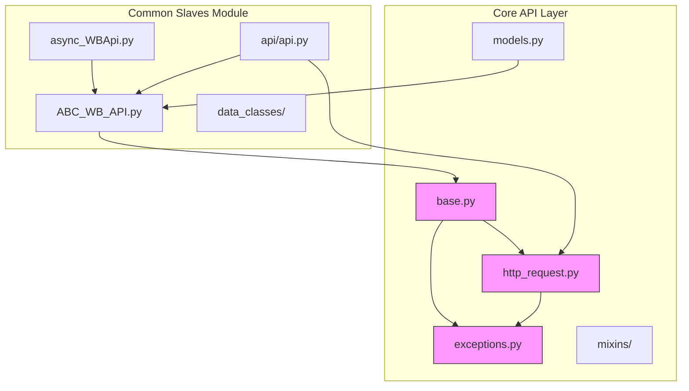
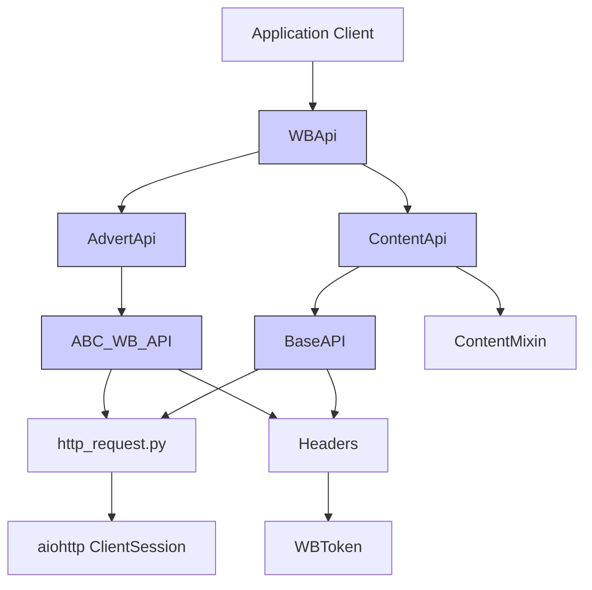
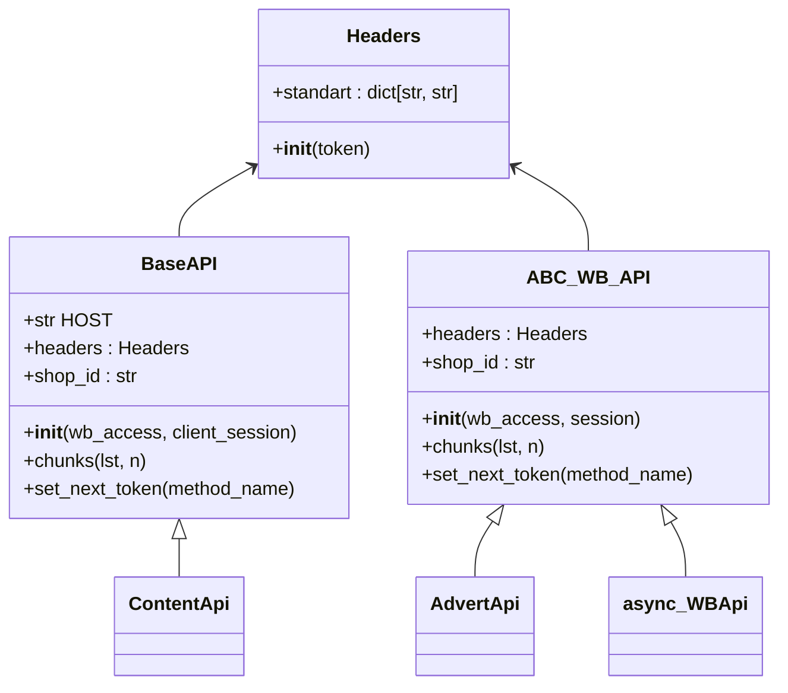
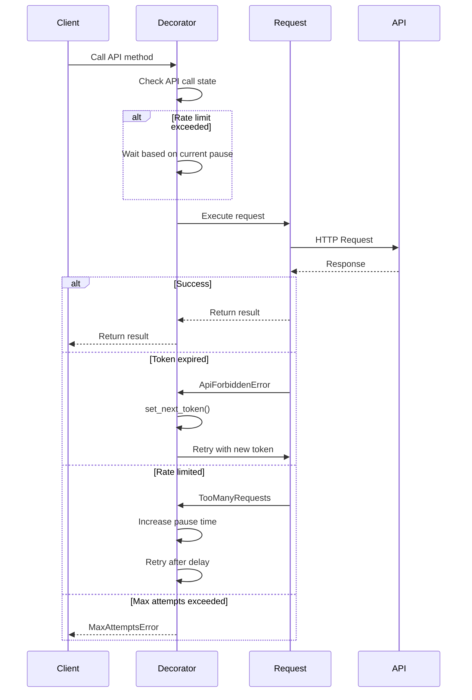
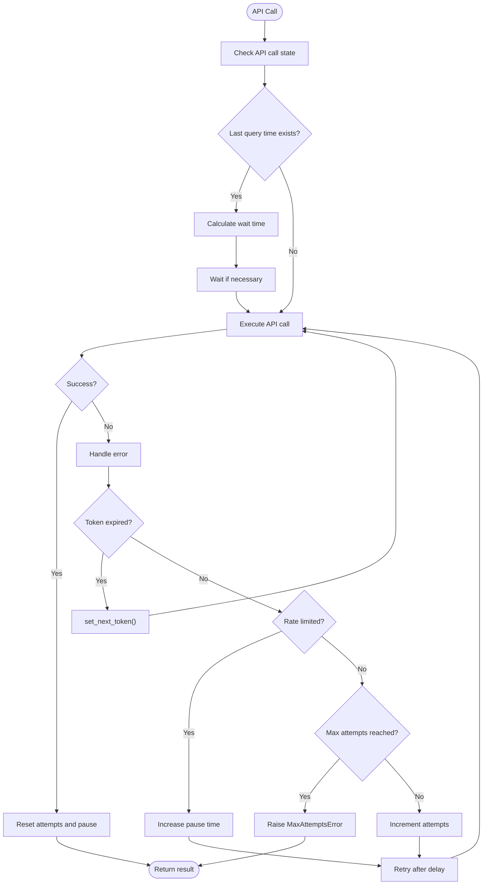
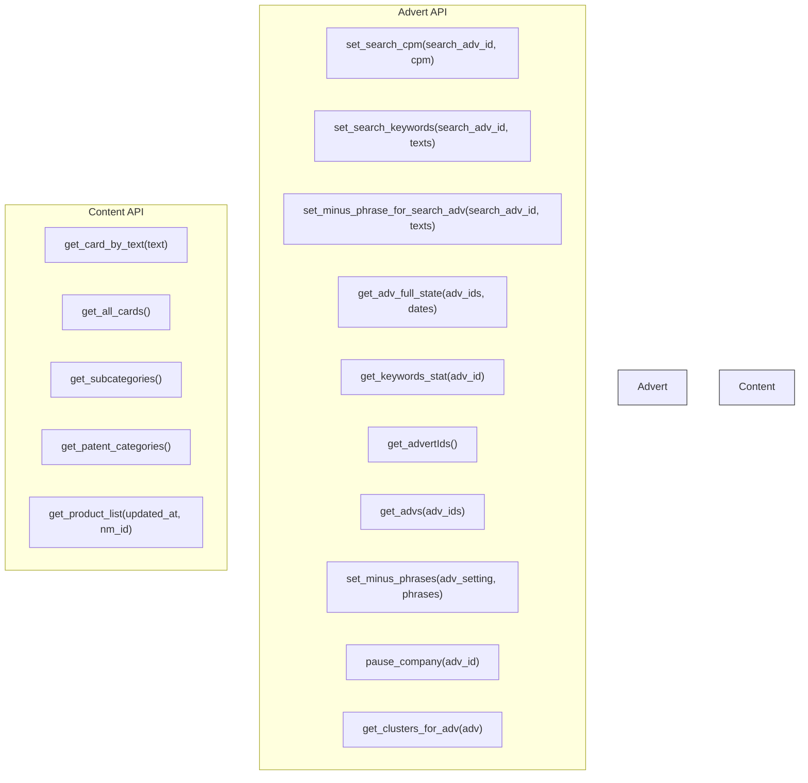
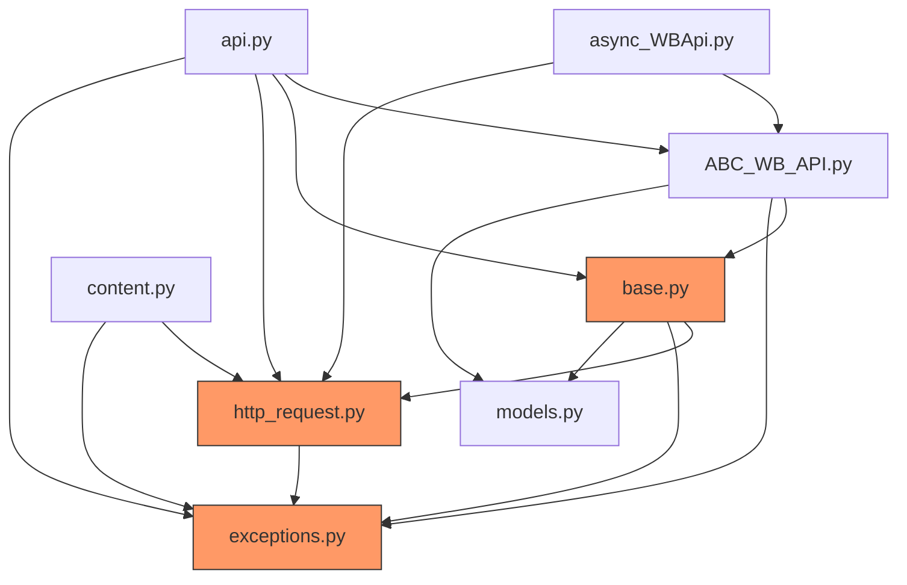

# External API Integration

<cite>
**Referenced Files in This Document**   
- [base.py](file://app/core/wb_api/base.py)
- [async_WBApi.py](file://app/modules/common_slaves/wildberries/async_WBApi.py)
- [http_request.py](file://app/core/wb_api/http_request.py)
- [exceptions.py](file://app/core/wb_api/exceptions.py)
- [ABC_WB_API.py](file://app/modules/common_slaves/wildberries/ABC_WB_API.py)
- [api.py](file://app/modules/common_slaves/wildberries/api/api.py)
- [content.py](file://app/core/wb_api/mixins/content.py)
- [models.py](file://app/core/wb_api/models.py)
</cite>

## Table of Contents
1. [Introduction](#introduction)
2. [Project Structure](#project-structure)
3. [Core Components](#core-components)
4. [Architecture Overview](#architecture-overview)
5. [Detailed Component Analysis](#detailed-component-analysis)
6. [Dependency Analysis](#dependency-analysis)
7. [Performance Considerations](#performance-considerations)
8. [Troubleshooting Guide](#troubleshooting-guide)
9. [Conclusion](#conclusion)

## Introduction
This document provides comprehensive API documentation for the Wildberries API integration layer within the advertising automation system. The integration layer abstracts HTTP interactions with Wildberries' advertising and content APIs, providing a resilient, token-aware client with robust error handling, retry mechanisms, and circuit breaker patterns. The system supports campaign management, keyword data retrieval, and performance statistics for advertising campaigns. This documentation covers the abstraction patterns, request/response handling, authentication with WBTokens, rate limiting, error recovery, retry mechanisms, supported endpoints, usage examples, and extension guidelines.

## Project Structure
The Wildberries API integration is organized across multiple modules with clear separation of concerns. The core functionality resides in the `app/core/wb_api` and `app/modules/common_slaves/wildberries` directories, with base classes, HTTP request handling, data models, and API clients distributed across these locations.

**Diagram sources**
- [base.py](file://app/core/wb_api/base.py)
- [http_request.py](file://app/core/wb_api/http_request.py)
- [ABC_WB_API.py](file://app/modules/common_slaves/wildberries/ABC_WB_API.py)
- [async_WBApi.py](file://app/modules/common_slaves/wildberries/async_WBApi.py)
- [api.py](file://app/modules/common_slaves/wildberries/api/api.py)
- [exceptions.py](file://app/core/wb_api/exceptions.py)
- [models.py](file://app/core/wb_api/models.py)

**Section sources**
- [base.py](file://app/core/wb_api/base.py)
- [async_WBApi.py](file://app/modules/common_slaves/wildberries/async_WBApi.py)
- [http_request.py](file://app/core/wb_api/http_request.py)

## Core Components
The Wildberries API integration consists of several core components that work together to provide a robust interface to Wildberries' advertising and content APIs. The system is built around an abstraction layer that encapsulates HTTP interactions, handles authentication with WBTokens, implements rate limiting and error recovery, and provides retry mechanisms and circuit breaker patterns for resilience. The integration supports a comprehensive set of endpoints for campaign management, keyword data retrieval, and performance statistics.

**Section sources**
- [base.py](file://app/core/wb_api/base.py)
- [async_WBApi.py](file://app/modules/common_slaves/wildberries/async_WBApi.py)
- [http_request.py](file://app/core/wb_api/http_request.py)
- [ABC_WB_API.py](file://app/modules/common_slaves/wildberries/ABC_WB_API.py)

## Architecture Overview
The Wildberries API integration follows a layered architecture with clear separation between HTTP request handling, API abstraction, and business logic. The system uses a decorator-based approach for retry mechanisms and error handling, with token management and rate limiting built into the core API classes.

**Diagram sources**
- [api.py](file://app/modules/common_slaves/wildberries/api/api.py)
- [ABC_WB_API.py](file://app/modules/common_slaves/wildberries/ABC_WB_API.py)
- [base.py](file://app/core/wb_api/base.py)
- [http_request.py](file://app/core/wb_api/http_request.py)

## Detailed Component Analysis

### API Abstraction Pattern
The Wildberries API integration uses a dual abstraction pattern with both `BaseAPI` and `ABC_WB_API` classes providing similar functionality. This represents a known architectural issue with duplicated base classes that should be refactored.

**Diagram sources**
- [base.py](file://app/core/wb_api/base.py)
- [ABC_WB_API.py](file://app/modules/common_slaves/wildberries/ABC_WB_API.py)
- [http_request.py](file://app/core/wb_api/http_request.py)

**Section sources**
- [base.py](file://app/core/wb_api/base.py)
- [ABC_WB_API.py](file://app/modules/common_slaves/wildberries/ABC_WB_API.py)

### Request/Response Handling
The request/response handling is centralized in `http_request.py` with a decorator-based approach for retry mechanisms and error handling. The `try_except_decorator` implements adaptive retry logic with exponential backoff.

**Diagram sources**
- [http_request.py](file://app/core/wb_api/http_request.py)
- [base.py](file://app/core/wb_api/base.py)

**Section sources**
- [http_request.py](file://app/core/wb_api/http_request.py)

### Retry Mechanisms and Circuit Breaker Patterns
The integration implements a sophisticated retry mechanism with adaptive rate limiting and token rotation. When API rate limits are encountered, the system implements exponential backoff with a maximum delay.

**Diagram sources**
- [http_request.py](file://app/core/wb_api/http_request.py)

**Section sources**
- [http_request.py](file://app/core/wb_api/http_request.py)

### Supported Endpoints
The integration supports a comprehensive set of endpoints for campaign management, keyword data, and performance statistics through the `AdvertApi` and `ContentApi` classes.

**Diagram sources**
- [api.py](file://app/modules/common_slaves/wildberries/api/api.py)

**Section sources**
- [api.py](file://app/modules/common_slaves/wildberries/api/api.py)

## Dependency Analysis
The Wildberries API integration has a complex dependency structure with multiple layers of abstraction and potential circular dependencies between the core and common slaves modules.

**Diagram sources**
- [base.py](file://app/core/wb_api/base.py)
- [http_request.py](file://app/core/wb_api/http_request.py)
- [exceptions.py](file://app/core/wb_api/exceptions.py)
- [ABC_WB_API.py](file://app/modules/common_slaves/wildberries/ABC_WB_API.py)
- [async_WBApi.py](file://app/modules/common_slaves/wildberries/async_WBApi.py)
- [api.py](file://app/modules/common_slaves/wildberries/api/api.py)
- [content.py](file://app/core/wb_api/mixins/content.py)
- [models.py](file://app/core/wb_api/models.py)

## Performance Considerations
The Wildberries API integration includes several performance optimizations including request batching, adaptive rate limiting, and token rotation. The system batches requests to stay within API rate limits and uses exponential backoff when rate limits are exceeded. The `chunks` method is used to batch requests for multiple items, and the adaptive rate limiting adjusts pause times based on API response patterns.

**Section sources**
- [http_request.py](file://app/core/wb_api/http_request.py)
- [base.py](file://app/core/wb_api/base.py)

## Troubleshooting Guide
Common issues with the Wildberries API integration include token expiration, rate limiting, and authentication errors. The system handles token expiration by rotating to the next available token in the `WBCabinetAccess`. When all tokens are exhausted, the associated cabinet is deactivated. Rate limiting is handled with exponential backoff, and the system adapts pause times based on API response patterns.

**Section sources**
- [base.py](file://app/core/wb_api/base.py)
- [ABC_WB_API.py](file://app/modules/common_slaves/wildberries/ABC_WB_API.py)
- [http_request.py](file://app/core/wb_api/http_request.py)
- [exceptions.py](file://app/core/wb_api/exceptions.py)

## Conclusion
The Wildberries API integration provides a comprehensive, resilient interface to Wildberries' advertising and content APIs. The system uses a decorator-based approach for retry mechanisms and error handling, with token management and rate limiting built into the core API classes. While there is a known architectural issue with duplicated base classes (`BaseAPI` and `ABC_WB_API`), the overall design provides a robust foundation for interacting with Wildberries' APIs. The integration supports a comprehensive set of endpoints for campaign management, keyword data retrieval, and performance statistics, with sophisticated error recovery and resilience patterns.