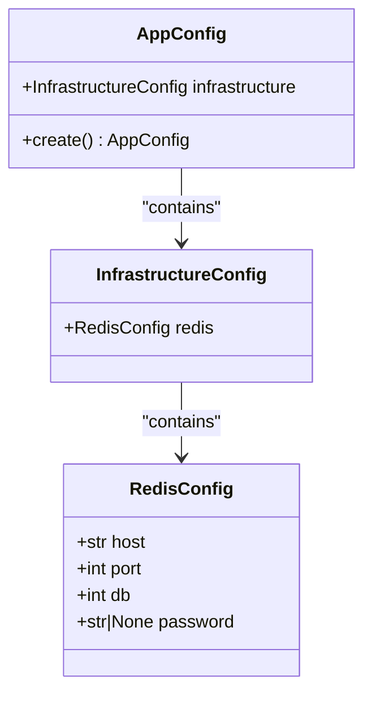
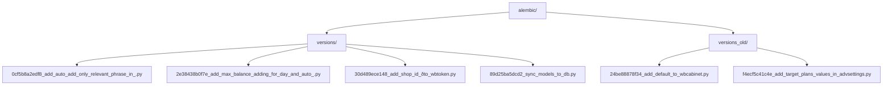
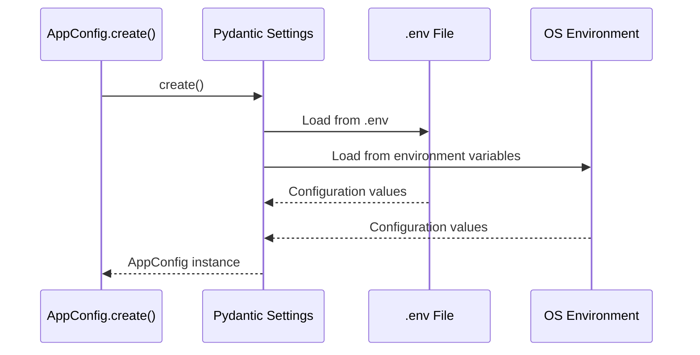
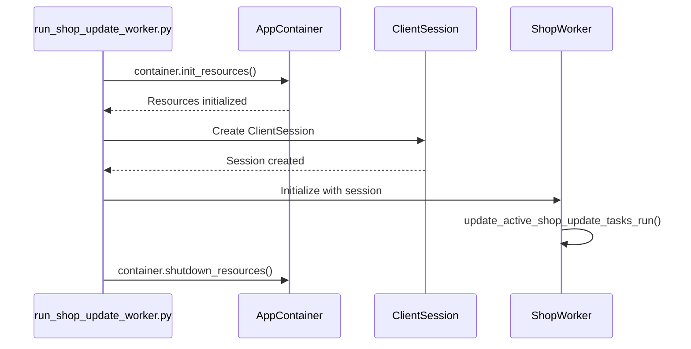
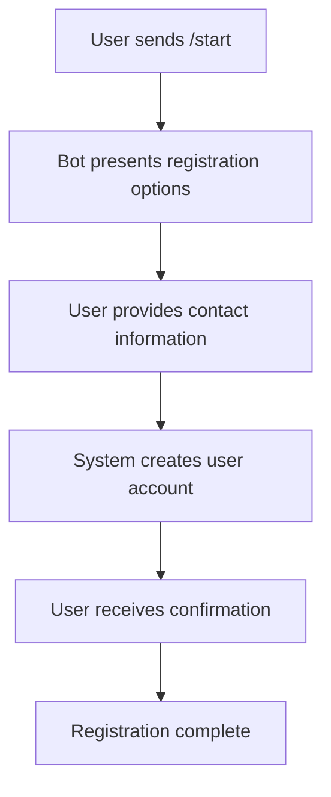

# Getting Started

<cite>
**Referenced Files in This Document**   
- [linux_requirements.txt](file://linux_requirements.txt)
- [app_config.py](file://app/configs/app_config.py)
- [infrastructure_config.py](file://app/configs/infrastructure_config/infrastructure_config.py)
- [redis_config.py](file://app/configs/infrastructure_config/redis_config.py)
- [settings_master.py](file://app/settings/settings_master.py)
- [client_bot_run.py](file://client_bot_run.py)
- [run_shop_update_worker.py](file://run_shop_update_worker.py)
- [arq_workers.py](file://app/arq_workers/workers.py)
- [arq_redis_settings.py](file://app/arq_workers/arq_redis_settings.py)
- [wb_shop.py](file://app/modules/shop_runner/wb_shop.py)
- [service_manager.py](file://app/modules/shop_runner/service_manager/manager.py)
- [wb_shop_data_manager.py](file://app/modules/shop_runner/service_manager/wb_shop_data_manager/wb_shop_data_manager.py)
- [.env](file://.env)
</cite>

## Table of Contents
1. [Introduction](#introduction)
2. [Prerequisites](#prerequisites)
3. [Environment Setup](#environment-setup)
4. [Configuration](#configuration)
5. [Database Initialization](#database-initialization)
6. [Service Configuration via AppConfig](#service-configuration-via-appconfig)
7. [Launching Core Services](#launching-core-services)
8. [Onboarding Flow](#onboarding-flow)
9. [Troubleshooting Common Issues](#troubleshooting-common-issues)
10. [Critical Entry Points](#critical-entry-points)

## Introduction
This document provides comprehensive guidance for setting up and running the adv-bot system. It covers the complete initialization process from environment preparation to executing core services and onboarding users. The adv-bot system is designed to manage advertising campaigns on Wildberries, with components for client interaction, background processing, shop management, and analytics. This guide focuses on the initial setup, configuration, and basic usage patterns required to get the system operational.

## Prerequisites
Before setting up the adv-bot system, ensure the following prerequisites are met:

- **Python 3.10+**: The system requires Python 3.10 or higher for proper execution of asynchronous components and type hinting features.
- **Wildberries API Token**: Obtain a valid WB API token from the Wildberries Partner Center with appropriate permissions for campaign management and analytics access.
- **PostgreSQL 13+**: A running PostgreSQL database instance is required for persistent data storage. The system uses SQLAlchemy 2.0+ for ORM operations.
- **Redis 6.0+**: Redis is used for caching, session storage, and message queuing. Both master and replica configurations are supported.
- **ClickHouse 22.8+**: Required for analytical data storage and high-performance querying of advertising statistics.
- **YooKassa Integration**: A YooKassa merchant account and API token are needed for payment processing functionality.

**Section sources**
- [linux_requirements.txt](file://linux_requirements.txt)
- [settings_master.py](file://app/settings/settings_master.py)

## Environment Setup
The environment setup process involves installing dependencies and configuring the runtime environment.

### Python Environment
Create a virtual environment and install the required dependencies:

```bash
python -m venv venv
source venv/bin/activate  # On Windows: venv\Scripts\activate
pip install -r linux_requirements.txt
```

The `linux_requirements.txt` file contains all production dependencies including:
- aiogram 3.4.1 for Telegram bot functionality
- SQLAlchemy 2.0.28 for database operations
- Redis 5.1.0b4 for caching and queuing
- ClickHouse Connect 0.7.18 for analytical queries
- Arq 0.26.3 for background job processing

### System Dependencies
Ensure the following system services are running and accessible:
- PostgreSQL on the configured host and port (default: 5432)
- Redis on the configured host and port (default: 6379)
- ClickHouse on the configured host and port (default: 8123)

**Section sources**
- [linux_requirements.txt](file://linux_requirements.txt)
- [settings_master.py](file://app/settings/settings_master.py)

## Configuration
The adv-bot system uses a hierarchical configuration system based on Pydantic Settings and environment variables.

### .env File Configuration
Create a `.env` file in the project root with the following essential variables:

```env
# Telegram Bot Configuration
TELEGRAM_BOT_TOKEN=your_telegram_bot_token
WEBHOOK_SECRET=your_webhook_secret

# Database Configuration
POSTGRES_MASTER_HOST=localhost
POSTGRES_REPLICA_HOST=localhost
POSTGRES_USER=advbot
POSTGRES_PASSWORD=your_password
POSTGRES_DBNAME=advbot
POSTGRES_PORT=5432

# Redis Configuration
REDIS_MASTER_HOST=localhost
REDIS_REPLICA_HOST=localhost
REDIS_DB=0

# ClickHouse Configuration
CLICK_HOUSE_HOST=localhost
CLICK_HOUSE_USER=default
CLICK_HOUSE_PASSWORD=your_password
CLICKHOUSE_PORT=8123

# Wildberries API
WB_API_TOKEN=your_wildberries_api_token

# Payment Processing
YOOKASSA_TOKEN=your_yookassa_token
```

### Configuration Architecture
The configuration system is structured hierarchically:



**Diagram sources**
- [app_config.py](file://app/configs/app_config.py)
- [infrastructure_config.py](file://app/configs/infrastructure_config/infrastructure_config.py)
- [redis_config.py](file://app/configs/infrastructure_config/redis_config.py)

**Section sources**
- [app_config.py](file://app/configs/app_config.py)
- [infrastructure_config.py](file://app/configs/infrastructure_config/infrastructure_config.py)
- [redis_config.py](file://app/configs/infrastructure_config/redis_config.py)
- [settings_master.py](file://app/settings/settings_master.py)

## Database Initialization
The database initialization process uses Alembic for schema migrations and PostgreSQL for data persistence.

### Running Alembic Migrations
Initialize the database schema by applying all pending migrations:

```bash
alembic upgrade head
```

This command will execute all migration scripts in the `alembic/versions` directory in chronological order, creating the necessary tables for:
- Advertising campaigns and settings
- User accounts and permissions
- Shop configurations and tokens
- Keyword statistics and analytics
- Billing and payment records

The migration history is tracked in the `alembic_version` table, ensuring consistent schema state across deployments.

### Migration Structure
The migration system contains both current and legacy migration scripts:



**Diagram sources**
- [alembic.ini](file://alembic.ini)
- [alembic/env.py](file://alembic/env.py)

**Section sources**
- [alembic.ini](file://alembic.ini)
- [alembic/env.py](file://alembic/env.py)

## Service Configuration via AppConfig
The AppConfig system provides a centralized configuration mechanism for all services.

### Configuration Loading Process
The configuration system follows a specific loading order:



The `AppConfig` class serves as the root configuration object, containing nested configuration objects for different infrastructure components. The system prioritizes environment variables over .env file values, allowing for flexible configuration across different deployment environments.

### Configuration Validation
The configuration system performs automatic validation of required fields and type conversion:

- String values are automatically converted to appropriate types (int, bool, etc.)
- Required fields without defaults trigger validation errors
- Extra fields are ignored due to the `extra: ignore` setting
- Sensitive values like passwords can be None for development environments

**Diagram sources**
- [app_config.py](file://app/configs/app_config.py)
- [infrastructure_config.py](file://app/configs/infrastructure_config/infrastructure_config.py)

**Section sources**
- [app_config.py](file://app/configs/app_config.py)
- [infrastructure_config.py](file://app/configs/infrastructure_config/infrastructure_config.py)
- [settings_master.py](file://app/settings/settings_master.py)

## Launching Core Services
The adv-bot system consists of multiple independent services that must be launched to achieve full functionality.

### Main Client Bot
Launch the main Telegram client bot using the dedicated entry point:

```bash
python client_bot_run.py
```

This script initializes the aiogram-based Telegram bot, sets up routing for user interactions, and starts polling for incoming messages. The bot handles user registration, campaign management, and configuration through a conversational interface.

### ARQ Workers
Start the background job processors using ARQ:

```bash
arq app.arq_workers.workers.WorkerSettings
```

The ARQ worker system processes background tasks such as:
- Creating complex advertising campaigns
- Processing asynchronous API requests
- Handling long-running operations without blocking the main bot

The worker configuration is defined in `app.arq_workers.workers.WorkerSettings`, which specifies the functions to be processed and Redis connection settings.

### Shop Update Worker
Launch the shop update worker to manage Wildberries shop synchronization:

```bash
python run_shop_update_worker.py
```

This worker performs the following functions:
- Identifies active shops that require updating
- Creates update tasks for each active shop
- Manages the lifecycle of shop update processes
- Handles error conditions and retry logic



**Diagram sources**
- [client_bot_run.py](file://client_bot_run.py)
- [arq_workers.py](file://app/arq_workers/workers.py)
- [arq_redis_settings.py](file://app/arq_workers/arq_redis_settings.py)
- [run_shop_update_worker.py](file://run_shop_update_worker.py)

**Section sources**
- [client_bot_run.py](file://client_bot_run.py)
- [arq_workers.py](file://app/arq_workers/workers.py)
- [arq_redis_settings.py](file://app/arq_workers/arq_redis_settings.py)
- [run_shop_update_worker.py](file://run_shop_update_worker.py)

## Onboarding Flow
The complete onboarding flow guides new users through system setup and initial campaign creation.

### Starting the Bot
1. Launch the main client bot using `python client_bot_run.py`
2. Start a conversation with the bot on Telegram
3. Use the `/start` command to initiate the registration process

### User Registration
The registration process collects essential user information:



### Connecting Wildberries Shop
To connect a Wildberries shop:
1. Navigate to the shop settings menu in the bot interface
2. Select "Add New Shop" option
3. Enter the WB API token obtained from Wildberries Partner Center
4. Confirm shop details and permissions
5. Wait for system verification and connection establishment

### Creating a Test Campaign
Create a test advertising campaign to verify the setup:

1. Navigate to the campaign management section
2. Select "Create New Campaign"
3. Choose campaign type (automatic or manual)
4. Configure basic settings (budget, duration, targeting)
5. Add initial keywords and phrases
6. Activate the campaign
7. Monitor initial performance metrics

The system will automatically begin collecting data and optimizing the campaign based on configured parameters.

**Section sources**
- [client_bot_run.py](file://client_bot_run.py)
- [run_shop_update_worker.py](file://run_shop_update_worker.py)
- [wb_shop.py](file://app/modules/shop_runner/wb_shop.py)
- [service_manager.py](file://app/modules/shop_runner/service_manager/manager.py)

## Troubleshooting Common Issues
This section addresses common setup issues and their solutions.

### Connection Failures
**Issue**: Unable to connect to PostgreSQL, Redis, or ClickHouse
**Solution**: 
- Verify service availability on the configured hosts and ports
- Check firewall settings and network connectivity
- Validate credentials in the .env file
- Test connections using command-line tools (psql, redis-cli, clickhouse-client)

### Authentication Errors
**Issue**: Invalid credentials for Wildberries API or YooKassa
**Solution**:
- Regenerate API tokens from the respective provider portals
- Verify token permissions and scopes
- Check for typos in the .env file
- Ensure tokens are not expired

### Migration Conflicts
**Issue**: Alembic migration errors or conflicts
**Solution**:
- Check the current migration state with `alembic current`
- Resolve any branching in the migration history
- If necessary, create a new migration to reconcile schema differences
- Never modify existing migration files in production environments

### Worker Process Failures
**Issue**: ARQ workers or shop update workers failing to start
**Solution**:
- Verify Redis connectivity and authentication
- Check worker logs for specific error messages
- Ensure all required dependencies are installed
- Validate configuration settings in the .env file

**Section sources**
- [settings_master.py](file://app/settings/settings_master.py)
- [arq_workers.py](file://app/arq_workers/workers.py)
- [run_shop_update_worker.py](file://run_shop_update_worker.py)
- [wb_shop.py](file://app/modules/shop_runner/wb_shop.py)

## Critical Entry Points
The system has several critical entry points that serve as main execution starting points.

### Main Client Bot Entry Point
`client_bot_run.py` - The primary entry point for the Telegram client bot. This script initializes the aiogram dispatcher, sets up routing for user interactions, and starts the message polling loop.

### Background Worker Entry Points
- `app.arq_workers.workers.WorkerSettings` - Configuration for ARQ background workers that handle asynchronous tasks
- `run_shop_update_worker.py` - Entry point for the shop update worker that manages Wildberries shop synchronization

### Service Manager Entry Points
- `app.modules.shop_runner.wb_shop.WBShop.run()` - Main execution method for individual shop management
- `app.modules.shop_runner.service_manager.CoroutinesManager` - Coordinator for various shop maintenance coroutines

These entry points follow a consistent pattern of resource initialization, service configuration, and graceful shutdown handling, ensuring reliable operation in production environments.

**Section sources**
- [client_bot_run.py](file://client_bot_run.py)
- [run_shop_update_worker.py](file://run_shop_update_worker.py)
- [arq_workers.py](file://app/arq_workers/workers.py)
- [wb_shop.py](file://app/modules/shop_runner/wb_shop.py)
- [service_manager.py](file://app/modules/shop_runner/service_manager/manager.py)
- [wb_shop_data_manager.py](file://app/modules/shop_runner/service_manager/wb_shop_data_manager/wb_shop_data_manager.py)