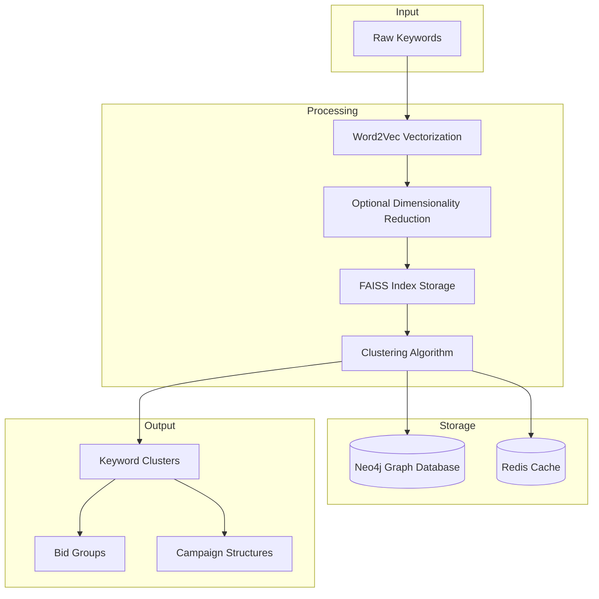
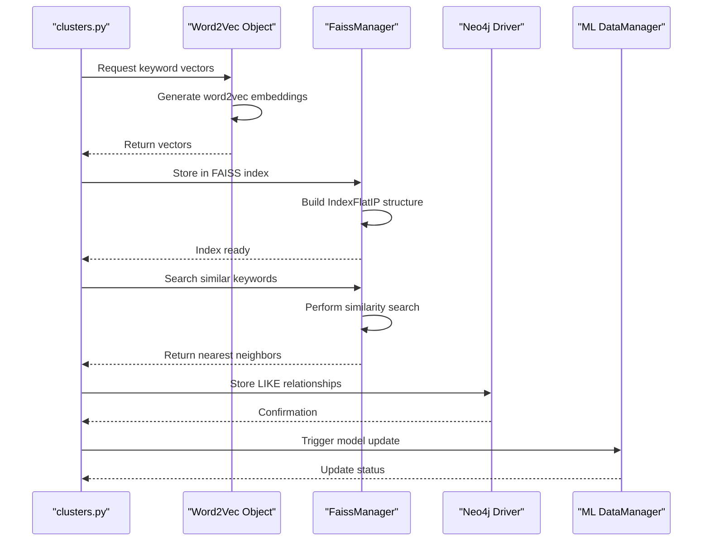
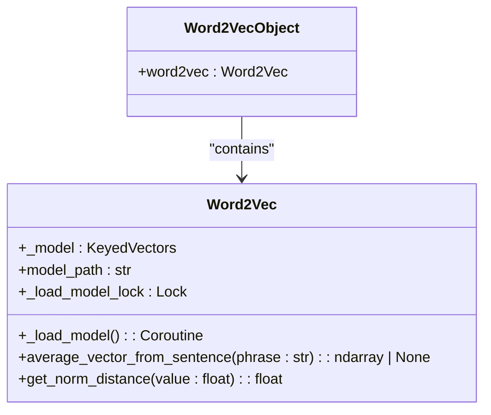
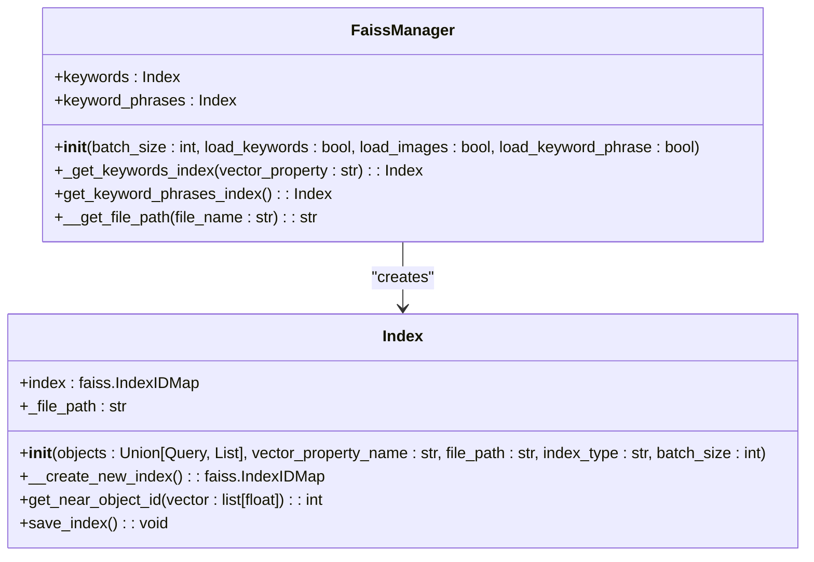
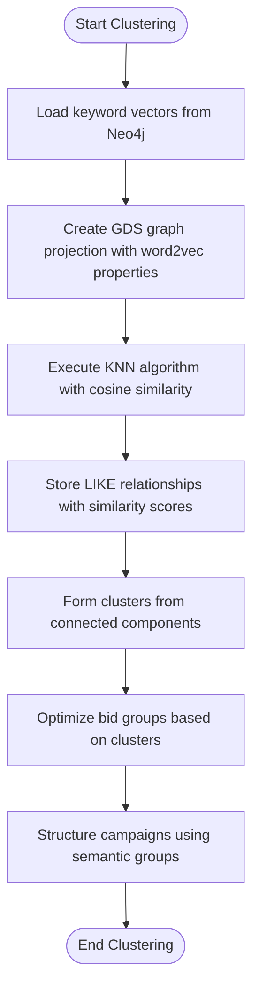
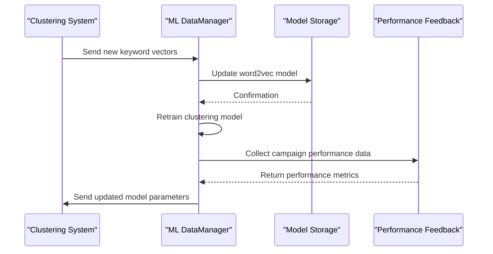
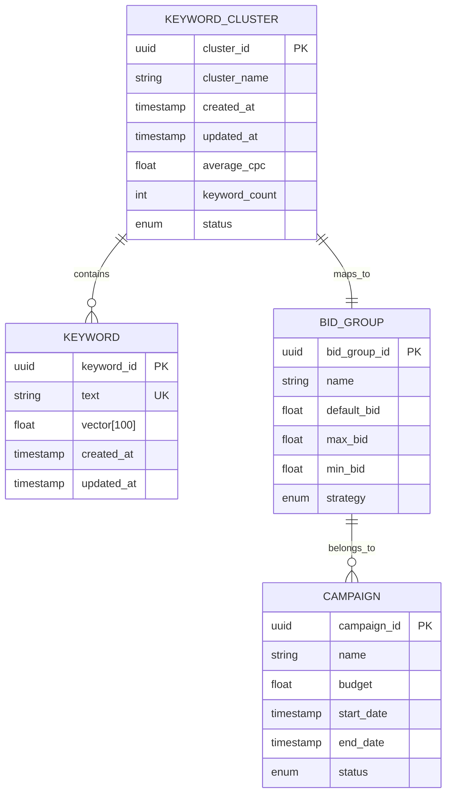

# Clustering

<cite>
**Referenced Files in This Document**   
- [word_to_vec_object.py](file://app/modules/wb_adv_updater/word_to_vec_object.py)
- [faiss_index_manager.py](file://app/utils/faiss_manager/faiss_index_manager.py)
- [faiss_index.py](file://app/utils/faiss_manager/faiss_index.py)
- [Transformers.py](file://app/utils/text_master/Transformers.py)
- [driver.py](file://app/utils/NeoDataScience/driver.py)
- [data_getter.py](file://app/modules/wb_adv_updater/data_getter.py)
- [clusters.py](file://app/client_bot/user_interface/handlers/clusters.py)
- [ml_data_manager.py](file://app/modules/wb_adv_updater/ml_data_manager.py)
</cite>

## Table of Contents
1. [Introduction](#introduction)
2. [Core Components](#core-components)
3. [Architecture Overview](#architecture-overview)
4. [Keyword Clustering Workflow](#keyword-clustering-workflow)
5. [Vectorization and Semantic Representation](#vectorization-and-semantic-representation)
6. [FAISS-Based Similarity Search](#faiss-based-similarity-search)
7. [Clustering Process Implementation](#clustering-process-implementation)
8. [Integration with ML Pipeline](#integration-with-ml-pipeline)
9. [Use Cases: Bid Group Optimization and Campaign Structuring](#use-cases-bid-group-optimization-and-campaign-structuring)
10. [Common Issues and Tuning Recommendations](#common-issues-and-tuning-recommendations)
11. [Performance Considerations](#performance-considerations)
12. [Conclusion](#conclusion)

## Introduction
The Keyword Clustering sub-feature enables semantic grouping of advertising keywords using vector embeddings and similarity search. This system leverages word2vec technology for semantic representation and FAISS (Facebook AI Similarity Search) for efficient nearest-neighbor lookups. The clustering process supports bid group optimization and campaign structuring by identifying semantically related keywords. This document details the implementation workflow, integration points, performance characteristics, and tuning strategies for large-scale keyword clustering operations.

## Core Components
The keyword clustering system consists of several interconnected components responsible for vectorization, indexing, similarity search, and cluster formation. Key modules include the word2vec model for semantic embedding, FAISS-based index management for fast similarity search, Neo4j graph database integration for relationship storage, and clustering logic for group formation.

**Section sources**
- [word_to_vec_object.py](file://app/modules/wb_adv_updater/word_to_vec_object.py#L1-L3)
- [faiss_index_manager.py](file://app/utils/faiss_manager/faiss_index_manager.py#L1-L187)
- [ml_data_manager.py](file://app/modules/wb_adv_updater/ml_data_manager.py#L1-L50)

## Architecture Overview
The keyword clustering architecture follows a pipeline pattern where keywords are first vectorized using word2vec embeddings, then indexed using FAISS for efficient similarity search, and finally grouped into clusters based on semantic proximity. The system integrates with Neo4j to store keyword relationships and with the ML pipeline for continuous model updates.

**Diagram sources**
- [word_to_vec_object.py](file://app/modules/wb_adv_updater/word_to_vec_object.py#L1-L3)
- [faiss_index_manager.py](file://app/utils/faiss_manager/faiss_index_manager.py#L1-L187)
- [driver.py](file://app/utils/NeoDataScience/driver.py#L842-L880)

## Keyword Clustering Workflow
The clustering workflow begins with keyword ingestion and proceeds through vectorization, indexing, similarity search, and cluster formation. The process is initiated through the clusters.py handler and coordinates between multiple components to produce semantically meaningful keyword groups.

**Diagram sources**
- [clusters.py](file://app/client_bot/user_interface/handlers/clusters.py#L1-L20)
- [word_to_vec_object.py](file://app/modules/wb_adv_updater/word_to_vec_object.py#L1-L3)
- [faiss_index_manager.py](file://app/utils/faiss_manager/faiss_index_manager.py#L1-L187)

**Section sources**
- [clusters.py](file://app/client_bot/user_interface/handlers/clusters.py#L1-L50)
- [faiss_index_manager.py](file://app/utils/faiss_manager/faiss_index_manager.py#L1-L187)

## Vectorization and Semantic Representation
Keywords are converted into dense vector representations using the Word2Vec model loaded from the Wikipedia2Vec Russian corpus. The vectorization process computes average vectors from individual word embeddings, enabling semantic representation of multi-word phrases.

**Diagram sources**
- [Transformers.py](file://app/utils/text_master/Transformers.py#L1-L88)
- [word_to_vec_object.py](file://app/modules/wb_adv_updater/word_to_vec_object.py#L1-L3)

**Section sources**
- [Transformers.py](file://app/utils/text_master/Transformers.py#L1-L88)
- [word_to_vec_object.py](file://app/modules/wb_adv_updater/word_to_vec_object.py#L1-L3)

## FAISS-Based Similarity Search
The system uses FAISS with IndexFlatIP (Inner Product) for efficient similarity search between keyword vectors. The FaissManager class handles index creation, loading, and querying, supporting both keyword and keyword phrase indexing with cosine similarity metrics.

**Diagram sources**
- [faiss_index_manager.py](file://app/utils/faiss_manager/faiss_index_manager.py#L1-L187)
- [faiss_index.py](file://app/utils/faiss_manager/faiss_index.py#L1-L105)

**Section sources**
- [faiss_index_manager.py](file://app/utils/faiss_manager/faiss_index_manager.py#L1-L187)
- [faiss_index.py](file://app/utils/faiss_manager/faiss_index.py#L1-L105)

## Clustering Process Implementation
The clustering process involves creating a graph projection in Neo4j using keyword vectors, executing KNN (k-nearest neighbors) algorithms to identify semantic relationships, and storing LIKE relationships with similarity scores. This enables formation of clusters based on semantic proximity rather than exact keyword matching.

**Diagram sources**
- [driver.py](file://app/utils/NeoDataScience/driver.py#L461-L499)
- [data_getter.py](file://app/modules/wb_adv_updater/data_getter.py#L36-L52)

**Section sources**
- [driver.py](file://app/utils/NeoDataScience/driver.py#L461-L499)
- [data_getter.py](file://app/modules/wb_adv_updater/data_getter.py#L36-L52)

## Integration with ML Pipeline
The clustering system integrates with the ML pipeline through the ml_data_manager.py module, enabling continuous model updates based on new keyword data and clustering results. This ensures the word2vec model and clustering patterns evolve with changing market language and user behavior.

**Diagram sources**
- [ml_data_manager.py](file://app/modules/wb_adv_updater/ml_data_manager.py#L1-L50)
- [word_to_vec_object.py](file://app/modules/wb_adv_updater/word_to_vec_object.py#L1-L3)

**Section sources**
- [ml_data_manager.py](file://app/modules/wb_adv_updater/ml_data_manager.py#L1-L50)

## Use Cases: Bid Group Optimization and Campaign Structuring
Clustered keywords enable strategic bid group optimization and campaign structuring by grouping semantically related terms. This allows for more efficient budget allocation, improved ad relevance, and better performance tracking at the cluster level rather than individual keyword level.

**Diagram sources**
- [clusters.py](file://app/client_bot/user_interface/handlers/clusters.py#L1-L20)
- [ml_data_manager.py](file://app/modules/wb_adv_updater/ml_data_manager.py#L1-L50)

**Section sources**
- [clusters.py](file://app/client_bot/user_interface/handlers/clusters.py#L1-L50)

## Common Issues and Tuning Recommendations
The system may encounter issues such as over-clustering (too many small clusters) or semantic drift (clusters losing coherence over time). These can be addressed through parameter tuning, model refresh rates, and similarity threshold adjustments.

### Common Issues:
- **Over-clustering**: Caused by overly sensitive similarity thresholds
- **Semantic drift**: Occurs when model isn't updated frequently enough
- **Cold start problem**: New keywords without vector representations
- **Memory pressure**: Large index loading times and memory usage

### Tuning Recommendations:
- Adjust KNN parameters (k-value, similarity threshold)
- Implement periodic model retraining schedules
- Use dimensionality reduction for high-dimensional vectors
- Implement caching strategies for frequently accessed clusters
- Monitor cluster quality metrics and adjust parameters accordingly

**Section sources**
- [faiss_index_manager.py](file://app/utils/faiss_manager/faiss_index_manager.py#L1-L187)
- [ml_data_manager.py](file://app/modules/wb_adv_updater/ml_data_manager.py#L1-L50)
- [Transformers.py](file://app/utils/text_master/Transformers.py#L1-L88)

## Performance Considerations
The system is optimized for large-scale clustering operations with thousands of keywords. Key performance considerations include memory usage, indexing time, and query latency. The implementation uses batch processing, efficient indexing, and caching to handle large datasets.

### Performance Optimization Strategies:
- **Batch processing**: Processes keywords in batches to reduce memory footprint
- **Index persistence**: Saves FAISS indexes to disk to avoid recreation
- **Asynchronous operations**: Uses async/await for I/O operations
- **Memory mapping**: Loads only necessary portions of large indexes
- **Connection pooling**: Reuses database connections for vector retrieval

### Memory Usage Optimization:
- Uses float32 instead of float64 for vector storage
- Implements incremental index building
- Provides options to load only required indexes
- Includes automatic index cleanup and saving

**Section sources**
- [faiss_index_manager.py](file://app/utils/faiss_manager/faiss_index_manager.py#L1-L187)
- [faiss_index.py](file://app/utils/faiss_manager/faiss_index.py#L1-L105)
- [driver.py](file://app/utils/NeoDataScience/driver.py#L1066-L1104)

## Conclusion
The Keyword Clustering sub-feature provides a robust system for semantic keyword grouping using word2vec embeddings and FAISS-based similarity search. The implementation enables effective bid group optimization and campaign structuring through meaningful semantic clusters. By integrating with the ML pipeline, the system supports continuous improvement and adaptation to changing market conditions. With proper tuning and performance optimization, this system can efficiently handle large-scale clustering operations for thousands of keywords while maintaining high-quality cluster formation.