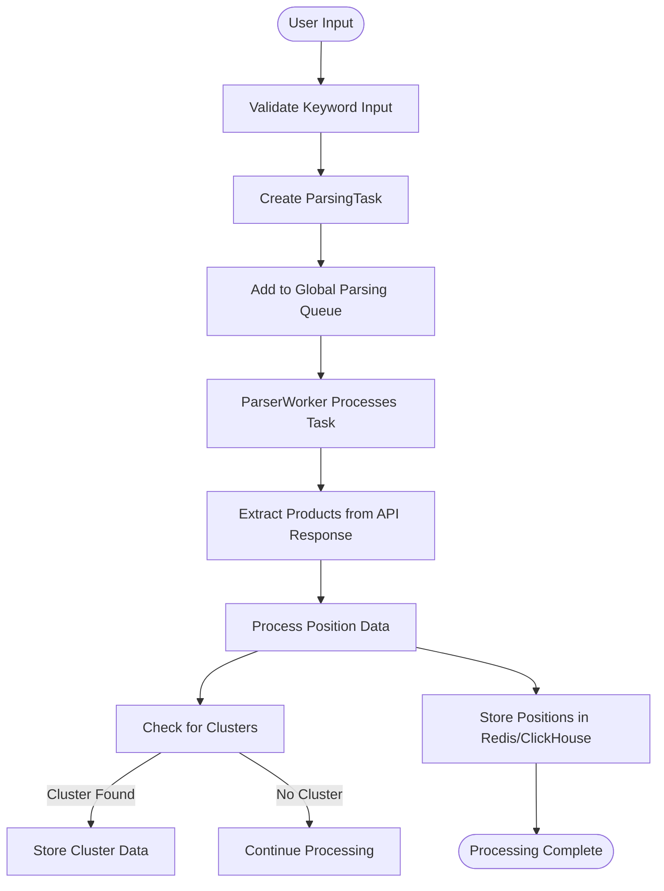
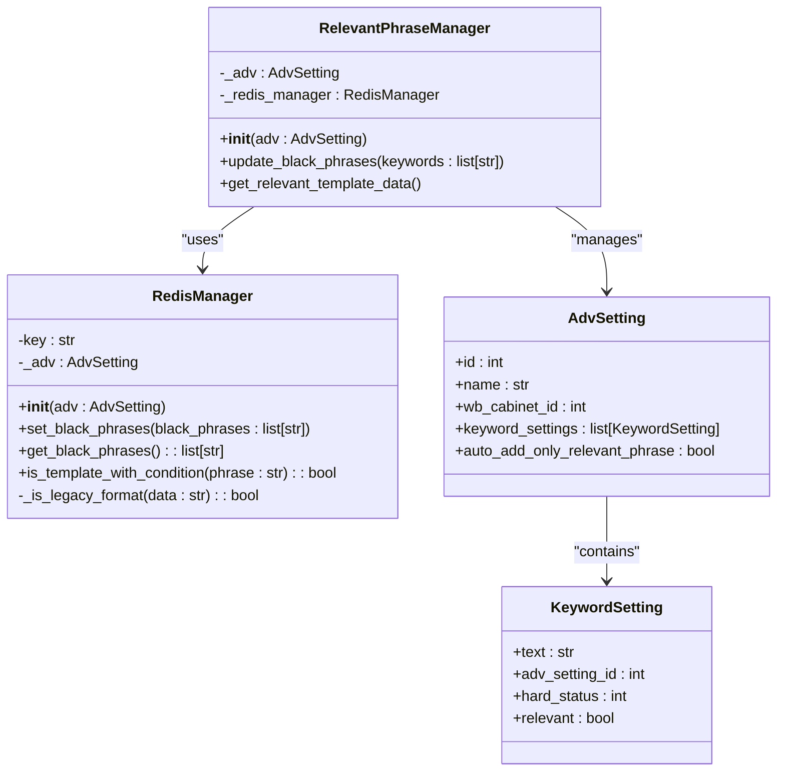
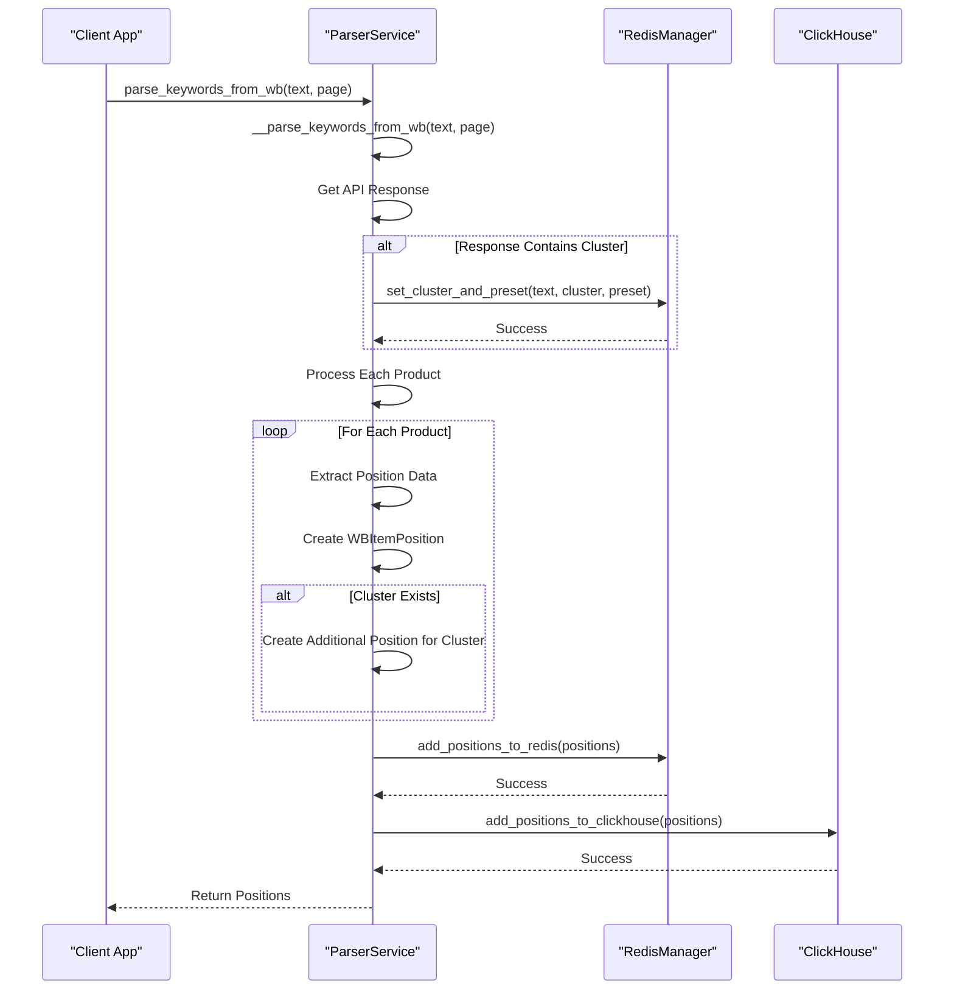
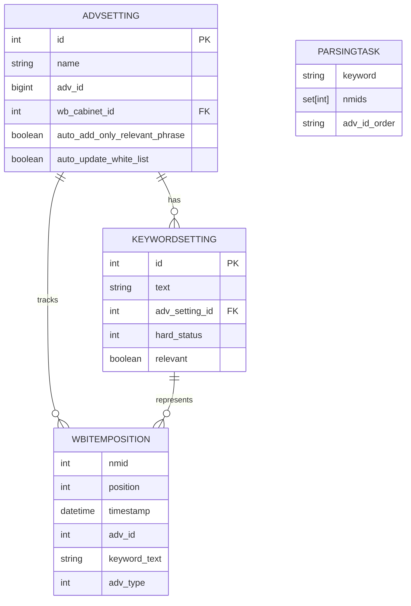
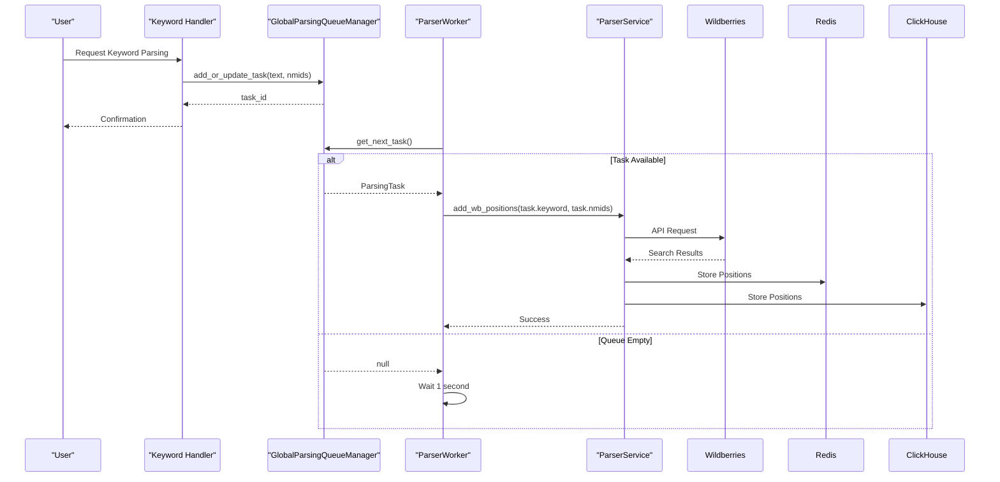
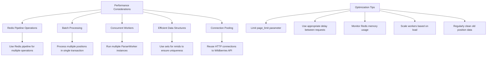

# Keyword Management System

<cite>
**Referenced Files in This Document**   
- [parser.py](file://app/modules/wb_keywords_parser/wb_parser/parser.py)
- [relevant_phrase_manager.py](file://app/modules/relevant_phrase_manager/relevant_phrase_manager.py)
- [parser_worker.py](file://app/modules/wb_keywords_parser/parser_worker.py)
- [parsing_task.py](file://app/modules/wb_keywords_parser/parsing_task.py)
- [global_parsing_queue_manager.py](file://app/modules/wb_keywords_parser/global_parsing_queue_manager.py)
- [redis_manager.py](file://app/modules/relevant_phrase_manager/redis_manager/redis_manager.py)
- [models.py](file://app/modules/common_slaves/wildberries/models/models.py)
</cite>

## Table of Contents
1. [Introduction](#introduction)
2. [Keyword Parsing System](#keyword-parsing-system)
3. [Relevance Filtering and Phrase Management](#relevance-filtering-and-phrase-management)
4. [Clustering and Position Tracking](#clustering-and-position-tracking)
5. [System Architecture and Data Flow](#system-architecture-and-data-flow)
6. [Domain Models and Data Classes](#domain-models-and-data-classes)
7. [Command Invocation and Worker Relationships](#command-invocation-and-worker-relationships)
8. [Performance Considerations](#performance-considerations)
9. [Common Issues and Solutions](#common-issues-and-solutions)
10. [Usage Patterns and Best Practices](#usage-patterns-and-best-practices)

## Introduction
The Keyword Management System in the adv-bot application is responsible for extracting, processing, and managing keywords from Wildberries search results. This system enables advertisers to track keyword positions, filter relevant phrases, and optimize their advertising campaigns. The system operates through a distributed architecture using Redis queues to manage parsing tasks and store results. It integrates with Wildberries' API to extract keyword data, processes this information through relevance algorithms, and maintains position tracking for campaign optimization. The system supports both white and black phrase management, allowing users to control which keywords are included or excluded from their campaigns.

## Keyword Parsing System

The keyword parsing system extracts data from Wildberries search results and processes it for position tracking. The system uses the Wildberries search API to retrieve product listings for specific keywords and parses the response to extract position data.

**Diagram sources**
- [parser.py](file://app/modules/wb_keywords_parser/wb_parser/parser.py#L100-L200)
- [parser_worker.py](file://app/modules/wb_keywords_parser/parser_worker.py#L50-L70)

**Section sources**
- [parser.py](file://app/modules/wb_keywords_parser/wb_parser/parser.py#L1-L343)
- [parser_worker.py](file://app/modules/wb_keywords_parser/parser_worker.py#L1-L80)

## Relevance Filtering and Phrase Management

The relevance filtering system manages white and black phrases for advertising campaigns. The system uses a template-based approach to determine keyword relevance and updates database records accordingly.

**Diagram sources**
- [relevant_phrase_manager.py](file://app/modules/relevant_phrase_manager/relevant_phrase_manager.py#L1-L44)
- [redis_manager.py](file://app/modules/relevant_phrase_manager/redis_manager/redis_manager.py#L1-L57)

**Section sources**
- [relevant_phrase_manager.py](file://app/modules/relevant_phrase_manager/relevant_phrase_manager.py#L1-L44)
- [redis_manager.py](file://app/modules/relevant_phrase_manager/redis_manager/redis_manager.py#L1-L57)

## Clustering and Position Tracking

The system implements clustering functionality to group related keywords and track their positions across Wildberries search results. When a search query returns a cluster, the system stores positions for both the original keyword and the cluster.

**Diagram sources**
- [parser.py](file://app/modules/wb_keywords_parser/wb_parser/parser.py#L150-L200)
- [redis_manager.py](file://app/utils/redis_manager.py#L1-L10)

## System Architecture and Data Flow

The Keyword Management System follows a distributed architecture with multiple components working together to process keyword data. The system uses Redis as a message broker to coordinate parsing tasks between workers.

```mermaid
graph TD
subgraph "User Interface"
Client[Client Bot]
Admin[Admin Bot]
end
subgraph "Processing Layer"
Worker[ParserWorker]
Queue[GlobalParsingQueueManager]
Task[ParsingTask]
end
subgraph "Data Storage"
Redis[(Redis)]
ClickHouse[(ClickHouse)]
PostgreSQL[(PostgreSQL)]
end
Client --> |Add Keywords| Queue
Admin --> |Manage Phrases| Queue
Queue --> Worker
Worker --> |Process| Task
Task --> |Extract Data| Wildberries[Wildberries API]
Wildberries --> |Return Results| Worker
Worker --> |Store| Redis
Worker --> |Store| ClickHouse
Worker --> |Update| PostgreSQL
Redis --> |Cache Phrases| Worker
PostgreSQL --> |Store Settings| Worker
```

**Diagram sources**
- [parser_worker.py](file://app/modules/wb_keywords_parser/parser_worker.py#L1-L80)
- [global_parsing_queue_manager.py](file://app/modules/wb_keywords_parser/global_parsing_queue_manager.py#L1-L131)
- [parsing_task.py](file://app/modules/wb_keywords_parser/parsing_task.py#L1-L23)

## Domain Models and Data Classes

The system uses several key domain models to represent keyword data and settings. These models define the structure of keyword-related data and their relationships.

**Diagram sources**
- [models.py](file://app/modules/common_slaves/wildberries/models/models.py#L500-L600)
- [parsing_task.py](file://app/modules/wb_keywords_parser/parsing_task.py#L1-L23)

**Section sources**
- [models.py](file://app/modules/common_slaves/wildberries/models/models.py#L1-L654)
- [parsing_task.py](file://app/modules/wb_keywords_parser/parsing_task.py#L1-L23)

## Command Invocation and Worker Relationships

The system processes user commands through a worker-based architecture. When a user requests keyword parsing, the command is converted into a parsing task and added to a Redis queue for processing by parser workers.

**Diagram sources**
- [parser_worker.py](file://app/modules/wb_keywords_parser/parser_worker.py#L50-L75)
- [global_parsing_queue_manager.py](file://app/modules/wb_keywords_parser/global_parsing_queue_manager.py#L50-L100)
- [parser.py](file://app/modules/wb_keywords_parser/wb_parser/parser.py#L250-L300)

## Performance Considerations

The system is designed to handle large-scale keyword operations efficiently. Several performance optimizations are implemented to ensure responsiveness and scalability.

**Section sources**
- [parser.py](file://app/modules/wb_keywords_parser/wb_parser/parser.py#L250-L300)
- [parser_worker.py](file://app/modules/wb_keywords_parser/parser_worker.py#L10-L30)
- [global_parsing_queue_manager.py](file://app/modules/wb_keywords_parser/global_parsing_queue_manager.py#L80-L100)

## Common Issues and Solutions

The system may encounter various issues during operation. This section documents common problems and their solutions.

```mermaid
flowchart TD
A[Common Issues] --> B[Parsing Failures]
A --> C[Relevance Miscalculations]
A --> D[Queue Backlogs]
A --> E[Data Inconsistencies]
B --> F["Wildberries API returns empty data"]
B --> G["Network connectivity issues"]
B --> H["Rate limiting by Wildberries"]
C --> I["Black phrases not properly applied"]
C --> J["Relevance template format issues"]
C --> K["Database synchronization delays"]
D --> L["Too many parsing tasks"]
D --> M["Insufficient worker instances"]
D --> N["Redis performance bottlenecks"]
E --> O["Position data not updated"]
E --> P["Cluster data inconsistencies"]
E --> Q["NMID mismatches"]
R[Solutions] --> S["Implement retry logic for API calls"]
R --> T["Validate relevance templates before application"]
R --> U["Scale worker instances based on queue size"]
R --> V["Monitor Redis memory and connection limits"]
R --> W["Implement data consistency checks"]
R --> X["Use structured logging for debugging"]
```

**Section sources**
- [parser.py](file://app/modules/wb_keywords_parser/wb_parser/parser.py#L50-L100)
- [relevant_phrase_manager.py](file://app/modules/relevant_phrase_manager/relevant_phrase_manager.py#L20-L40)
- [parser_worker.py](file://app/modules/wb_keywords_parser/parser_worker.py#L60-L75)

## Usage Patterns and Best Practices

Effective use of the Keyword Management System requires understanding proper usage patterns for white and black phrase management and their impact on campaign performance.

```mermaid
flowchart TD
A[Usage Patterns] --> B[White Phrase Management]
A --> C[Black Phrase Management]
A --> D[Campaign Performance Impact]
B --> E["Add high-performing keywords to white list"]
B --> F["Use clusters to group related keywords"]
B --> G["Regularly review white list effectiveness"]
C --> H["Add irrelevant search terms to black list"]
C --> I["Use pattern matching with NOT: and ANY: prefixes"]
C --> J["Automatically update black list from performance data"]
D --> K["Improved campaign ROI"]
D --> L["Reduced wasted ad spend"]
D --> M["Higher conversion rates"]
D --> N["Better keyword relevance"]
O[Best Practices] --> P["Start with broad keyword coverage"]
O --> Q["Gradually refine white/black lists"]
O --> R["Monitor position changes regularly"]
O --> S["Use auto_update_white_list feature"]
O --> T["Set appropriate max_cpc values"]
O --> U["Regularly analyze campaign performance"]
```

**Section sources**
- [relevant_phrase_manager.py](file://app/modules/relevant_phrase_manager/relevant_phrase_manager.py#L1-L44)
- [models.py](file://app/modules/common_slaves/wildberries/models/models.py#L400-L450)
- [parser.py](file://app/modules/wb_keywords_parser/wb_parser/parser.py#L1-L50)