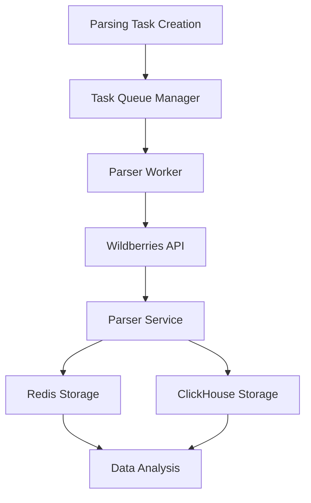
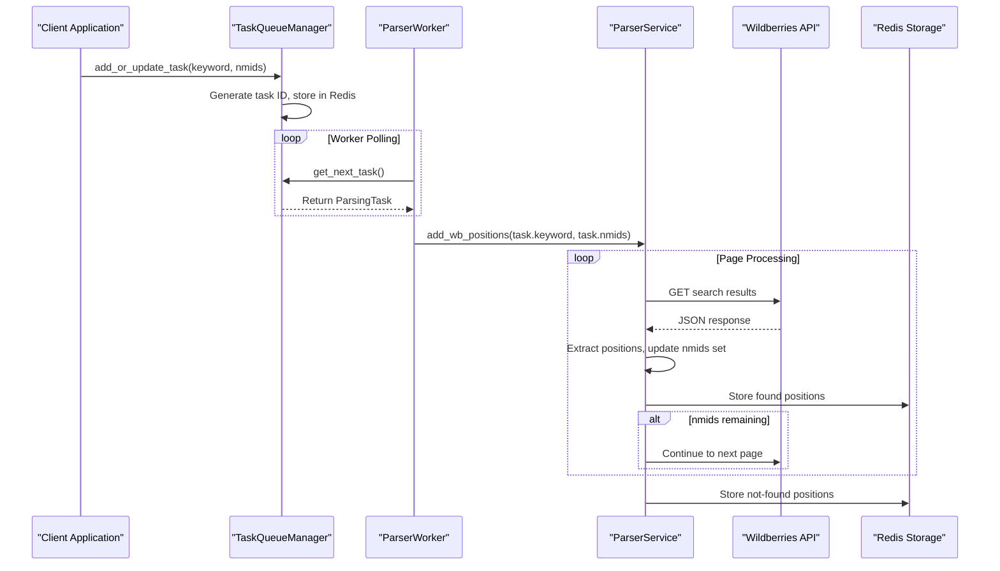
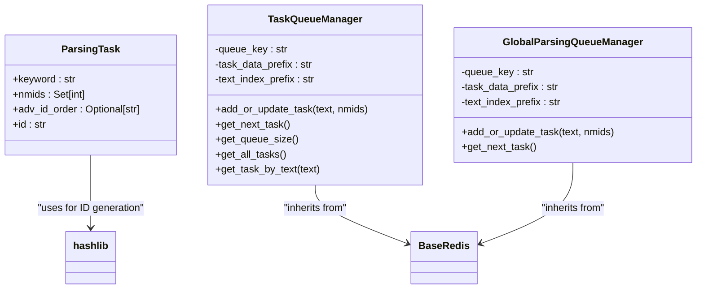
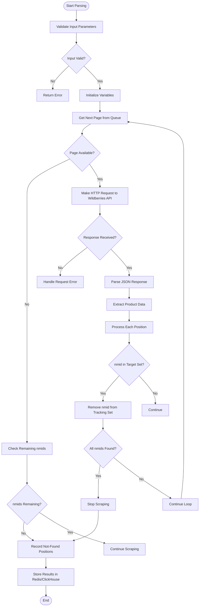
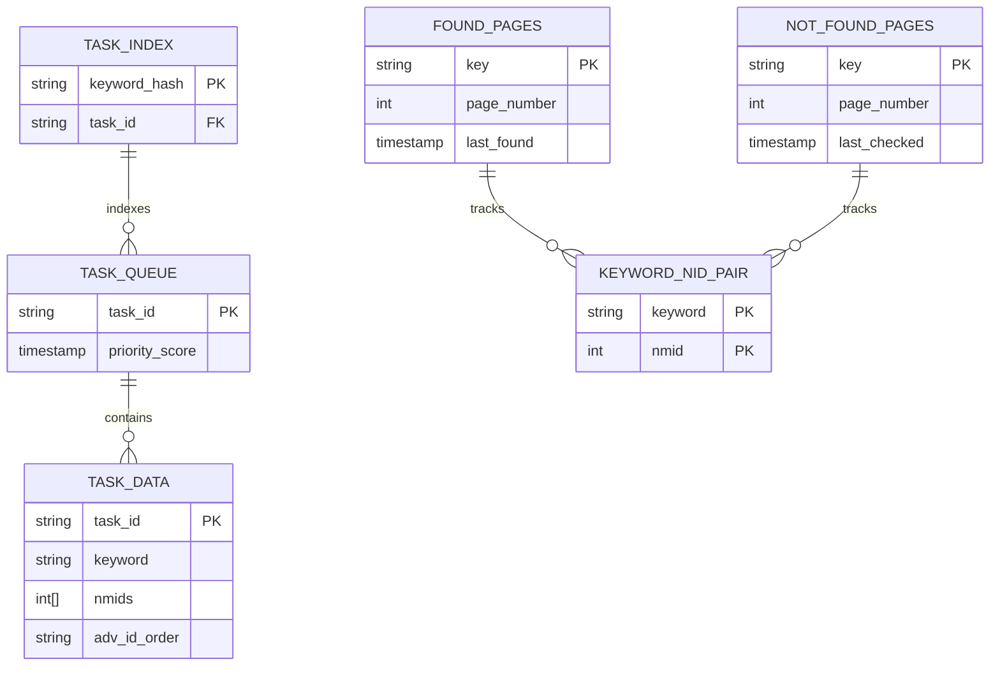
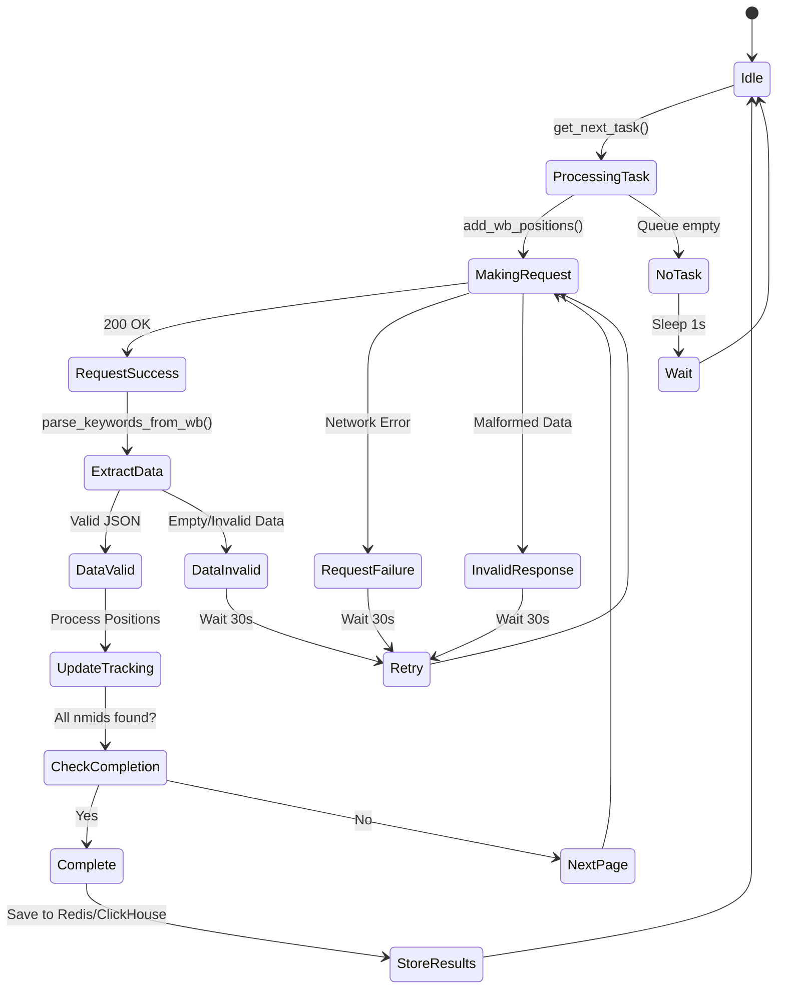

# Keyword Parsing

<cite>
**Referenced Files in This Document**   
- [parsing_task.py](file://app/modules/wb_keywords_parser/parsing_task.py)
- [task_queue_manager.py](file://app/modules/wb_keywords_parser/task_queue_manager.py)
- [parser_worker.py](file://app/modules/wb_keywords_parser/parser_worker.py)
- [parser.py](file://app/modules/wb_keywords_parser/wb_parser/parser.py)
- [parsing_found_redis_manager.py](file://app/modules/wb_keywords_parser/parsing_found_redis_manager.py)
- [global_parsing_queue_manager.py](file://app/modules/wb_keywords_parser/global_parsing_queue_manager.py)
- [parsing_page_queue_manager.py](file://app/modules/wb_keywords_parser/wb_parser/parsing_page_queue_manager.py)
- [parsing_queue_settings.py](file://app/settings/parsing_queue_settings.py)
</cite>

## Table of Contents
1. [Introduction](#introduction)
2. [Core Components](#core-components)
3. [Parsing Workflow](#parsing-workflow)
4. [Task Management System](#task-management-system)
5. [Parser Implementation](#parser-implementation)
6. [Redis Integration](#redis-integration)
7. [Error Handling and Resilience](#error-handling-and-resilience)
8. [Performance Optimization](#performance-optimization)
9. [Conclusion](#conclusion)

## Introduction

The Keyword Parsing sub-feature of the Keyword Management System enables asynchronous scraping and extraction of keywords from Wildberries search results. This system is designed to efficiently process large volumes of keyword data across multiple shops while maintaining resilience against common web scraping challenges such as rate limiting and CAPTCHA mechanisms. The architecture leverages Redis for task queuing and state management, with an asynchronous Python implementation that maximizes throughput and reliability.

The parsing system follows a producer-consumer pattern where parsing tasks are created, queued, and processed by worker processes. Each task contains specific keywords and product identifiers (nmids) to track, with results stored in both Redis and ClickHouse databases for real-time analytics and historical analysis.

**Section sources**
- [parsing_task.py](file://app/modules/wb_keywords_parser/parsing_task.py#L1-L23)
- [parser.py](file://app/modules/wb_keywords_parser/wb_parser/parser.py#L1-L343)

## Core Components

The Keyword Parsing system consists of several interconnected components that work together to extract and process keyword data from Wildberries. The core components include the parser implementation, task management system, worker processes, and Redis integration layer.

The system is built around asynchronous processing using Python's asyncio framework, allowing for efficient handling of multiple concurrent HTTP requests to the Wildberries search API. The architecture follows a modular design with clear separation of concerns between task creation, queue management, parsing logic, and data persistence.

**Diagram sources**
- [parser_worker.py](file://app/modules/wb_keywords_parser/parser_worker.py#L1-L80)
- [parser.py](file://app/modules/wb_keywords_parser/wb_parser/parser.py#L1-L343)

**Section sources**
- [parser_worker.py](file://app/modules/wb_keywords_parser/parser_worker.py#L1-L80)
- [parser.py](file://app/modules/wb_keywords_parser/wb_parser/parser.py#L1-L343)

## Parsing Workflow

The parsing workflow begins with the creation of a parsing task and ends with the storage of extracted keyword position data. The process follows a well-defined sequence of operations that ensures efficient and reliable data extraction.

When a new parsing request is initiated, a `ParsingTask` object is created containing the target keyword and a set of nmids (product identifiers) to track. This task is then added to the global parsing queue through the `GlobalParsingQueueManager`. The queue manager handles deduplication by merging nmids when multiple tasks exist for the same keyword.

Worker processes continuously monitor the queue for new tasks. When a task is available, the worker retrieves it and initiates the parsing process by calling the `add_wb_positions` function in the parser module. This function orchestrates the scraping of multiple pages from Wildberries search results, processing each page asynchronously.

For each page, the parser makes an HTTP request to the Wildberries search API, extracts product positions, and identifies whether any tracked nmids appear in the results. The process continues until all relevant pages have been processed or all nmids have been found. Any nmids not found during the search are recorded with a position of zero, indicating they did not appear in the search results.

**Diagram sources**
- [parsing_task.py](file://app/modules/wb_keywords_parser/parsing_task.py#L1-L23)
- [task_queue_manager.py](file://app/modules/wb_keywords_parser/task_queue_manager.py#L1-L176)
- [parser_worker.py](file://app/modules/wb_keywords_parser/parser_worker.py#L1-L80)

**Section sources**
- [parsing_task.py](file://app/modules/wb_keywords_parser/parsing_task.py#L1-L23)
- [task_queue_manager.py](file://app/modules/wb_keywords_parser/task_queue_manager.py#L1-L176)
- [parser_worker.py](file://app/modules/wb_keywords_parser/parser_worker.py#L1-L80)

## Task Management System

The task management system is responsible for creating, queuing, and distributing parsing tasks across worker processes. At its core is the `ParsingTask` dataclass that represents a unit of work for the parsing system.

Each `ParsingTask` contains three key attributes: the keyword to search for, a set of nmids to track, and an optional advertising order ID. The task ID is generated using a SHA-1 hash of the keyword, ensuring uniqueness while allowing for easy identification and deduplication.

The `TaskQueueManager` and `GlobalParsingQueueManager` classes provide the infrastructure for task queuing and retrieval. These managers use Redis as a backend to store task data and maintain a priority queue of pending tasks. The queue implementation supports atomic operations for adding, updating, and retrieving tasks, preventing race conditions in multi-worker environments.

When a new task is added via `add_or_update_task`, the system checks if a task already exists for the same keyword. If so, it merges the nmids from the new request with those from the existing task, ensuring that all product identifiers are tracked without creating duplicate work.

The queue managers use multiple Redis data structures to maintain task state:
- A sorted set (`parser:task:queue`) to maintain the task queue with priority based on submission time
- Hash keys (`parser:task:data:*`) to store task details including keywords and nmids
- Set keys (`parser:task:index:text:*`) to enable lookup of tasks by keyword

**Diagram sources**
- [parsing_task.py](file://app/modules/wb_keywords_parser/parsing_task.py#L1-L23)
- [task_queue_manager.py](file://app/modules/wb_keywords_parser/task_queue_manager.py#L1-L176)
- [global_parsing_queue_manager.py](file://app/modules/wb_keywords_parser/global_parsing_queue_manager.py#L1-L131)

**Section sources**
- [parsing_task.py](file://app/modules/wb_keywords_parser/parsing_task.py#L1-L23)
- [task_queue_manager.py](file://app/modules/wb_keywords_parser/task_queue_manager.py#L1-L176)
- [global_parsing_queue_manager.py](file://app/modules/wb_keywords_parser/global_parsing_queue_manager.py#L1-L131)

## Parser Implementation

The parser implementation is centered around the `ParserService` class, which handles the actual scraping of Wildberries search results. The parser makes asynchronous HTTP requests to the Wildberries search API endpoint, processing the JSON responses to extract product positioning data.

The primary method, `parse_keywords_from_wb`, takes a search text and page number as parameters and returns a list of `WBItemPosition` objects. Each position includes the product nmid, advertising ID (if present), position in search results, keyword text, timestamp, and advertising type.

The parser constructs URLs for the Wildberries search API using the `get_parse_url` function, which formats the request with appropriate parameters including:
- `query`: The search keyword
- `page`: The page number (1-60)
- `resultset`: Set to "catalog" for product results
- `sort`: Set to "popular" for default sorting
- Various tracking parameters

When processing search results, the parser extracts both organic and advertising positions. Advertising positions are identified by the presence of a "log" field in the product data, which contains advertising metadata including the advertising ID and type. The parser converts the raw advertising type codes into standardized values for downstream processing.

The parsing process is optimized through the use of the `TotalPages` class, which dynamically adjusts the number of pages to scrape based on the total number of items returned by the API. This prevents unnecessary requests to pages that would be empty, improving efficiency.

**Diagram sources**
- [parser.py](file://app/modules/wb_keywords_parser/wb_parser/parser.py#L1-L343)
- [parsing_page_queue_manager.py](file://app/modules/wb_keywords_parser/wb_parser/parsing_page_queue_manager.py#L1-L68)

**Section sources**
- [parser.py](file://app/modules/wb_keywords_parser/wb_parser/parser.py#L1-L343)

## Redis Integration

Redis plays a critical role in the keyword parsing system, serving as the primary storage mechanism for both task management and parsed data. The system uses several specialized Redis managers to handle different aspects of data persistence.

The `ParsingFoundRedisManager` class is responsible for tracking the search history of specific keyword-nmid pairs. It maintains two types of records for each combination:
- Found pages: Pages where the product appeared in search results
- Not-found pages: Pages where the product was searched for but not found

These records are stored as sorted sets with timestamps as scores, allowing the system to track when each page was last checked. This information is used to optimize future parsing tasks by prioritizing pages that are more likely to contain updated information.

The `ParsingQueueManager` uses the data from `ParsingFoundRedisManager` to generate intelligent page processing queues. When a new parsing task is initiated, the manager retrieves the history for each nmid and constructs a priority queue that follows this order:
1. Pages where the product was previously found (highest priority)
2. Pages with no prior information (medium priority)
3. Pages where the product was previously not found (lowest priority)

This intelligent queuing strategy significantly improves parsing efficiency by focusing on the most promising pages first, reducing the number of requests needed to find all target products.

Additionally, the system uses Redis to store the main task queue and task data, leveraging Redis's sorted sets for priority-based task processing and hash structures for efficient data retrieval.

**Diagram sources**
- [parsing_found_redis_manager.py](file://app/modules/wb_keywords_parser/parsing_found_redis_manager.py#L1-L31)
- [parsing_page_queue_manager.py](file://app/modules/wb_keywords_parser/wb_parser/parsing_page_queue_manager.py#L1-L68)

**Section sources**
- [parsing_found_redis_manager.py](file://app/modules/wb_keywords_parser/parsing_found_redis_manager.py#L1-L31)
- [parsing_page_queue_manager.py](file://app/modules/wb_keywords_parser/wb_parser/parsing_page_queue_manager.py#L1-L68)

## Error Handling and Resilience

The keyword parsing system implements comprehensive error handling and resilience mechanisms to maintain reliability in the face of various challenges encountered during web scraping.

The system handles several types of exceptions:
- `EmptyDataDictFromSearchWB`: Raised when the search API returns empty data
- `DataError`: Raised for malformed responses or data validation failures
- `ErrorParsingPositions`: General exception for parsing failures

When exceptions occur during page processing, the system logs the error with full traceback information but continues processing other pages. This fault tolerance ensures that transient issues with individual pages don't prevent the completion of the entire task.

The parser worker implements a retry mechanism through its main event loop. If an exception occurs in the worker's main loop, it waits for 30 seconds before attempting to process the next task. This delay helps prevent overwhelming the system during periods of instability.

Rate limiting is managed through the `delay` parameter in the `add_wb_positions` function, which introduces a configurable pause between page requests. This prevents the system from sending requests too rapidly and triggering Wildberries' anti-bot mechanisms.

CAPTCHA challenges are implicitly handled by the system's error recovery mechanisms. When CAPTCHA is encountered, the response typically differs from the expected JSON format, triggering a `DataError`. The system logs this event and continues with other tasks, effectively bypassing the blocked request without crashing.

Network-related issues are mitigated by the asynchronous nature of the implementation, which can handle multiple concurrent requests and automatically retry failed connections through the underlying aiohttp library.

**Diagram sources**
- [parser.py](file://app/modules/wb_keywords_parser/wb_parser/parser.py#L1-L343)
- [parser_worker.py](file://app/modules/wb_keywords_parser/parser_worker.py#L1-L80)

**Section sources**
- [parser.py](file://app/modules/wb_keywords_parser/wb_parser/parser.py#L1-L343)
- [parser_worker.py](file://app/modules/wb_keywords_parser/parser_worker.py#L1-L80)

## Performance Optimization

The keyword parsing system includes several performance optimization features designed to scale efficiently across multiple shops and keywords.

The `ParserWorker` class supports configurable concurrency through the `max_parallel_tasks` parameter, allowing multiple parsing tasks to be processed simultaneously. By default, the worker runs three parallel tasks, but this can be adjusted based on system resources and performance requirements.

Page request sequencing is optimized through the intelligent queue generation in `ParsingQueueManager`. By prioritizing pages where products were previously found, the system minimizes the number of requests needed to locate all target nmids. The randomization of "unknown" pages helps distribute requests more evenly across the search result set.

The system implements efficient data structures for tracking progress:
- Sets for nmids to enable O(1) lookup and removal operations
- Redis sorted sets for maintaining ordered queues with timestamp-based scoring
- In-memory caching of frequently accessed data to reduce Redis round trips

Configuration settings in `parsing_queue_settings.py` allow fine-tuning of performance parameters:
- `worker_concurrency`: Controls the number of parallel worker processes
- `worker_sleep_interval`: Adjusts the polling frequency for new tasks
- `MAX_PAGE_LIMIT_PARSER_WORKER`: Limits the number of pages to scan per task

For large-scale operations, the system can be deployed with multiple worker instances, each processing tasks from the same Redis-backed queue. This horizontal scaling approach allows the system to handle increased loads by simply adding more worker nodes.

Memory usage is optimized by processing pages incrementally rather than loading all results into memory at once. The streaming nature of the asynchronous implementation ensures that only the current page's data is held in memory at any given time.

**Section sources**
- [parser_worker.py](file://app/modules/wb_keywords_parser/parser_worker.py#L1-L80)
- [parsing_queue_settings.py](file://app/settings/parsing_queue_settings.py#L1-L31)
- [parser.py](file://app/modules/wb_keywords_parser/wb_parser/parser.py#L1-L343)

## Conclusion

The Keyword Parsing sub-feature provides a robust and scalable solution for extracting keyword position data from Wildberries search results. The system's asynchronous architecture, combined with intelligent queuing and comprehensive error handling, enables reliable data collection even in challenging web scraping environments.

Key strengths of the implementation include:
- Efficient task management with deduplication and merging of requests
- Intelligent page sequencing that prioritizes high-probability results
- Comprehensive Redis integration for state management and data persistence
- Resilient error handling that maintains operation during transient failures
- Configurable performance parameters for optimization across different use cases

The modular design allows for easy maintenance and extension, with clear separation between task management, parsing logic, and data storage components. This architecture supports both small-scale operations and large deployments across multiple shops and keyword sets.

For optimal performance, users should configure the system based on their specific requirements, balancing concurrency settings with rate limits imposed by the Wildberries platform. The existing framework provides a solid foundation for further enhancements, such as distributed deployment, advanced caching strategies, and machine learning-based page prediction.

**Section sources**
- [parser.py](file://app/modules/wb_keywords_parser/wb_parser/parser.py#L1-L343)
- [parser_worker.py](file://app/modules/wb_keywords_parser/parser_worker.py#L1-L80)
- [parsing_task.py](file://app/modules/wb_keywords_parser/parsing_task.py#L1-L23)