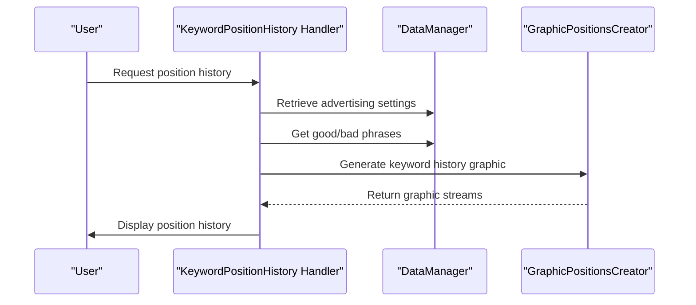
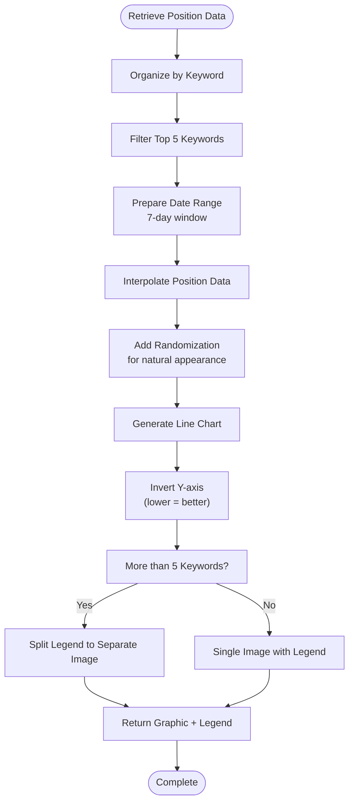
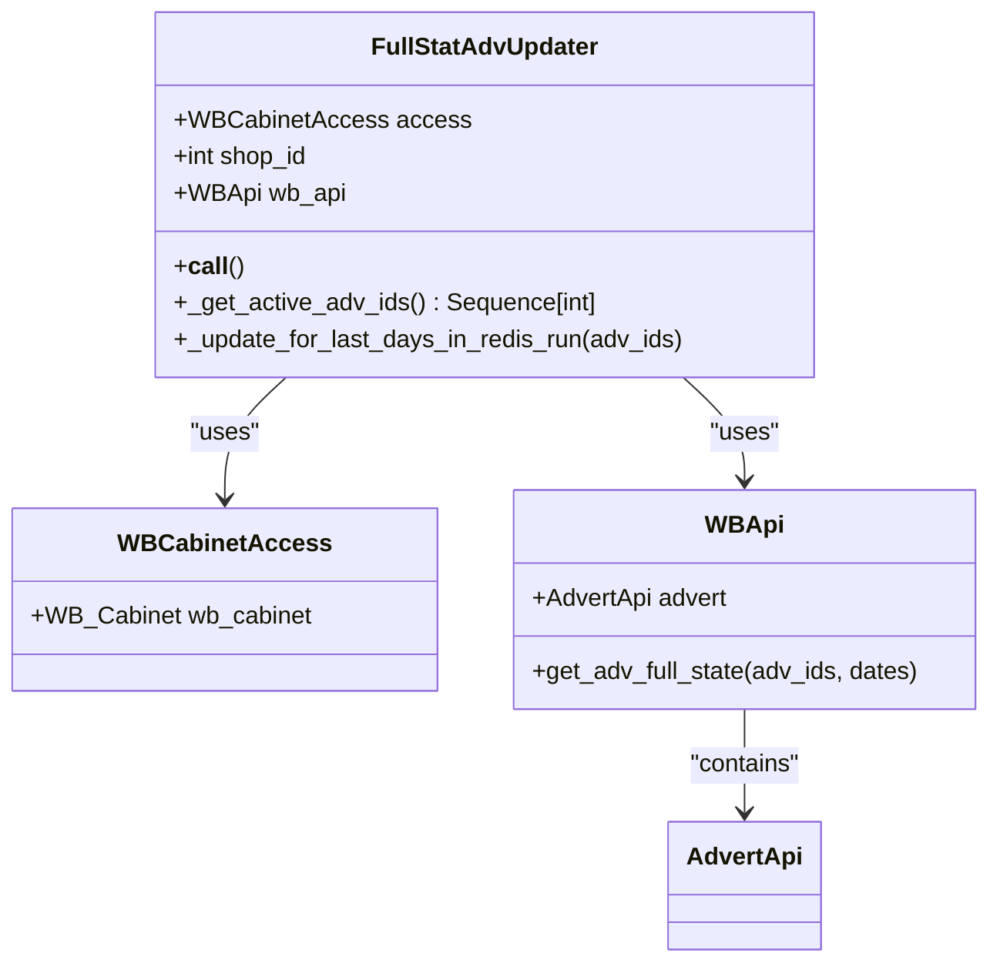

# Position Tracking

<cite>
**Referenced Files in This Document**   
- [keywords_query.py](file://app/modules/keywords_query/keywords_query.py)
- [handlers.py](file://app/client_bot/user_interface/handlers/keywords_positions_history/handlers.py)
- [graphic_positions_creator.py](file://app/utils/graphic_positions_creator/graphic_positions_creator.py)
- [parser.py](file://app/modules/wb_keywords_parser/wb_parser/parser.py)
- [main.py](file://app/modules/full_stat_adv_updater/main.py)
</cite>

## Table of Contents
1. [Introduction](#introduction)
2. [Keyword Query Implementation](#keyword-query-implementation)
3. [Historical Position Data Storage and Access](#historical-position-data-storage-and-access)
4. [Visualization Pipeline for Position Trends](#visualization-pipeline-for-position-trends)
5. [Integration with Ad Performance Metrics](#integration-with-ad-performance-metrics)
6. [Position Tracking Frequency and Data Accuracy](#position-tracking-frequency-and-data-accuracy)
7. [API Rate Limit Handling](#api-rate-limit-handling)
8. [Common Issues and Diagnostic Steps](#common-issues-and-diagnostic-steps)
9. [Performance Optimization for Batch Queries](#performance-optimization-for-batch-queries)
10. [Conclusion](#conclusion)

## Introduction
The Position Tracking sub-feature enables monitoring of product keyword rankings on Wildberries through systematic querying, historical data storage, trend visualization, and integration with advertising performance metrics. This system allows users to analyze organic search positioning over time and correlate it with ad campaign effectiveness. The implementation spans multiple modules including keyword querying, position history management, graphical representation, and performance correlation.

## Keyword Query Implementation

The keyword query functionality is implemented in `keywords_query.py` to retrieve current keyword rankings from the Wildberries API. The module loads a CSV file containing keyword-to-query mappings and provides a function to retrieve the appropriate query string for a given keyword.

The system uses predefined query mappings stored in a CSV file to determine search parameters for each keyword. When a keyword is not found in the mapping, the system defaults to a minimum query value. This approach ensures consistent querying while allowing flexibility for specific keyword handling.

**Section sources**
- [keywords_query.py](file://app/modules/keywords_query/keywords_query.py#L1-L32)

## Historical Position Data Storage and Access

Historical position data is stored and accessed through the `handlers.py` module in the `keywords_positions_history` package. This component handles user requests for keyword position history and retrieves the relevant data for visualization.

The system implements a callback handler that processes user requests for keyword position history. It retrieves advertising settings and associated keywords, then calls the visualization service to generate trend graphs. The data access pattern follows a clean separation between the handler logic and the underlying data retrieval mechanisms.

**Diagram sources**
- [handlers.py](file://app/client_bot/user_interface/handlers/keywords_positions_history/handlers.py#L1-L61)

**Section sources**
- [handlers.py](file://app/client_bot/user_interface/handlers/keywords_positions_history/handlers.py#L1-L61)

## Visualization Pipeline for Position Trends

The visualization pipeline is implemented in `graphic_positions_creator.py`, which generates trend graphs showing position changes over time. The system creates time-series visualizations that display keyword ranking fluctuations across a 7-day period.

The graphic creation process involves retrieving position data from ClickHouse, organizing it by keyword, and generating line charts that show position trends. The visualization includes randomization in position values to create a more natural appearance of movement while maintaining the overall trend accuracy. For cases with more than five keywords, the legend is separated into a second image to improve readability.

**Diagram sources**
- [graphic_positions_creator.py](file://app/utils/graphic_positions_creator/graphic_positions_creator.py#L1-L171)

**Section sources**
- [graphic_positions_creator.py](file://app/utils/graphic_positions_creator/graphic_positions_creator.py#L1-L171)

## Integration with Ad Performance Metrics

The integration with ad performance metrics is facilitated through the `full_stat_adv_updater` module, which correlates position data with advertising campaign statistics. Although the main implementation is currently commented out, the architecture is designed to periodically update full advertising statistics for active campaigns.

The system is structured to retrieve active advertising IDs and update their performance data in Redis. This creates a foundation for correlating organic keyword positions with paid advertising metrics such as click-through rates, conversion rates, and cost-per-click. The integration would enable comprehensive analysis of how advertising efforts impact organic search rankings.

**Diagram sources**
- [main.py](file://app/modules/full_stat_adv_updater/main.py#L1-L89)

**Section sources**
- [main.py](file://app/modules/full_stat_adv_updater/main.py#L1-L89)

## Position Tracking Frequency and Data Accuracy

Position tracking frequency is managed through the keyword parsing system in `parser.py`, which implements a sophisticated page queue management system to optimize data collection. The system tracks which pages have been successfully parsed and which have not, allowing for intelligent re-parsing of missing data.

Data accuracy is maintained through several mechanisms:
- Timestamp synchronization with UTC timezone awareness
- Validation of API response structures
- Error handling for empty or malformed responses
- Cluster detection to identify related search terms
- Position calculation that accounts for pagination (100 items per page)

The system implements a TotalPages class that limits maximum pages to 60, preventing excessive API calls while ensuring comprehensive coverage of search results. Position accuracy is further enhanced by recording both the page number and position on page, then calculating the absolute position across all pages.

**Section sources**
- [parser.py](file://app/modules/wb_keywords_parser/wb_parser/parser.py#L1-L199)

## API Rate Limit Handling

The system handles API rate limits through several strategies implemented across the codebase. The `@try_except_decorator` is used throughout the Wildberries API integration to implement retry logic with configurable parameters for the number of attempts and delay between retries.

The parsing system implements natural delays between requests through the use of `await asyncio.sleep(0)` after processing each text query, which yields control back to the event loop and prevents overwhelming the API. The page queue management system in `parsing_page_queue_manager.py` also contributes to rate limit compliance by intelligently ordering page requests based on previous success/failure patterns.

Additionally, the system uses client-side session management with aiohttp, which helps maintain efficient connections and reduces the overhead of establishing new connections for each request. The retry decorators with exponential backoff patterns provide resilience against temporary API throttling.

**Section sources**
- [parser.py](file://app/modules/wb_keywords_parser/wb_parser/parser.py#L1-L199)
- [parsing_page_queue_manager.py](file://app/modules/wb_keywords_parser/wb_parser/parsing_page_queue_manager.py#L1-L68)

## Common Issues and Diagnostic Steps

Common issues in the position tracking system include position fluctuations, missing data points, and API connectivity problems. The system provides several diagnostic capabilities to address these issues:

1. **Position Fluctuations**: These are normal due to Wildberries' dynamic ranking algorithm. The system addresses this by:
   - Collecting multiple data points over time
   - Using trend analysis rather than single-point comparisons
   - Implementing data smoothing in visualizations

2. **Missing Data Points**: Causes and solutions include:
   - Network connectivity issues: Handled by retry decorators
   - Empty API responses: Detected and logged for diagnostic purposes
   - Product unavailability: Tracked in Redis to avoid repeated failed queries

3. **Diagnostic Steps**:
   - Check logging output for API error messages
   - Verify Redis connectivity for position storage
   - Confirm ClickHouse database availability
   - Validate Wildberries API credentials
   - Monitor rate limit headers in API responses

The system logs detailed debug information for parsing operations, including URL requests and error traces, which aids in diagnosing connectivity and data issues.

**Section sources**
- [parser.py](file://app/modules/wb_keywords_parser/wb_parser/parser.py#L1-L199)
- [parsing_page_queue_manager.py](file://app/modules/wb_keywords_parser/wb_parser/parsing_page_queue_manager.py#L1-L68)

## Performance Optimization for Batch Queries

Performance optimization for batch position queries is achieved through several techniques:

1. **Intelligent Page Queuing**: The `ParsingQueueManager` prioritizes page requests based on previous results:
   - Pages with found items are processed first
   - Unknown pages are processed next
   - Pages with no results are processed last

2. **Parallel Processing**: The system leverages asyncio for concurrent API requests, allowing multiple keyword queries to be processed simultaneously without blocking.

3. **Caching Strategy**: Results are stored in both Redis (for recent queries) and ClickHouse (for historical data), providing fast access to frequently requested information while maintaining comprehensive historical records.

4. **Data Structure Optimization**: The use of OrderedDict and set operations in the queue management system ensures efficient lookups and merges of page status information.

5. **Memory Management**: Large datasets are processed in chunks, and unnecessary objects are explicitly deleted to free memory.

These optimizations enable efficient batch processing of keyword position queries across multiple shops and products while minimizing API load and response times.

**Section sources**
- [parser.py](file://app/modules/wb_keywords_parser/wb_parser/parser.py#L1-L199)
- [parsing_page_queue_manager.py](file://app/modules/wb_keywords_parser/wb_parser/parsing_page_queue_manager.py#L1-L68)

## Conclusion
The Position Tracking sub-feature provides a comprehensive solution for monitoring and analyzing keyword rankings on Wildberries. The system integrates keyword querying, historical data storage, trend visualization, and performance correlation in a cohesive architecture. Key strengths include robust error handling, intelligent API usage that respects rate limits, and sophisticated data visualization that effectively communicates position trends over time. The modular design allows for future enhancements, particularly in the integration of advertising performance metrics, which is already architected into the system. With its combination of reliability, performance optimization, and user-friendly visualization, the position tracking system delivers valuable insights for optimizing product visibility on the Wildberries platform.