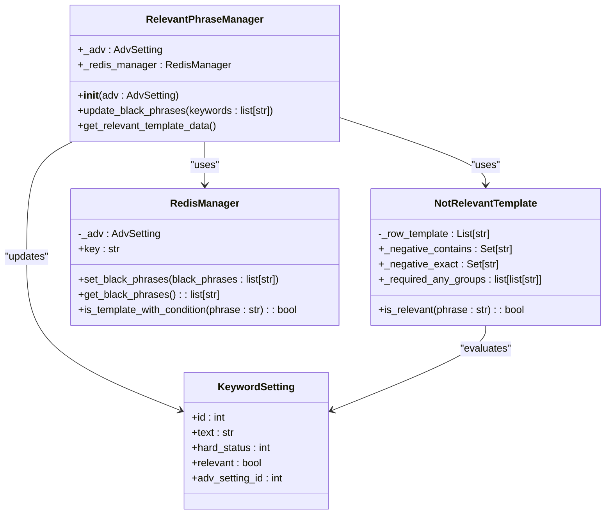
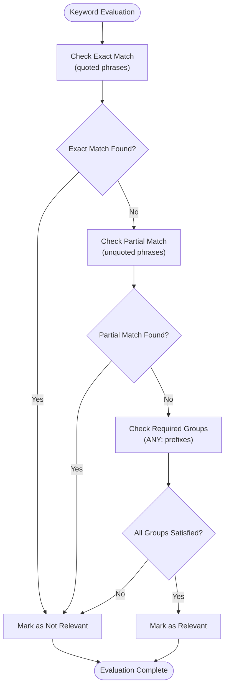
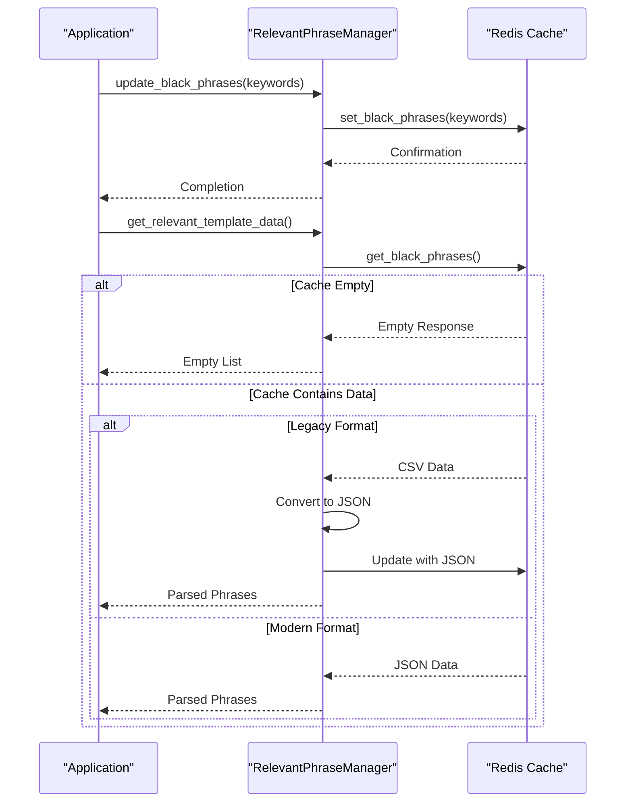
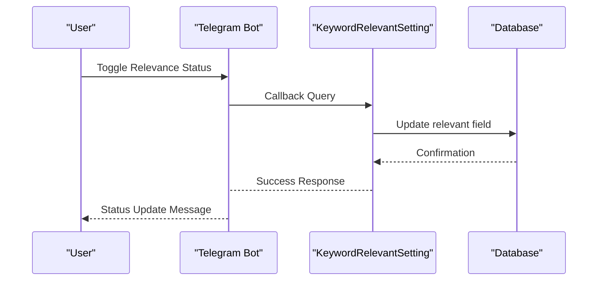
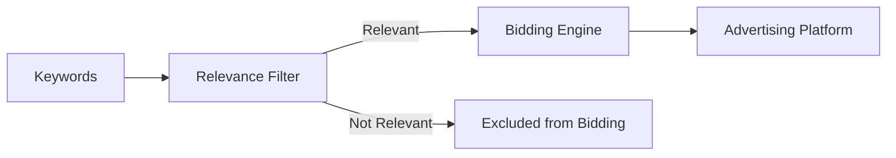

# Relevance Filtering

<cite>
**Referenced Files in This Document**   
- [relevant_phrase_manager.py](file://app/modules/relevant_phrase_manager/relevant_phrase_manager.py)
- [not_relevante_template.py](file://app/modules/relevant_phrase_manager/not_relevante_template.py)
- [redis_manager.py](file://app/modules/relevant_phrase_manager/redis_manager/redis_manager.py)
- [keyword_relevant_setting.py](file://app/client_bot/user_interface/handlers/keyword_relevant_setting.py)
- [models.py](file://app/modules/common_slaves/wildberries/models/models.py)
- [add_relevant_to_keywordsetting.py](file://alembic/versions/3a55768aa832_add_relevant_to_keywordsetting.py)
</cite>

## Table of Contents
1. [Introduction](#introduction)
2. [Core Components](#core-components)
3. [Relevance Determination Logic](#relevance-determination-logic)
4. [Exclusion Pattern Definition](#exclusion-pattern-definition)
5. [Redis Caching Mechanism](#redis-caching-mechanism)
6. [User Interface for Relevance Configuration](#user-interface-for-relevance-configuration)
7. [Integration with Advertising System](#integration-with-advertising-system)
8. [Common Issues and Troubleshooting](#common-issues-and-troubleshooting)
9. [Performance Considerations](#performance-considerations)
10. [Conclusion](#conclusion)

## Introduction
The Relevance Filtering sub-feature enables precise control over keyword relevance in advertising campaigns by combining product matching logic with user-defined rules. This system prevents bidding on irrelevant keywords, improving campaign efficiency and reducing wasted ad spend. The implementation leverages a multi-layered approach involving rule-based filtering, Redis caching for performance, and user-configurable settings.

**Section sources**
- [relevant_phrase_manager.py](file://app/modules/relevant_phrase_manager/relevant_phrase_manager.py#L1-L44)
- [not_relevante_template.py](file://app/modules/relevant_phrase_manager/not_relevante_template.py#L1-L82)

## Core Components
The Relevance Filtering system consists of several interconnected components that work together to determine keyword relevance:

- **RelevantPhraseManager**: Orchestrates the relevance filtering process and interfaces with other components
- **NotRelevantTemplate**: Implements the logic for determining keyword relevance based on exclusion patterns
- **RedisManager**: Handles caching of blacklisted phrases in Redis for fast access
- **KeywordSetting Model**: Stores relevance status for individual keywords in the database
- **User Interface Handlers**: Allow users to configure relevance settings and view filtered results



**Diagram sources**
- [relevant_phrase_manager.py](file://app/modules/relevant_phrase_manager/relevant_phrase_manager.py#L1-L44)
- [not_relevante_template.py](file://app/modules/relevant_phrase_manager/not_relevante_template.py#L1-L82)
- [redis_manager.py](file://app/modules/relevant_phrase_manager/redis_manager/redis_manager.py#L1-L57)
- [models.py](file://app/modules/common_slaves/wildberries/models/models.py#L200-L400)

## Relevance Determination Logic
The relevance determination process evaluates keywords against user-defined rules to determine whether they should be considered relevant for advertising campaigns. The system uses a hierarchical evaluation approach with multiple rule types:

1. **Exact Match Exclusion**: Keywords that exactly match phrases enclosed in quotes are considered irrelevant
2. **Partial Match Exclusion**: Keywords containing unquoted phrases are considered irrelevant
3. **Required Group Matching**: Keywords must contain at least one term from each "ANY:" group to be considered relevant

The evaluation follows a specific order where exact matches take precedence over partial matches, and all required groups must be satisfied. This allows for sophisticated filtering rules that can handle complex relevance criteria.



**Diagram sources**
- [not_relevante_template.py](file://app/modules/relevant_phrase_manager/not_relevante_template.py#L1-L82)

**Section sources**
- [not_relevante_template.py](file://app/modules/relevant_phrase_manager/not_relevante_template.py#L1-L82)
- [relevant_phrase_manager.py](file://app/modules/relevant_phrase_manager/relevant_phrase_manager.py#L1-L44)

## Exclusion Pattern Definition
The exclusion pattern system in `not_relevante_template.py` provides a flexible syntax for defining relevance rules through three distinct pattern types:

- **Quoted Phrases**: Enclosed in single or double quotes, these represent exact matches that must be fully present in the keyword
- **Unquoted Phrases**: These represent partial matches where the phrase can appear anywhere within the keyword text
- **ANY: Groups**: Comma-separated lists prefixed with "ANY:" that require at least one term from the group to be present

The system also supports the "NOT:" prefix to explicitly indicate negation, though this is primarily for readability as all exclusion patterns are inherently negative. The pattern parser normalizes input by stripping whitespace and handling the various syntax elements appropriately.

```mermaid
classDiagram
class NotRelevantTemplate {
-_row_template : List[str]
+_negative_contains : Set[str]
+_negative_exact : Set[str]
+_required_any_groups : list[list[str]]
+is_relevant(phrase : str) : bool
+_is_quoted(text : str) : bool
+_strip_not_prefix(text : str) : str
}
NotRelevantTemplate : +is_relevant() evaluates all three rule types
NotRelevantTemplate : +_negative_contains contains unquoted phrases
NotRelevantTemplate : +_negative_exact contains quoted phrases
NotRelevantTemplate : +_required_any_groups contains ANY : groups
```

**Diagram sources**
- [not_relevante_template.py](file://app/modules/relevant_phrase_manager/not_relevante_template.py#L1-L82)

**Section sources**
- [not_relevante_template.py](file://app/modules/relevant_phrase_manager/not_relevante_template.py#L1-L82)

## Redis Caching Mechanism
The Redis caching system optimizes performance by storing blacklisted phrases in Redis, enabling fast retrieval and reducing database load. The `RedisManager` class implements a robust caching strategy with backward compatibility for legacy data formats.

When retrieving phrases, the system first checks for legacy CSV format and automatically migrates it to the current JSON format. This ensures seamless upgrades without data loss. The cache key is generated using the advertising setting ID, providing isolation between different campaigns.



**Diagram sources**
- [redis_manager.py](file://app/modules/relevant_phrase_manager/redis_manager/redis_manager.py#L1-L57)
- [relevant_phrase_manager.py](file://app/modules/relevant_phrase_manager/relevant_phrase_manager.py#L1-L44)

**Section sources**
- [redis_manager.py](file://app/modules/relevant_phrase_manager/redis_manager/redis_manager.py#L1-L57)

## User Interface for Relevance Configuration
The user interface in `keyword_relevant_setting.py` enables users to manually adjust the relevance status of individual keywords through callback handlers. Users can toggle keywords between relevant and non-relevant states, with immediate updates reflected in the database.

The interface integrates with the broader advertising management system, allowing users to filter keyword lists to show only relevant phrases or include non-relevant ones. This provides flexibility in managing keyword portfolios while maintaining control over campaign targeting.



**Diagram sources**
- [keyword_relevant_setting.py](file://app/client_bot/user_interface/handlers/keyword_relevant_setting.py#L1-L39)

**Section sources**
- [keyword_relevant_setting.py](file://app/client_bot/user_interface/handlers/keyword_relevant_setting.py#L1-L39)
- [models.py](file://app/modules/common_slaves/wildberries/models/models.py#L200-L400)

## Integration with Advertising System
The relevance filtering system integrates tightly with the core advertising system to prevent bidding on irrelevant keywords. When keywords are processed for bidding, their relevance status is checked and non-relevant keywords are excluded from bidding consideration.

The integration occurs at multiple levels:
- During keyword analysis, relevance status is included in keyword statistics
- The bidding engine respects the `relevant` flag in `KeywordSetting` records
- Campaign performance reports filter results based on relevance when requested

This integration ensures that advertising budget is focused only on keywords that meet the relevance criteria, improving overall campaign efficiency and return on ad spend.



**Diagram sources**
- [relevant_phrase_manager.py](file://app/modules/relevant_phrase_manager/relevant_phrase_manager.py#L1-L44)
- [models.py](file://app/modules/common_slaves/wildberries/models/models.py#L200-L400)

**Section sources**
- [relevant_phrase_manager.py](file://app/modules/relevant_phrase_manager/relevant_phrase_manager.py#L1-L44)
- [models.py](file://app/modules/common_slaves/wildberries/models/models.py#L200-L400)
- [add_relevant_to_keywordsetting.py](file://alembic/versions/3a55768aa832_add_relevant_to_keywordsetting.py#L1-L31)

## Common Issues and Troubleshooting
Several common issues may arise when using the relevance filtering system, along with their troubleshooting steps:

**Issue 1: False Negatives in Relevance Detection**
- **Symptoms**: Relevant keywords incorrectly marked as non-relevant
- **Causes**: Overly broad exclusion patterns, incorrect quoting, or missing ANY: group requirements
- **Troubleshooting**: Review exclusion patterns for unintended matches, verify proper syntax, and test with specific examples

**Issue 2: Cache Inconsistencies**
- **Symptoms**: Relevance rules not being applied consistently
- **Causes**: Redis cache not updated after rule changes
- **Troubleshooting**: Verify that `update_black_phrases` is called after rule modifications and check Redis connectivity

**Issue 3: Performance Degradation with Large Keyword Sets**
- **Symptoms**: Slow response times when processing many keywords
- **Causes**: Inefficient pattern matching or excessive database queries
- **Troubleshooting**: Ensure Redis caching is functioning properly and consider optimizing exclusion patterns

**Issue 4: Migration Problems from Legacy Format**
- **Symptoms**: Data loss or corruption during system upgrades
- **Causes**: Failed automatic migration from CSV to JSON format
- **Troubleshooting**: Verify the migration logic in `get_black_phrases` and check Redis data integrity

**Section sources**
- [not_relevante_template.py](file://app/modules/relevant_phrase_manager/not_relevante_template.py#L1-L82)
- [redis_manager.py](file://app/modules/relevant_phrase_manager/redis_manager/redis_manager.py#L1-L57)

## Performance Considerations
The relevance filtering system is designed with performance optimization in mind, particularly when evaluating large keyword sets. The primary performance strategy is the use of Redis caching to minimize database queries and enable fast pattern retrieval.

For large-scale operations, the system batches database updates to reduce transaction overhead. The pattern matching algorithm is optimized to short-circuit evaluation as soon as irrelevance is determined, avoiding unnecessary processing.

When evaluating performance, consider the following factors:
- **Cache Hit Rate**: Monitor Redis cache effectiveness to ensure frequently accessed patterns are cached
- **Pattern Complexity**: Simplify exclusion rules when possible to reduce evaluation time
- **Batch Processing**: Process keywords in batches rather than individually to leverage database optimization
- **Memory Usage**: Monitor Redis memory consumption, especially with large exclusion lists

The system automatically handles format migration from legacy CSV to modern JSON, which improves parsing performance and reduces storage requirements.

**Section sources**
- [redis_manager.py](file://app/modules/relevant_phrase_manager/redis_manager/redis_manager.py#L1-L57)
- [not_relevante_template.py](file://app/modules/relevant_phrase_manager/not_relevante_template.py#L1-L82)

## Conclusion
The Relevance Filtering sub-feature provides a comprehensive solution for managing keyword relevance in advertising campaigns. By combining flexible rule-based filtering, efficient Redis caching, and user-friendly configuration interfaces, the system enables precise control over campaign targeting.

Key strengths of the implementation include its hierarchical evaluation logic, backward compatibility with legacy data formats, and tight integration with the core advertising system. The ability to define complex exclusion patterns using exact matches, partial matches, and required groups provides significant flexibility in crafting relevance rules.

For optimal results, users should regularly review and refine their exclusion patterns, monitor cache performance, and leverage the manual relevance override capabilities when needed. This ensures that advertising budgets are focused on the most relevant keywords, maximizing campaign efficiency and return on investment.