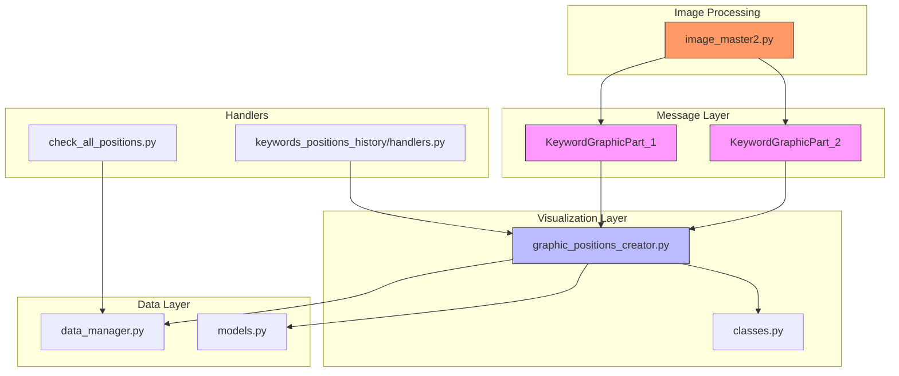
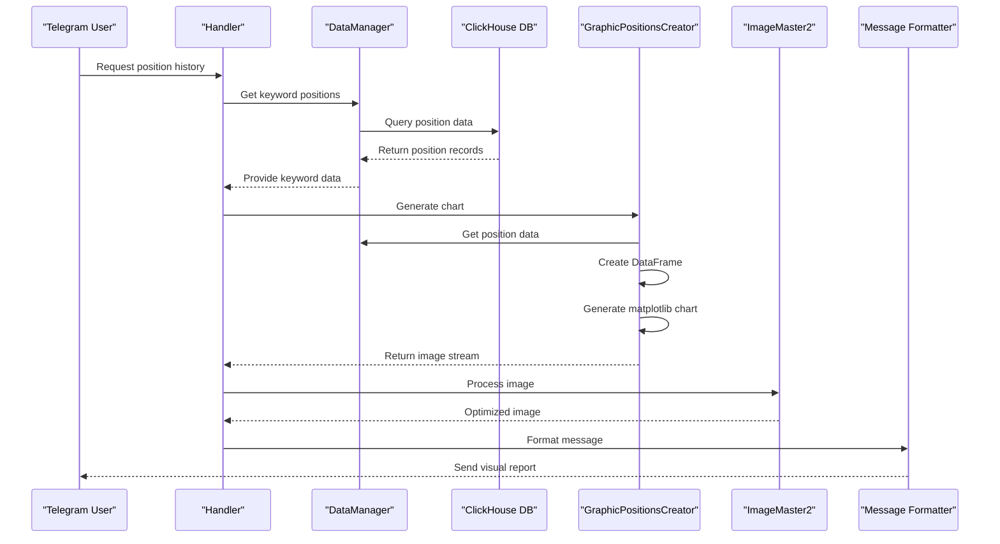
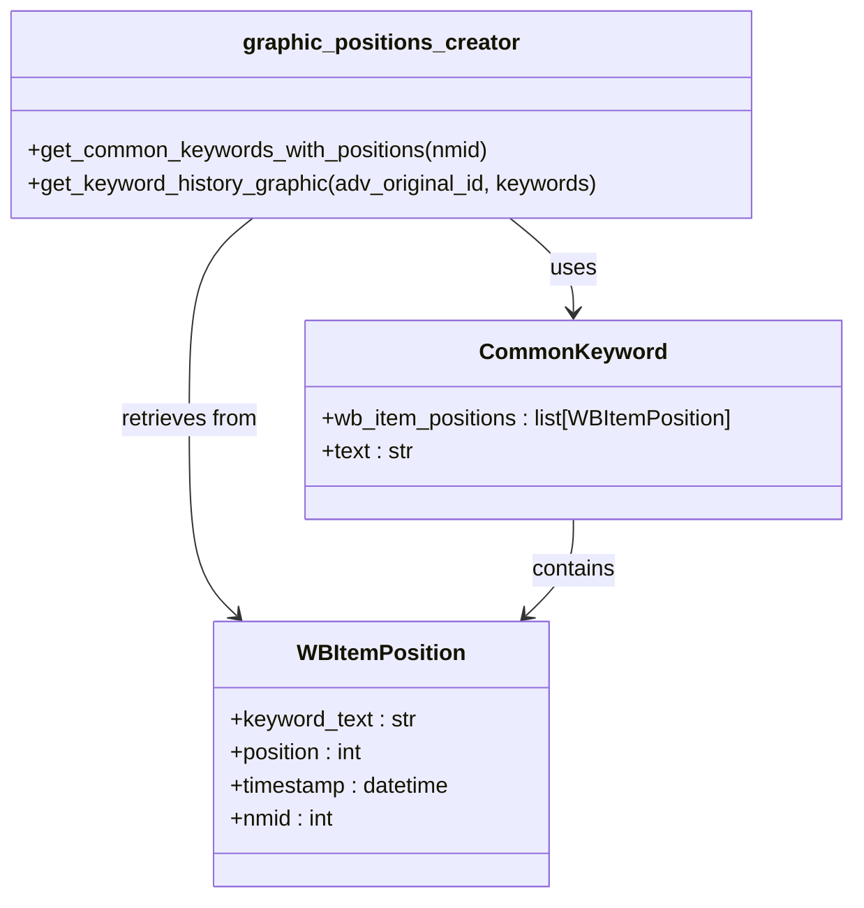
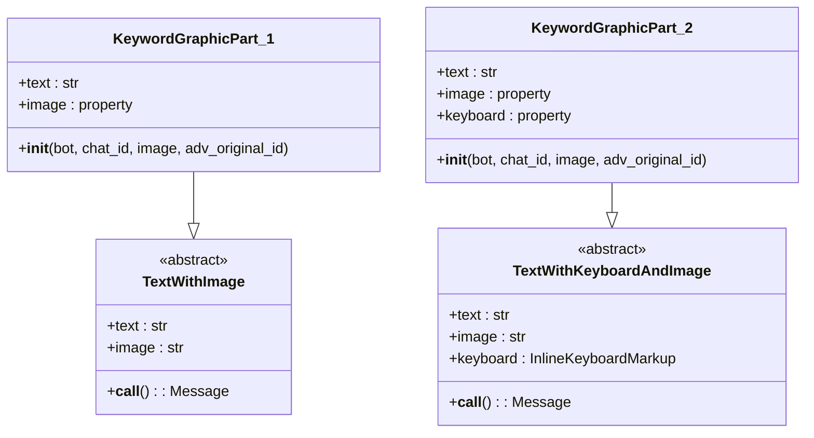
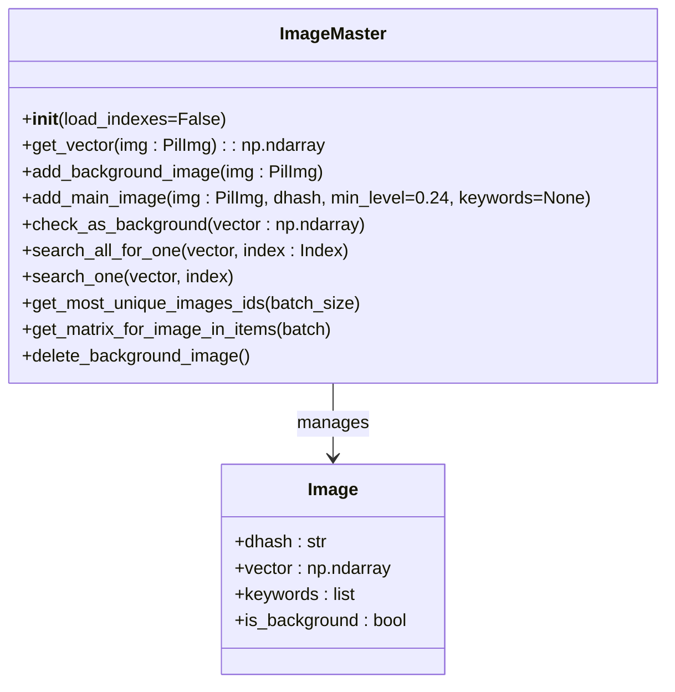
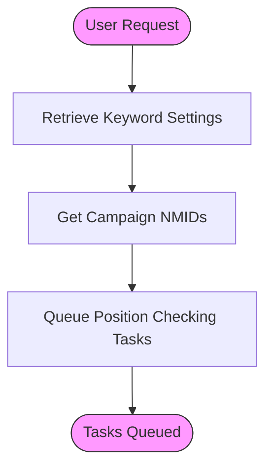
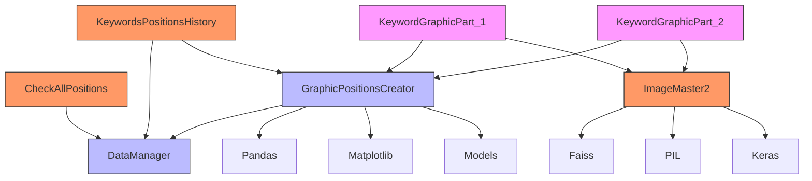

# Graphical Reporting System

<cite>
**Referenced Files in This Document**   
- [positions_graphic_messanges.py](file://app/client_bot/user_interface/views/messages/positions_graphic_messanges/positions_graphic_messanges.py)
- [graphic_positions_creator.py](file://app/utils/graphic_positions_creator/graphic_positions_creator.py)
- [classes.py](file://app/utils/graphic_positions_creator/classes.py)
- [image_master2.py](file://app/utils/image_master/image_master2.py)
- [check_all_positions.py](file://app/client_bot/user_interface/handlers/check_all_positions.py)
- [handlers.py](file://app/client_bot/user_interface/handlers/keywords_positions_history/handlers.py)
- [adv_keyword_messages.py](file://app/client_bot/user_interface/views/messages/adv_keyword_messages/adv_keyword_messages.py)
- [data_manager.py](file://app/modules/wb_adv_updater/data_manager.py)
- [models.py](file://app/modules/common_slaves/wildberries/models/models.py)
</cite>

## Table of Contents
1. [Introduction](#introduction)
2. [Project Structure](#project-structure)
3. [Core Components](#core-components)
4. [Architecture Overview](#architecture-overview)
5. [Detailed Component Analysis](#detailed-component-analysis)
6. [Dependency Analysis](#dependency-analysis)
7. [Performance Considerations](#performance-considerations)
8. [Troubleshooting Guide](#troubleshooting-guide)
9. [Conclusion](#conclusion)

## Introduction
The Graphical Reporting System is designed to visualize keyword position history for advertising campaigns on the Wildberries platform. This system generates rich message responses with embedded charts that display organic positioning trends over time. The reporting pipeline integrates multiple components to collect position data, generate visualizations, process images, and deliver formatted messages through Telegram. The system enables users to monitor keyword performance, identify trends and anomalies, and make data-driven optimization decisions for their advertising strategies.

## Project Structure
The graphical reporting system is organized across multiple directories within the application structure. Key components are located in specific modules:
- Message generation and templates in `app/client_bot/user_interface/views/messages/`
- Chart creation utilities in `app/utils/graphic_positions_creator/`
- Image processing functionality in `app/utils/image_master/`
- Data management and retrieval in `app/modules/wb_adv_updater/`
- Handler logic in `app/client_bot/user_interface/handlers/`

The system follows a modular architecture with clear separation between data retrieval, visualization generation, message formatting, and delivery components.

**Diagram sources**
- [positions_graphic_messanges.py](file://app/client_bot/user_interface/views/messages/positions_graphic_messanges/positions_graphic_messanges.py)
- [graphic_positions_creator.py](file://app/utils/graphic_positions_creator/graphic_positions_creator.py)
- [image_master2.py](file://app/utils/image_master/image_master2.py)
- [data_manager.py](file://app/modules/wb_adv_updater/data_manager.py)

**Section sources**
- [positions_graphic_messanges.py](file://app/client_bot/user_interface/views/messages/positions_graphic_messanges/positions_graphic_messanges.py)
- [graphic_positions_creator.py](file://app/utils/graphic_positions_creator/graphic_positions_creator.py)
- [image_master2.py](file://app/utils/image_master/image_master2.py)

## Core Components
The graphical reporting system consists of several core components that work together to generate visual reports of keyword position history. The system begins with data collection from ClickHouse database through the data_manager module, which retrieves historical position data for specific product identifiers (nmids). This data is processed by the graphic_positions_creator module to generate matplotlib charts showing position trends over a 7-day period. The visualization is then formatted into Telegram-compatible messages using the positions_graphic_messanges components, which create multi-part messages with charts and legends. The image_master2 component handles image optimization and processing to ensure appropriate file sizes and formats for Telegram delivery.

**Section sources**
- [graphic_positions_creator.py](file://app/utils/graphic_positions_creator/graphic_positions_creator.py)
- [positions_graphic_messanges.py](file://app/client_bot/user_interface/views/messages/positions_graphic_messanges/positions_graphic_messanges.py)
- [image_master2.py](file://app/utils/image_master/image_master2.py)

## Architecture Overview
The graphical reporting system follows a pipeline architecture that transforms raw position data into visual reports. The process begins when a user requests keyword position history through a Telegram interface. The request triggers the check_all_positions handler, which initiates data collection for all keywords in an advertising campaign. The system retrieves position data from ClickHouse database using the data_manager component, which queries historical records of keyword positions. This data is then processed by the graphic_positions_creator module, which creates matplotlib visualizations with specific styling for Telegram display. The generated charts are formatted into message components by the positions_graphic_messanges module, which can split charts and legends into separate messages when necessary. Finally, the image_master2 component ensures proper image optimization before delivery to the user.

**Diagram sources**
- [check_all_positions.py](file://app/client_bot/user_interface/handlers/check_all_positions.py)
- [data_manager.py](file://app/modules/wb_adv_updater/data_manager.py)
- [graphic_positions_creator.py](file://app/utils/graphic_positions_creator/graphic_positions_creator.py)
- [image_master2.py](file://app/utils/image_master/image_master2.py)

## Detailed Component Analysis

### Graphic Positions Creator Analysis
The graphic_positions_creator module is responsible for generating visualizations of keyword position history. It uses matplotlib to create line charts that display position trends over time, with specific styling optimized for Telegram display. The module processes position data from ClickHouse and organizes it into a pandas DataFrame for visualization. The chart displays up to five keywords sorted by their best position, with data points interpolated for dates without direct measurements. The visualization includes randomization in position values to create a more natural appearance of movement, while maintaining the overall trend accuracy.

**Diagram sources**
- [graphic_positions_creator.py](file://app/utils/graphic_positions_creator/graphic_positions_creator.py)
- [classes.py](file://app/utils/graphic_positions_creator/classes.py)
- [models.py](file://app/modules/common_slaves/wildberries/models/models.py)

**Section sources**
- [graphic_positions_creator.py](file://app/utils/graphic_positions_creator/graphic_positions_creator.py)
- [classes.py](file://app/utils/graphic_positions_creator/classes.py)

### Positions Graphic Messages Analysis
The positions_graphic_messanges module handles the formatting of visual reports for Telegram delivery. It defines message classes that encapsulate both image content and text formatting. The system uses two message components (KeywordGraphicPart_1 and KeywordGraphicPart_2) to handle cases where charts and legends need to be sent as separate messages due to size constraints or display requirements. These message classes inherit from base templates that handle the Telegram API integration, ensuring proper formatting and delivery of rich media messages.

**Diagram sources**
- [positions_graphic_messanges.py](file://app/client_bot/user_interface/views/messages/positions_graphic_messanges/positions_graphic_messanges.py)
- [templates.py](file://app/client_bot/user_interface/message_templates/templates.py)

**Section sources**
- [positions_graphic_messanges.py](file://app/client_bot/user_interface/views/messages/positions_graphic_messanges/positions_graphic_messanges.py)

### Image Master Analysis
The image_master2 component handles image processing and optimization for the graphical reporting system. It provides functionality for adding, searching, and managing images in a FAISS index for similarity detection. The component includes methods for vectorizing images using VGG19 features, which allows for efficient similarity searches and duplicate detection. This ensures that generated charts are optimized for storage and delivery, with mechanisms to prevent redundant processing of similar visualizations.

**Diagram sources**
- [image_master2.py](file://app/utils/image_master/image_master2.py)
- [model.py](file://app/utils/image_master/database/model.py)

**Section sources**
- [image_master2.py](file://app/utils/image_master/image_master2.py)

### Check All Positions Analysis
The check_all_positions component triggers the reporting flow for all keywords in an advertising campaign. When activated, it retrieves all keyword settings for a specific campaign and queues tasks for position checking. This handler serves as the entry point for comprehensive position monitoring, initiating the data collection process that feeds into the visualization pipeline. The component uses a fast queue system to distribute position checking tasks efficiently across available resources.

**Diagram sources**
- [check_all_positions.py](file://app/client_bot/user_interface/handlers/check_all_positions.py)

**Section sources**
- [check_all_positions.py](file://app/client_bot/user_interface/handlers/check_all_positions.py)

## Dependency Analysis
The graphical reporting system has a well-defined dependency structure that ensures proper data flow from retrieval to visualization. The core dependencies flow from the handler components through the data management layer to the visualization and message formatting components. The graphic_positions_creator module depends on data_manager for position data retrieval and on matplotlib/pandas for visualization generation. The positions_graphic_messanges components depend on the graphic_positions_creator for image generation and on Telegram message templates for formatting. The image_master2 component provides image processing services that can be utilized by the message components for optimization. All components share dependencies on the database models for data structure definitions.

**Diagram sources**
- [check_all_positions.py](file://app/client_bot/user_interface/handlers/check_all_positions.py)
- [handlers.py](file://app/client_bot/user_interface/handlers/keywords_positions_history/handlers.py)
- [graphic_positions_creator.py](file://app/utils/graphic_positions_creator/graphic_positions_creator.py)
- [positions_graphic_messanges.py](file://app/client_bot/user_interface/views/messages/positions_graphic_messanges/positions_graphic_messanges.py)
- [image_master2.py](file://app/utils/image_master/image_master2.py)

**Section sources**
- [check_all_positions.py](file://app/client_bot/user_interface/handlers/check_all_positions.py)
- [handlers.py](file://app/client_bot/user_interface/handlers/keywords_positions_history/handlers.py)
- [graphic_positions_creator.py](file://app/utils/graphic_positions_creator/graphic_positions_creator.py)
- [positions_graphic_messanges.py](file://app/client_bot/user_interface/views/messages/positions_graphic_messanges/positions_graphic_messanges.py)
- [image_master2.py](file://app/utils/image_master/image_master2.py)

## Performance Considerations
The graphical reporting system incorporates several performance optimizations to handle rendering latency, image size, and data processing efficiency. The system uses asynchronous processing throughout the pipeline to prevent blocking operations, with database queries and image generation executed in non-blocking contexts. For chart rendering, the system limits visualization to the top five keywords by best position, reducing complexity and file size. The image_master2 component provides caching mechanisms through FAISS indexing, preventing redundant processing of similar images. The system also implements data batching and efficient querying patterns to minimize database load, particularly when retrieving position history from ClickHouse. Message splitting functionality allows large visualizations to be delivered in multiple parts, ensuring reliable delivery within Telegram's size constraints.

**Section sources**
- [graphic_positions_creator.py](file://app/utils/graphic_positions_creator/graphic_positions_creator.py)
- [image_master2.py](file://app/utils/image_master/image_master2.py)
- [data_manager.py](file://app/modules/wb_adv_updater/data_manager.py)

## Troubleshooting Guide
When troubleshooting issues with the graphical reporting system, consider the following common scenarios:

1. **Missing or blank charts**: Verify that position data exists in ClickHouse for the requested nmid. Check that the data_manager can successfully retrieve position records and that the graphic_positions_creator receives valid data.

2. **Performance issues**: Monitor rendering times and consider the number of keywords being processed. The system is optimized for up to five keywords in a single chart; larger sets may require pagination or filtering.

3. **Image quality problems**: Check that the image_master2 component is properly configured and that image optimization settings are appropriate for Telegram display requirements.

4. **Data inconsistencies**: Verify that timestamps in position data are properly timezone-aware, as the graphic_positions_creator expects UTC timestamps for accurate date range calculations.

5. **Message delivery failures**: Ensure that the message formatting components receive properly formatted image streams and that file size limits are respected for Telegram delivery.

**Section sources**
- [graphic_positions_creator.py](file://app/utils/graphic_positions_creator/graphic_positions_creator.py)
- [positions_graphic_messanges.py](file://app/client_bot/user_interface/views/messages/positions_graphic_messanges/positions_graphic_messanges.py)
- [image_master2.py](file://app/utils/image_master/image_master2.py)

## Conclusion
The Graphical Reporting System provides a comprehensive solution for visualizing keyword position history in advertising campaigns. By integrating data retrieval, visualization generation, image processing, and message formatting components, the system delivers rich, informative reports through Telegram. The architecture enables users to monitor keyword performance trends, identify optimization opportunities, and make data-driven decisions for their advertising strategies. The system's modular design allows for efficient processing and delivery of visual reports while maintaining flexibility for future enhancements and optimizations.