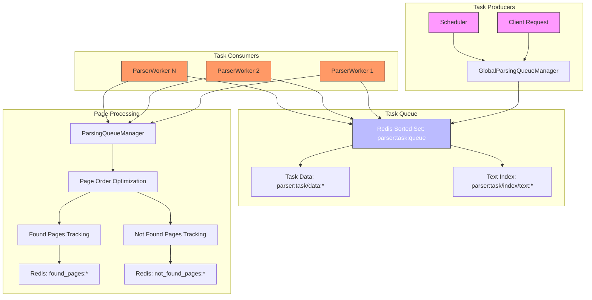
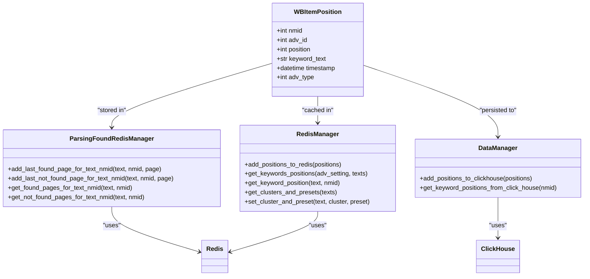
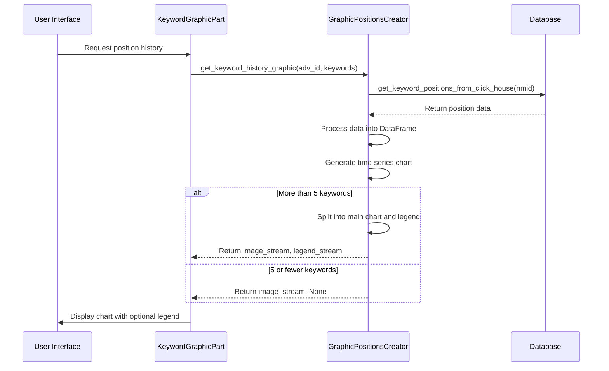
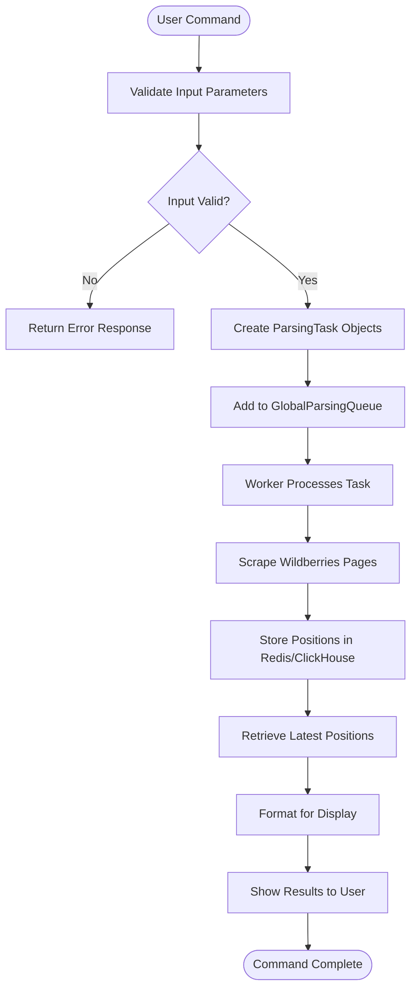
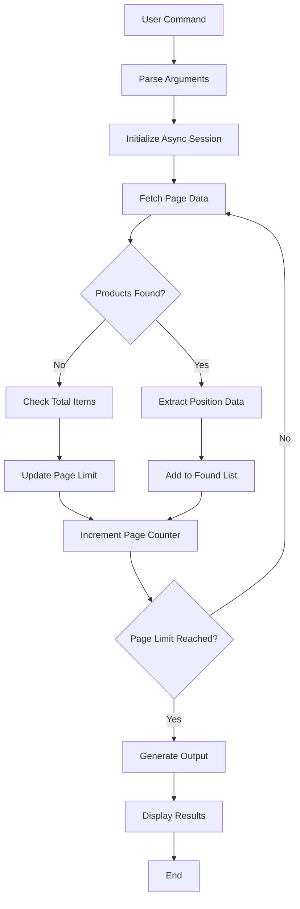
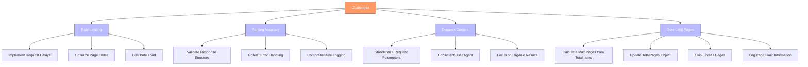
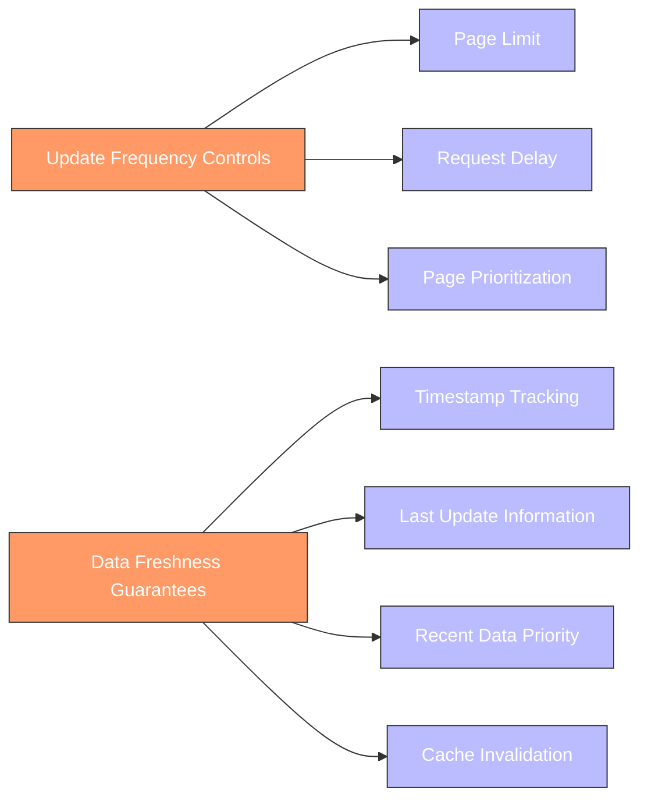

# Keyword Position Tracking

<cite>
**Referenced Files in This Document**   
- [parsing_task.py](file://app/modules/wb_keywords_parser/parsing_task.py) - *Updated in recent commit*
- [parser.py](file://app/modules/wb_keywords_parser/wb_parser/parser.py) - *Modified to handle over-limit pages*
- [parsing_page_queue_manager.py](file://app/modules/wb_keywords_parser/wb_parser/parsing_page_queue_manager.py) - *Updated for latest position prioritization*
- [parsing_found_redis_manager.py](file://app/modules/wb_keywords_parser/parsing_found_redis_manager.py) - *Updated in recent commit*
- [parser_worker.py](file://app/modules/wb_keywords_parser/parser_worker.py)
- [global_parsing_queue_manager.py](file://app/modules/wb_keywords_parser/global_parsing_queue_manager.py)
- [positions_graphic_messanges.py](file://app/client_bot/user_interface/views/messages/positions_graphic_messanges/positions_graphic_messanges.py)
- [graphic_positions_creator.py](file://app/utils/graphic_positions_creator/graphic_positions_creator.py)
- [classes.py](file://app/utils/graphic_positions_creator/classes.py)
- [data_manager.py](file://app/modules/wb_adv_updater/data_manager.py)
- [find_keyword_positions.py](file://scripts/find_keyword_positions.py) - *Added in recent commit*
</cite>

## Update Summary
**Changes Made**   
- Updated parsing workflow section to reflect changes in page handling and queue prioritization
- Added new section for diagnostic script functionality
- Enhanced distributed parsing architecture description with latest position prioritization logic
- Updated challenges section to include handling of over-limit pages
- Added sources for new script and updated files

## Table of Contents
1. [Introduction](#introduction)
2. [Parsing Workflow](#parsing-workflow)
3. [Distributed Parsing Architecture](#distributed-parsing-architecture)
4. [Position Data Storage and Retrieval](#position-data-storage-and-retrieval)
5. [Graphical Reporting System](#graphical-reporting-system)
6. [Position Checking Commands](#position-checking-commands)
7. [Diagnostic Tools](#diagnostic-tools)
8. [Challenges and Solutions](#challenges-and-solutions)
9. [Data Freshness and Update Controls](#data-freshness-and-update-controls)
10. [Interpretation and Optimization](#interpretation-and-optimization)
11. [Conclusion](#conclusion)

## Introduction
The keyword position tracking system monitors the placement of products in Wildberries search results for specific keywords. This document details the complete workflow from task creation to data visualization, covering the distributed architecture, data storage mechanisms, and reporting capabilities. The system enables users to track keyword performance, identify optimization opportunities, and make data-driven decisions for their advertising campaigns.

## Parsing Workflow

The parsing workflow begins with task creation in `parsing_task.py` and proceeds through page scraping in `parser.py`. The system follows a structured process to extract position data from Wildberries search results.

```mermaid
sequenceDiagram
participant Task as ParsingTask
participant Queue as GlobalParsingQueueManager
participant Worker as ParserWorker
participant Parser as ParserService
participant WB as Wildberries API
Task->>Queue : add_or_update_task(text, nmids)
Queue->>Queue : Store task in Redis queue
loop Worker Polling
Worker->>Queue : get_next_task()
alt Task Available
Queue->>Worker : Return ParsingTask
Worker->>Parser : _process_task(task)
Parser->>WB : parse_keywords_from_wb(text, page)
WB-->>Parser : Return search results
Parser->>Parser : Extract positions and metadata
Parser->>Redis : Store positions in Redis and ClickHouse
else No Task
Queue-->>Worker : Return None
Worker : Wait before next poll
end
end
```

**Section sources**
- [parsing_task.py](file://app/modules/wb_keywords_parser/parsing_task.py#L1-L25)
- [parser.py](file://app/modules/wb_keywords_parser/wb_parser/parser.py#L1-L325)

## Distributed Parsing Architecture

The system employs a distributed architecture using parsing queues and worker coordination to efficiently process keyword position tracking tasks. Multiple workers can operate in parallel, each processing tasks from a shared Redis-based queue.



The architecture features several key components:
- **GlobalParsingQueueManager**: Manages the central task queue in Redis, ensuring tasks are distributed efficiently among workers
- **ParserWorker**: Processes tasks from the queue, with configurable parallelism (default: 3 concurrent tasks)
- **ParsingQueueManager**: Optimizes page parsing order based on historical data to minimize requests, now prioritizing latest positions
- **ParsingFoundRedisManager**: Tracks which pages have been processed for specific keyword-NMID combinations

**Diagram sources**
- [global_parsing_queue_manager.py](file://app/modules/wb_keywords_parser/global_parsing_queue_manager.py#L1-L129)
- [parser_worker.py](file://app/modules/wb_keywords_parser/parser_worker.py#L1-L78)
- [parsing_page_queue_manager.py](file://app/modules/wb_keywords_parser/wb_parser/parsing_page_queue_manager.py#L1-L75)
- [parsing_found_redis_manager.py](file://app/modules/wb_keywords_parser/parsing_found_redis_manager.py#L1-L26)

**Section sources**
- [global_parsing_queue_manager.py](file://app/modules/wb_keywords_parser/global_parsing_queue_manager.py#L1-L129)
- [parser_worker.py](file://app/modules/wb_keywords_parser/parser_worker.py#L1-L78)
- [parsing_page_queue_manager.py](file://app/modules/wb_keywords_parser/wb_parser/parsing_page_queue_manager.py#L12-L73)
- [parsing_found_redis_manager.py](file://app/modules/wb_keywords_parser/parsing_found_redis_manager.py#L1-L25)

## Position Data Storage and Retrieval

Position data is stored in multiple locations for different use cases, with Redis providing fast access for real-time display and ClickHouse serving as the persistent data warehouse.



The data storage workflow follows these steps:
1. When a page is parsed, positions are extracted and stored in both Redis and ClickHouse
2. Redis stores the most recent position data for quick retrieval in the user interface
3. ClickHouse serves as the permanent data store for historical analysis and reporting
4. Additional metadata like cluster information and page history is maintained in Redis to optimize future parsing

**Diagram sources**
- [parsing_found_redis_manager.py](file://app/modules/wb_keywords_parser/parsing_found_redis_manager.py#L1-L26)
- [parser.py](file://app/modules/wb_keywords_parser/wb_parser/parser.py#L1-L325)
- [data_manager.py](file://app/modules/wb_adv_updater/data_manager.py#L1-L1683)

**Section sources**
- [parsing_found_redis_manager.py](file://app/modules/wb_keywords_parser/parsing_found_redis_manager.py#L1-L26)
- [parser.py](file://app/modules/wb_keywords_parser/wb_parser/parser.py#L1-L325)
- [data_manager.py](file://app/modules/wb_adv_updater/data_manager.py#L1557-L1595)

## Graphical Reporting System

The graphical reporting system visualizes position history through the `positions_graphic_messanges.py` module, which works in conjunction with the `graphic_positions_creator.py` utility to generate informative charts.



The system generates time-series charts showing keyword position trends over a 7-day period. Each keyword is represented as a line on the chart, with the y-axis inverted so that higher positions (closer to the top of search results) appear at the top of the chart. The x-axis shows the date, and the chart includes the current position of each keyword in parentheses in the legend.

**Diagram sources**
- [positions_graphic_messanges.py](file://app/client_bot/user_interface/views/messages/positions_graphic_messanges/positions_graphic_messanges.py#L1-L44)
- [graphic_positions_creator.py](file://app/utils/graphic_positions_creator/graphic_positions_creator.py#L1-L168)
- [classes.py](file://app/utils/graphic_positions_creator/classes.py#L1-L10)

**Section sources**
- [positions_graphic_messanges.py](file://app/client_bot/user_interface/views/messages/positions_graphic_messanges/positions_graphic_messanges.py#L1-L44)
- [graphic_positions_creator.py](file://app/utils/graphic_positions_creator/graphic_positions_creator.py#L38-L166)

## Position Checking Commands

The system supports various commands for checking keyword positions, with specific output formats designed for user clarity. These commands trigger the parsing workflow and present results in an accessible format.

Example command flow:
1. User requests position check for specific keywords
2. System creates parsing tasks for each keyword
3. Tasks are added to the global parsing queue
4. Worker processes tasks and scrapes Wildberries search results
5. Position data is stored and made available for display

The output format includes:
- Current position of the product for the keyword
- Timestamp of the last update
- Hard status indicators (e.g., "ЦП" for maximum position, "МП" for insufficient views)
- Additional statistics like clicks, views, and spend



**Diagram sources**
- [parsing_task.py](file://app/modules/wb_keywords_parser/parsing_task.py#L1-L25)
- [global_parsing_queue_manager.py](file://app/modules/wb_keywords_parser/global_parsing_queue_manager.py#L1-L129)
- [parser_worker.py](file://app/modules/wb_keywords_parser/parser_worker.py#L1-L78)

**Section sources**
- [parsing_task.py](file://app/modules/wb_keywords_parser/parsing_task.py#L1-L25)
- [parser.py](file://app/modules/wb_keywords_parser/wb_parser/parser.py#L1-L325)

## Diagnostic Tools

A new diagnostic script has been added to assist with troubleshooting and manual position verification. The `find_keyword_positions.py` script provides a standalone tool for checking product positions by keyword without affecting the main system's data storage.



The script accepts the following parameters:
- `--keyword`: Required keyword to search for
- `--nmid`: One or more NMIDs to track in the search results
- `--max-pages`: Maximum number of pages to check (default: 60, maximum: 60)
- `--verbose`: Enable detailed logging output

Example usage:
```bash
python scripts/find_keyword_positions.py --keyword "картина" --nmid 12345678 --max-pages 30
```

Output example:
```
Товар 12345678 (Картина масляная) найден на странице 3, позиция на странице 15, общая позиция 215
Товар 87654321 не найден в выдаче по заданному ключу
```

**Section sources**
- [find_keyword_positions.py](file://scripts/find_keyword_positions.py#L1-L224)

## Challenges and Solutions

The keyword position tracking system addresses several challenges inherent in web scraping and data processing at scale.

### Rate Limiting by Wildberries
Wildberries implements rate limiting to prevent excessive API usage. The system mitigates this through:
- Configurable delays between page requests (default: 0.1 seconds)
- Intelligent page ordering that prioritizes pages most likely to contain relevant results
- Distributed worker architecture that spreads requests over time

### Parsing Accuracy
Ensuring accurate parsing of search results is critical. The system handles this through:
- Robust error handling for malformed responses
- Validation of response structure before processing
- Fallback mechanisms when certain data points are missing
- Comprehensive logging for debugging parsing issues

### Handling Dynamic Content
Wildberries search results can vary based on user location, device, and other factors. The system addresses this by:
- Using consistent request parameters (dest=-1257786 for Moscow region)
- Standardizing the user agent and device type (appType=32)
- Ignoring personalized results that could skew position data
- Focusing on organic search results rather than personalized recommendations

### Over-Limit Page Handling
The system now properly handles cases where requested pages exceed the available pages in search results:
- Dynamically calculates maximum pages based on total items returned by API
- Updates TotalPages object with calculated maximum
- Skips processing when requested page exceeds maximum available
- Logs informational message when page limit is exceeded



**Diagram sources**
- [parser.py](file://app/modules/wb_keywords_parser/wb_parser/parser.py#L1-L325)
- [parsing_page_queue_manager.py](file://app/modules/wb_keywords_parser/wb_parser/parsing_page_queue_manager.py#L1-L75)

**Section sources**
- [parser.py](file://app/modules/wb_keywords_parser/wb_parser/parser.py#L1-L325)
- [parsing_page_queue_manager.py](file://app/modules/wb_keywords_parser/wb_parser/parsing_page_queue_manager.py#L1-L75)

## Data Freshness and Update Controls

The system provides mechanisms to control data freshness and update frequency, balancing the need for current information with resource constraints.

Update frequency is controlled through several parameters:
- **MAX_PAGE_LIMIT_PARSER_WORKER**: Limits the number of pages to parse per keyword (default: 60)
- **Request delay**: Configurable delay between page requests to avoid rate limiting
- **Page prioritization**: Uses historical data to prioritize pages most likely to contain relevant results

The system implements a freshness guarantee by:
- Tracking the timestamp of each position update
- Providing users with the "last full update" information
- Using the most recent available data for display and reporting
- Implementing cache invalidation when new data is available



**Diagram sources**
- [parser.py](file://app/modules/wb_keywords_parser/wb_parser/parser.py#L1-L325)
- [settings.py](file://app/settings/settings_master.py)
- [data_manager.py](file://app/modules/wb_adv_updater/data_manager.py#L1-L1683)

**Section sources**
- [parser.py](file://app/modules/wb_keywords_parser/wb_parser/parser.py#L1-L325)
- [data_manager.py](file://app/modules/wb_adv_updater/data_manager.py#L1-L1683)

## Interpretation and Optimization

The position tracking data enables users to interpret performance trends and make optimization decisions for their advertising campaigns.

Key interpretation guidelines:
- **Position trends**: Consistently improving positions indicate effective keyword optimization
- **Position stability**: Fluctuating positions may suggest competitive keywords or algorithm changes
- **Zero positions**: Products not found in search results may need keyword optimization or content improvements
- **Top positions**: Products in positions 1-10 receive the majority of organic traffic

Optimization decisions based on trends:
- **Keyword refinement**: Modify underperforming keywords based on position data
- **Content optimization**: Improve product titles, descriptions, and images for better relevance
- **Bid adjustments**: Increase bids for high-performing keywords to maintain top positions
- **New keyword discovery**: Identify related keywords from cluster data for expansion

The system supports these decisions by providing:
- Historical position data for trend analysis
- Cluster-based grouping of related keywords
- Performance metrics correlated with position data
- Visual representations of position history

**Section sources**
- [data_manager.py](file://app/modules/wb_adv_updater/data_manager.py#L1-L1683)
- [graphic_positions_creator.py](file://app/utils/graphic_positions_creator/graphic_positions_creator.py#L1-L168)

## Conclusion

The keyword position tracking system provides a comprehensive solution for monitoring and optimizing product visibility on Wildberries. By combining distributed parsing architecture with robust data storage and intuitive visualization, the system enables users to make data-driven decisions for their advertising campaigns. The workflow from task creation to data display is carefully designed to balance efficiency, accuracy, and usability, while addressing challenges like rate limiting and dynamic content. With proper interpretation of position trends, users can optimize their keywords and improve their products' visibility in search results.