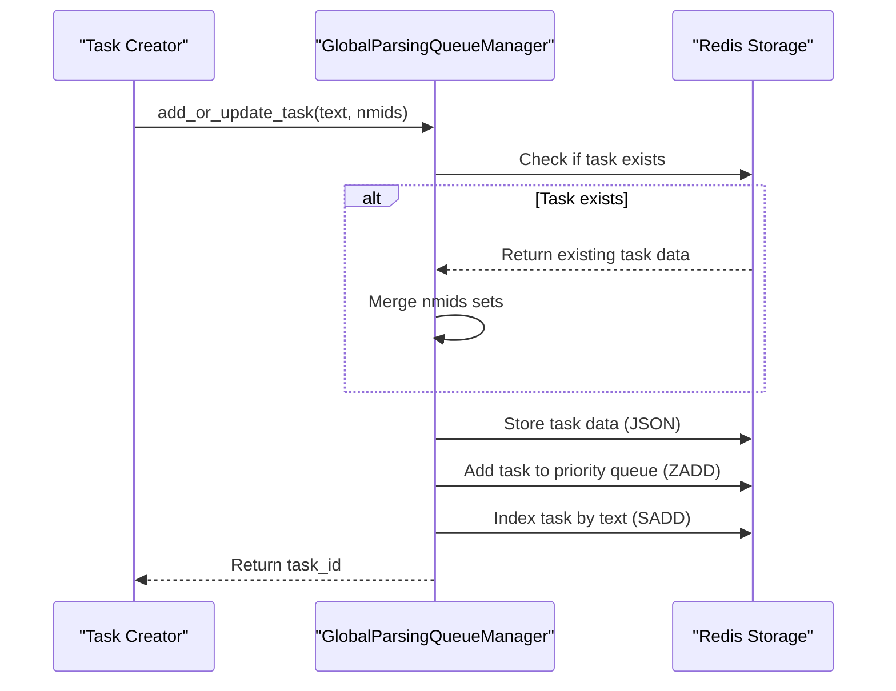
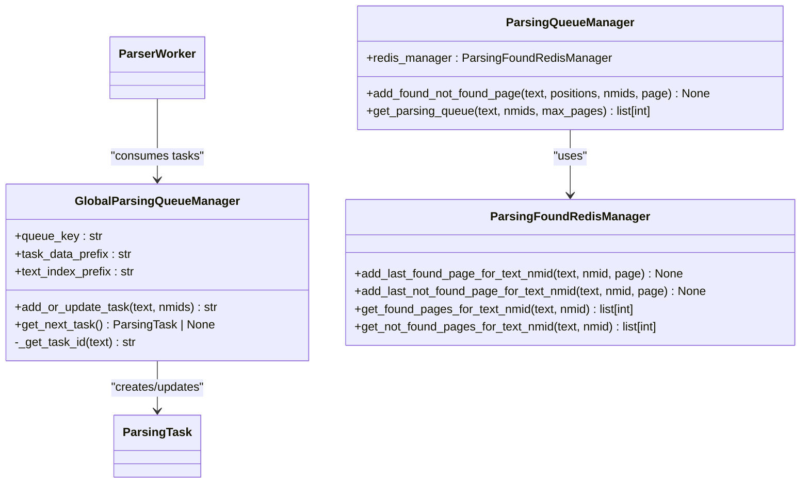
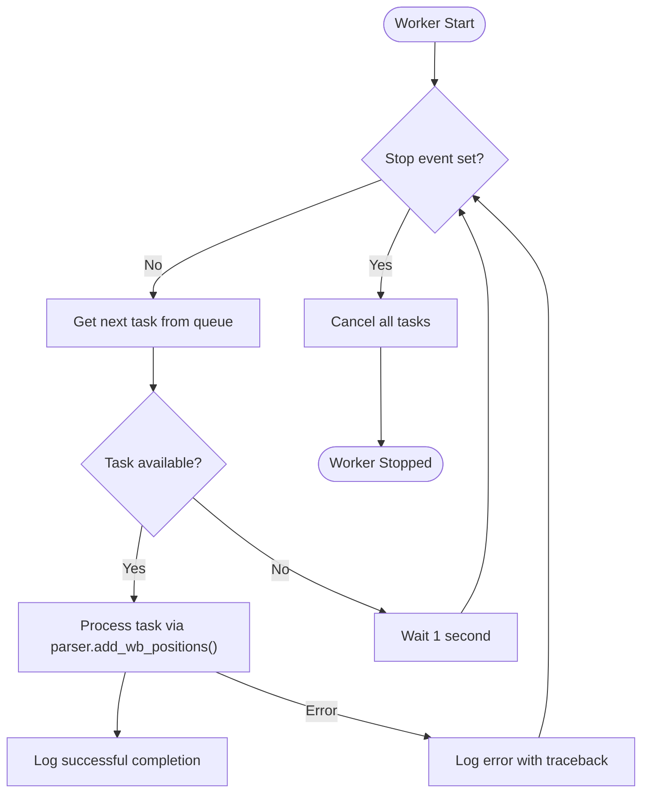
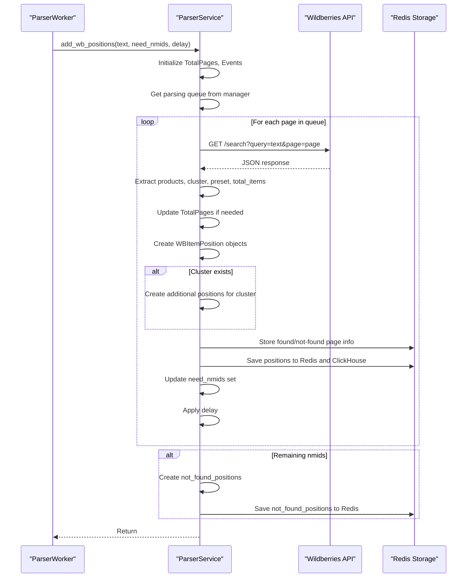
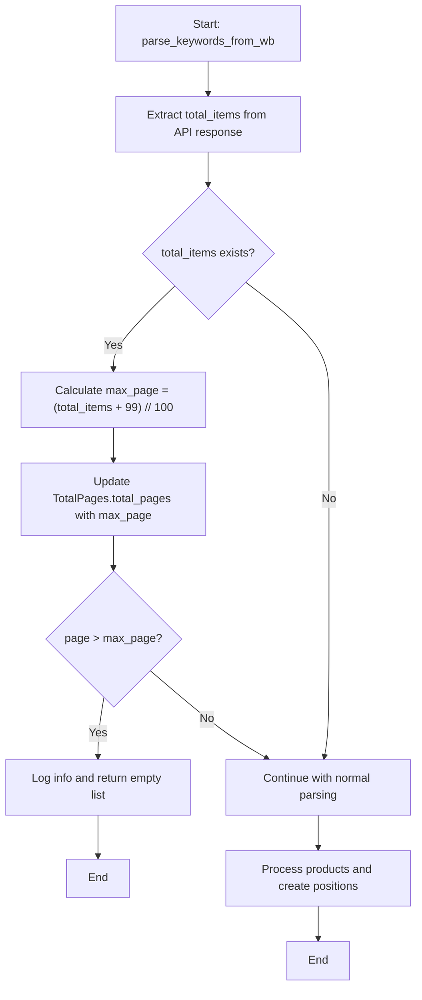
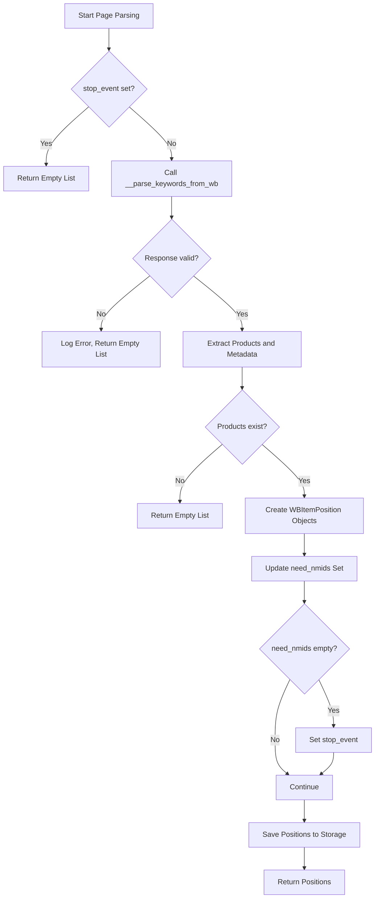
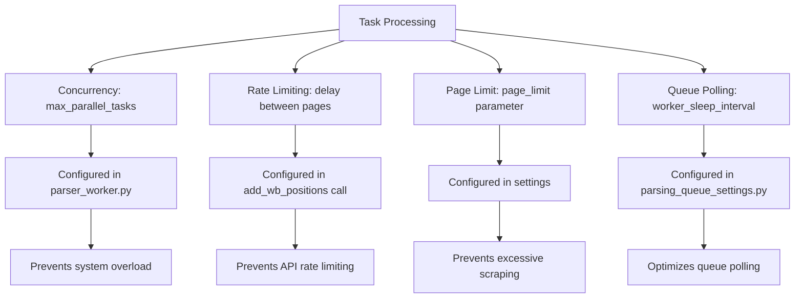
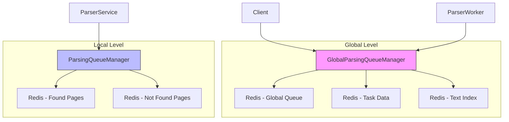
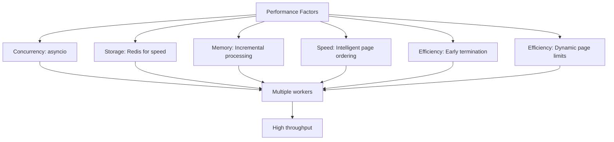

# Parsing Workflow

<cite>
**Referenced Files in This Document**   
- [parsing_task.py](file://app/modules/wb_keywords_parser/parsing_task.py)
- [parser_worker.py](file://app/modules/wb_keywords_parser/parser_worker.py)
- [parser.py](file://app/modules/wb_keywords_parser/wb_parser/parser.py) - *Updated in commit 2fe4ff378f83ddb073fb1cce28e31f59d11698d4*
- [global_parsing_queue_manager.py](file://app/modules/wb_keywords_parser/global_parsing_queue_manager.py)
- [parsing_page_queue_manager.py](file://app/modules/wb_keywords_parser/wb_parser/parsing_page_queue_manager.py)
- [parsing_found_redis_manager.py](file://app/modules/wb_keywords_parser/parsing_found_redis_manager.py)
- [task_queue_manager.py](file://app/modules/wb_keywords_parser/task_queue_manager.py)
- [parsing_queue_settings.py](file://app/settings/parsing_queue_settings.py)
</cite>

## Update Summary
**Changes Made**   
- Updated the pagination handling section to reflect dynamic total pages adjustment based on API response
- Enhanced the page scraping section with details about over-limit page handling
- Added new diagram showing updated pagination logic
- Updated code examples to reflect the new dynamic page limit behavior
- Improved accuracy of performance considerations regarding page processing

## Table of Contents
1. [Introduction](#introduction)
2. [Task Creation and Enqueuing](#task-creation-and-enqueuing)
3. [Queue Management](#queue-management)
4. [Worker Execution and Task Processing](#worker-execution-and-task-processing)
5. [Page Scraping and Content Extraction](#page-scraping-and-content-extraction)
6. [Pagination and Search Result Processing](#pagination-and-search-result-processing)
7. [Retry Mechanisms and Error Handling](#retry-mechanisms-and-error-handling)
8. [Rate Limiting and Concurrency Control](#rate-limiting-and-concurrency-control)
9. [Global and Local Queue Coordination](#global-and-local-queue-coordination)
10. [Performance Considerations](#performance-considerations)
11. [Troubleshooting and Detection Evasion](#troubleshooting-and-detection-evasion)

## Introduction
The keyword parsing workflow in the Wildberries advertising system is designed to efficiently extract product positioning data for specific keywords and nmids. This system employs a distributed architecture with task queues, worker processes, and sophisticated page parsing logic to handle the dynamic nature of Wildberries' search results. The workflow is optimized for robustness, scalability, and evasion of detection mechanisms while maintaining high parsing accuracy and performance.

## Task Creation and Enqueuing
The parsing workflow begins with the creation of parsing tasks through the `ParsingTask` class defined in `parsing_task.py`. Each task contains a keyword, a set of nmids to search for, and an optional advertising order ID. Tasks are created with a unique identifier generated from the SHA-1 hash of the keyword, ensuring that duplicate tasks for the same keyword are properly managed.

Tasks are enqueued through the `add_or_update_task` method in `global_parsing_queue_manager.py`, which handles both new task creation and updates to existing tasks. When a task with an existing keyword is added, the system merges the new nmids with any existing ones, preventing redundant processing. The task data is stored in Redis with a structured key format, and tasks are prioritized in the queue based on their timestamp.

**Section sources**
- [parsing_task.py](file://app/modules/wb_keywords_parser/parsing_task.py#L1-L25)
- [global_parsing_queue_manager.py](file://app/modules/wb_keywords_parser/global_parsing_queue_manager.py#L40-L100)

## Queue Management
The parsing system employs a sophisticated queue management architecture that combines global and local queue coordination for optimal load balancing and efficiency. The `GlobalParsingQueueManager` handles the central task queue stored in Redis, while the `ParsingQueueManager` manages local page-level queues for individual keyword searches.

The global queue uses Redis sorted sets (ZSET) to maintain task priority based on insertion time, ensuring that older tasks are processed first (FIFO principle). Each task is indexed by its text content, allowing for efficient lookup and deduplication. The system uses atomic Redis pipelines to ensure data consistency when adding or updating tasks, preventing race conditions in multi-worker environments.

**Diagram sources**
- [global_parsing_queue_manager.py](file://app/modules/wb_keywords_parser/global_parsing_queue_manager.py#L10-L129)
- [parsing_page_queue_manager.py](file://app/modules/wb_keywords_parser/wb_parser/parsing_page_queue_manager.py#L1-L75)
- [parsing_found_redis_manager.py](file://app/modules/wb_keywords_parser/parsing_found_redis_manager.py#L1-L26)

**Section sources**
- [global_parsing_queue_manager.py](file://app/modules/wb_keywords_parser/global_parsing_queue_manager.py#L10-L129)
- [task_queue_manager.py](file://app/modules/wb_keywords_parser/task_queue_manager.py#L1-L173)

## Worker Execution and Task Processing
The `ParserWorker` class in `parser_worker.py` manages the execution of parsing tasks across multiple concurrent workers. Each worker maintains a configurable number of parallel tasks (default: 3) and continuously polls the global task queue for new work. The worker implementation uses asyncio for asynchronous task processing, allowing for efficient handling of I/O-bound operations like HTTP requests.

When a worker retrieves a task from the queue, it delegates the actual parsing to the `parser` service, passing the keyword and nmids for processing. The worker implements proper error handling and logging, ensuring that task failures are captured and do not crash the entire worker process. Workers can be gracefully stopped using the `stop` method, which sets a stop event and cancels all running tasks.

**Diagram sources**
- [parser_worker.py](file://app/modules/wb_keywords_parser/parser_worker.py#L1-L78)
- [parsing_task.py](file://app/modules/wb_keywords_parser/parsing_task.py#L1-L25)

**Section sources**
- [parser_worker.py](file://app/modules/wb_keywords_parser/parser_worker.py#L1-L78)

## Page Scraping and Content Extraction
The core page scraping functionality is implemented in `parser.py` through the `ParserService` class. This service handles HTTP requests to Wildberries' search API, parsing the JSON response to extract product positioning data. The system uses carefully crafted HTTP headers to mimic a real browser, including User-Agent, Accept, and Referer headers that match typical Chrome browser requests.

The scraping process targets the Wildberries search API endpoint, which returns structured JSON data containing product information, including nmids, positions, and advertising metadata. For each product in the search results, the parser extracts the position, nmid, and advertising information (if present), creating `WBItemPosition` objects that capture the complete context of each product's placement in the search results.

**Diagram sources**
- [parser.py](file://app/modules/wb_keywords_parser/wb_parser/parser.py#L1-L336)
- [parsing_page_queue_manager.py](file://app/modules/wb_keywords_parser/wb_parser/parsing_page_queue_manager.py#L1-L75)

**Section sources**   
- [parser.py](file://app/modules/wb_keywords_parser/wb_parser/parser.py#L57-L185) - *Updated in commit 2fe4ff378f83ddb073fb1cce28e31f59d11698d4*

## Pagination and Search Result Processing
The system implements intelligent pagination handling to efficiently process search results across multiple pages. The `TotalPages` class caps the maximum number of pages at 60, which aligns with Wildberries' search result limits. When processing search results, the parser dynamically updates the total pages count based on the API response, ensuring accurate pagination.

The `ParsingQueueManager` plays a crucial role in optimizing page processing order. It maintains separate records of pages where nmids were found, not found, and pages that haven't been checked yet. When generating the parsing queue for a keyword, it prioritizes pages as follows: first pages where the nmid was previously found, then unchecked pages, and finally pages where the nmid was previously not found. This intelligent ordering minimizes unnecessary requests and improves parsing efficiency.

The updated implementation in `parser.py` now dynamically adjusts the total pages based on the API response, preventing unnecessary requests beyond available pages. When the API returns the total number of items, the system calculates the maximum number of pages and updates the `TotalPages` object accordingly. If a requested page exceeds the maximum available pages, the system logs this information and returns an empty result, avoiding wasted requests.

**Diagram sources**
- [parser.py](file://app/modules/wb_keywords_parser/wb_parser/parser.py#L57-L185) - *Updated in commit 2fe4ff378f83ddb073fb1cce28e31f59d11698d4*
- [parsing_page_queue_manager.py](file://app/modules/wb_keywords_parser/wb_parser/parsing_page_queue_manager.py#L1-L75)

**Section sources**
- [parser.py](file://app/modules/wb_keywords_parser/wb_parser/parser.py#L15-L32) - *Updated in commit 2fe4ff378f83ddb073fb1cce28e31f59d11698d4*
- [parsing_page_queue_manager.py](file://app/modules/wb_keywords_parser/wb_parser/parsing_page_queue_manager.py#L12-L73)

## Retry Mechanisms and Error Handling
The parsing system implements comprehensive error handling and retry mechanisms to ensure robustness in the face of network issues, API changes, or temporary service disruptions. When an error occurs during page parsing, the system logs the error with full traceback information but continues processing other pages, preventing a single failure from aborting an entire task.

The system defines specific exception types like `EmptyDataDictFromSearchWB` and `DataError` to handle different failure scenarios. For empty responses or parsing errors, the system simply skips the problematic page and continues with the next one in the queue. The worker process itself has error handling in its main loop, with a 30-second wait period after any unhandled exception to prevent rapid failure cycles.

**Diagram sources**
- [parser.py](file://app/modules/wb_keywords_parser/wb_parser/parser.py#L1-L336)
- [parser_worker.py](file://app/modules/wb_keywords_parser/parser_worker.py#L1-L78)

**Section sources**
- [parser.py](file://app/modules/wb_keywords_parser/wb_parser/parser.py#L1-L336)

## Rate Limiting and Concurrency Control
The system implements multiple layers of rate limiting and concurrency control to prevent overwhelming the Wildberries API and to avoid detection. The primary rate limiting mechanism is the `delay` parameter in the `add_wb_positions` function, which introduces a configurable delay (default: 0.1 seconds) between page requests. This delay can be adjusted based on system load and API responsiveness.

Concurrency is controlled at multiple levels: the `ParserWorker` limits the number of parallel workers (configurable via `max_parallel_tasks`), and the system uses an asyncio lock to ensure that only one worker checks the task queue at a time, preventing thundering herd problems. The `page_limit` parameter further controls the maximum number of pages processed per task, providing an additional safeguard against excessive requests.

**Diagram sources**
- [parser_worker.py](file://app/modules/wb_keywords_parser/parser_worker.py#L1-L78)
- [parser.py](file://app/modules/wb_keywords_parser/wb_parser/parser.py#L1-L336)
- [parsing_queue_settings.py](file://app/settings/parsing_queue_settings.py#L1-L30)

**Section sources**
- [parser_worker.py](file://app/modules/wb_keywords_parser/parser_worker.py#L1-L78)
- [parsing_queue_settings.py](file://app/settings/parsing_queue_settings.py#L1-L30)

## Global and Local Queue Coordination
The parsing system employs a sophisticated coordination mechanism between global and local queues to optimize load balancing and parsing efficiency. The global queue, managed by `GlobalParsingQueueManager`, serves as the central task distribution system, while local queues, managed by `ParsingQueueManager`, optimize the order of page processing for individual keyword searches.

This two-level queue system enables several optimization strategies: task deduplication at the global level prevents redundant keyword processing, while intelligent page ordering at the local level minimizes unnecessary API calls. The system also uses Redis to maintain state about previously found and not-found pages for each keyword-nmid pair, allowing subsequent parsing tasks to focus on the most promising pages first.

**Diagram sources**
- [global_parsing_queue_manager.py](file://app/modules/wb_keywords_parser/global_parsing_queue_manager.py#L1-L129)
- [parsing_page_queue_manager.py](file://app/modules/wb_keywords_parser/wb_parser/parsing_page_queue_manager.py#L1-L75)
- [parsing_found_redis_manager.py](file://app/modules/wb_keywords_parser/parsing_found_redis_manager.py#L1-L26)

**Section sources**
- [global_parsing_queue_manager.py](file://app/modules/wb_keywords_parser/global_parsing_queue_manager.py#L1-L129)
- [parsing_page_queue_manager.py](file://app/modules/wb_keywords_parser/wb_parser/parsing_page_queue_manager.py#L1-L75)

## Performance Considerations
The parsing system is designed with several performance optimizations to handle high volumes of keyword searches efficiently. The use of asyncio enables concurrent processing of multiple tasks without the overhead of threading, while Redis provides fast, persistent storage for task queues and parsing state.

Memory usage is optimized by processing pages incrementally and only keeping necessary data in memory. The system uses sets and generators where possible to minimize memory footprint, and results are streamed to storage systems (Redis and ClickHouse) as they are generated rather than accumulating in memory.

Parsing speed is maximized through intelligent page ordering, which prioritizes pages most likely to contain results, and through parallel worker execution. The system also implements early termination when all target nmids have been found, avoiding unnecessary page requests. The updated dynamic page limit calculation further improves performance by preventing requests to non-existent pages based on the API's total item count.

**Section sources**
- [parser_worker.py](file://app/modules/wb_keywords_parser/parser_worker.py#L1-L78)
- [parser.py](file://app/modules/wb_keywords_parser/wb_parser/parser.py#L1-L336)
- [parsing_page_queue_manager.py](file://app/modules/wb_keywords_parser/wb_parser/parsing_page_queue_manager.py#L1-L75)

## Troubleshooting and Detection Evasion
The system includes several features to handle common parsing failures and evade detection by Wildberries' anti-bot systems. The use of realistic HTTP headers, including User-Agent and Referer, helps mimic legitimate browser traffic. The configurable delay between requests prevents rate limiting, and the randomized order of unchecked pages makes the scraping pattern less predictable.

Common issues such as empty responses, parsing errors, or network timeouts are handled gracefully, with detailed logging to aid in troubleshooting. The system's modular design allows for easy updates to the scraping logic if Wildberries changes its API or response format.

For detection evasion, the system avoids aggressive scraping patterns by limiting concurrency and implementing realistic delays. The use of multiple workers with staggered request timing further reduces the likelihood of detection. If issues persist, administrators can adjust the delay parameter or implement additional randomization in the request timing.

**Section sources**
- [parser.py](file://app/modules/wb_keywords_parser/wb_parser/parser.py#L1-L336)
- [parser_worker.py](file://app/modules/wb_keywords_parser/parser_worker.py#L1-L78)
- [parsing_queue_settings.py](file://app/settings/parsing_queue_settings.py#L1-L30)