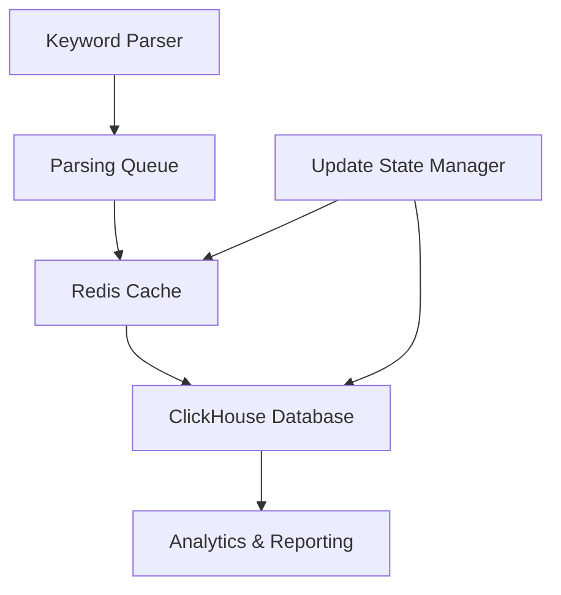
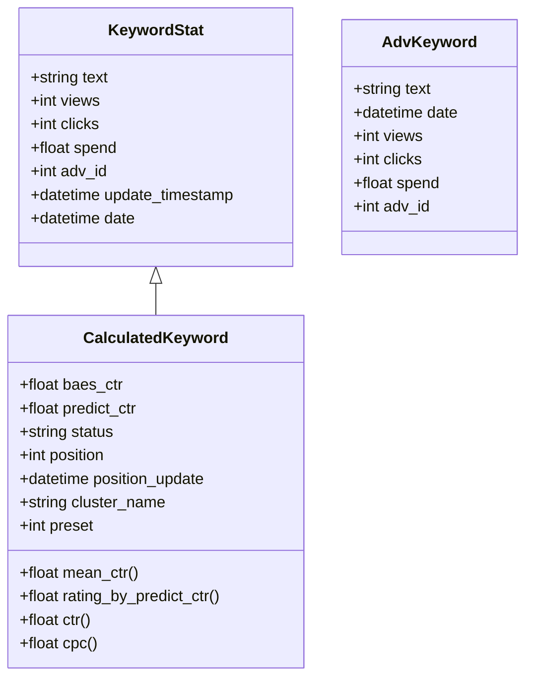

# Position Data Storage and Management

<cite>
**Referenced Files in This Document**   
- [parsing_found_redis_manager.py](file://app/modules/wb_keywords_parser/parsing_found_redis_manager.py)
- [parsing_page_queue_manager.py](file://app/modules/wb_keywords_parser/wb_parser/parsing_page_queue_manager.py)
- [base.py](file://app/utils/click_house/base.py)
- [models.py](file://app/utils/click_house/models.py)
- [adv_keyword_update.py](file://app/modules/wb_update_state_manager/state_managers/adv_keyword_update.py)
- [data_manager.py](file://app/modules/wb_adv_updater/data_manager.py)
- [keywordstat.py](file://app/modules/common_slaves/wildberries/data_classes/keywordstat.py)
- [keywordstat_from_db.py](file://app/modules/common_slaves/wildberries/data_classes/keywordstat_from_db.py)
</cite>

## Update Summary
**Changes Made**   
- Updated Redis Storage section to reflect the new priority-based parsing queue implementation
- Added detailed explanation of the parsing queue prioritization logic
- Enhanced Data Flow Overview with updated parsing priority workflow
- Added new section on Parsing Queue Prioritization
- Updated diagram to show the new three-tier priority system

## Table of Contents
1. [Introduction](#introduction)
2. [Data Flow Overview](#data-flow-overview)
3. [Parsing Queue Prioritization](#parsing-queue-prioritization)
4. [Redis Storage for Parsed Position Data](#redis-storage-for-parsed-position-data)
5. [ClickHouse Persistent Storage](#clickhouse-persistent-storage)
6. [Update State Management](#update-state-management)
7. [Data Model for Keyword Statistics](#data-model-for-keyword-statistics)
8. [Data Retention and Indexing](#data-retention-and-indexing)
9. [Query Patterns and Retrieval](#query-patterns-and-retrieval)
10. [Consistency Between Cache and Persistent Storage](#consistency-between-cache-and-persistent-storage)
11. [Performance Optimization and Best Practices](#performance-optimization-and-best-practices)

## Introduction
This document details the position data storage and lifecycle management system within the advertising bot application. The system handles keyword position data from initial parsing through Redis caching to persistent storage in ClickHouse. It covers the data model, storage mechanisms, update state management, and strategies for ensuring data consistency and performance optimization. Recent updates have enhanced the parsing queue prioritization to improve data freshness and efficiency.

## Data Flow Overview
The position data lifecycle begins with keyword parsing, where position data is temporarily stored in Redis before being persisted in ClickHouse. The system uses Redis as a high-performance cache for recently parsed position data, while ClickHouse serves as the durable data warehouse for historical analytics. The data flow follows a multi-stage process: parsing → Redis storage → ClickHouse persistence → state management.



**Diagram sources**
- [parsing_found_redis_manager.py](file://app/modules/wb_keywords_parser/parsing_found_redis_manager.py)
- [parsing_page_queue_manager.py](file://app/modules/wb_keywords_parser/wb_parser/parsing_page_queue_manager.py)
- [data_manager.py](file://app/modules/wb_adv_updater/data_manager.py)
- [adv_keyword_update.py](file://app/modules/wb_update_state_manager/state_managers/adv_keyword_update.py)

## Parsing Queue Prioritization
The system implements a sophisticated three-tier prioritization strategy for parsing keyword positions, designed to maximize data freshness and efficiency. The ParsingQueueManager in parsing_page_queue_manager.py orchestrates this prioritization by leveraging data stored in Redis through the ParsingFoundRedisManager.

The parsing queue follows a strict priority order:
1. **Found Pages**: Pages where items were previously found (highest priority)
2. **Unknown Pages**: Pages with no historical data (medium priority)
3. **Not-Found Pages**: Pages where items were previously not found (lowest priority)

This prioritization ensures that recently discovered positions are verified first, maintaining data freshness while efficiently utilizing parsing resources. The implementation uses Redis sorted sets with timestamps as scores to track when pages were last processed, allowing the system to prioritize recently active search results.

The get_parsing_queue method constructs the final queue by:
1. Retrieving found and not-found pages for each NMID from Redis
2. Calculating remaining pages with no historical data
3. Combining pages in priority order: found → unknown → not-found
4. Removing duplicates while preserving order using OrderedDict
5. Validating that all expected pages are included

This approach optimizes parsing efficiency by focusing on pages most likely to contain relevant data while maintaining comprehensive coverage.

**Section sources**
- [parsing_page_queue_manager.py](file://app/modules/wb_keywords_parser/wb_parser/parsing_page_queue_manager.py#L1-L75)
- [parsing_found_redis_manager.py](file://app/modules/wb_keywords_parser/parsing_found_redis_manager.py#L1-L25)

## Redis Storage for Parsed Position Data
The system uses Redis to store parsed keyword position data through the ParsingFoundRedisManager class. This manager handles both found and not-found page tracking for text-NMID pairs, using sorted sets with timestamps as scores to maintain chronological order.

The Redis storage mechanism provides temporary caching of position data with the following operations:
- `add_last_found_page_for_text_nmid`: Stores the last found page for a text-NMID combination with a timestamp score
- `add_last_not_found_page_for_text_nmid`: Records pages where the item was not found
- `get_found_pages_for_text_nmid`: Retrieves all previously found pages for a text-NMID pair
- `get_not_found_pages_for_text_nmid`: Retrieves pages where the item was not found

This implementation allows the system to track parsing history and avoid redundant operations while maintaining performance for frequent read/write operations. The timestamps are used by the parsing queue manager to prioritize recently active search results, ensuring data freshness.

**Section sources**
- [parsing_found_redis_manager.py](file://app/modules/wb_keywords_parser/parsing_found_redis_manager.py#L1-L25)
- [base_redis_manager.py](file://app/core/redis_manager/base_redis_manager.py#L1-L21)

## ClickHouse Persistent Storage
Position data is ultimately persisted in ClickHouse using the data_manager.py module. The system inserts position data into the `wbitemposition` table with the following fields:
- nmid: Item identifier
- text: Search keyword text
- promo_position: Promotional position
- base_position: Base position
- cpm: Cost per mille
- adv_type: Advertising type
- timestamp: When the position was recorded
- version: Version timestamp for conflict resolution

The data persistence process involves:
1. Converting the position timestamp to a formatted string
2. Calculating a version based on the timestamp
3. Executing an INSERT statement for each position
4. Handling potential exceptions during insertion

ClickHouse serves as the system of record for historical position data, enabling complex analytical queries over time.

**Section sources**
- [data_manager.py](file://app/modules/wb_adv_updater/data_manager.py#L1550-L1583)
- [base.py](file://app/utils/click_house/base.py#L1-L17)

## Update State Management
The AdvActiveKeywordUpdateStateManager in adv_keyword_update.py manages the state of keyword updates, tracking when advertisements were last updated. This state management is crucial for determining data freshness and coordinating update cycles.

The update state manager provides:
- `set_one`: Stores a timestamp for when an advertisement was updated
- `get_one`: Retrieves the last update timestamp for an advertisement
- Key format: "minus_update:{adv_id}" for Redis storage

This state information helps prevent redundant updates and ensures that data processing occurs at appropriate intervals. The timestamps are stored as formatted strings in Redis, allowing for human-readable debugging while maintaining compatibility with the application's datetime parsing.

**Section sources**
- [adv_keyword_update.py](file://app/modules/wb_update_state_manager/state_managers/adv_keyword_update.py#L1-L44)

## Data Model for Keyword Statistics
The system employs multiple data models for keyword statistics across different storage layers. The primary models include:

### ClickHouse Data Model
The AdvKeyword model in ClickHouse stores aggregated keyword statistics with fields:
- text: Keyword text
- date: Date of the statistics
- views: Number of views
- clicks: Number of clicks
- spend: Total spending
- adv_id: Advertisement ID
- Unique constraint on text, date, and adv_id

### Application Data Models
The system uses Pydantic models for keyword statistics in the application layer:

**KeywordStat**: Basic keyword statistics
- text: Keyword text
- views: View count
- clicks: Click count
- spend: Total spending
- adv_id: Advertisement ID
- update_timestamp: When data was updated
- date: Date of the statistics

**CalculatedKeyword**: Enhanced keyword data with derived metrics
- Includes all fields from KeywordStat
- Additional fields: baes_ctr, predict_ctr, status, position, cluster_name, etc.
- Computed properties: mean_ctr, rating_by_predict_ctr, ctr, cpc

The data model supports both raw metrics and calculated values, enabling sophisticated analysis while maintaining data integrity.



**Diagram sources**
- [models.py](file://app/utils/click_house/models.py#L1-L14)
- [keywordstat.py](file://app/modules/common_slaves/wildberries/data_classes/keywordstat.py#L1-L13)
- [keywordstat_from_db.py](file://app/modules/common_slaves/wildberries/data_classes/keywordstat_from_db.py#L1-L168)

## Data Retention and Indexing
The system implements data retention policies through both application logic and database configuration. While specific retention periods are not explicitly defined in the code, the system includes queries that filter data by time ranges (e.g., "last_days=7"), suggesting a time-based retention strategy.

ClickHouse indexing is handled through:
- Primary key on the id field with auto-increment
- Unique constraint on text, date, and adv_id fields in the AdvKeyword table
- Natural indexing through the MergeTree engine's handling of timestamp columns

The wbitemposition table in ClickHouse likely uses timestamp-based partitioning, as evidenced by queries that filter on date ranges and use toDate() functions for aggregation. This enables efficient querying of time-series data while maintaining performance at scale.

**Section sources**
- [models.py](file://app/utils/click_house/models.py#L1-L14)
- [data_manager.py](file://app/modules/wb_adv_updater/data_manager.py#L1500-L1682)

## Query Patterns and Retrieval
The system employs several query patterns for efficient data retrieval from ClickHouse:

### Aggregation Queries
The system uses GROUP BY with aggregate functions to summarize position data:
```sql
SELECT
    text,
    toDate(timestamp) AS day,
    AVG(promo_position) AS avg_promo_position,
    AVG(base_position) AS avg_base_position,
    AVG(cpm) AS avg_cpm
FROM default_db.wbitemposition
WHERE nmid = {nmid}
GROUP BY text, day
ORDER BY day
```

### Time-Series Analysis
Queries filter data by time ranges for recent analysis:
```sql
SELECT DISTINCT text FROM default_db.advkeyword_new 
WHERE date >= today() - %(last_days)s
```

### Average Position Calculation
The system calculates average base positions over specific time periods:
```sql
SELECT toDate(timestamp) as date, 
   text,
   AVG(base_position) as avg_base_position
FROM default_db.wbitemposition
WHERE nmid = %(nmid)s 
  AND timestamp >= toDateTime(%(start_date)s)
  AND timestamp <= toDateTime(%(end_date)s)
GROUP BY date, text
```

These query patterns support both real-time monitoring and historical analysis of keyword positions, enabling data-driven decision making.

**Section sources**
- [data_manager.py](file://app/modules/wb_adv_updater/data_manager.py#L1500-L1682)

## Consistency Between Cache and Persistent Storage
The system faces consistency challenges between Redis cache and ClickHouse persistent storage, addressed through several mechanisms:

### Versioning System
Each position record in ClickHouse includes a version field calculated from the timestamp:
```python
def __calculate_version(position):
    return int(position.timestamp.timestamp())
```
This versioning helps identify the most recent data and resolve conflicts during updates.

### Data Flow Coordination
The system follows a write-through pattern where data is first processed in Redis and then persisted to ClickHouse. The update state manager tracks when data was last processed, preventing race conditions and ensuring orderly updates.

### Error Handling
Comprehensive error handling surrounds ClickHouse operations, with exceptions logged but not propagated to prevent system-wide failures. This ensures that temporary database issues don't disrupt the overall data pipeline.

### Data Synchronization
The system uses Redis to store intermediate state and frequently accessed data, while ClickHouse maintains the authoritative record. Periodic synchronization processes ensure that cached data remains consistent with the persistent store.

**Section sources**
- [data_manager.py](file://app/modules/wb_adv_updater/data_manager.py#L1550-L1583)
- [adv_keyword_update.py](file://app/modules/wb_update_state_manager/state_managers/adv_keyword_update.py#L1-L44)

## Performance Optimization and Best Practices
The system implements several performance optimizations for efficient data storage and retrieval:

### Batch Processing
Position data is processed in batches when writing to ClickHouse, reducing the number of database round-trips and improving throughput.

### Selective Field Loading
When querying the primary database (not ClickHouse), the system uses SQLAlchemy's load_only() to retrieve only necessary fields, reducing memory usage and network overhead.

### Connection Management
The system likely employs connection pooling for both Redis and ClickHouse (though not explicitly shown in the provided code), which would be essential for handling high concurrency.

### Index Optimization
The unique constraint on (text, date, adv_id) in the AdvKeyword table optimizes queries that filter by these common dimensions.

### Caching Strategy
The two-tier storage system (Redis + ClickHouse) optimizes for both speed and durability:
- Redis for fast access to recent data
- ClickHouse for efficient storage and querying of historical data

### Best Practices
1. Always escape single quotes in SQL string literals to prevent injection
2. Use parameterized queries where possible
3. Implement comprehensive error logging
4. Maintain data versioning for conflict resolution
5. Use appropriate data types (e.g., DateTime for timestamps)
6. Implement unique constraints to prevent duplicate data
7. Use batch operations for bulk data processing
8. Monitor and optimize query performance regularly

These optimizations ensure the system can handle large volumes of position data while maintaining responsiveness and reliability.

**Section sources**
- [data_manager.py](file://app/modules/wb_adv_updater/data_manager.py#L1550-L1682)
- [models.py](file://app/utils/click_house/models.py#L1-L14)
- [parsing_found_redis_manager.py](file://app/modules/wb_keywords_parser/parsing_found_redis_manager.py#L1-L25)