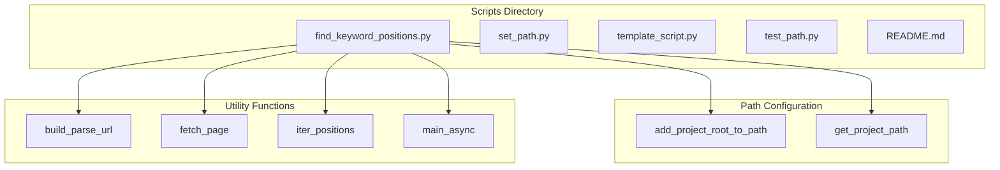
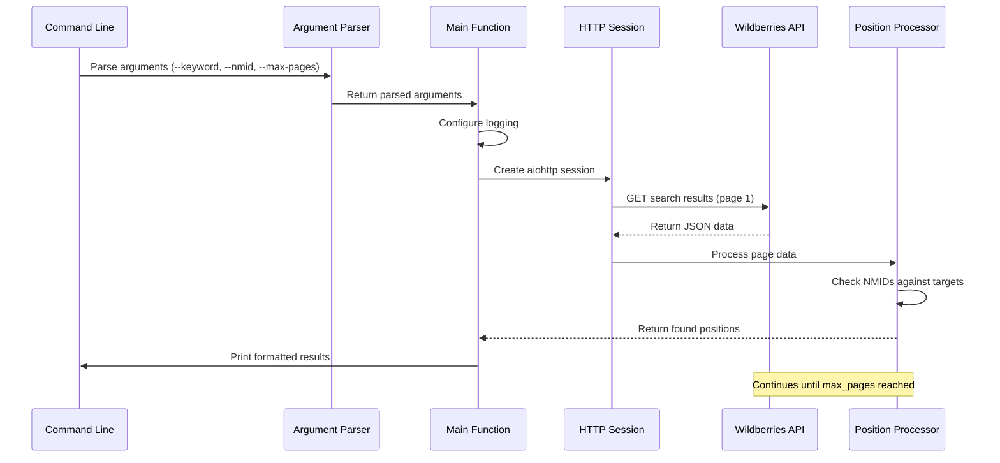
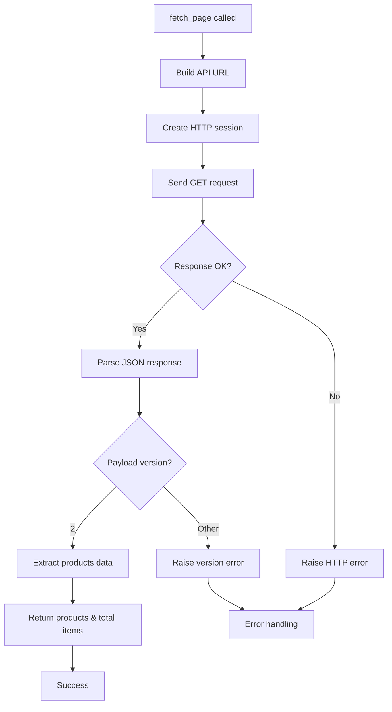
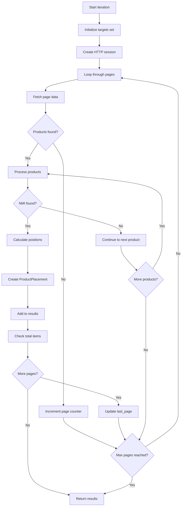

# Keyword Position Utility Scripts

<cite>
**Referenced Files in This Document**
- [find_keyword_positions.py](file://scripts/find_keyword_positions.py)
- [README.md](file://scripts/README.md)
- [set_path.py](file://scripts/set_path.py)
- [template_script.py](file://scripts/template_script.py)
- [test_path.py](file://scripts/test_path.py)
</cite>

## Table of Contents
1. [Introduction](#introduction)
2. [Project Structure](#project-structure)
3. [Core Components](#core-components)
4. [Architecture Overview](#architecture-overview)
5. [Detailed Component Analysis](#detailed-component-analysis)
6. [Command-Line Usage](#command-line-usage)
7. [Error Handling and Logging](#error-handling-and-logging)
8. [Practical Examples](#practical-examples)
9. [Troubleshooting Guide](#troubleshooting-guide)
10. [Conclusion](#conclusion)

## Introduction

The `find_keyword_positions.py` utility script is a specialized tool designed to track and monitor product positions in Wildberries search results. This script enables marketers and analysts to monitor how their products appear in search results for specific keywords, helping optimize advertising strategies and improve visibility in e-commerce platforms.

The utility operates by querying Wildberries' search API, iterating through search pages, and collecting position data for specified product identifiers (NMIDs). Unlike other monitoring tools, this script focuses specifically on position tracking without storing data in Redis caches, making it ideal for temporary analysis and troubleshooting.

## Project Structure

The utility script is part of a larger collection of Python scripts located in the `scripts/` directory. These scripts share a standardized structure and path configuration system.



**Diagram sources**
- [find_keyword_positions.py](file://scripts/find_keyword_positions.py#L1-L225)
- [set_path.py](file://scripts/set_path.py#L1-L45)

**Section sources**
- [README.md](file://scripts/README.md#L1-L70)
- [find_keyword_positions.py](file://scripts/find_keyword_positions.py#L1-L20)

## Core Components

The utility script consists of several key components that work together to provide comprehensive position tracking functionality:

### Data Classes and Types

The script defines a `ProductPlacement` data class that encapsulates all relevant information about a product's position in search results:

```python
@dataclass
class ProductPlacement:
    """Information about the found product."""
    nmid: int
    page: int
    index_on_page: int
    absolute_position: int
    name: str | None
```

### Core Functions

1. **URL Building**: `build_parse_url()` constructs Wildberries search API URLs
2. **Page Fetching**: `fetch_page()` retrieves raw JSON data from the API
3. **Position Iteration**: `iter_positions()` processes search results across multiple pages
4. **Argument Parsing**: `parse_args()` handles command-line interface configuration

### Constants and Configuration

- `MAX_WB_PAGES`: Maximum number of pages to search (60 according to Wildberries rules)
- Comprehensive logging system with configurable verbosity
- Async-first architecture for efficient API communication

**Section sources**
- [find_keyword_positions.py](file://scripts/find_keyword_positions.py#L25-L45)
- [find_keyword_positions.py](file://scripts/find_keyword_positions.py#L100-L150)

## Architecture Overview

The script follows a modular asynchronous architecture designed for scalability and maintainability:



**Diagram sources**
- [find_keyword_positions.py](file://scripts/find_keyword_positions.py#L150-L225)

The architecture emphasizes:
- **Asynchronous Processing**: Uses asyncio for concurrent API requests
- **Modular Design**: Clear separation of concerns between URL building, data fetching, and result processing
- **Error Resilience**: Comprehensive error handling at each stage
- **Configurable Limits**: Adjustable page limits and timeout settings

**Section sources**
- [find_keyword_positions.py](file://scripts/find_keyword_positions.py#L150-L225)

## Detailed Component Analysis

### URL Construction Module

The `build_parse_url()` function creates properly formatted Wildberries search API URLs:

```python
def build_parse_url(keyword: str, page: int) -> str:
    """Construct URL for Wildberries search query."""
    assert 1 <= page <= MAX_WB_PAGES
    return (
        "https://search.wb.ru/exactmatch/ru/common/v5/search"
        "?ab_testing=false"
        "&appType=32"
        "&curr=rub"
        "&dest=-1257786"
        f"&page={page}"
        f"&query={keyword}"
        "&resultset=catalog"
        "&sort=popular"
        "&suppressSpellcheck=false"
    )
```

This function ensures:
- **Parameter Validation**: Enforces page limits (1-60)
- **URL Encoding**: Properly formats keyword parameters
- **API Compliance**: Uses correct endpoint and parameters for Wildberries search

### Data Fetching Module

The `fetch_page()` function handles HTTP communication with the Wildberries API:



**Diagram sources**
- [find_keyword_positions.py](file://scripts/find_keyword_positions.py#L50-L85)

### Position Processing Engine

The `iter_positions()` function orchestrates the entire search process:



**Diagram sources**
- [find_keyword_positions.py](file://scripts/find_keyword_positions.py#L87-L145)

**Section sources**
- [find_keyword_positions.py](file://scripts/find_keyword_positions.py#L25-L145)

## Command-Line Usage

The script provides a comprehensive command-line interface with multiple parameters for flexible usage:

### Basic Syntax

```bash
python scripts/find_keyword_positions.py \
    --keyword "product name" \
    --nmid 12345678 \
    [--max-pages 60] \
    [--verbose]
```

### Parameter Details

| Parameter | Type | Required | Description |
|-----------|------|----------|-------------|
| `--keyword` | String | Yes | The search term to monitor |
| `--nmid` | Integer | Yes | One or more product identifiers to track |
| `--max-pages` | Integer | No | Maximum pages to search (default: 60) |
| `--verbose` | Flag | No | Enable debug logging |

### Output Format

The script produces human-readable output showing:
- **Product Information**: NMID and product name (if available)
- **Position Details**: Page number, position on page, and absolute position
- **Missing Products**: List of NMIDs not found in search results

Example output:
```
Товар 12345678 (Картинная рама) найден на странице 3, позиция на странице 5, общая позиция 205
Не найдены в выдаче: 87654321
```

**Section sources**
- [find_keyword_positions.py](file://scripts/find_keyword_positions.py#L150-L180)

## Error Handling and Logging

The script implements comprehensive error handling and logging mechanisms:

### Logging Configuration

```python
logging.basicConfig(
    level=logging.DEBUG if args.verbose else logging.INFO,
    format="%(asctime)s [%(levelname)s] %(name)s: %(message)s",
)
```

### Error Categories

1. **Network Errors**: HTTP timeouts, connection failures
2. **API Errors**: Invalid responses, rate limiting
3. **Data Validation**: Malformed JSON, missing fields
4. **Input Errors**: Invalid parameters, unsupported formats

### Error Recovery Strategies

- **Graceful Degradation**: Continues processing despite individual page failures
- **Retry Logic**: Built-in retry mechanisms for transient failures
- **Fallback Values**: Default values when optional data is unavailable
- **User-Friendly Messages**: Clear error descriptions for troubleshooting

**Section sources**
- [find_keyword_positions.py](file://scripts/find_keyword_positions.py#L180-L225)

## Practical Examples

### Example 1: Basic Position Tracking

Monitor a single product's position for a specific keyword:

```bash
python scripts/find_keyword_positions.py \
    --keyword "ноутбук apple" \
    --nmid 12345678
```

### Example 2: Multi-Product Monitoring

Track multiple products for the same keyword:

```bash
python scripts/find_keyword_positions.py \
    --keyword "кофеварка" \
    --nmid 98765432 98765433 98765434
```

### Example 3: Extended Search Range

Search through more pages for comprehensive analysis:

```bash
python scripts/find_keyword_positions.py \
    --keyword "умная лампа" \
    --nmid 11223344 \
    --max-pages 100
```

### Example 4: Debug Mode

Enable verbose logging for troubleshooting:

```bash
python scripts/find_keyword_positions.py \
    --keyword "телевизор samsung" \
    --nmid 55667788 \
    --verbose
```

## Troubleshooting Guide

### Common Issues and Solutions

#### Issue 1: Script Not Found

**Symptom**: "File not found" or "Permission denied" errors

**Solution**: Ensure you're in the correct directory or use the full path:
```bash
cd scripts
python find_keyword_positions.py
```

#### Issue 2: Import Errors

**Symptom**: "ModuleNotFoundError" or "ImportError"

**Solution**: Run the path test script to verify configuration:
```bash
python scripts/test_path.py
```

#### Issue 3: Network Connectivity

**Symptom**: Timeout errors or connection refused

**Solution**: 
- Check internet connectivity
- Verify Wildberries API availability
- Increase timeout values if needed

#### Issue 4: Empty Results

**Symptom**: "Товары не найдены в выдаче" message

**Solutions**:
- Verify keyword spelling and accuracy
- Try broader search terms
- Check if products are actively listed
- Consider regional differences in search results

#### Issue 5: Rate Limiting

**Symptom**: HTTP 429 errors or blocked requests

**Solution**: 
- Reduce search frequency
- Add delays between requests
- Use smaller search ranges

### Debugging Steps

1. **Verify Path Configuration**: Run `test_path.py` to confirm setup
2. **Check Network**: Ensure internet connectivity and API accessibility
3. **Validate Parameters**: Double-check keyword and NMID values
4. **Review Logs**: Use verbose mode for detailed troubleshooting
5. **Test with Simple Queries**: Start with basic searches before complex ones

**Section sources**
- [test_path.py](file://scripts/test_path.py#L1-L69)
- [find_keyword_positions.py](file://scripts/find_keyword_positions.py#L180-L225)

## Conclusion

The `find_keyword_positions.py` utility script provides a powerful and flexible solution for monitoring product positions in Wildberries search results. Its asynchronous architecture, comprehensive error handling, and user-friendly interface make it an essential tool for e-commerce optimization and competitive analysis.

Key benefits include:
- **Real-time Position Tracking**: Monitor product visibility instantly
- **Multi-product Support**: Track multiple products simultaneously
- **Flexible Configuration**: Adjustable search ranges and verbosity levels
- **Robust Error Handling**: Graceful handling of network and API issues
- **Standards-based Implementation**: Follows Python best practices and async patterns

The script's modular design and clear separation of concerns ensure maintainability and extensibility for future enhancements. Whether used for routine monitoring or troubleshooting position issues, this utility provides reliable and actionable insights for optimizing Wildberries advertising strategies.