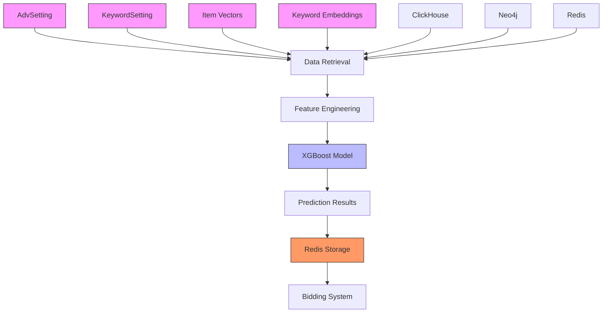
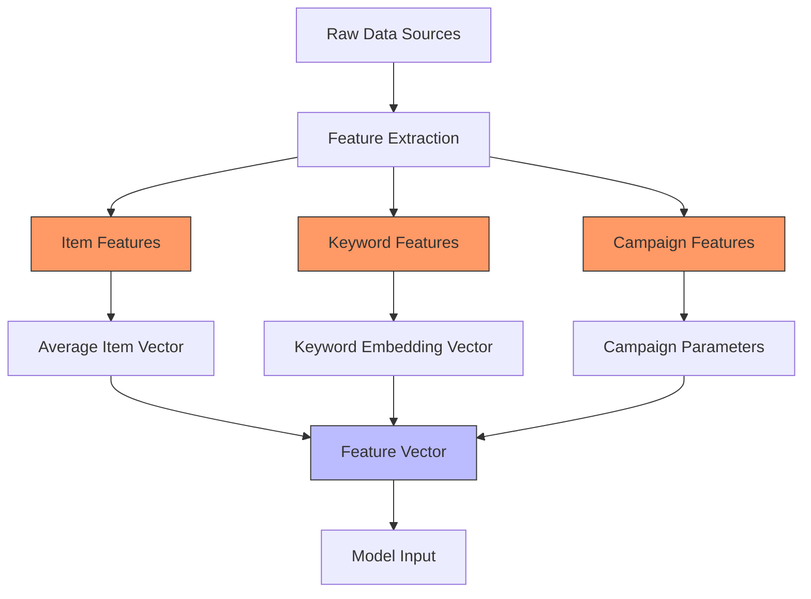
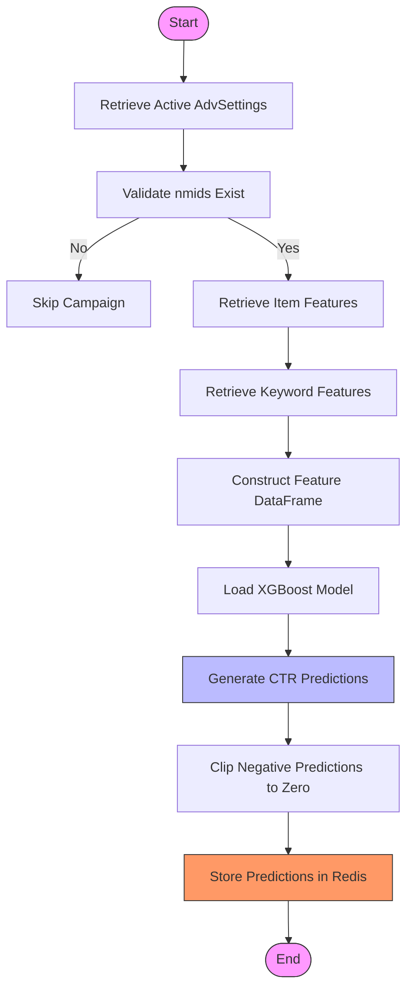
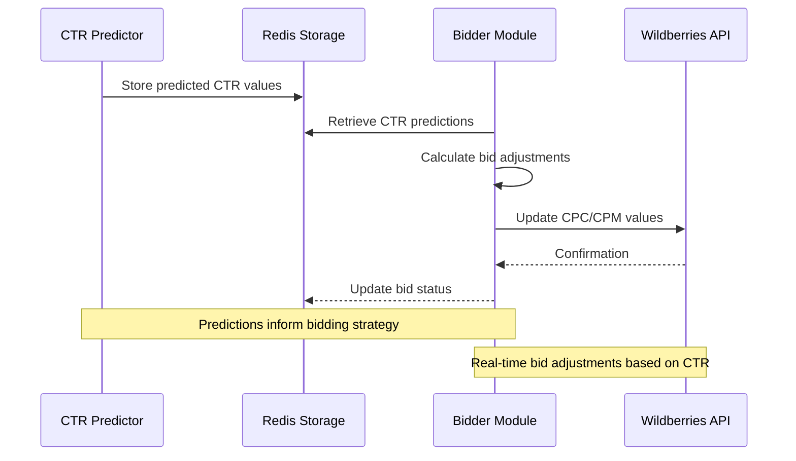

# CTR Prediction Model

<cite>
**Referenced Files in This Document**   
- [ML.py](file://app/modules/wb_adv_updater/ML.py)
- [data_getter.py](file://app/modules/wb_adv_updater/data_getter.py)
- [fitter.py](file://app/modules/wb_adv_updater/fitter.py)
- [models.py](file://app/modules/wb_adv_updater/models.py)
- [bidder.py](file://app/modules/wb_adv_updater/bidder.py)
- [ml_common_funcs.py](file://app/modules/wb_adv_updater/ml_common_funcs.py)
- [predic_ctr.py](file://app/core/redis_manager_v2/mixins/predic_ctr.py)
- [base_redis_manager.py](file://app/core/redis_manager/base_redis_manager.py)
- [models.py](file://app/modules/common_slaves/wildberries/models/models.py)
</cite>

## Table of Contents
1. [Introduction](#introduction)
2. [Architecture Overview](#architecture-overview)
3. [Core Components](#core-components)
4. [Feature Engineering](#feature-engineering)
5. [Prediction Pipeline](#prediction-pipeline)
6. [Redis Integration](#redis-integration)
7. [Bidding Logic Integration](#bidding-logic-integration)
8. [Error Handling and Edge Cases](#error-handling-and-edge-cases)
9. [Performance Considerations](#performance-considerations)
10. [Conclusion](#conclusion)

## Introduction
The CTR Prediction Model is a critical component of the advertising automation system, responsible for predicting click-through rates for keyword-advertisement pairs. This document provides a comprehensive analysis of the model's architecture, implementation details, and integration points within the larger system. The model leverages XGBoost as its primary machine learning algorithm and integrates with Redis for efficient feature retrieval and prediction storage. The system processes data from various sources including keyword settings, item vectors, and campaign configurations to generate accurate CTR predictions that inform bidding decisions.

## Architecture Overview
The CTR prediction system follows a modular architecture with clear separation of concerns between data retrieval, model inference, and result storage. The system is designed to handle high-frequency prediction requests while maintaining low latency for bidding operations.



**Diagram sources**
- [ML.py](file://app/modules/wb_adv_updater/ML.py#L1-L257)
- [data_getter.py](file://app/modules/wb_adv_updater/data_getter.py#L1-L54)

**Section sources**
- [ML.py](file://app/modules/wb_adv_updater/ML.py#L1-L257)
- [fitter.py](file://app/modules/wb_adv_updater/fitter.py#L1-L282)

## Core Components
The CTR prediction system consists of several core components that work together to generate and store predictions. The Predictor class in ML.py serves as the main entry point for the prediction process, coordinating data retrieval, feature engineering, model inference, and result storage.

The system utilizes XGBoost as the primary machine learning model, with model persistence handled through joblib serialization. The Fitter class is responsible for training the model using historical campaign data, while the Predictor class handles inference operations. Data retrieval is abstracted through the DataGetter class, which provides a unified interface for accessing features from multiple sources including Redis, Neo4j, and ClickHouse.

**Section sources**
- [ML.py](file://app/modules/wb_adv_updater/ML.py#L1-L257)
- [fitter.py](file://app/modules/wb_adv_updater/fitter.py#L1-L282)
- [data_getter.py](file://app/modules/wb_adv_updater/data_getter.py#L1-L54)

## Feature Engineering
The feature engineering process combines multiple data sources to create comprehensive feature vectors for CTR prediction. The system extracts features from three primary sources: item characteristics, keyword embeddings, and campaign settings.



**Diagram sources**
- [ML.py](file://app/modules/wb_adv_updater/ML.py#L1-L257)
- [fitter.py](file://app/modules/wb_adv_updater/fitter.py#L1-L282)

### Item Features
Item features are derived from product vectors stored in Redis and Neo4j. For campaigns with multiple items (nmids), the system calculates the average feature vector across all items in the campaign. The Fitter class implements the __get_average_vector method to compute these averages, handling edge cases such as empty nmids lists or missing vectors.

### Keyword Features
Keyword features are obtained through the DataGetter class, which retrieves pre-computed embeddings from Redis. The system first normalizes keyword text by removing underscores and applying cleaning functions before feature retrieval. These embeddings capture semantic information about search terms and their historical performance patterns.

### Campaign Features
Campaign features include parameters such as campaign type, bid settings, and optimization goals. These features are extracted directly from the AdvSetting entity and include both categorical and numerical attributes that influence CTR predictions.

**Section sources**
- [ML.py](file://app/modules/wb_adv_updater/ML.py#L1-L257)
- [fitter.py](file://app/modules/wb_adv_updater/fitter.py#L1-L282)
- [data_getter.py](file://app/modules/wb_adv_updater/data_getter.py#L1-L54)

## Prediction Pipeline
The prediction pipeline follows a structured sequence of operations to generate CTR predictions for active advertising campaigns.



**Diagram sources**
- [ML.py](file://app/modules/wb_adv_updater/ML.py#L1-L257)

### Data Preparation
The _get_df_for_predict method orchestrates the data preparation process by collecting feature data for all active advertising campaigns. It iterates through each AdvSetting, retrieves associated KeywordSettings, and constructs feature vectors by combining item averages, keyword embeddings, and campaign parameters.

### Model Inference
The _predict method handles the actual model inference operation. It loads the pre-trained XGBoost model using the load_model function from ml_common_funcs.py, prepares the feature matrix by removing non-predictive columns, and generates predictions using the model's predict method. The system employs asyncio.to_thread to run the prediction in a separate thread, preventing blocking of the event loop.

### Result Processing
After prediction generation, the system applies post-processing steps including clipping negative CTR values to zero (since CTR cannot be negative) and storing the results for downstream consumption. The predictions are also saved to a CSV file for debugging and analysis purposes.

**Section sources**
- [ML.py](file://app/modules/wb_adv_updater/ML.py#L1-L257)
- [ml_common_funcs.py](file://app/modules/wb_adv_updater/ml_common_funcs.py#L1-L53)

## Redis Integration
The system leverages Redis as a high-performance cache for both feature storage and prediction results. The integration follows a structured pattern using Redis pipelines for efficient batch operations.

```mermaid
classDiagram
class BaseRedis {
+client : Redis
+get_client() : Redis
}
class PredictCTRRedisMixin {
+_get_new_key(nmids, keyword) : String
+_get_legacy_key(adv_id, keyword) : String
+set_predict_ctr_with_pipeline_by_nmids(pipeline, nmids, keyword, predict_ctr)
+get_predict_ctr_by_nmids(nmids, keyword) : Float
+_get_predict_ctr_by_key(key) : Float
}
class Predictor {
+__update_predict_ctr(redis_pipeline, keyword_setting, predict_df)
}
BaseRedis <|-- PredictCTRRedisMixin
PredictCTRRedisMixin ..> Predictor : "used by"
note right of PredictCTRRedisMixin
Implements both legacy and new
key formats for backward compatibility
New format uses nmids array and
sorted keyword for consistent hashing
end note
```

**Diagram sources**
- [predic_ctr.py](file://app/core/redis_manager_v2/mixins/predic_ctr.py#L33-L75)
- [base_redis_manager.py](file://app/core/redis_manager/base_redis_manager.py#L1-L25)
- [ML.py](file://app/modules/wb_adv_updater/ML.py#L1-L257)

The Redis storage strategy uses a composite key format that combines nmids and cleaned keywords to ensure unique identification of prediction records. The system supports both legacy and new key formats to maintain backward compatibility during migration. The __update_predict_ctr method uses Redis pipelines to batch multiple prediction writes, significantly improving throughput compared to individual write operations.

**Section sources**
- [predic_ctr.py](file://app/core/redis_manager_v2/mixins/predic_ctr.py#L33-L75)
- [base_redis_manager.py](file://app/core/redis_manager/base_redis_manager.py#L1-L25)
- [ML.py](file://app/modules/wb_adv_updater/ML.py#L1-L257)

## Bidding Logic Integration
The CTR prediction system is tightly integrated with the bidding logic in the wb_adv_updater/bidder.py module. Predicted CTR values inform bid adjustment decisions by providing estimates of ad performance.



**Diagram sources**
- [ML.py](file://app/modules/wb_adv_updater/ML.py#L1-L257)
- [bidder.py](file://app/modules/wb_adv_updater/bidder.py#L1-L130)

The bidder process retrieves CTR predictions from Redis and uses them to determine optimal bid levels. Higher predicted CTR values typically result in more aggressive bidding to secure better ad positions, while lower predictions lead to conservative bidding or pausing of underperforming keywords. The integration enables data-driven bidding decisions that maximize return on advertising spend.

**Section sources**
- [ML.py](file://app/modules/wb_adv_updater/ML.py#L1-L257)
- [bidder.py](file://app/modules/wb_adv_updater/bidder.py#L1-L130)

## Error Handling and Edge Cases
The system implements comprehensive error handling to address various edge cases and potential failure modes.

### Missing Features
When item or keyword features are missing, the system implements fallback strategies:
- Empty nmids lists are skipped during processing
- Missing item vectors result in campaign exclusion from prediction
- Keywords without embeddings are excluded from the feature matrix

### Cold-Start Problems
For new campaigns or keywords with insufficient historical data, the system employs several strategies:
- Bayesian smoothing is applied during model training to handle low-observation cases
- Minimum CTR thresholds are used to prevent overestimation of performance for new entities
- Default feature values are used when embeddings are unavailable

### Data Validation
The system performs extensive data validation at multiple levels:
- Input parameter validation for all public methods
- Type checking for database entities
- Range validation for numerical features
- Consistency checks between related entities

**Section sources**
- [ML.py](file://app/modules/wb_adv_updater/ML.py#L1-L257)
- [fitter.py](file://app/modules/wb_adv_updater/fitter.py#L1-L282)
- [data_getter.py](file://app/modules/wb_adv_updater/data_getter.py#L1-L54)

## Performance Considerations
The CTR prediction system is optimized for low-latency inference to support high-frequency bidding operations.

### Parallel Processing
The system leverages asyncio for non-blocking operations:
- Database queries are executed asynchronously
- Redis operations use async/await patterns
- Model inference runs in separate threads to avoid event loop blocking

### Caching Strategy
A multi-layer caching strategy minimizes redundant computations:
- Redis caches feature vectors to avoid repeated database queries
- In-memory model caching prevents repeated deserialization
- Pipeline operations batch multiple Redis writes

### Resource Management
The system implements resource constraints to prevent overload:
- Semaphore limits concurrent prediction processes
- Batch processing reduces per-operation overhead
- Memory-efficient data structures minimize footprint

**Section sources**
- [ML.py](file://app/modules/wb_adv_updater/ML.py#L1-L257)
- [fitter.py](file://app/modules/wb_adv_updater/fitter.py#L1-L282)
- [data_getter.py](file://app/modules/wb_adv_updater/data_getter.py#L1-L54)

## Conclusion
The CTR Prediction Model represents a sophisticated integration of machine learning and real-time advertising systems. By leveraging XGBoost for accurate predictions and Redis for high-performance data storage, the system enables data-driven bidding decisions that optimize advertising performance. The modular architecture allows for independent development and testing of components while maintaining tight integration between prediction and bidding logic. Future enhancements could include model ensembling, real-time retraining, and advanced feature engineering to further improve prediction accuracy and system responsiveness.