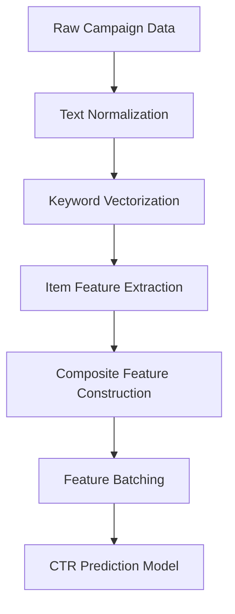
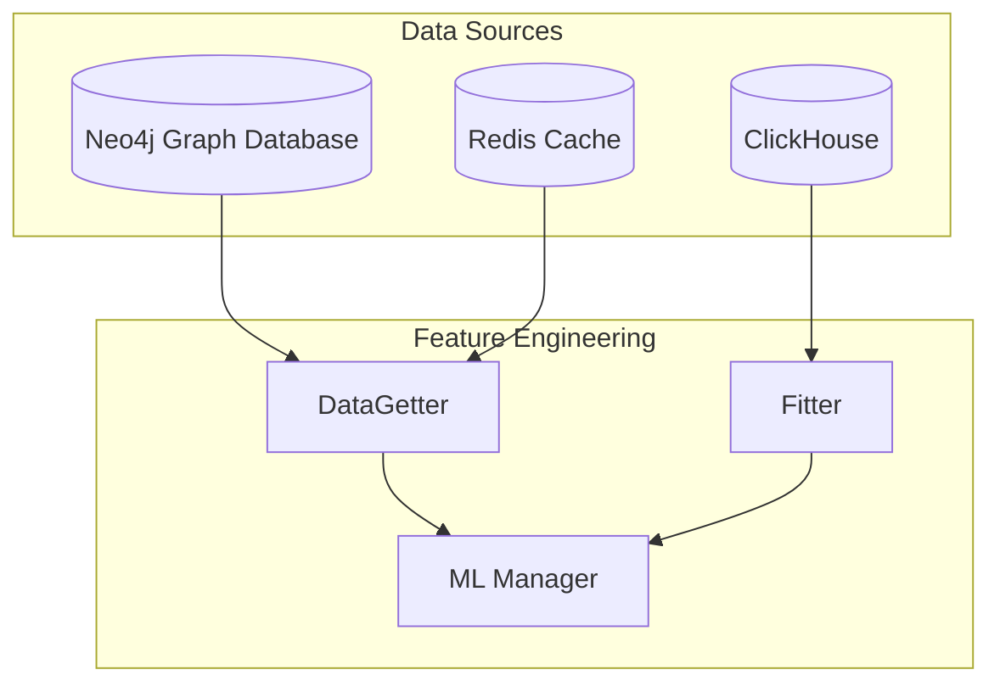
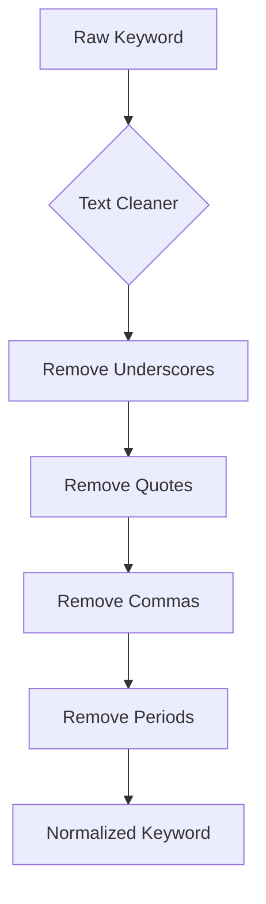
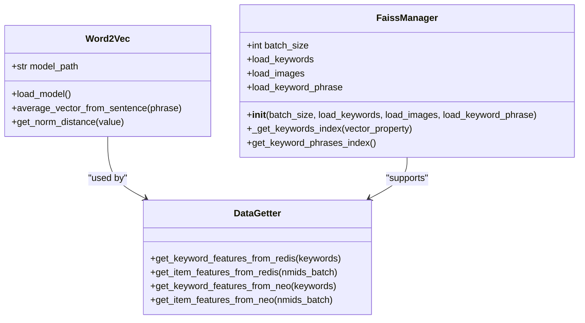
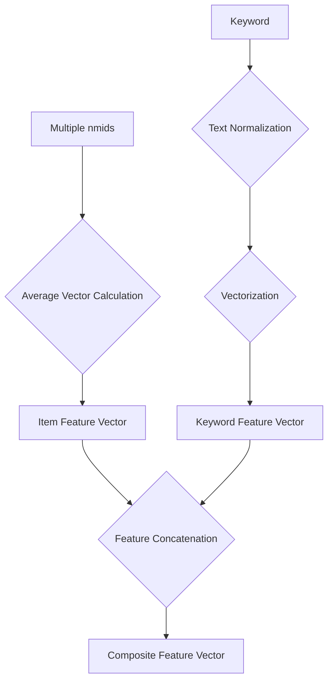
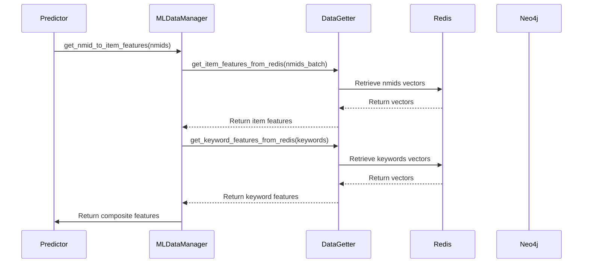
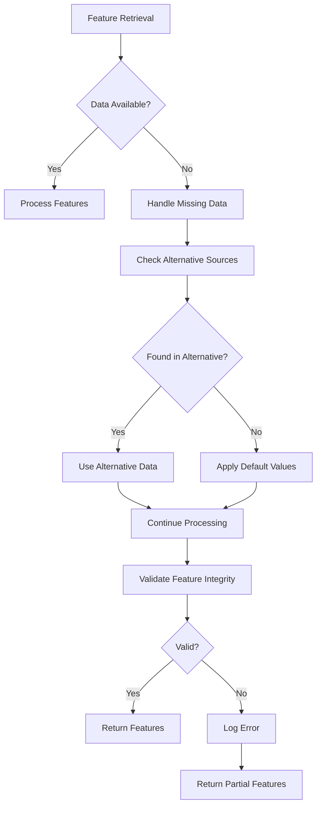
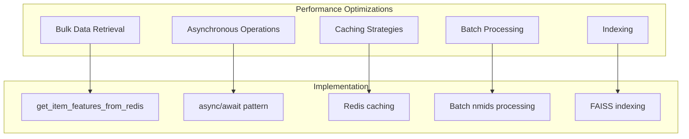

# Feature Engineering

<cite>
**Referenced Files in This Document**   
- [data_getter.py](file://app/modules/wb_adv_updater/data_getter.py)
- [ml_data_manager.py](file://app/modules/wb_adv_updater/ml_data_manager.py)
- [faiss_index_manager.py](file://app/utils/faiss_manager/faiss_index_manager.py)
- [word_to_vec_object.py](file://app/modules/wb_adv_updater/word_to_vec_object.py)
- [text_cleaner/__init__.py](file://app/utils/text_cleaner/__init__.py)
- [Transformers.py](file://app/utils/text_master/Transformers.py)
- [ML.py](file://app/modules/wb_adv_updater/ML.py)
- [fitter.py](file://app/modules/wb_adv_updater/fitter.py)
- [gds_object.py](file://app/modules/wb_adv_updater/gds_object.py)
- [driver.py](file://app/utils/NeoDataScience/driver.py)
</cite>

## Table of Contents
1. [Introduction](#introduction)
2. [Feature Extraction Pipeline](#feature-extraction-pipeline)
3. [Data Sources and Storage](#data-sources-and-storage)
4. [Text Processing and Normalization](#text-processing-and-normalization)
5. [Vector Representation and Similarity Search](#vector-representation-and-similarity-search)
6. [Composite Feature Construction](#composite-feature-construction)
7. [Integration with CTR Prediction Pipeline](#integration-with-ctr-prediction-pipeline)
8. [Data Quality and Error Handling](#data-quality-and-error-handling)
9. [Performance Considerations](#performance-considerations)

## Introduction
The feature engineering process in the Wildberries advertising system transforms raw campaign data into machine learning features for CTR prediction. This document details how item features are extracted from Neo4j via the DataScience driver, keyword features are retrieved from Redis, and composite features are constructed using various vectorization techniques. The system integrates multiple data sources and employs advanced techniques like FAISS for vector similarity search to enhance prediction accuracy.

## Feature Extraction Pipeline

The feature engineering pipeline follows a structured approach to transform raw data into machine learning-ready features. The process begins with data retrieval from multiple sources, followed by text normalization, vectorization, and composite feature construction.



**Diagram sources**
- [data_getter.py](file://app/modules/wb_adv_updater/data_getter.py#L1-L53)
- [ML.py](file://app/modules/wb_adv_updater/ML.py#L0-L256)

**Section sources**
- [data_getter.py](file://app/modules/wb_adv_updater/data_getter.py#L1-L53)
- [ML.py](file://app/modules/wb_adv_updater/ML.py#L0-L256)

## Data Sources and Storage

The system leverages multiple data storage systems for efficient feature retrieval. Neo4j serves as the primary graph database for item features, while Redis provides fast access to keyword vectors. The DataScience driver facilitates communication with Neo4j, and custom Redis managers handle keyword vector storage.



**Diagram sources**
- [data_getter.py](file://app/modules/wb_adv_updater/data_getter.py#L1-L53)
- [driver.py](file://app/utils/NeoDataScience/driver.py#L0-L799)
- [fitter.py](file://app/modules/wb_adv_updater/fitter.py#L0-L281)

**Section sources**
- [data_getter.py](file://app/modules/wb_adv_updater/data_getter.py#L1-L53)
- [driver.py](file://app/utils/NeoDataScience/driver.py#L0-L799)

## Text Processing and Normalization

Text normalization is a critical preprocessing step that ensures consistent keyword representation before vectorization. The system uses a dedicated text cleaner to remove special characters and standardize text format.



**Section sources**
- [text_cleaner/__init__.py](file://app/utils/text_cleaner/__init__.py#L0-L7)
- [Transformers.py](file://app/utils/text_master/Transformers.py#L0-L88)

The text cleaning process, implemented in `text_cleaner.clear()`, removes common special characters that could interfere with vectorization. This normalization ensures that keywords like "wireless_mouse" and "wireless mouse" are treated as equivalent during feature extraction.

```python
[SPEC SYMBOL](file://app/utils/text_cleaner/__init__.py#L1-L7)
```

## Vector Representation and Similarity Search

The system employs Word2Vec for keyword vectorization and FAISS for efficient similarity search. Keyword vectors are stored in Redis for rapid retrieval, while FAISS enables similarity-based CTR prediction for unseen keywords.



**Diagram sources**
- [word_to_vec_object.py](file://app/modules/wb_adv_updater/word_to_vec_object.py#L0-L2)
- [Transformers.py](file://app/utils/text_master/Transformers.py#L0-L88)
- [faiss_index_manager.py](file://app/utils/faiss_manager/faiss_index_manager.py#L0-L187)

The FAISS index manager creates and maintains vector indexes for efficient similarity search. When a new keyword is encountered, the system searches for similar keywords with known CTR values and uses them to predict the CTR for the new keyword.

```python
[SPEC SYMBOL](file://app/modules/wb_adv_updater/ml_data_manager.py#L150-L294)
```

## Composite Feature Construction

Composite features are constructed by combining item and keyword vectors into a unified feature space. The system calculates average item vectors across multiple nmids and combines them with keyword embeddings to create comprehensive feature representations.



**Section sources**
- [fitter.py](file://app/modules/wb_adv_updater/fitter.py#L0-L281)
- [ML.py](file://app/modules/wb_adv_updater/ML.py#L0-L256)

The `get_nmid_to_item_features` function in the fitter module retrieves item vectors from Redis and constructs a dictionary mapping nmids to their feature vectors. For campaigns with multiple items, the system calculates the average vector across all items in the campaign.

```python
[SPEC SYMBOL](file://app/modules/wb_adv_updater/fitter.py#L250-L281)
```

## Integration with CTR Prediction Pipeline

The feature engineering process is tightly integrated with the CTR prediction pipeline. Features are batched and formatted in the `get_nmid_to_item_features` function, which serves as the bridge between raw data and the machine learning model.



**Diagram sources**
- [ML.py](file://app/modules/wb_adv_updater/ML.py#L0-L256)
- [fitter.py](file://app/modules/wb_adv_updater/fitter.py#L0-L281)
- [data_getter.py](file://app/modules/wb_adv_updater/data_getter.py#L1-L53)

The predictor class in ML.py orchestrates the feature engineering process, combining item and keyword features into a unified DataFrame for CTR prediction. The system handles both active and paused campaigns, ensuring comprehensive feature coverage.

```python
[SPEC SYMBOL](file://app/modules/wb_adv_updater/ML.py#L150-L256)
```

## Data Quality and Error Handling

The system implements robust error handling to address common data quality issues such as missing vectors and inconsistent product data. Various safeguards ensure the pipeline continues to function even when encountering incomplete or corrupted data.



**Section sources**
- [data_getter.py](file://app/modules/wb_adv_updater/data_getter.py#L1-L53)
- [ml_data_manager.py](file://app/modules/wb_adv_updater/ml_data_manager.py#L0-L294)
- [fitter.py](file://app/modules/wb_adv_updater/fitter.py#L0-L281)

The system handles missing vectors by checking alternative data sources and applying default values when necessary. For example, if a keyword vector is not found in Redis, the system attempts to generate it using Word2Vec and falls back to default values if vectorization fails.

```python
[SPEC SYMBOL](file://app/modules/wb_adv_updater/ml_data_manager.py#L150-L294)
```

## Performance Considerations

The feature engineering system is designed for high-performance operation at scale. Various optimizations ensure efficient feature retrieval and processing, even with large volumes of campaign data.



**Section sources**
- [data_getter.py](file://app/modules/wb_adv_updater/data_getter.py#L1-L53)
- [faiss_index_manager.py](file://app/utils/faiss_manager/faiss_index_manager.py#L0-L187)
- [fitter.py](file://app/modules/wb_adv_updater/fitter.py#L0-L281)

The system employs several performance optimizations:
- Bulk retrieval of feature vectors to minimize database round-trips
- Asynchronous operations to maximize throughput
- Redis caching for frequently accessed keyword vectors
- Batch processing of nmids to reduce computational overhead
- FAISS indexing for efficient similarity search

These optimizations enable the system to handle large-scale feature engineering tasks efficiently, ensuring timely CTR predictions for Wildberries advertising campaigns.

```python
[SPEC SYMBOL](file://app/modules/wb_adv_updater/data_getter.py#L40-L53)
```