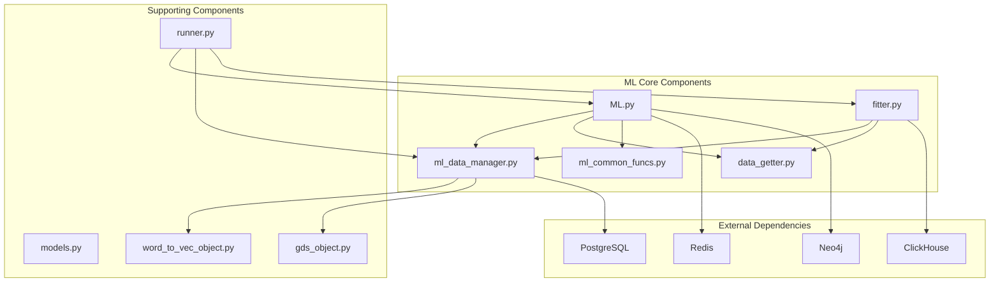
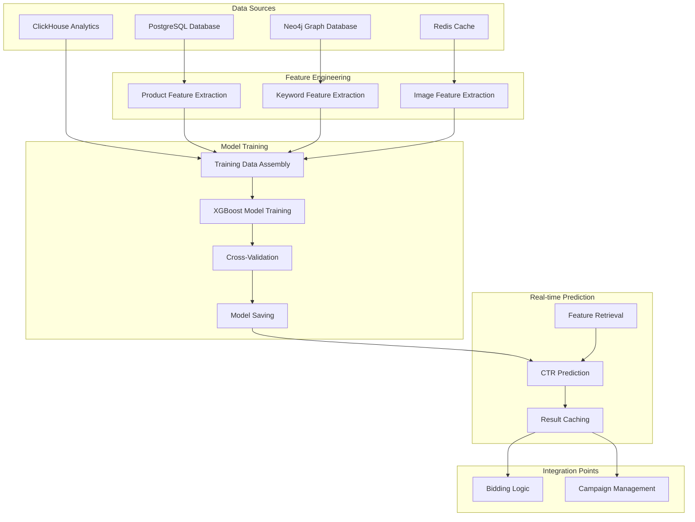
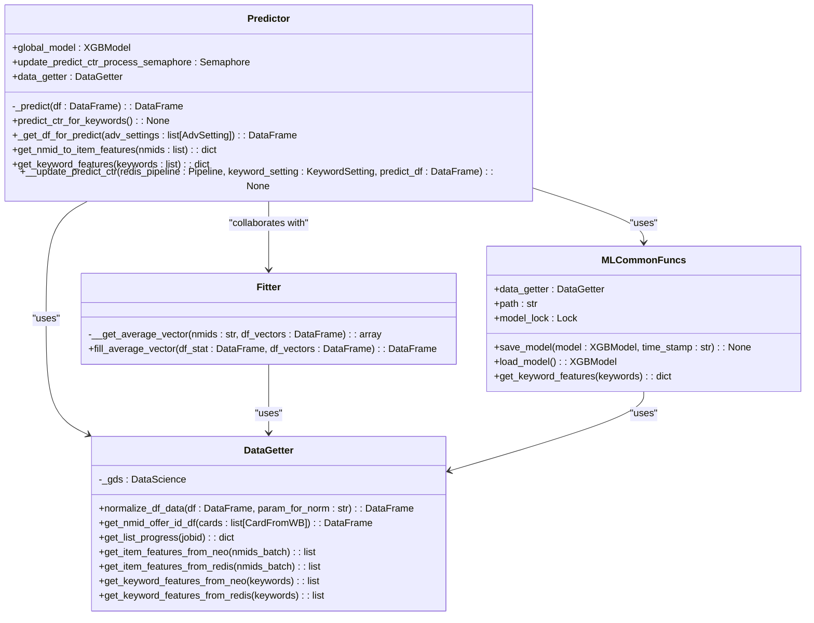
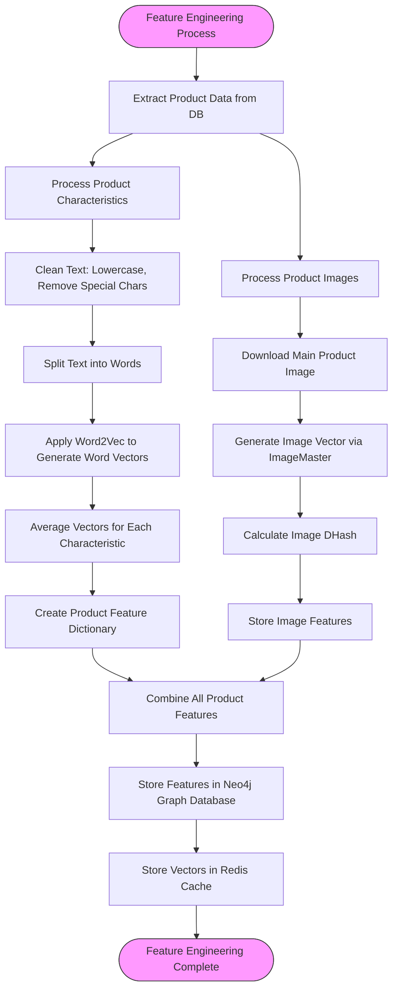
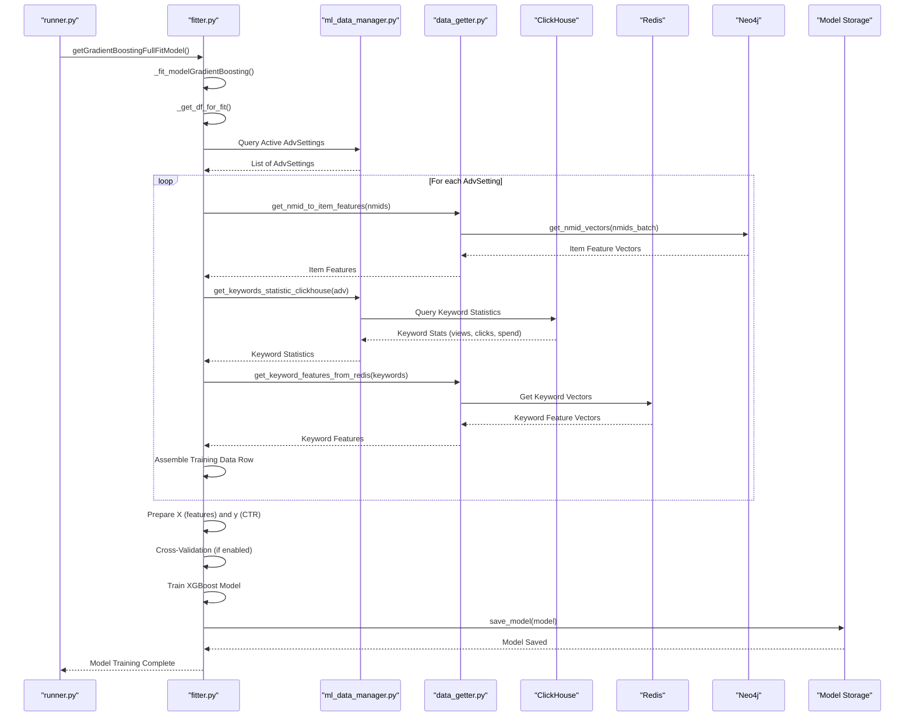
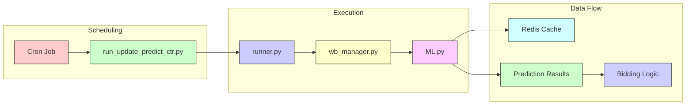
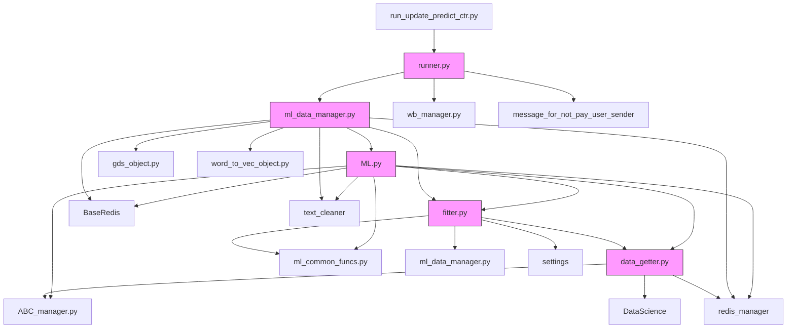

# Machine Learning Integration

<cite>
**Referenced Files in This Document**   
- [ML.py](file://app/modules/wb_adv_updater/ML.py)
- [ml_data_manager.py](file://app/modules/wb_adv_updater/ml_data_manager.py)
- [fitter.py](file://app/modules/wb_adv_updater/fitter.py)
- [data_getter.py](file://app/modules/wb_adv_updater/data_getter.py)
- [ml_common_funcs.py](file://app/modules/wb_adv_updater/ml_common_funcs.py)
- [runner.py](file://app/modules/wb_adv_updater/runner.py)
- [models.py](file://app/modules/wb_adv_updater/models.py)
- [requirements.txt](file://requirements.txt)
- [run_update_predict_ctr.py](file://run_update_predict_ctr.py)
</cite>

## Table of Contents
1. [Introduction](#introduction)
2. [Project Structure](#project-structure)
3. [Core Components](#core-components)
4. [Architecture Overview](#architecture-overview)
5. [Detailed Component Analysis](#detailed-component-analysis)
6. [Dependency Analysis](#dependency-analysis)
7. [Performance Considerations](#performance-considerations)
8. [Troubleshooting Guide](#troubleshooting-guide)
9. [Conclusion](#conclusion)

## Introduction
The Machine Learning Integration in the adv-bot system provides a comprehensive solution for predicting Click-Through Rate (CTR) in advertising campaigns. This documentation details the CTR prediction model architecture, feature engineering process, model training pipeline, and deployment strategy. The system leverages historical campaign data processed through ml_data_manager.py to generate training features and employs the ML model in app/modules/wb_adv_updater/ML.py for real-time predictions. The integration between machine learning components and bidding logic is critical for optimizing advertising performance, with data flowing from ClickHouse analytics to model inference. The system utilizes key machine learning libraries including tensorflow, xgboost, and gensim as specified in requirements.txt.

## Project Structure

**Diagram sources**
- [ML.py](file://app/modules/wb_adv_updater/ML.py)
- [ml_data_manager.py](file://app/modules/wb_adv_updater/ml_data_manager.py)
- [fitter.py](file://app/modules/wb_adv_updater/fitter.py)
- [data_getter.py](file://app/modules/wb_adv_updater/data_getter.py)

**Section sources**
- [app/modules/wb_adv_updater](file://app/modules/wb_adv_updater)

## Core Components

The core components of the ML integration include the Predictor class in ML.py which handles real-time CTR predictions, the fitter.py module responsible for model training, and the data_getter.py component that manages feature retrieval from various data sources. The ml_data_manager.py orchestrates the overall ML workflow, coordinating data updates, model training, and prediction processes. The system uses a global model instance stored in memory for efficient inference, with model persistence handled through joblib serialization to disk. Feature vectors for both keywords and product items are stored in Redis for low-latency access during prediction.

**Section sources**
- [ML.py](file://app/modules/wb_adv_updater/ML.py#L1-L257)
- [fitter.py](file://app/modules/wb_adv_updater/fitter.py#L1-L282)
- [data_getter.py](file://app/modules/wb_adv_updater/data_getter.py#L1-L54)

## Architecture Overview

**Diagram sources**
- [ML.py](file://app/modules/wb_adv_updater/ML.py)
- [fitter.py](file://app/modules/wb_adv_updater/fitter.py)
- [ml_data_manager.py](file://app/modules/wb_adv_updater/ml_data_manager.py)
- [data_getter.py](file://app/modules/wb_adv_updater/data_getter.py)

## Detailed Component Analysis

### CTR Prediction Model Architecture

**Diagram sources**
- [ML.py](file://app/modules/wb_adv_updater/ML.py#L1-L257)
- [data_getter.py](file://app/modules/wb_adv_updater/data_getter.py#L1-L54)
- [ml_common_funcs.py](file://app/modules/wb_adv_updater/ml_common_funcs.py#L1-L53)

### Feature Engineering Process

**Diagram sources**
- [ml_data_manager.py](file://app/modules/wb_adv_updater/ml_data_manager.py#L1-L295)
- [word_to_vec_object.py](file://app/modules/wb_adv_updater/word_to_vec_object.py)
- [gds_object.py](file://app/modules/wb_adv_updater/gds_object.py)
- [image_master2.py](file://app/utils/image_master/image_master2.py)

### Model Training Pipeline

**Diagram sources**
- [fitter.py](file://app/modules/wb_adv_updater/fitter.py#L1-L282)
- [ml_data_manager.py](file://app/modules/wb_adv_updater/ml_data_manager.py#L1-L295)
- [data_getter.py](file://app/modules/wb_adv_updater/data_getter.py#L1-L54)
- [ML.py](file://app/modules/wb_adv_updater/ML.py#L1-L257)

### Deployment Strategy and Integration

**Diagram sources**
- [run_update_predict_ctr.py](file://run_update_predict_ctr.py#L1-L9)
- [runner.py](file://app/modules/wb_adv_updater/runner.py#L1-L96)
- [ML.py](file://app/modules/wb_adv_updater/ML.py#L1-L257)
- [wb_manager.py](file://app/modules/wb_adv_updater/wb_manager.py)

## Dependency Analysis

**Diagram sources**
- [ML.py](file://app/modules/wb_adv_updater/ML.py)
- [fitter.py](file://app/modules/wb_adv_updater/fitter.py)
- [ml_data_manager.py](file://app/modules/wb_adv_updater/ml_data_manager.py)
- [data_getter.py](file://app/modules/wb_adv_updater/data_getter.py)
- [runner.py](file://app/modules/wb_adv_updater/runner.py)

**Section sources**
- [ML.py](file://app/modules/wb_adv_updater/ML.py)
- [fitter.py](file://app/modules/wb_adv_updater/fitter.py)
- [ml_data_manager.py](file://app/modules/wb_adv_updater/ml_data_manager.py)
- [data_getter.py](file://app/modules/wb_adv_updater/data_getter.py)
- [runner.py](file://app/modules/wb_adv_updater/runner.py)

## Performance Considerations

The ML integration is designed for high-performance operation in a production environment with several key performance considerations:

1. **Low-latency inference**: The system uses Redis as a cache for feature vectors, enabling sub-millisecond retrieval of keyword and product features during prediction.

2. **Parallel processing**: The architecture leverages asyncio for non-blocking I/O operations, allowing concurrent data retrieval from multiple sources (ClickHouse, Neo4j, Redis).

3. **Memory efficiency**: The global model is loaded once and shared across requests, reducing memory overhead and initialization time.

4. **Batch processing**: Feature retrieval operations are batched to minimize database round-trips and network overhead.

5. **Asynchronous execution**: Long-running operations like model training are executed in separate threads using asyncio.to_thread to prevent blocking the event loop.

6. **Caching strategy**: Both feature vectors and prediction results are cached to avoid redundant computation.

7. **Resource limiting**: Semaphores are used to limit concurrent model update processes, preventing resource exhaustion.

8. **Efficient data structures**: Pandas DataFrames are used for efficient data manipulation and XGBoost for high-performance gradient boosting.

**Section sources**
- [ML.py](file://app/modules/wb_adv_updater/ML.py)
- [ml_data_manager.py](file://app/modules/wb_adv_updater/ml_data_manager.py)
- [fitter.py](file://app/modules/wb_adv_updater/fitter.py)

## Troubleshooting Guide

### Common Issues and Solutions

**Section sources**
- [ML.py](file://app/modules/wb_adv_updater/ML.py#L1-L257)
- [fitter.py](file://app/modules/wb_adv_updater/fitter.py#L1-L282)
- [ml_data_manager.py](file://app/modules/wb_adv_updater/ml_data_manager.py#L1-L295)

#### Model Drift
**Symptoms**: Decreasing prediction accuracy over time, increasing discrepancy between predicted and actual CTR.
**Causes**: Changes in user behavior, market conditions, or platform algorithms.
**Solutions**: 
- Implement regular retraining schedule (currently configured to run periodically)
- Monitor prediction accuracy metrics
- Set up alerts for significant performance degradation
- Maintain versioned models for rollback capability

#### Data Quality Problems
**Symptoms**: Missing features, null values in training data, failed feature extraction.
**Causes**: Incomplete product data, missing images, malformed keyword data.
**Solutions**:
- Implement data validation checks in ml_data_manager.py
- Add fallback mechanisms for missing features
- Log data quality issues for monitoring
- Implement data cleansing routines in text_cleaner

#### Performance Bottlenecks
**Symptoms**: Slow prediction times, high CPU/memory usage, timeout errors.
**Causes**: Large feature vectors, unoptimized queries, insufficient caching.
**Solutions**:
- Optimize feature vector dimensions
- Implement query batching
- Increase Redis cache capacity
- Profile and optimize critical code paths

#### Model Training Failures
**Symptoms**: Training process crashes, incomplete model updates, missing model files.
**Causes**: Insufficient training data, memory limitations, file system issues.
**Solutions**:
- Verify minimum data requirements are met
- Monitor system resources during training
- Implement robust error handling in fitter.py
- Ensure proper file permissions and disk space

#### Integration Issues
**Symptoms**: Failed predictions, missing prediction results in bidding system.
**Causes**: Redis connectivity issues, incorrect data formatting, API changes.
**Solutions**:
- Implement comprehensive logging in ML.py
- Add integration tests
- Monitor Redis connectivity and performance
- Implement circuit breakers for external dependencies

## Conclusion

The Machine Learning Integration in the adv-bot system provides a robust framework for CTR prediction in advertising campaigns. The architecture combines historical campaign data from ClickHouse with product and keyword features from multiple sources to train an XGBoost model that delivers real-time predictions. The system is designed for high availability and performance, with careful attention to low-latency inference requirements in high-frequency bidding scenarios. Key strengths include its modular design, comprehensive feature engineering pipeline, and seamless integration with the bidding logic. The use of established libraries like xgboost, gensim, and tensorflow ensures reliability and access to state-of-the-art machine learning techniques. For optimal performance, regular monitoring of model accuracy and data quality is recommended, along with adherence to the established retraining schedule to mitigate model drift.