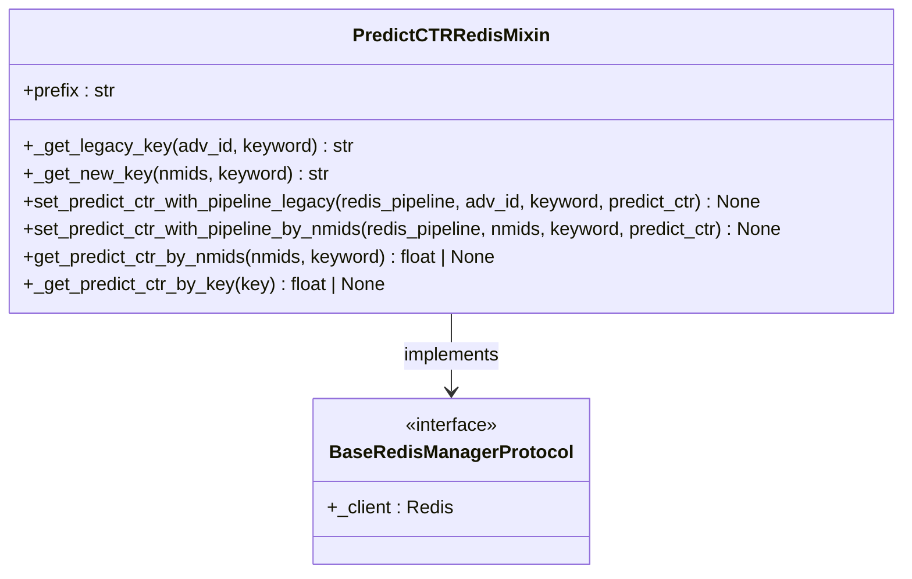
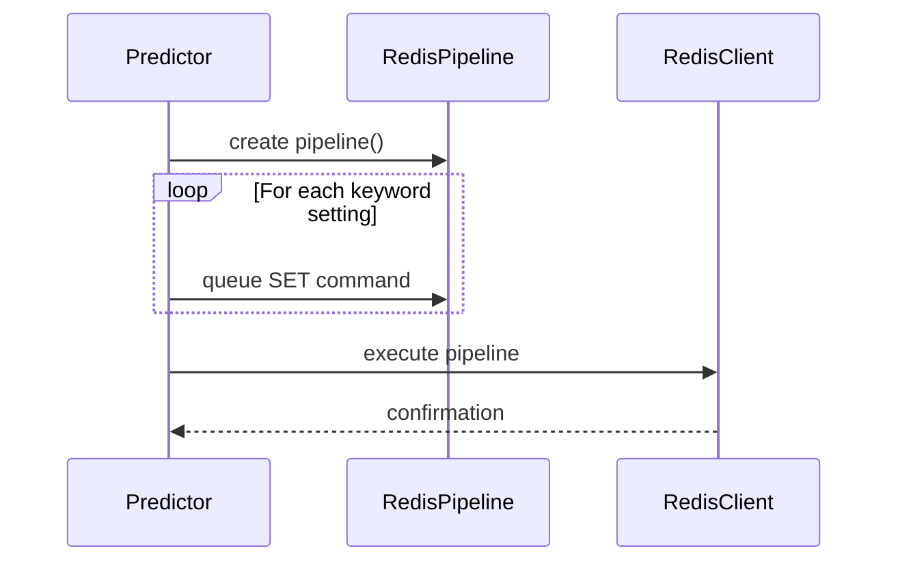

# Model Deployment

<cite>
**Referenced Files in This Document**   
- [ML.py](file://app/modules/wb_adv_updater/ML.py)
- [ml_common_funcs.py](file://app/modules/wb_adv_updater/ml_common_funcs.py)
- [min_ctr_manager.py](file://app/modules/wb_adv_updater/min_ctr_manager/min_ctr_manager.py)
- [predic_ctr.py](file://app/core/redis_manager_v2/mixins/predic_ctr.py)
- [redis_manager.py](file://app/utils/redis_manager/__init__.py)
</cite>

## Table of Contents
1. [Model Loading and Initialization](#model-loading-and-initialization)
2. [Redis-Based Prediction Storage](#redis-based-prediction-storage)
3. [Prediction Consumption by Bidding System](#prediction-consumption-by-bidding-system)
4. [Atomic Update Process with Redis Pipelines](#atomic-update-process-with-redis-pipelines)
5. [Race Condition Prevention](#race-condition-prevention)
6. [Deployment Challenges](#deployment-challenges)
7. [Performance Considerations](#performance-considerations)

## Model Loading and Initialization

The model deployment strategy centers around the ML.py module, which implements a singleton pattern for model management through the `global_model` variable. The model loading process is handled by the `load_model()` function in ml_common_funcs.py, which uses joblib to deserialize the trained XGBoost model from a file. This function employs a multiprocessing Lock (`model_lock`) to ensure thread-safe access during model loading, preventing race conditions in multi-process environments. The loaded model is stored in the `global_model` variable, providing a centralized, shared instance that can be accessed across different components of the application without repeated deserialization overhead.

**Section sources**
- [ML.py](file://app/modules/wb_adv_updater/ML.py#L30)
- [ml_common_funcs.py](file://app/modules/wb_adv_updater/ml_common_funcs.py#L32-L40)

## Redis-Based Prediction Storage

The system implements a dual-format Redis storage strategy for prediction data through the `PredictCTRRedisMixin` class. This approach supports both legacy and new key formats to ensure backward compatibility during the transition period. The legacy format uses the key pattern `predict_ctr:{adv_id}:{keyword}` for individual advertisement lookups, while the new format uses `predict_ctr_v2:{nmids}:{keyword}` to support nmids-based lookups. The `clear()` function from text_cleaner is applied to keywords before key formation to ensure consistent formatting. This dual-format approach allows the system to gradually migrate from advertisement-centric to product-centric (nmid) prediction storage, accommodating different lookup patterns required by various components of the bidding system.

**Diagram sources**
- [predic_ctr.py](file://app/core/redis_manager_v2/mixins/predic_ctr.py#L11-L75)

**Section sources**
- [predic_ctr.py](file://app/core/redis_manager_v2/mixins/predic_ctr.py#L11-L75)

## Prediction Consumption by Bidding System

The bidding system consumes predictions through the `MinCtrManager` class in min_ctr_manager.py, which determines minimum CTR thresholds for advertisement campaigns. This component first checks if the campaign uses the new auto-min-CTR mode; if not, it falls back to hard-coded minimum values or default settings. For campaigns using the new mode, it retrieves relevant keywords from the database and queries both historical performance data from ClickHouse and predicted CTR values from Redis. The system prioritizes predicted CTR values when available, falling back to historical real CTR values if predictions are missing. The final minimum CTR is determined as the minimum value among all relevant keywords, ensuring conservative bidding behavior that protects campaign performance.

**Section sources**
- [min_ctr_manager.py](file://app/modules/wb_adv_updater/min_ctr_manager/min_ctr_manager.py#L0-L124)

## Atomic Update Process with Redis Pipelines

The system ensures data consistency during prediction updates through atomic Redis pipeline operations. The `predict_ctr_for_keywords` method in the Predictor class orchestrates the entire prediction workflow, culminating in a batch update of Redis keys. After generating predictions, the method creates a Redis pipeline using `redis_master_client.pipeline()` and iterates through all keyword settings, adding individual prediction updates to the pipeline. Each update is added via the `set_predict_ctr_with_pipeline` method, which formats the appropriate Redis key and queues the SET command. Only after all updates are queued does the system execute the pipeline with `execute()`, ensuring all changes are applied atomically. This approach prevents partial updates and maintains data consistency even in the event of process interruption.

**Diagram sources**
- [ML.py](file://app/modules/wb_adv_updater/ML.py#L200-L256)
- [redis_manager.py](file://app/utils/redis_manager/__init__.py#L797-L799)

**Section sources**
- [ML.py](file://app/modules/wb_adv_updater/ML.py#L200-L256)
- [redis_manager.py](file://app/utils/redis_manager/__init__.py#L797-L799)

## Race Condition Prevention

The system employs multiple concurrency control mechanisms to prevent race conditions during prediction updates. The most critical is the `update_predict_ctr_process_semaphore`, an asyncio.Semaphore with a limit of 10, which restricts the number of concurrent prediction update processes. This semaphore prevents resource exhaustion and ensures system stability during peak loads. Additionally, the model loading process uses a multiprocessing Lock to prevent multiple processes from simultaneously loading the model, which could lead to file access conflicts. The Redis pipeline approach itself provides atomicity for individual update batches, ensuring that either all predictions in a batch are written or none are, preventing partial updates that could corrupt the prediction data.

**Section sources**
- [ML.py](file://app/modules/wb_adv_updater/ML.py#L30)

## Deployment Challenges

The deployment strategy addresses several key challenges in model serving. Model versioning is implicitly handled through the file-based model storage, where the `model.json` file can be replaced with new versions during deployment. Rollback strategies are supported by maintaining the previous model file until the new model is successfully loaded and validated. Zero-downtime updates are achieved through the singleton pattern and lazy loading - the system continues serving predictions with the current model while the new model is being loaded in the background. The dual Redis key format (legacy and v2) facilitates gradual migration, allowing old and new components to coexist during deployment. Cache invalidation is handled automatically through the periodic prediction update process, which overwrites existing Redis keys with fresh predictions.

**Section sources**
- [ML.py](file://app/modules/wb_adv_updater/ML.py#L30)
- [ml_common_funcs.py](file://app/modules/wb_adv_updater/ml_common_funcs.py#L32-L40)

## Performance Considerations

The system is designed for high-throughput prediction serving with several performance optimizations. The use of Redis as a prediction cache enables sub-millisecond read latency for the bidding system. Batch updates through Redis pipelines minimize network overhead and maximize write throughput. The prediction process itself is optimized through asynchronous database queries and parallel processing of advertisement settings. The system leverages asyncio.to_thread for CPU-intensive operations like model prediction, preventing event loop blocking. Cache invalidation is efficient as the entire prediction set is updated in a single atomic operation, avoiding the overhead of individual key deletions. The dual Redis key format allows for optimized lookups based on the access pattern - either by adv_id for legacy components or by nmids for newer, product-centric workflows.

**Section sources**
- [ML.py](file://app/modules/wb_adv_updater/ML.py#L200-L256)
- [predic_ctr.py](file://app/core/redis_manager_v2/mixins/predic_ctr.py#L11-L75)
- [redis_manager.py](file://app/utils/redis_manager/__init__.py#L797-L799)