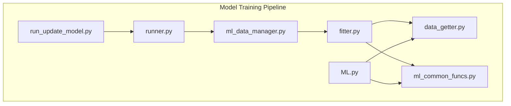
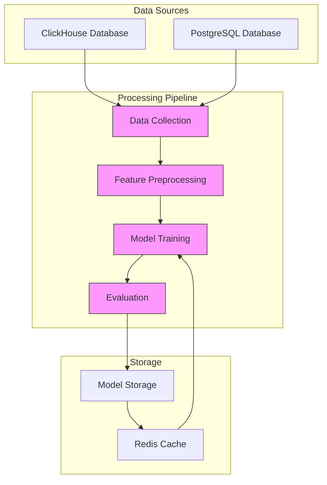
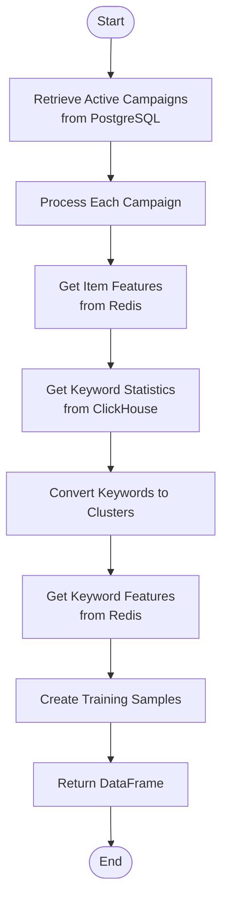
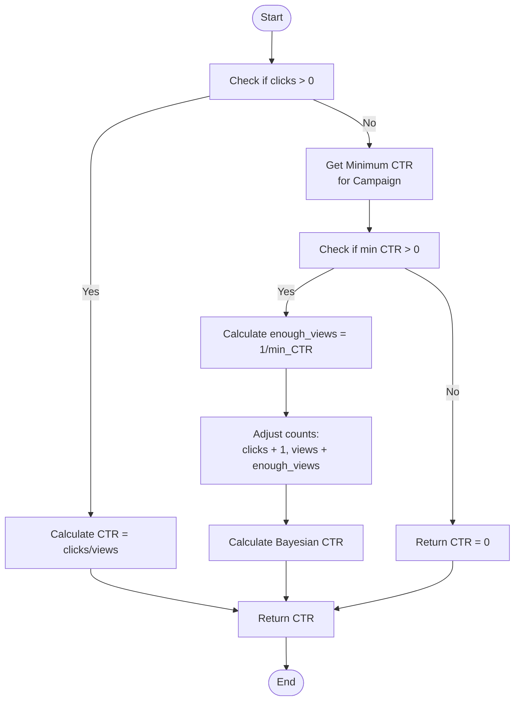
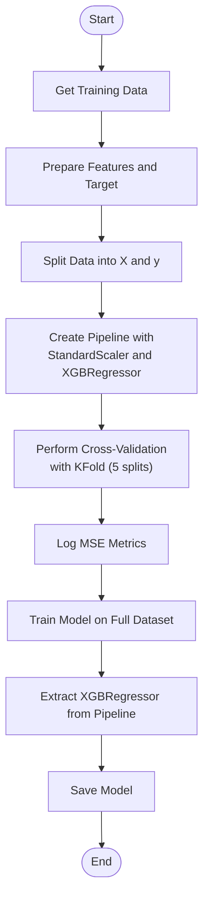
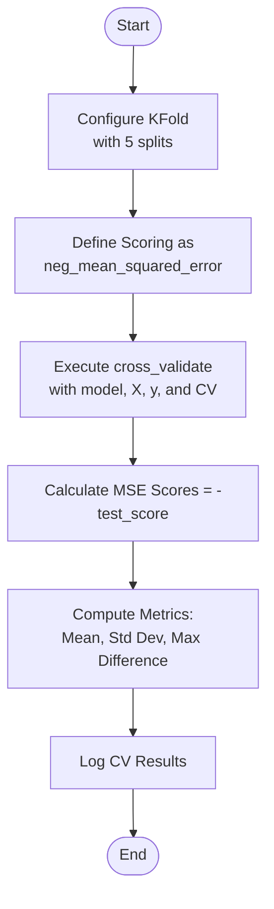
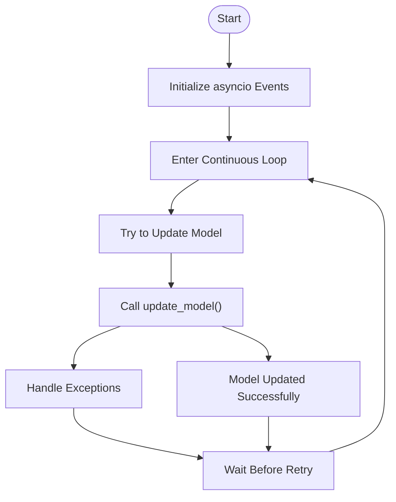
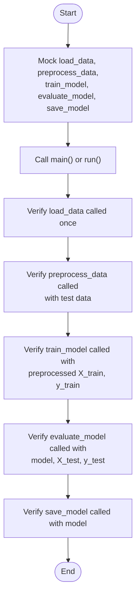
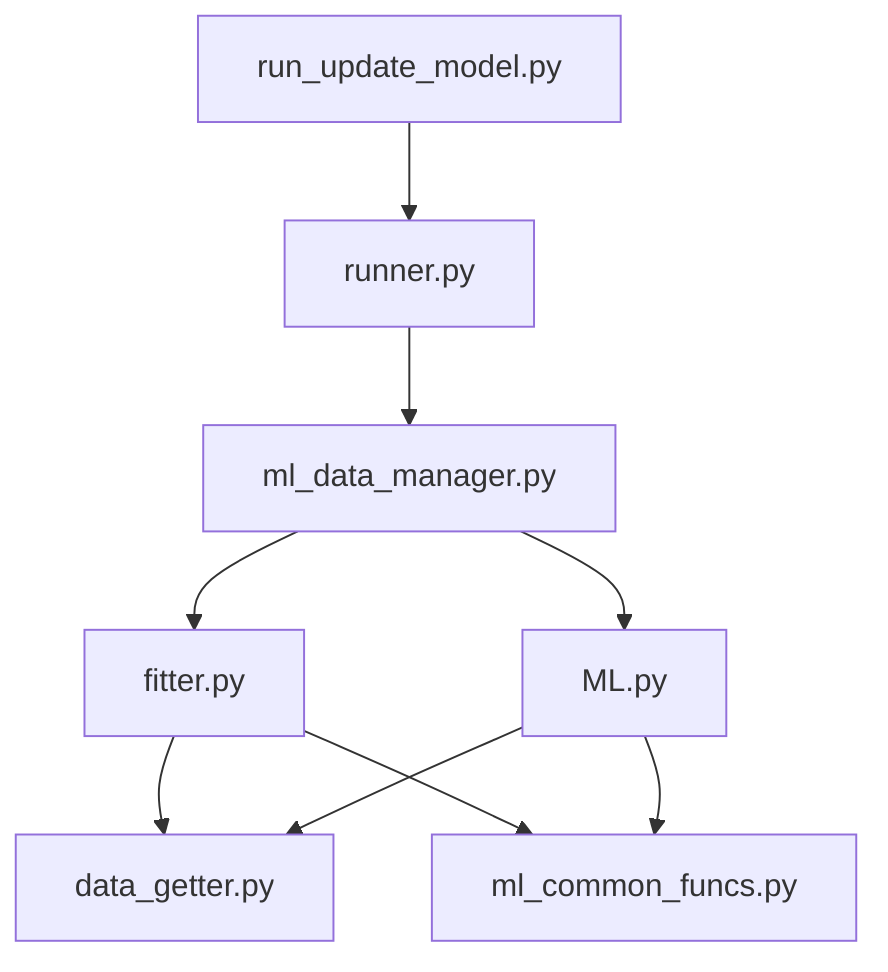

# Model Training

<cite>
**Referenced Files in This Document**   
- [fitter.py](file://app/modules/wb_adv_updater/fitter.py)
- [runner.py](file://app/modules/wb_adv_updater/runner.py)
- [run_update_model.py](file://run_update_model.py)
- [ml_data_manager.py](file://app/modules/wb_adv_updater/ml_data_manager.py)
- [data_getter.py](file://app/modules/wb_adv_updater/data_getter.py)
- [ML.py](file://app/modules/wb_adv_updater/ML.py)
- [ml_common_funcs.py](file://app/modules/wb_adv_updater/ml_common_funcs.py)
- [test_model_updater.py](file://tests/tests_entry_points/test_model_updater.py)
</cite>

## Table of Contents
1. [Introduction](#introduction)
2. [Project Structure](#project-structure)
3. [Core Components](#core-components)
4. [Architecture Overview](#architecture-overview)
5. [Detailed Component Analysis](#detailed-component-analysis)
6. [Dependency Analysis](#dependency-analysis)
7. [Performance Considerations](#performance-considerations)
8. [Troubleshooting Guide](#troubleshooting-guide)
9. [Conclusion](#conclusion)

## Introduction
This document provides a comprehensive analysis of the Model Training pipeline in the advertising bot system. The pipeline is responsible for training machine learning models to predict click-through rates (CTR) for advertising campaigns based on historical performance data. The system orchestrates data collection from multiple sources, feature preprocessing, model training with XGBoost, and evaluation metrics. The training workflow is designed to handle concept drift in advertising data and optimize hyperparameters for large datasets.

## Project Structure
The Model Training pipeline is organized within the `app/modules/wb_adv_updater` directory, with key components distributed across several files that handle specific aspects of the training process. The main entry point for model updates is `run_update_model.py`, which coordinates the execution of the training workflow. The core training logic is implemented in `fitter.py` and `runner.py`, while data management and retrieval are handled by `data_getter.py` and associated modules.

**Diagram sources**
- [run_update_model.py](file://run_update_model.py)
- [fitter.py](file://app/modules/wb_adv_updater/fitter.py)
- [runner.py](file://app/modules/wb_adv_updater/runner.py)
- [ml_data_manager.py](file://app/modules/wb_adv_updater/ml_data_manager.py)
- [ML.py](file://app/modules/wb_adv_updater/ML.py)
- [data_getter.py](file://app/modules/wb_adv_updater/data_getter.py)
- [ml_common_funcs.py](file://app/modules/wb_adv_updater/ml_common_funcs.py)

**Section sources**
- [run_update_model.py](file://run_update_model.py)
- [fitter.py](file://app/modules/wb_adv_updater/fitter.py)
- [runner.py](file://app/modules/wb_adv_updater/runner.py)

## Core Components
The Model Training pipeline consists of several core components that work together to collect data, preprocess features, train models, and evaluate performance. The main components include the data collection system that retrieves historical campaign performance data from ClickHouse and PostgreSQL, the feature preprocessing module that transforms raw data into training samples, the model training component that uses XGBoost for gradient boosting, and the evaluation system that assesses model performance using cross-validation and various metrics.

The pipeline also includes a retraining scheduler that controls when models are updated based on both time-based schedules and event-driven triggers. The system is designed to handle concept drift in advertising data by regularly updating models with new data and adjusting for changing patterns in user behavior and market conditions.

**Section sources**
- [fitter.py](file://app/modules/wb_adv_updater/fitter.py#L0-L281)
- [runner.py](file://app/modules/wb_adv_updater/runner.py#L0-L95)
- [ml_data_manager.py](file://app/modules/wb_adv_updater/ml_data_manager.py#L0-L294)

## Architecture Overview
The Model Training pipeline follows a modular architecture with clear separation of concerns between data collection, preprocessing, model training, and evaluation. The system is orchestrated by the `run_update_model.py` script, which serves as the main entry point and coordinates the execution of the training workflow. The `runner.py` module contains the primary execution loop that manages the training process, while `fitter.py` implements the core model fitting logic.

Data flows through the system starting from ClickHouse and PostgreSQL databases where historical campaign performance data is stored. The `data_getter.py` module retrieves this data and transforms it into a format suitable for training. Feature preprocessing is performed to extract relevant characteristics from product listings and keyword data, which are then combined with campaign metrics to create training samples. The XGBoost model is trained on this data using cross-validation to ensure robust performance.

**Diagram sources**
- [fitter.py](file://app/modules/wb_adv_updater/fitter.py#L0-L281)
- [data_getter.py](file://app/modules/wb_adv_updater/data_getter.py#L0-L53)
- [ml_data_manager.py](file://app/modules/wb_adv_updater/ml_data_manager.py#L0-L294)

## Detailed Component Analysis

### Data Collection and Preprocessing
The data collection process begins with retrieving historical campaign performance data from ClickHouse and PostgreSQL databases. The `DataGetter` class in `data_getter.py` provides methods for retrieving item features from Redis and keyword features from both Redis and Neo4j. This data is combined with campaign metrics to create a comprehensive dataset for training.

The `_get_df_for_fit` function in `fitter.py` orchestrates the data collection process, retrieving campaign settings from PostgreSQL and keyword statistics from ClickHouse. For each active campaign, it collects item features for the associated products and keyword features for the campaign's keywords. These features are combined with campaign metrics such as views, clicks, and spend to create training samples.

**Diagram sources**
- [fitter.py](file://app/modules/wb_adv_updater/fitter.py#L150-L281)
- [data_getter.py](file://app/modules/wb_adv_updater/data_getter.py#L0-L53)

**Section sources**
- [fitter.py](file://app/modules/wb_adv_updater/fitter.py#L150-L281)
- [data_getter.py](file://app/modules/wb_adv_updater/data_getter.py#L0-L53)

### CTR Calculation with Minimum View Thresholds
The system implements a sophisticated CTR calculation method that accounts for minimum view thresholds to address the challenge of sparse data in advertising campaigns. The `_bayesian_apply` function in `fitter.py` calculates CTR values using a Bayesian approach that incorporates minimum CTR requirements for each campaign.

When a keyword has zero clicks, the system applies a correction based on the minimum CTR requirement for the campaign. It adds one click and a corresponding number of views calculated as the inverse of the minimum CTR, effectively creating a "prior" that prevents CTR from being zero. This approach ensures that keywords with few views are not unfairly penalized while still reflecting their actual performance.

**Diagram sources**
- [fitter.py](file://app/modules/wb_adv_updater/fitter.py#L230-L250)

**Section sources**
- [fitter.py](file://app/modules/wb_adv_updater/fitter.py#L230-L250)

### Model Training with XGBoost
The model training process is implemented in the `_fit_modelGradientBoosting` function in `fitter.py`. The system uses XGBoost, a powerful gradient boosting framework, to train a regression model for predicting CTR. The training pipeline includes feature scaling using StandardScaler to normalize input features before training.

The model is trained on a dataset that combines item features (derived from product characteristics and images), keyword features (derived from text embeddings), and campaign metadata. The target variable is the calculated CTR, which has been adjusted using the Bayesian approach described earlier. The training process includes cross-validation using KFold with 5 splits to evaluate model performance and prevent overfitting.

**Diagram sources**
- [fitter.py](file://app/modules/wb_adv_updater/fitter.py#L50-L150)

**Section sources**
- [fitter.py](file://app/modules/wb_adv_updater/fitter.py#L50-L150)

### Cross-Validation and Evaluation
The system implements a robust evaluation process using cross-validation to assess model performance. The KFold cross-validation with 5 splits is used to evaluate the model's ability to generalize to unseen data. The primary evaluation metric is negative mean squared error (MSE), which is used to quantify the difference between predicted and actual CTR values.

The evaluation process calculates several metrics including the mean CV MSE, standard deviation of CV MSE, and the maximum difference between CV MSE scores. These metrics provide insights into the model's performance and stability across different data splits. The results are logged for monitoring and analysis, allowing the team to track model performance over time and identify potential issues with concept drift or data quality.

**Diagram sources**
- [fitter.py](file://app/modules/wb_adv_updater/fitter.py#L90-L110)

**Section sources**
- [fitter.py](file://app/modules/wb_adv_updater/fitter.py#L90-L110)

### Retraining Schedule and Event-Driven Updates
The model retraining process is controlled by `run_update_model.py` and `runner.py`, which implement both scheduled and event-driven updates. The system uses asyncio events to coordinate updates, with `update_model_on_new_features` signaling when new features are available and `need_update_model` controlling when updates should proceed.

The `run_update_model` function in `runner.py` contains a continuous loop that attempts to update the model, with error handling and retry logic. This ensures that the model is regularly updated with new data, even if individual update attempts fail due to transient issues. The event-driven architecture allows the system to respond quickly to changes in data or model performance, ensuring that the predictions remain accurate and relevant.

**Diagram sources**
- [run_update_model.py](file://run_update_model.py#L0-L27)
- [runner.py](file://app/modules/wb_adv_updater/runner.py#L70-L95)

**Section sources**
- [run_update_model.py](file://run_update_model.py#L0-L27)
- [runner.py](file://app/modules/wb_adv_updater/runner.py#L70-L95)

### Testing the Training Pipeline
The training pipeline is tested using mocked data in `test_model_updater.py`, which verifies that each component of the pipeline functions correctly. The tests use MagicMock to mock the various functions in the pipeline, allowing the team to verify the flow of data and control without requiring actual data or model training.

The tests cover key aspects of the pipeline including data loading, preprocessing, model training, evaluation, and model saving. By mocking the dependencies, the tests can verify that each function is called with the correct arguments and that the overall workflow executes as expected. This approach enables comprehensive testing of the pipeline logic without the computational cost of actual model training.

**Diagram sources**
- [test_model_updater.py](file://tests/tests_entry_points/test_model_updater.py#L0-L206)

**Section sources**
- [test_model_updater.py](file://tests/tests_entry_points/test_model_updater.py#L0-L206)

## Dependency Analysis
The Model Training pipeline has a well-defined dependency structure that ensures modularity and separation of concerns. The main entry point `run_update_model.py` depends on `runner.py` to execute the training workflow, while `runner.py` depends on `ml_data_manager.py` to coordinate the model update process.

The core training logic in `fitter.py` depends on `data_getter.py` for data retrieval and `ml_common_funcs.py` for model persistence. The `ML.py` module, which contains the prediction logic, shares dependencies with the training components, using the same `data_getter.py` and `ml_common_funcs.py` modules for consistency.

**Diagram sources**
- [run_update_model.py](file://run_update_model.py)
- [runner.py](file://app/modules/wb_adv_updater/runner.py)
- [ml_data_manager.py](file://app/modules/wb_adv_updater/ml_data_manager.py)
- [fitter.py](file://app/modules/wb_adv_updater/fitter.py)
- [data_getter.py](file://app/modules/wb_adv_updater/data_getter.py)
- [ml_common_funcs.py](file://app/modules/wb_adv_updater/ml_common_funcs.py)
- [ML.py](file://app/modules/wb_adv_updater/ML.py)

**Section sources**
- [run_update_model.py](file://run_update_model.py)
- [runner.py](file://app/modules/wb_adv_updater/runner.py)
- [ml_data_manager.py](file://app/modules/wb_adv_updater/ml_data_manager.py)

## Performance Considerations
The Model Training pipeline is designed to handle large datasets efficiently, with several optimizations in place to improve performance. The system uses asynchronous programming with asyncio to handle I/O operations concurrently, reducing the overall training time. Data retrieval from databases and caches is performed asynchronously, allowing the system to overlap network operations with computation.

For large datasets, the system implements batching and incremental processing where appropriate. The feature retrieval methods in `data_getter.py` can handle batches of items or keywords, reducing the number of individual requests to the data stores. The model training process uses XGBoost's built-in support for parallel processing with n_jobs=-1, utilizing all available CPU cores to speed up training.

The system also includes performance monitoring through comprehensive logging, which helps identify bottlenecks and optimize the pipeline. Execution times are measured for key operations such as data retrieval and model training, providing insights into the performance characteristics of the system.

**Section sources**
- [fitter.py](file://app/modules/wb_adv_updater/fitter.py#L50-L150)
- [data_getter.py](file://app/modules/wb_adv_updater/data_getter.py#L0-L53)
- [runner.py](file://app/modules/wb_adv_updater/runner.py#L70-L95)

## Troubleshooting Guide
When troubleshooting issues with the Model Training pipeline, start by checking the logs for error messages and warnings. The system uses comprehensive logging throughout the pipeline, with different log levels to help identify the severity of issues.

Common issues include data retrieval failures, which may be caused by database connectivity problems or missing data. Check the logs for messages related to database queries and data processing. If the model training fails, verify that the training data is properly formatted and contains sufficient samples. The system requires a minimum number of views for each keyword to calculate meaningful CTR values.

For performance issues, monitor the execution time of key operations and check for bottlenecks in data retrieval or model training. The system's asynchronous design should handle I/O operations efficiently, but network latency or database performance issues can impact overall training time.

**Section sources**
- [fitter.py](file://app/modules/wb_adv_updater/fitter.py#L50-L281)
- [runner.py](file://app/modules/wb_adv_updater/runner.py#L70-L95)
- [ml_data_manager.py](file://app/modules/wb_adv_updater/ml_data_manager.py#L0-L294)

## Conclusion
The Model Training pipeline in the advertising bot system is a sophisticated machine learning workflow that effectively addresses the challenges of predicting CTR in a dynamic advertising environment. The system combines data from multiple sources, applies advanced feature engineering, and uses state-of-the-art machine learning algorithms to generate accurate predictions.

The pipeline's modular architecture and comprehensive testing ensure reliability and maintainability, while its event-driven design allows for timely updates in response to changing market conditions. The implementation of Bayesian CTR calculation with minimum view thresholds addresses the challenge of sparse data in advertising campaigns, producing more robust predictions.

Future improvements could include exploring alternative machine learning algorithms, implementing automated hyperparameter optimization, and enhancing the system's ability to detect and adapt to concept drift in real-time. The current architecture provides a solid foundation for these enhancements, ensuring that the system can continue to deliver accurate predictions as the advertising landscape evolves.