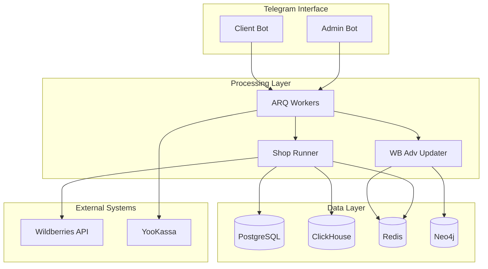
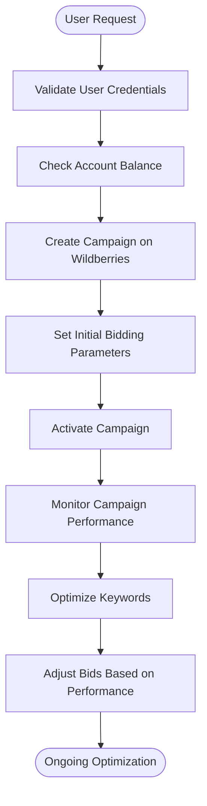

# Project Overview

<cite>
**Referenced Files in This Document**   
- [wb_shop.py](file://app/modules/shop_runner/wb_shop.py)
- [runner.py](file://app/modules/wb_adv_updater/runner.py)
- [workers.py](file://app/arq_workers/workers.py)
- [bot.py](file://app/client_bot/bot.py)
- [settings_master.py](file://app/settings/settings_master.py)
- [run.py](file://app/admin_bot/run.py)
</cite>

## Table of Contents
1. [Introduction](#introduction)
2. [System Architecture](#system-architecture)
3. [Core Components](#core-components)
4. [Key Features](#key-features)
5. [User Workflows](#user-workflows)
6. [External Integrations](#external-integrations)
7. [Codebase Navigation](#codebase-navigation)
8. [Onboarding Guidance](#onboarding-guidance)

## Introduction

The adv-bot system is a Telegram-based automation platform designed for managing Wildberries advertising campaigns. It provides comprehensive tools for bid optimization, keyword management, and performance analytics, enabling sellers to maximize their visibility and sales on the Wildberries marketplace. The system combines automation capabilities with machine learning to deliver intelligent campaign management solutions.

The platform operates through a multi-component architecture that includes client and admin Telegram bots, ARQ workers for background processing, and specialized modules for different advertising functions. Key terminology used throughout the system includes 'wb_adv_updater' (responsible for updating advertising data), 'adv_setting' (campaign configuration parameters), and 'shop_runner' (managing shop-specific operations).

This documentation provides a conceptual overview suitable for beginners while including technical depth for experienced developers working with the codebase.

## System Architecture

The adv-bot system follows a modular microservices-inspired architecture with clear separation of concerns between components. The system is built primarily in Python using the aiogram framework for Telegram bot interactions, with ARQ for task queuing and various database technologies for data storage and retrieval.

**Diagram sources**
- [wb_shop.py](file://app/modules/shop_runner/wb_shop.py#L1-L42)
- [runner.py](file://app/modules/wb_adv_updater/runner.py#L1-L95)
- [workers.py](file://app/arq_workers/workers.py#L1-L49)

**Section sources**
- [wb_shop.py](file://app/modules/shop_runner/wb_shop.py#L1-L42)
- [runner.py](file://app/modules/wb_adv_updater/runner.py#L1-L95)

## Core Components

The adv-bot system consists of several core components that work together to provide comprehensive advertising management capabilities:

### Client Bot
The client-facing Telegram bot that allows users to interact with the system, configure advertising campaigns, and receive performance reports. Built using the aiogram framework, it handles user authentication, command processing, and message delivery.

### Admin Bot
A separate Telegram bot interface for administrative functions, including user management, system monitoring, and operational controls. This component provides tools for managing the overall system health and user accounts.

### ARQ Workers
Background task processors that handle asynchronous operations using the ARQ framework. These workers manage resource-intensive tasks such as campaign creation, data synchronization, and payment processing without blocking the main application flow.

### Shop Runner
The `shop_runner` module manages shop-specific operations and maintains active connections with Wildberries API. It orchestrates various coroutines for keyword parsing, ad data updates, CPM bidding, and statistical reporting.

### WB Adv Updater
The `wb_adv_updater` component handles predictive analytics and machine learning functions, including CTR prediction, vector updates, and model training. It also manages payment processing for advertising campaigns.

**Section sources**
- [bot.py](file://app/client_bot/bot.py#L1-L15)
- [run.py](file://app/admin_bot/run.py#L1-L30)
- [workers.py](file://app/arq_workers/workers.py#L1-L49)

## Key Features

### Automated Bidding
The system implements automated bidding strategies through the bidder module, which adjusts CPC (cost-per-click) bids based on campaign performance and market conditions. The bidding logic considers factors such as keyword relevance, historical performance, and budget constraints.

### CTR Prediction Using Machine Learning
The platform employs machine learning models to predict click-through rates (CTR) for advertising campaigns. The `wb_adv_updater` component continuously trains and updates these models using historical performance data stored in ClickHouse. The prediction system uses vector representations of keywords and products to identify patterns and optimize campaign performance.

### Real-time Campaign Monitoring
The system provides real-time monitoring of advertising campaigns through integration with Wildberries API and ClickHouse analytics. Users can track key metrics such as impressions, clicks, conversions, and ROI through the Telegram interface.

### Keyword Management
Advanced keyword management capabilities allow users to maintain white and black lists, optimize keyword relevance, and automatically discover high-performing search terms. The system analyzes search patterns and suggests keyword improvements based on performance data.

**Section sources**
- [runner.py](file://app/modules/wb_adv_updater/runner.py#L1-L95)
- [wb_shop.py](file://app/modules/shop_runner/wb_shop.py#L1-L42)

## User Workflows

### Campaign Creation
Users initiate campaign creation through the client bot interface by providing product information and campaign parameters. The request is processed by ARQ workers, which coordinate with the `adv_creator` module to establish the campaign on Wildberries. The system validates user credentials, checks budget availability, and configures initial bidding parameters before activating the campaign.

### Keyword Optimization
The keyword optimization workflow begins with data collection from Wildberries search results. The system parses relevant keywords, evaluates their performance metrics, and updates campaign configurations accordingly. Users can manually adjust keyword settings or enable automatic optimization through the `white_list_updater` and `relevant_phrase_manager` modules.

**Diagram sources**
- [workers.py](file://app/arq_workers/workers.py#L1-L49)
- [wb_shop.py](file://app/modules/shop_runner/wb_shop.py#L1-L42)

## External Integrations

The adv-bot system integrates with several external systems to provide comprehensive advertising management:

### Wildberries API
The primary integration point for all advertising operations, allowing the system to create and manage campaigns, retrieve performance data, and update keyword configurations. The integration uses authenticated API calls with token-based authorization.

### YooKassa
Payment processing integration that handles subscription payments and campaign funding. The system uses YooKassa's API to process payments and verify transaction status.

### ClickHouse
Analytics database used for storing and querying large volumes of advertising performance data. The system writes detailed campaign metrics to ClickHouse for fast aggregation and analysis.

### Redis
In-memory data store used for caching frequently accessed data, managing session state, and coordinating distributed operations across multiple system components.

### Neo4j
Graph database that stores relationships between keywords, products, and advertising campaigns. This enables sophisticated analysis of search patterns and market dynamics.

**Section sources**
- [settings_master.py](file://app/settings/settings_master.py#L1-L375)
- [wb_shop.py](file://app/modules/shop_runner/wb_shop.py#L1-L42)

## Codebase Navigation

The codebase is organized into a clear directory structure with well-defined modules:

- `app/client_bot`: Client-facing Telegram bot implementation
- `app/admin_bot`: Administrative interface and tools
- `app/arq_workers`: Background task processing configuration
- `app/modules`: Core functionality modules including `shop_runner` and `wb_adv_updater`
- `app/core`: Shared utilities and base classes
- `app/settings`: Configuration management

Key files for understanding system initialization include:
- `client_bot_run.py`: Client bot entry point
- `run_shop_update_worker.py`: Shop runner launcher
- `run_predict_ctr.py`: CTR prediction processor
- `updater.py`: Main update process coordinator

## Onboarding Guidance

New developers should focus on understanding the following aspects when onboarding to the adv-bot system:

1. Start with the `settings_master.py` file to understand configuration parameters and environment variables.
2. Examine the `wb_shop.py` module to grasp the core shop management architecture.
3. Review the `runner.py` file to understand the main processing loops and coroutine management.
4. Study the ARQ worker configuration in `workers.py` to learn about background task processing.
5. Explore the client bot implementation in `bot.py` to understand Telegram integration patterns.

Common challenges during onboarding include understanding the asynchronous coroutine patterns, navigating the multiple database integrations, and comprehending the machine learning pipeline for CTR prediction. Developers should pay particular attention to error handling patterns and the use of Redis for state management across distributed components.

**Section sources**
- [settings_master.py](file://app/settings/settings_master.py#L1-L375)
- [runner.py](file://app/modules/wb_adv_updater/runner.py#L1-L95)
- [wb_shop.py](file://app/modules/shop_runner/wb_shop.py#L1-L42)
- [workers.py](file://app/arq_workers/workers.py#L1-L49)