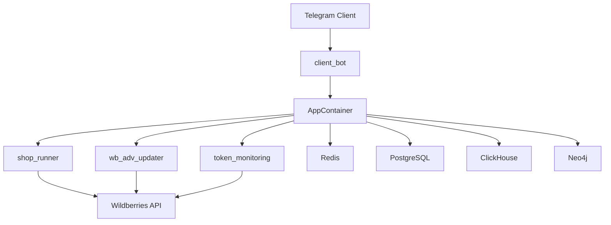
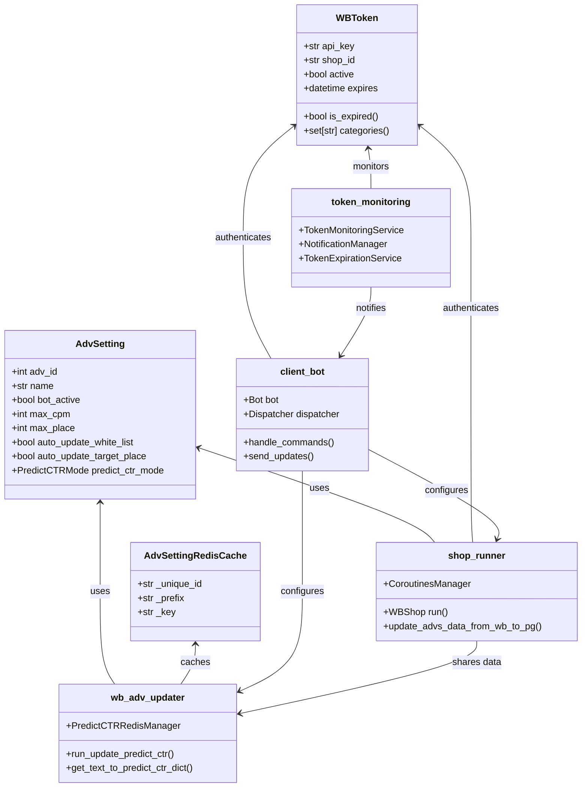
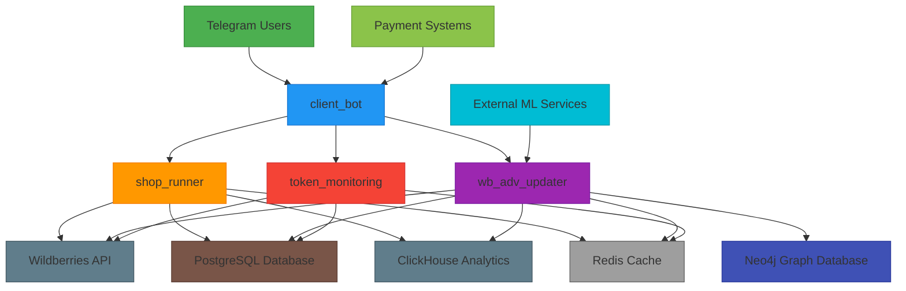
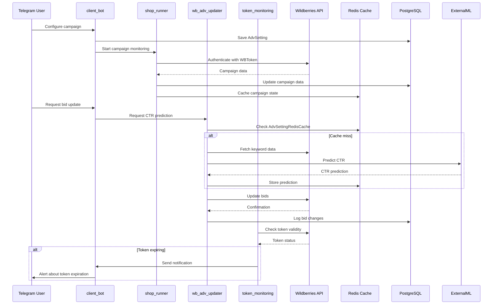

# Project Overview

<cite>
**Referenced Files in This Document**   
- [client_bot_run.py](file://client_bot_run.py)
- [run_shop_update_worker.py](file://run_shop_update_worker.py)
- [run_update_predict_ctr.py](file://run_update_predict_ctr.py)
- [app/core/di/app_container.py](file://app/core/di/app_container.py)
- [app/modules/common_slaves/wildberries/models/models.py](file://app/modules/common_slaves/wildberries/models/models.py)
- [app/core/redis_cache/redis_cache_base.py](file://app/core/redis_cache/redis_cache_base.py)
- [app/core/redis_cache/mixins/main_objects_mixins/adv_setting_redis_cache.py](file://app/core/redis_cache/mixins/main_objects_mixins/adv_setting_redis_cache.py)
- [app/modules/shop_runner/wb_shop.py](file://app/modules/shop_runner/wb_shop.py)
- [app/modules/token_monitoring/README.md](file://app/modules/token_monitoring/README.md)
- [app/modules/wb_adv_updater/get_text_to_predict_ctr_dict.py](file://app/modules/wb_adv_updater/get_text_to_predict_ctr_dict.py)
</cite>

## Table of Contents
1. [Introduction](#introduction)
2. [Core Architecture](#core-architecture)
3. [Key Components](#key-components)
4. [Component Relationships](#component-relationships)
5. [External System Integration](#external-system-integration)
6. [User Workflows](#user-workflows)
7. [System Context Diagram](#system-context-diagram)
8. [Component Interaction Diagram](#component-interaction-diagram)

## Introduction

The adv-bot project is a sophisticated backend automation system designed to manage Wildberries advertising campaigns through a Telegram interface. This system enables users to control their advertising strategies, monitor campaign performance, and optimize bidding parameters directly from Telegram. The architecture follows a modular design pattern with dependency injection, allowing for flexible integration with external systems including Wildberries API, Redis, Neo4j, and ClickHouse.

The system revolves around key entities such as AdvSetting, WBToken, and AdvSettingRedisCache, which represent advertising campaign configurations, Wildberries API authentication tokens, and Redis-based caching mechanisms respectively. The application is composed of several interconnected components including client_bot, shop_runner, token_monitoring, and wb_adv_updater, each responsible for specific aspects of the advertising management workflow.

This documentation provides both conceptual overviews for beginners and technical details for experienced developers, explaining how these components work together to automate advertising campaign management on the Wildberries marketplace.

**Section sources**
- [client_bot_run.py](file://client_bot_run.py)
- [app/modules/common_slaves/wildberries/models/models.py](file://app/modules/common_slaves/wildberries/models/models.py)

## Core Architecture

The adv-bot project implements a modular architecture with dependency injection as its core design principle. The system is structured around several key architectural components that work together to provide a robust advertising campaign management solution.

At the heart of the architecture is the AppContainer, which serves as the main dependency injection container. This container manages the lifecycle of various services and ensures proper initialization and shutdown of resources. The dependency injection system allows for loose coupling between components, making the codebase more maintainable and testable.

The application follows a layered approach with clear separation of concerns:
- **Presentation Layer**: The client_bot component handles Telegram interactions and user interface
- **Business Logic Layer**: Modules like shop_runner and wb_adv_updater contain the core advertising management logic
- **Data Access Layer**: Database interactions are managed through SQLAlchemy models and repositories
- **Integration Layer**: External system integrations are abstracted through dedicated service classes

The system is designed to be highly concurrent, leveraging Python's asyncio framework for asynchronous operations. This allows the system to handle multiple Wildberries API requests simultaneously, improving overall performance and responsiveness.

**Diagram sources **
- [app/core/di/app_container.py](file://app/core/di/app_container.py)
- [client_bot_run.py](file://client_bot_run.py)

**Section sources**
- [app/core/di/app_container.py](file://app/core/di/app_container.py)
- [app/core/di/di_manager.py](file://app/core/di/di_manager.py)

## Key Components

The adv-bot system consists of several key components that work together to provide comprehensive advertising campaign management capabilities.

### client_bot
The client_bot component serves as the primary user interface, connecting the system to Telegram. It handles all user interactions, including command processing, message handling, and interface rendering. This component uses the aiogram framework to manage Telegram bot functionality and provides a rich interactive experience for users to configure and monitor their advertising campaigns.

### shop_runner
The shop_runner component is responsible for executing the core advertising management workflows. It orchestrates various operations such as keyword parsing, campaign data updates, and bid management. This component runs as a background worker, continuously monitoring and updating advertising campaigns based on user-defined settings.

### token_monitoring
The token_monitoring component manages Wildberries API authentication tokens (WBToken). It handles token validation, expiration monitoring, and notification systems to alert users when tokens require renewal. This component ensures uninterrupted access to Wildberries API services by proactively managing token lifecycle.

### wb_adv_updater
The wb_adv_updater component focuses on updating advertising campaign settings and performance data. It integrates with machine learning models to predict click-through rates (CTR) and optimize bidding strategies. This component uses Redis caching extensively to improve performance and reduce API call frequency.

**Section sources**
- [client_bot_run.py](file://client_bot_run.py)
- [run_shop_update_worker.py](file://run_shop_update_worker.py)
- [run_update_predict_ctr.py](file://run_update_predict_ctr.py)
- [app/modules/token_monitoring/README.md](file://app/modules/token_monitoring/README.md)

## Component Relationships

The components of the adv-bot system are interconnected through well-defined relationships and dependencies. The AppContainer serves as the central coordination point, injecting required dependencies into each component.

The client_bot component interacts with users through Telegram and communicates campaign settings to the shop_runner and wb_adv_updater components. When a user configures an advertising campaign, the client_bot updates the AdvSetting model in the database, which triggers corresponding actions in the background components.

The shop_runner component depends on the WBToken model for API authentication and uses the AdvSetting model to determine campaign parameters. It runs periodic tasks to update campaign data from Wildberries API and store it in PostgreSQL and ClickHouse databases.

The wb_adv_updater component relies on Redis for caching predicted CTR values (AdvSettingRedisCache) and uses Neo4j for storing keyword relationships and patterns. It processes advertising data and updates campaign settings based on performance metrics and machine learning predictions.

All components share access to the Redis cache for performance optimization and state management. The token_monitoring component monitors the health of WBToken instances and notifies the other components when authentication issues arise.

**Diagram sources **
- [app/modules/common_slaves/wildberries/models/models.py](file://app/modules/common_slaves/wildberries/models/models.py)
- [app/core/redis_cache/mixins/main_objects_mixins/adv_setting_redis_cache.py](file://app/core/redis_cache/mixins/main_objects_mixins/adv_setting_redis_cache.py)
- [app/modules/shop_runner/wb_shop.py](file://app/modules/shop_runner/wb_shop.py)
- [app/modules/wb_adv_updater/get_text_to_predict_ctr_dict.py](file://app/modules/wb_adv_updater/get_text_to_predict_ctr_dict.py)

**Section sources**
- [app/modules/common_slaves/wildberries/models/models.py](file://app/modules/common_slaves/wildberries/models/models.py)
- [app/core/redis_cache/redis_cache_base.py](file://app/core/redis_cache/redis_cache_base.py)
- [app/modules/shop_runner/wb_shop.py](file://app/modules/shop_runner/wb_shop.py)

## External System Integration

The adv-bot system integrates with multiple external systems to provide comprehensive advertising campaign management capabilities.

### Wildberries API Integration
The system connects to the Wildberries API through authenticated sessions using WBToken instances. These tokens contain JWT-based authentication information and are validated for expiration and permissions before API calls. The integration supports various API endpoints for retrieving campaign data, updating bidding parameters, and managing keyword lists.

### Redis Integration
Redis serves as the primary caching layer for the system, storing frequently accessed data such as predicted CTR values, campaign settings, and temporary state information. The AdvSettingRedisCache class provides a structured interface for caching advertising campaign data, with specific implementations for different types of cached information like LastAutoAddPhraseToWhiteList and LastSetUpTargetPlace.

### Neo4j Integration
Neo4j is used as a graph database to store relationships between keywords, products, and advertising campaigns. This allows for sophisticated pattern analysis and recommendation systems. The graph structure enables efficient querying of keyword associations and campaign performance patterns.

### ClickHouse Integration
ClickHouse serves as the analytical database, storing historical advertising performance data. This enables fast aggregation and analysis of campaign metrics over time. The system uses ClickHouse to generate performance reports and identify trends in advertising effectiveness.

### PostgreSQL Integration
PostgreSQL is the primary relational database, storing structured data such as user accounts, campaign configurations (AdvSetting), and transaction records. The database schema is managed through Alembic migrations, ensuring consistent schema evolution across deployment environments.

**Section sources**
- [app/modules/common_slaves/wildberries/models/models.py](file://app/modules/common_slaves/wildberries/models/models.py)
- [app/core/redis_cache/redis_cache_base.py](file://app/core/redis_cache/redis_cache_base.py)
- [app/modules/token_monitoring/README.md](file://app/modules/token_monitoring/README.md)

## User Workflows

The adv-bot system supports several key user workflows for managing Wildberries advertising campaigns.

### Campaign Setup Workflow
1. User authenticates with Wildberries by providing a WBToken
2. System validates token permissions and extracts shop_id
3. User selects advertising campaign to manage
4. System creates AdvSetting record with default parameters
5. User configures campaign settings through Telegram interface
6. System stores settings in PostgreSQL and initializes Redis cache

### Bid Management Workflow
1. User requests bid adjustment for specific keywords
2. System retrieves current campaign data from Wildberries API
3. Machine learning model predicts CTR for keywords
4. Predicted values are cached in Redis using AdvSettingRedisCache
5. System calculates optimal bid based on CTR prediction and budget constraints
6. Updated bids are sent to Wildberries API
7. Results are stored in ClickHouse for performance analysis

### Performance Monitoring Workflow
1. User requests campaign performance data
2. System retrieves historical data from ClickHouse
3. Current campaign status is fetched from Wildberries API
4. Data is combined and processed for presentation
5. Performance metrics are displayed through Telegram interface
6. Trend analysis is performed using Neo4j graph queries
7. Recommendations are generated based on performance patterns

These workflows demonstrate how the system components work together to provide a seamless advertising management experience through the Telegram interface.

**Section sources**
- [app/modules/common_slaves/wildberries/models/models.py](file://app/modules/common_slaves/wildberries/models/models.py)
- [app/modules/wb_adv_updater/get_text_to_predict_ctr_dict.py](file://app/modules/wb_adv_updater/get_text_to_predict_ctr_dict.py)
- [app/modules/shop_runner/wb_shop.py](file://app/modules/shop_runner/wb_shop.py)

## System Context Diagram

**Diagram sources **
- [client_bot_run.py](file://client_bot_run.py)
- [run_shop_update_worker.py](file://run_shop_update_worker.py)
- [run_update_predict_ctr.py](file://run_update_predict_ctr.py)

## Component Interaction Diagram

**Diagram sources **
- [app/modules/common_slaves/wildberries/models/models.py](file://app/modules/common_slaves/wildberries/models/models.py)
- [app/core/redis_cache/mixins/main_objects_mixins/adv_setting_redis_cache.py](file://app/core/redis_cache/mixins/main_objects_mixins/adv_setting_redis_cache.py)
- [app/modules/shop_runner/wb_shop.py](file://app/modules/shop_runner/wb_shop.py)
- [app/modules/wb_adv_updater/get_text_to_predict_ctr_dict.py](file://app/modules/wb_adv_updater/get_text_to_predict_ctr_dict.py)