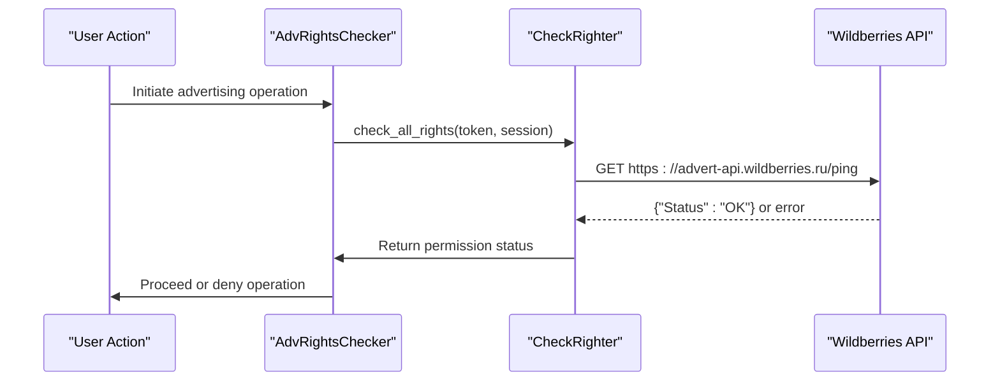
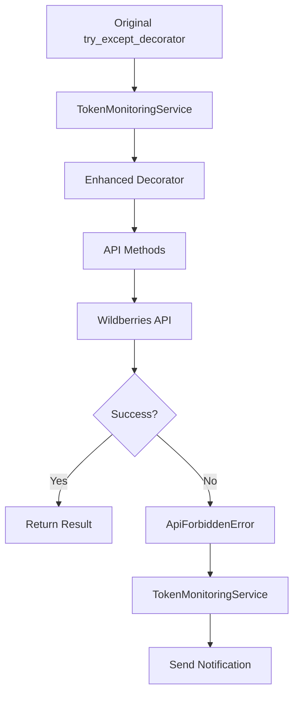
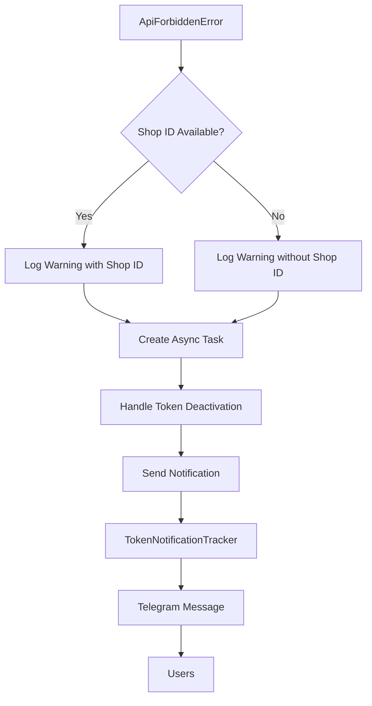

# Authentication and Authorization

<cite>
**Referenced Files in This Document**   
- [check_righter.py](file://app/core/wb_api/check_righter.py)
- [adv_rights_checker.py](file://app/core/wb_api/mixins/adv_rights_checker.py)
- [token_monitoring_service.py](file://app/modules/token_monitoring/services/token_monitoring_service.py)
- [token_expiration_service.py](file://app/modules/token_monitoring/services/token_expiration_service.py)
- [notification_manager.py](file://app/modules/token_monitoring/services/notification_manager.py)
- [token_info_service.py](file://app/modules/token_monitoring/services/token_info_service.py)
- [http_request.py](file://app/core/wb_api/http_request.py)
- [models.py](file://app/modules/token_monitoring/models.py)
- [integration.py](file://app/modules/token_monitoring/integration.py)
- [wb_token.py](file://app/modules/common_slaves/wildberries/models/models.py)
</cite>

## Table of Contents
1. [Introduction](#introduction)
2. [Core Components](#core-components)
3. [Permission Validation Workflow](#permission-validation-workflow)
4. [Token Monitoring Integration](#token-monitoring-integration)
5. [HTTP Request Interception](#http-request-interception)
6. [Response Handling for Permission-Denied Scenarios](#response-handling-for-permission-denied-scenarios)
7. [User Action Validation](#user-action-validation)
8. [Common Issues and Solutions](#common-issues-and-solutions)
9. [Debugging Authorization Failures](#debugging-authorization-failures)
10. [Best Practices](#best-practices)

## Introduction
The authentication and authorization system in adv-bot provides comprehensive protection for Wildberries API operations through a multi-layered approach. The system combines proactive permission validation with reactive monitoring to ensure secure access to advertising operations. At its core, the AdvRightsChecker mixin and CheckRighter class validate token permissions before critical operations, while the token_monitoring_service detects and responds to permission violations during API calls. This documentation details the implementation of these components and their integration points throughout the system.

## Core Components

The authentication and authorization system consists of several key components that work together to enforce access control:

- **CheckRighter**: Validates Wildberries API token permissions by testing access to specific API endpoints
- **AdvRightsChecker**: Specialized mixin that inherits from CheckRighter for advertising-specific permission checks
- **TokenMonitoringService**: Monitors API calls for permission violations and triggers notifications
- **TokenExpirationService**: Proactively monitors token expiration dates and sends advance warnings
- **NotificationManager**: Handles delivery of token-related alerts to users via Telegram

These components work in concert to provide both preventive and reactive security measures for API access.

**Section sources**
- [check_righter.py](file://app/core/wb_api/check_righter.py#L1-L59)
- [adv_rights_checker.py](file://app/core/wb_api/mixins/adv_rights_checker.py#L1-L6)
- [token_monitoring_service.py](file://app/modules/token_monitoring/services/token_monitoring_service.py#L1-L209)

## Permission Validation Workflow

**Diagram sources**
- [check_righter.py](file://app/core/wb_api/check_righter.py#L1-L59)
- [adv_rights_checker.py](file://app/core/wb_api/mixins/adv_rights_checker.py#L1-L6)

The permission validation workflow begins when a user attempts to perform an advertising operation. The AdvRightsChecker mixin, which inherits from CheckRighter, validates the token's permissions by making a test request to the advertising API endpoint. The CheckRighter class manages this process by sending a ping request to the configured entry point and evaluating the response. If the response status is "OK", the token has sufficient permissions; otherwise, an ApiForbiddenError is raised, and the operation is denied.

The CheckRighter implementation uses a list of entry points and corresponding permission names to validate access. For advertising operations, it specifically checks the "Реклама" (Advertising) permission by pinging the advert-api endpoint. This approach allows for granular permission checking without performing actual operations that could affect the advertising account.

**Section sources**
- [check_righter.py](file://app/core/wb_api/check_righter.py#L1-L59)
- [adv_rights_checker.py](file://app/core/wb_api/mixins/adv_rights_checker.py#L1-L6)

## Token Monitoring Integration

**Diagram sources**
- [token_monitoring_service.py](file://app/modules/token_monitoring/services/token_monitoring_service.py#L1-L209)
- [http_request.py](file://app/core/wb_api/http_request.py#L1-L213)
- [integration.py](file://app/modules/token_monitoring/integration.py#L1-L112)

The token monitoring system integrates with the existing HTTP request infrastructure through decorator wrapping. During application startup, the TokenMonitoringService wraps the original try_except_decorator from http_request.py, creating an enhanced version that adds token deactivation detection capabilities. This integration approach allows the monitoring system to intercept all API calls without requiring changes to individual service implementations.

The integration process preserves the original decorator's functionality while adding a monitoring wrapper that catches ApiForbiddenError exceptions. When such an error occurs, the system extracts the shop ID from the API instance and triggers a notification through the NotificationManager. This design ensures that permission violations are detected regardless of which specific API endpoint fails, providing comprehensive coverage across all Wildberries API interactions.

**Section sources**
- [token_monitoring_service.py](file://app/modules/token_monitoring/services/token_monitoring_service.py#L1-L209)
- [integration.py](file://app/modules/token_monitoring/integration.py#L1-L112)
- [http_request.py](file://app/core/wb_api/http_request.py#L1-L213)

## HTTP Request Interception

The HTTP request interception mechanism is implemented through the try_except_decorator in the http_request.py module. This decorator wraps all API calls and provides standardized error handling, rate limiting, and now token monitoring capabilities. The interception occurs at the method level, allowing for fine-grained control over API interactions.

When the enhanced decorator detects an ApiForbiddenError, it initiates the token deactivation handling process. The error handler extracts the shop_id from the API instance (if available) and asynchronously creates a task to handle the token deactivation event. This non-blocking approach ensures that the primary API flow is not delayed by notification processing, while still guaranteeing that users are informed of permission issues.

The interception system is designed to be transparent to the calling code, maintaining the same interface and exception behavior as the original decorator. This allows existing code to work without modification while gaining the benefits of enhanced monitoring and notification capabilities.

**Section sources**
- [http_request.py](file://app/core/wb_api/http_request.py#L1-L213)
- [token_monitoring_service.py](file://app/modules/token_monitoring/services/token_monitoring_service.py#L1-L209)

## Response Handling for Permission-Denied Scenarios

**Diagram sources**
- [token_monitoring_service.py](file://app/modules/token_monitoring/services/token_monitoring_service.py#L1-L209)
- [notification_manager.py](file://app/modules/token_monitoring/services/notification_manager.py#L1-L336)
- [models.py](file://app/modules/token_monitoring/models.py#L1-L81)

When a permission-denied scenario occurs, the system follows a structured response handling process. The TokenMonitoringService catches the ApiForbiddenError and first attempts to extract the shop_id from the API instance. If available, it logs a detailed warning message that includes both the shop ID and the method name that failed. This information is crucial for troubleshooting and user communication.

The system then creates an asynchronous task to handle the token deactivation event, preventing the notification process from blocking the main API flow. The _handle_token_deactivation method coordinates with the NotificationManager to send alerts to all users associated with the affected shop. The notification includes context about which method failed and the specific error details, enabling users to understand the nature of the issue.

To prevent duplicate notifications, the system uses the TokenNotificationTracker database table, which has a unique constraint on the combination of shop_id, user_telegram_id, and notification_type. This ensures that each user receives only one notification per token issue type, avoiding notification spam while maintaining auditability.

**Section sources**
- [token_monitoring_service.py](file://app/modules/token_monitoring/services/token_monitoring_service.py#L1-L209)
- [notification_manager.py](file://app/modules/token_monitoring/services/notification_manager.py#L1-L336)
- [models.py](file://app/modules/token_monitoring/models.py#L1-L81)

## User Action Validation

User actions are validated against token capabilities through a combination of proactive and reactive mechanisms. Before executing critical operations, the system uses the AdvRightsChecker mixin to verify that the token has the necessary permissions. This preventive approach stops unauthorized operations before they can affect the advertising account.

For operations that bypass explicit permission checks, the reactive monitoring system provides a safety net. The token_monitoring_service detects permission violations during API calls and triggers appropriate responses. This dual-layer approach ensures comprehensive protection, as it catches both attempted unauthorized actions and unexpected permission changes that might occur between the initial validation and the actual API call.

The validation process considers multiple factors beyond simple permission presence, including token expiration status, read-only flags, and shop association. The WBToken model provides properties like expires, read_only, categories, and is_expired that are used to make nuanced access control decisions based on the complete token context.

**Section sources**
- [adv_rights_checker.py](file://app/core/wb_api/mixins/adv_rights_checker.py#L1-L6)
- [check_righter.py](file://app/core/wb_api/check_righter.py#L1-L59)
- [wb_token.py](file://app/modules/common_slaves/wildberries/models/models.py#L159-L200)

## Common Issues and Solutions

### Insufficient Token Scopes
Insufficient token scopes occur when a Wildberries API token lacks the necessary permissions for advertising operations. This typically happens when users create tokens through the Wildberries interface without selecting all required permission categories. The system detects this issue through the CheckRighter's ping requests to the advertising API endpoint.

**Solution**: Guide users to recreate their tokens with all required permissions selected, specifically ensuring that "Реклама" (Advertising) permissions are included. The token_info_service provides detailed reports on missing permissions to help users understand exactly what's needed.

### Permission Caching Strategies
The system implements several caching strategies to balance performance and accuracy. Token validation results are not cached long-term to ensure that permission changes are detected promptly. However, the system does cache API call state information like rate limiting parameters to optimize performance.

The TokenNotificationTracker table serves as a form of negative cache, preventing duplicate notifications for the same token issue. This ensures users are informed of problems without being overwhelmed by repeated alerts. The resolved_at field allows the system to track when issues have been addressed, providing an audit trail of token health.

### Real-Time Permission Updates
Real-time permission updates are handled through the combination of proactive validation and reactive monitoring. The system doesn't rely on periodic polling for permission changes but instead validates permissions at the point of use. When permissions change (such as when a token is deactivated), the next API call will immediately detect the change and trigger the appropriate response.

For expiration monitoring, the system uses scheduled tasks to check for tokens expiring within predefined warning periods (14, 3, and 1 day). This proactive approach gives users ample time to replace expiring tokens before they affect service operations.

**Section sources**
- [token_info_service.py](file://app/modules/token_monitoring/services/token_info_service.py#L1-L353)
- [token_expiration_service.py](file://app/modules/token_monitoring/services/token_expiration_service.py#L1-L314)
- [notification_manager.py](file://app/modules/token_monitoring/services/notification_manager.py#L1-L336)

## Debugging Authorization Failures

Debugging authorization failures in the adv-bot system involves several steps and tools:

1. **Check Token Status**: Use the token_info_service to get a comprehensive report on a shop's token status, including available and missing permissions.

2. **Review Notification History**: Examine the TokenNotificationTracker table to see past notifications for a specific shop, which can reveal patterns in token issues.

3. **Analyze Log Messages**: Look for warning and error messages from the token_monitoring_service and http_request modules, which contain detailed information about failed API calls.

4. **Verify Token Properties**: Check the WBToken model properties like expires, read_only, and categories to ensure the token has the expected configuration.

5. **Test API Access**: Use the CheckRighter directly to test access to specific API endpoints and isolate permission issues.

The system provides multiple entry points for debugging, from high-level status reports to detailed log messages. The structured error handling ensures that relevant context is preserved throughout the call stack, making it easier to trace the root cause of authorization failures.

**Section sources**
- [token_info_service.py](file://app/modules/token_monitoring/services/token_info_service.py#L1-L353)
- [token_monitoring_service.py](file://app/modules/token_monitoring/services/token_monitoring_service.py#L1-L209)
- [wb_token.py](file://app/modules/common_slaves/wildberries/models/models.py#L159-L200)

## Best Practices

### Least-Privilege Token Usage
Adopt a least-privilege approach to token usage by ensuring tokens have only the permissions necessary for their intended operations. While the system requires certain permissions for core functionality, avoid granting additional permissions that aren't specifically needed.

When creating tokens, carefully review the permission categories and select only those required for the bot's operations. This minimizes the potential impact if a token is compromised and aligns with security best practices.

### Regular Token Rotation
Implement regular token rotation as part of your security hygiene. Even if tokens haven't expired, periodically replacing them reduces the window of opportunity for potential misuse. The expiration warning system helps facilitate this practice by providing advance notice of upcoming expirations.

### Monitoring and Alerting
Enable and monitor the notification system to stay informed about token issues. The proactive expiration warnings and reactive deactivation alerts provide valuable insights into token health and help prevent service disruptions.

Configure appropriate alerting for critical events like token deactivation, ensuring that responsible parties are notified promptly when issues arise. This enables rapid response and minimizes downtime.

### Testing and Validation
Regularly test token permissions using the validation endpoints provided by the token_info_service. This helps verify that tokens continue to have the necessary permissions and allows for proactive remediation of issues before they affect operations.

**Section sources**
- [token_info_service.py](file://app/modules/token_monitoring/services/token_info_service.py#L1-L353)
- [token_expiration_service.py](file://app/modules/token_monitoring/services/token_expiration_service.py#L1-L314)
- [notification_manager.py](file://app/modules/token_monitoring/services/notification_manager.py#L1-L336)