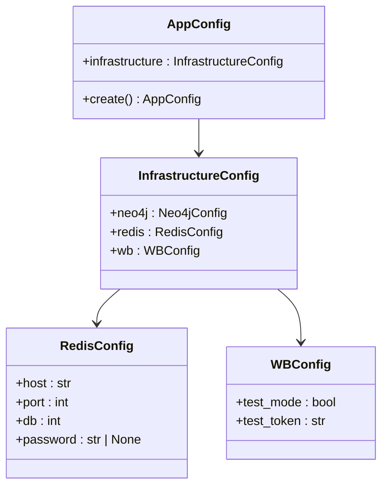
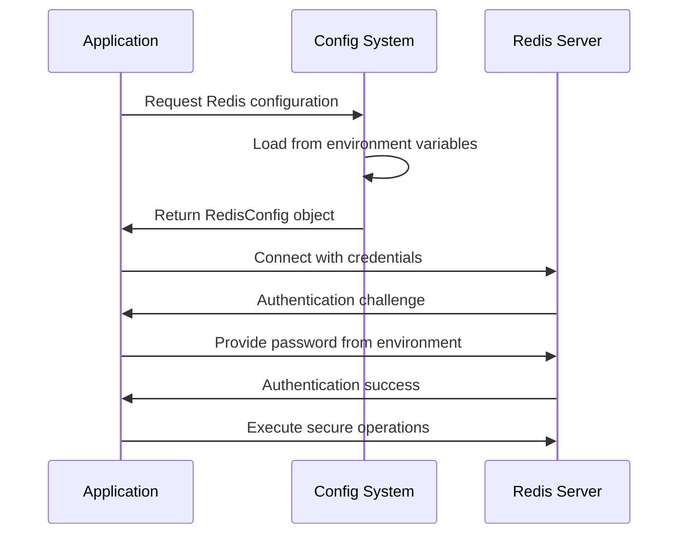
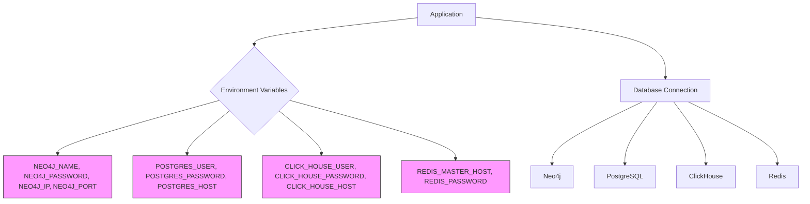
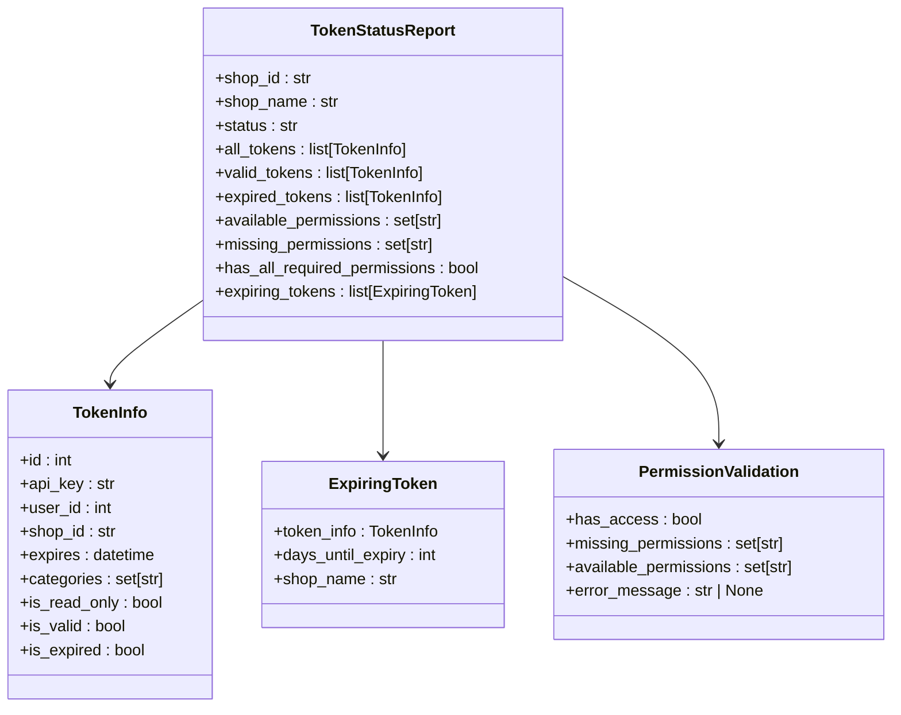
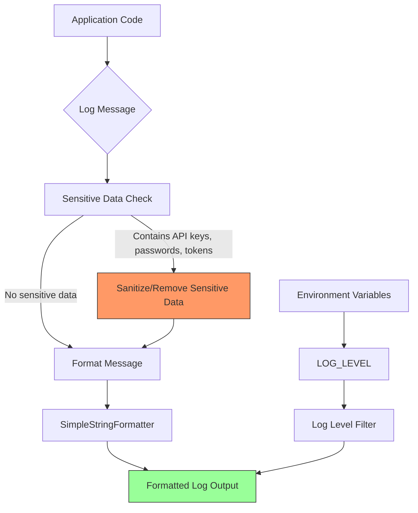
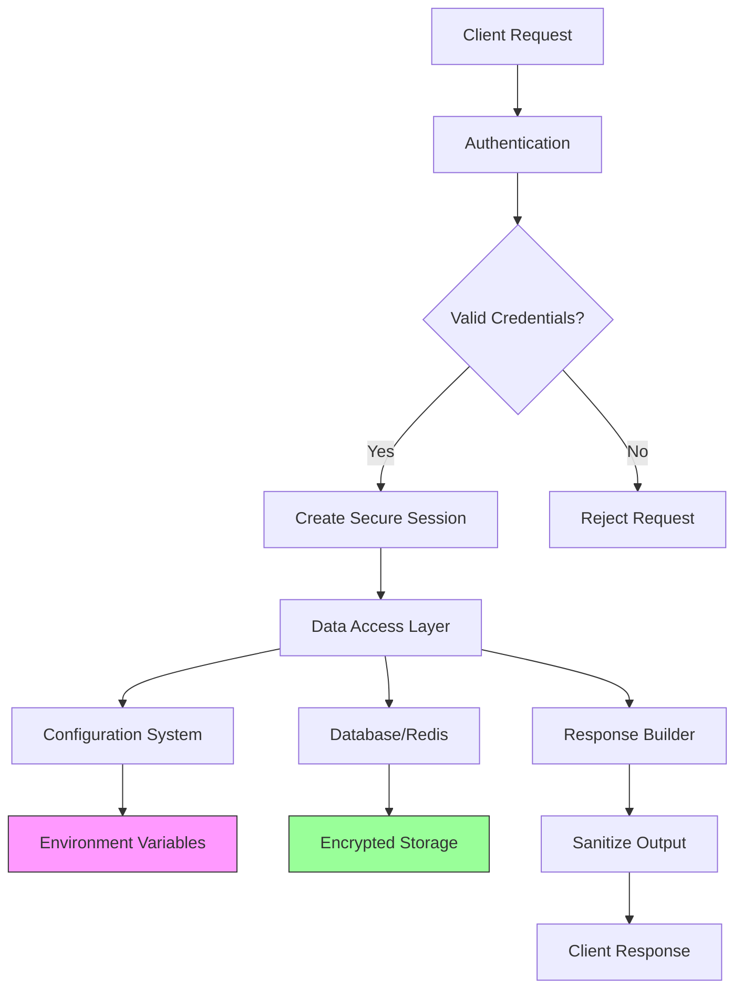

# Data Protection

<cite>
**Referenced Files in This Document**   
- [redis_config.py](file://app/configs/infrastructure_config/redis_config.py)
- [app_config.py](file://app/configs/app_config.py)
- [infrastructure_config.py](file://app/configs/infrastructure_config/infrastructure_config.py)
- [wb_config.py](file://app/configs/infrastructure_config/wb_config.py)
- [settings_master.py](file://app/settings/settings_master.py)
- [driver.py](file://app/utils/NeoDataScience/driver.py)
- [token_info_service.py](file://app/modules/token_monitoring/services/token_info_service.py)
</cite>

## Table of Contents
1. [Introduction](#introduction)
2. [Configuration Management and Environment Isolation](#configuration-management-and-environment-isolation)
3. [Redis Security Configuration](#redis-security-configuration)
4. [Database Connection Security](#database-connection-security)
5. [Sensitive Data Handling and PII Protection](#sensitive-data-handling-and-pii-protection)
6. [Secure Logging Practices](#secure-logging-practices)
7. [Data Access Patterns](#data-access-patterns)

## Introduction
The adv-bot system implements comprehensive data protection mechanisms to safeguard sensitive information including API tokens, user credentials, and billing data. This document details the security architecture, focusing on configuration practices, environment isolation, Redis security, and secure handling of sensitive data across the system.

## Configuration Management and Environment Isolation

The system employs a hierarchical configuration architecture that separates sensitive credentials from application code and enforces environment-specific settings. Configuration is managed through Pydantic settings models with environment variable injection, ensuring secrets are never hardcoded.

The configuration hierarchy consists of:
- **AppConfig**: Root configuration class that orchestrates all infrastructure settings
- **InfrastructureConfig**: Centralized configuration for external services (Redis, Neo4j, WB API)
- Service-specific configurations: Individual configuration classes for each external service

Environment isolation is achieved through:
- Separate environment variables for different deployment environments
- Test mode flag that routes to test tokens and configurations
- Prefix-based environment variable naming (e.g., REDIS_, WB_, APP_) to prevent collisions
- .env file loading with UTF-8 encoding and strict error handling

**Diagram sources**
- [app_config.py](file://app/configs/app_config.py#L1-L23)
- [infrastructure_config.py](file://app/configs/infrastructure_config/infrastructure_config.py#L1-L20)
- [redis_config.py](file://app/configs/infrastructure_config/redis_config.py#L1-L16)
- [wb_config.py](file://app/configs/infrastructure_config/wb_config.py#L1-L23)

**Section sources**
- [app_config.py](file://app/configs/app_config.py#L1-L23)
- [infrastructure_config.py](file://app/configs/infrastructure_config/infrastructure_config.py#L1-L20)

## Redis Security Configuration

Redis is configured with multiple security layers to protect temporary data storage. The system implements password authentication, network-level security, and secure connection practices.

Key security features include:
- Password authentication through environment variables
- Configurable host and port settings for network isolation
- Database separation (configurable DB index)
- Environment-specific configuration loading from .env files
- Integration with ARQ workers for secure task queuing

The Redis configuration follows security best practices by:
- Never exposing credentials in code
- Using environment variables with proper prefixes
- Implementing default values only for non-sensitive parameters
- Supporting password-protected Redis instances

**Diagram sources**
- [redis_config.py](file://app/configs/infrastructure_config/redis_config.py#L1-L16)
- [arq_redis_settings.py](file://app/arq_workers/arq_redis_settings.py#L1-L4)
- [settings_master.py](file://app/settings/settings_master.py#L1-L433)

**Section sources**
- [redis_config.py](file://app/configs/infrastructure_config/redis_config.py#L1-L16)
- [arq_redis_settings.py](file://app/arq_workers/arq_redis_settings.py#L1-L4)

## Database Connection Security

The system implements secure database connection practices for both Neo4j and PostgreSQL databases. Connection credentials are managed through environment variables and never stored in code.

For Neo4j database connections:
- Credentials loaded from environment variables (NEO4J_NAME, NEO4J_PASSWORD)
- Connection URI constructed dynamically
- Secure authentication protocol
- Environment-specific configuration

PostgreSQL connections are secured through:
- Environment variable-based credential management
- SSL mode configuration
- Connection pooling with size limits
- Master/replica host separation
- Sensitive credentials (password, user) never hardcoded

The system also implements ClickHouse database security with:
- Dedicated user and password from environment variables
- Configurable host and port
- Maximum thread limits for database operations

**Diagram sources**
- [driver.py](file://app/utils/NeoDataScience/driver.py#L42-L78)
- [settings_master.py](file://app/settings/settings_master.py#L1-L433)
- [session_maker.py](file://app/utils/db/session_maker.py)

**Section sources**
- [driver.py](file://app/utils/NeoDataScience/driver.py#L42-L78)
- [settings_master.py](file://app/settings/settings_master.py#L1-L433)

## Sensitive Data Handling and PII Protection

The system implements comprehensive protection for sensitive data including API tokens, user credentials, and billing information. Sensitive data is handled through multiple layers of protection.

API token management includes:
- Token validation and expiration checking
- Permission analysis for required rights (Content, Statistics, Analytics, Promotion)
- Expiration monitoring and notification system
- Read-only token detection
- Category-based permission verification

The token monitoring system provides:
- Comprehensive token status reporting
- Expiration date tracking
- Days-until-expiry calculations
- Service break prediction based on permission loss
- Batch token analysis for shops

Data protection measures include:
- Environment variable isolation for all credentials
- No hardcoded secrets in source code
- Test mode with isolated test tokens
- Secure credential injection through configuration system
- Limited token information exposure in logs and responses

**Diagram sources**
- [token_info_service.py](file://app/modules/token_monitoring/services/token_info_service.py#L1-L199)
- [wb_token.py](file://app/modules/common_slaves/wildberries/models.py#L1-L50)

**Section sources**
- [token_info_service.py](file://app/modules/token_monitoring/services/token_info_service.py#L1-L199)

## Secure Logging Practices

The system implements secure logging practices to prevent accidental data leaks through logs or error messages. The logging configuration ensures sensitive information is not exposed in log output.

Key logging security features:
- Custom log formatter that excludes sensitive data
- Configurable log levels through environment variables
- Sensitive information filtering
- Error message sanitization
- No credential logging in any log level

The logging system is configured to:
- Never log API keys, passwords, or other credentials
- Filter sensitive information from exception traces
- Use environment-controlled log levels
- Format log messages to exclude sensitive context
- Prevent accidental exposure through debug logging

**Diagram sources**
- [logger.py](file://python_modules/logger.py#L1-L60)
- [settings_master.py](file://app/settings/settings_master.py#L1-L433)

**Section sources**
- [logger.py](file://python_modules/logger.py#L1-L60)

## Data Access Patterns

The system implements secure data access patterns across all modules to protect PII and sensitive information. These patterns ensure consistent security practices throughout the codebase.

Secure data access principles:
- Dependency injection for configuration and services
- Environment-aware configuration loading
- Secure credential passing (never by value when possible)
- Minimal privilege principle for database access
- Time-limited connections and sessions

Key implementation patterns:
- Configuration factory methods that load from environment
- Service classes that accept session makers rather than direct credentials
- Redis managers that encapsulate connection details
- Database models that don't expose credentials
- API clients that receive credentials through secure configuration

The system also implements secure data handling in:
- ARQ workers with isolated Redis connections
- Celery tasks with secure credential passing
- Webhook handlers with secret validation
- API endpoints with proper authentication
- Background processes with limited data access

**Diagram sources**
- [app_config.py](file://app/configs/app_config.py#L1-L23)
- [infrastructure_config.py](file://app/configs/infrastructure_config/infrastructure_config.py#L1-L20)
- [redis_config.py](file://app/configs/infrastructure_config/redis_config.py#L1-L16)

**Section sources**
- [app_config.py](file://app/configs/app_config.py#L1-L23)
- [infrastructure_config.py](file://app/configs/infrastructure_config/infrastructure_config.py#L1-L20)
- [redis_config.py](file://app/configs/infrastructure_config/redis_config.py#L1-L16)