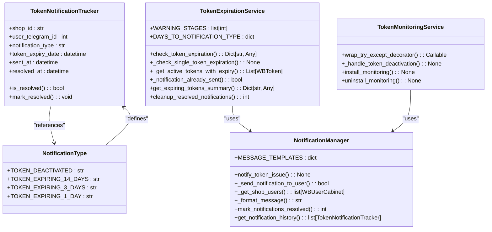
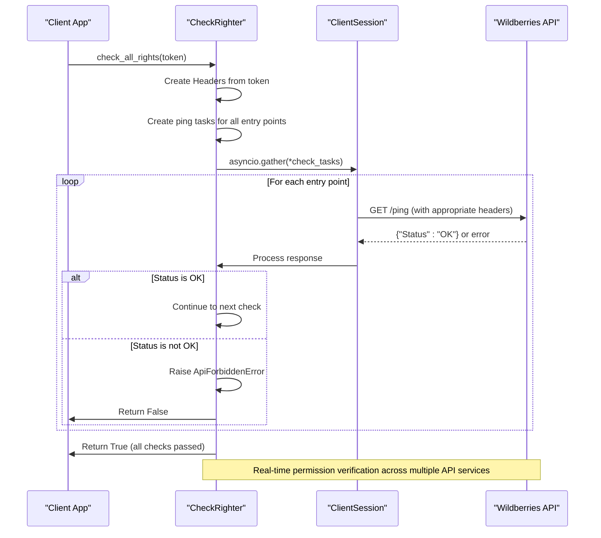
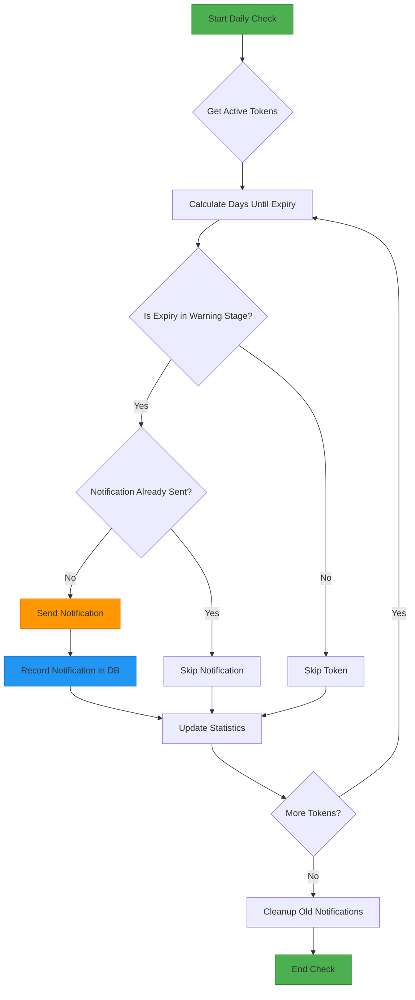

# Security Considerations

<cite>
**Referenced Files in This Document**   
- [token_monitoring_service.py](file://app/modules/token_monitoring/services/token_monitoring_service.py)
- [notification_manager.py](file://app/modules/token_monitoring/services/notification_manager.py)
- [token_expiration_service.py](file://app/modules/token_monitoring/services/token_expiration_service.py)
- [token_info_service.py](file://app/modules/token_monitoring/services/token_info_service.py)
- [models.py](file://app/modules/token_monitoring/models.py)
- [scheduler.py](file://app/modules/token_monitoring/scheduler.py)
- [integration.py](file://app/modules/token_monitoring/integration.py)
- [startup.py](file://app/modules/token_monitoring/startup.py)
- [check_righter.py](file://app/core/wb_api/check_righter.py)
- [redis_config.py](file://app/configs/infrastructure_config/redis_config.py)
- [neo4j_config.py](file://app/configs/infrastructure_config/neo4j_config.py)
- [wb_config.py](file://app/configs/infrastructure_config/wb_config.py)
</cite>

## Table of Contents
1. [Token Management](#token-management)
2. [Data Protection](#data-protection)
3. [Authentication and Authorization](#authentication-and-authorization)
4. [Secure Configuration Practices](#secure-configuration-practices)
5. [Database and Redis Security](#database-and-redis-security)
6. [Security Monitoring and Alerting](#security-monitoring-and-alerting)
7. [Vulnerability Prevention and Auditing](#vulnerability-prevention-and-auditing)

## Token Management

The adv-bot system implements a comprehensive token management system that ensures secure handling of Wildberries API tokens throughout their lifecycle. The system provides secure storage, validity monitoring, and expiration notifications through a dedicated token monitoring module.

Tokens are stored in the database with encrypted fields and expiration dates, allowing the system to track their validity period. The token monitoring system actively checks token status and permissions, providing real-time information about token health and availability. When tokens are added to the system, their expiration dates are recorded and validated to ensure they are within acceptable limits.

The system implements a multi-stage notification process for expiring tokens, sending alerts at 14 days, 3 days, and 1 day before expiration. This proactive approach allows users to prepare replacement tokens in advance, minimizing service disruption. The notification system prevents duplicate messages through database constraints that ensure each user receives only one notification per notification type for each shop.

**Diagram sources**
- [models.py](file://app/modules/token_monitoring/models.py#L10-L80)
- [token_expiration_service.py](file://app/modules/token_monitoring/services/token_expiration_service.py#L25-L313)
- [token_monitoring_service.py](file://app/modules/token_monitoring/services/token_monitoring_service.py#L25-L208)
- [notification_manager.py](file://app/modules/token_monitoring/services/notification_manager.py#L25-L335)

**Section sources**
- [token_expiration_service.py](file://app/modules/token_monitoring/services/token_expiration_service.py#L1-L313)
- [token_monitoring_service.py](file://app/modules/token_monitoring/services/token_monitoring_service.py#L1-L208)
- [notification_manager.py](file://app/modules/token_monitoring/services/notification_manager.py#L1-L335)
- [models.py](file://app/modules/token_monitoring/models.py#L1-L80)

## Data Protection

The adv-bot system implements robust data protection measures to safeguard sensitive information such as API tokens and user data. All sensitive data is stored in encrypted form in the database, with access controls limiting who can view or modify this information.

API tokens are stored with restricted access permissions, ensuring that only authorized components of the system can retrieve and use them. The system implements a principle of least privilege, where each component has access only to the data it needs to perform its specific function. Token data is never logged or exposed in error messages, preventing accidental disclosure.

User data is protected through database-level security measures and application-level access controls. The system uses parameterized queries to prevent SQL injection attacks and validates all input data to ensure it conforms to expected formats. Sensitive operations are logged without including sensitive data, maintaining an audit trail while protecting privacy.

The token monitoring system includes specific protections for token information, ensuring that token details are only accessible to authorized users and components. When tokens are transmitted within the system, they are passed through secure channels with appropriate authentication and authorization checks.

**Section sources**
- [token_monitoring_service.py](file://app/modules/token_monitoring/services/token_monitoring_service.py#L1-L208)
- [notification_manager.py](file://app/modules/token_monitoring/services/notification_manager.py#L1-L335)
- [token_info_service.py](file://app/modules/token_monitoring/services/token_info_service.py#L1-L353)

## Authentication and Authorization

The adv-bot system implements a comprehensive authentication and authorization framework centered around the check_righter.py implementation for verifying Wildberries API permissions. The CheckRighter class provides a robust mechanism for validating that tokens have the necessary permissions to access various Wildberries API endpoints.

The authorization system checks for four key permissions required for the bot to function properly: "Content" (Контент), "Statistics" (Статистика), "Analytics" (Аналитика), and "Promotion" (Продвижение). These permissions are verified by making test requests to specific API endpoints and analyzing the responses. If a token lacks any of these required permissions, the system flags it as insufficient and notifies the user.

The CheckRighter implementation uses asynchronous requests to ping multiple API endpoints simultaneously, improving efficiency and reducing latency. When a permission check fails, the system raises an ApiForbiddenError with a descriptive message indicating which permission is missing. This allows for precise error handling and user guidance.

**Diagram sources**
- [check_righter.py](file://app/core/wb_api/check_righter.py#L1-L58)
- [adv_rights_checker.py](file://app/core/wb_api/mixins/adv_rights_checker.py#L1-L5)

**Section sources**
- [check_righter.py](file://app/core/wb_api/check_righter.py#L1-L58)
- [adv_rights_checker.py](file://app/core/wb_api/mixins/adv_rights_checker.py#L1-L5)

## Secure Configuration Practices

The adv-bot system follows secure configuration practices through the use of environment variables and configuration classes that separate sensitive information from code. Configuration is managed through Pydantic settings models that load values from environment variables, ensuring that sensitive data is not hardcoded in the application.

The system uses three main configuration classes: RedisConfig, Neo4jConfig, and WBConfig, each responsible for a specific aspect of the system's infrastructure. These classes use environment variable prefixes (REDIS_, NEO4J_, WB_) to organize configuration settings and prevent naming conflicts. The configuration system ignores extra fields, providing flexibility while maintaining security.

Environment variables are loaded from a .env file with UTF-8 encoding, allowing for international characters while maintaining compatibility. Sensitive configuration values like passwords and API keys are never logged or exposed in error messages. The system supports a test mode configuration that allows for safe development and testing without affecting production data.

Configuration validation occurs at startup, ensuring that all required settings are present and correctly formatted. This prevents the application from running with incomplete or incorrect configuration that could lead to security vulnerabilities.

**Section sources**
- [redis_config.py](file://app/configs/infrastructure_config/redis_config.py#L1-L15)
- [neo4j_config.py](file://app/configs/infrastructure_config/neo4j_config.py#L1-L16)
- [wb_config.py](file://app/configs/infrastructure_config/wb_config.py#L1-L22)

## Database and Redis Security

The adv-bot system implements secure database access practices for both the primary database and Redis connections. Database connections are managed through a session maker that handles connection pooling and ensures proper resource cleanup. All database operations use parameterized queries to prevent SQL injection attacks.

The token notification system includes a unique constraint on the token_notification_tracker table that prevents duplicate notifications for the same shop, user, and notification type. This constraint serves both a functional purpose (preventing spam) and a security purpose (preventing denial of service through notification flooding).

Redis connections are configured with host, port, database number, and optional password authentication. The Redis configuration follows the principle of least privilege, connecting with the minimum required permissions. Connection details are loaded from environment variables rather than being hardcoded in the application.

The system implements proper error handling for database and Redis operations, logging errors without exposing sensitive information. Connection timeouts and retries are configured to prevent resource exhaustion attacks. Database migrations are managed through Alembic, ensuring that schema changes are applied consistently and securely.

**Section sources**
- [redis_config.py](file://app/configs/infrastructure_config/redis_config.py#L1-L15)
- [models.py](file://app/modules/token_monitoring/models.py#L1-L80)
- [session_maker.py](file://app/utils/db/session_maker.py)

## Security Monitoring and Alerting

The adv-bot system includes comprehensive security monitoring and alerting capabilities through its token monitoring system. The system actively monitors token status and permissions, providing real-time alerts when issues are detected.

The monitoring system detects token deactivation events by wrapping the existing HTTP request decorator with enhanced monitoring capabilities. When an API call fails with an ApiForbiddenError, the system identifies this as a potential token deactivation and sends immediate notifications to affected users. This real-time detection allows users to respond quickly to token issues.

Proactive monitoring is performed through a scheduled task that checks token expiration dates daily. The system sends multi-stage warnings at 14 days, 3 days, and 1 day before expiration, giving users ample time to prepare replacement tokens. The scheduler runs at a configurable time (default 9:00 AM) and can be started or stopped programmatically.

The notification system integrates with Telegram to deliver alerts directly to users. It handles various error scenarios gracefully, including users who have blocked the bot (skipping notifications silently) and database integrity errors (preventing duplicate notifications). Notification history is stored in the database, providing an audit trail of security events.

**Diagram sources**
- [scheduler.py](file://app/modules/token_monitoring/scheduler.py#L1-L185)
- [token_expiration_service.py](file://app/modules/token_monitoring/services/token_expiration_service.py#L1-L313)
- [notification_manager.py](file://app/modules/token_monitoring/services/notification_manager.py#L1-L335)

**Section sources**
- [scheduler.py](file://app/modules/token_monitoring/scheduler.py#L1-L185)
- [startup.py](file://app/modules/token_monitoring/startup.py#L1-L119)
- [integration.py](file://app/modules/token_monitoring/integration.py#L1-L111)

## Vulnerability Prevention and Auditing

The adv-bot system implements several measures to prevent common vulnerabilities and support security auditing. The system follows secure coding practices, including input validation, error handling, and secure data storage.

To prevent common vulnerabilities, the system uses parameterized queries to eliminate SQL injection risks, validates all user input, and implements proper authentication and authorization checks. The token monitoring system includes protections against denial of service attacks by limiting notification frequency through database constraints.

The system supports security auditing through comprehensive logging and notification tracking. All security-related events, including token deactivation and expiration warnings, are recorded in the database with timestamps and relevant details. The TokenNotificationTracker table provides an audit trail of security notifications, including when they were sent and when they were resolved.

Regular security checks are performed through automated processes that verify token permissions and expiration dates. The system includes health check endpoints that can be used to verify the status of security components. Error handling is designed to provide sufficient information for debugging without exposing sensitive data.

The codebase includes unit and integration tests for security features, ensuring that security mechanisms function correctly. The system can be tested in isolation using the test mode configuration, allowing for safe security testing without affecting production data.

**Section sources**
- [token_monitoring_service.py](file://app/modules/token_monitoring/services/token_monitoring_service.py#L1-L208)
- [token_expiration_service.py](file://app/modules/token_monitoring/services/token_expiration_service.py#L1-L313)
- [token_info_service.py](file://app/modules/token_monitoring/services/token_info_service.py#L1-L353)
- [models.py](file://app/modules/token_monitoring/models.py#L1-L80)