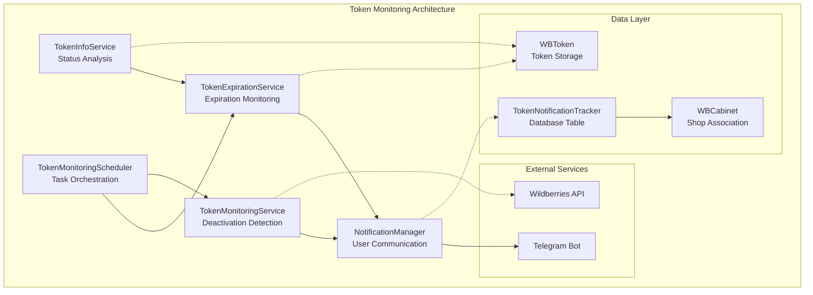
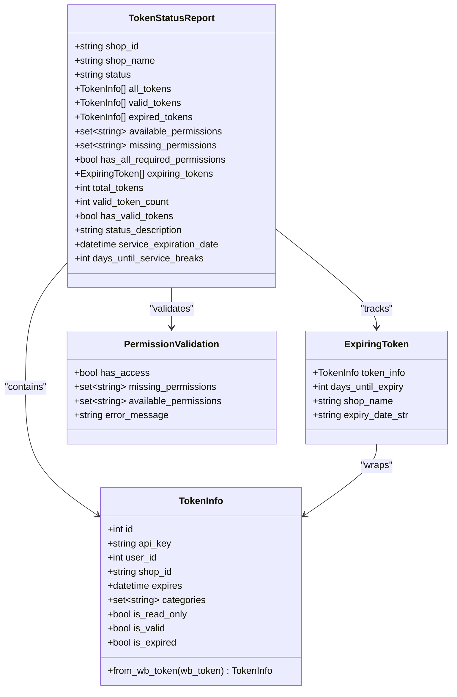
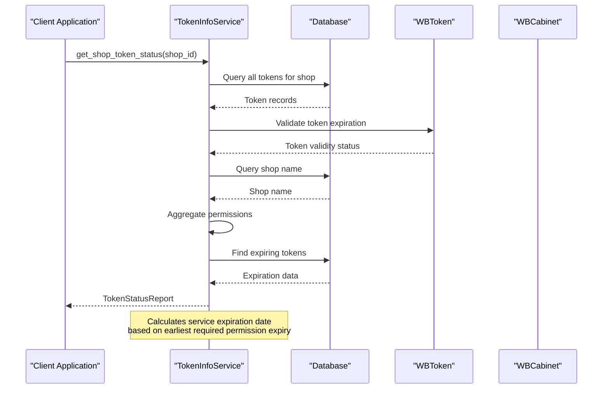
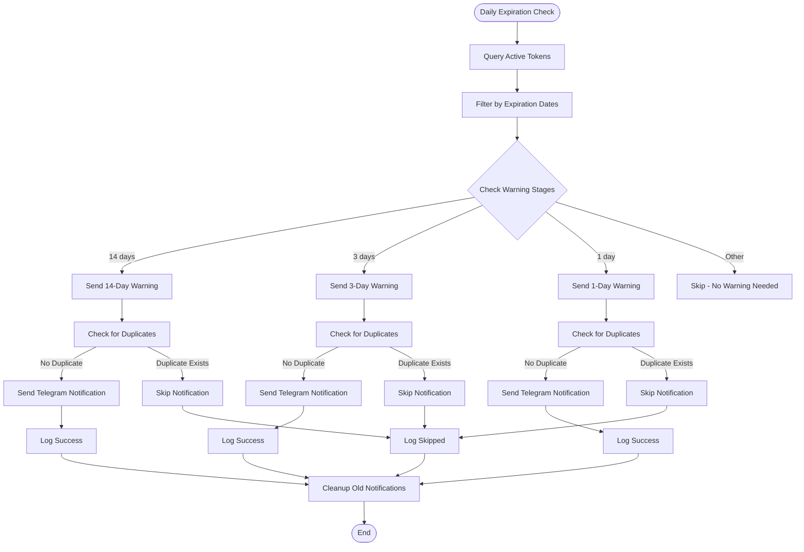
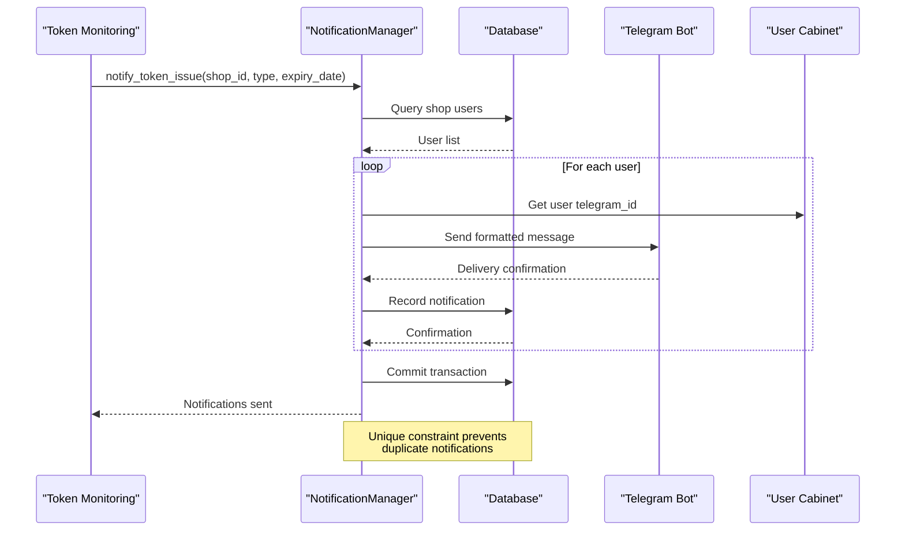
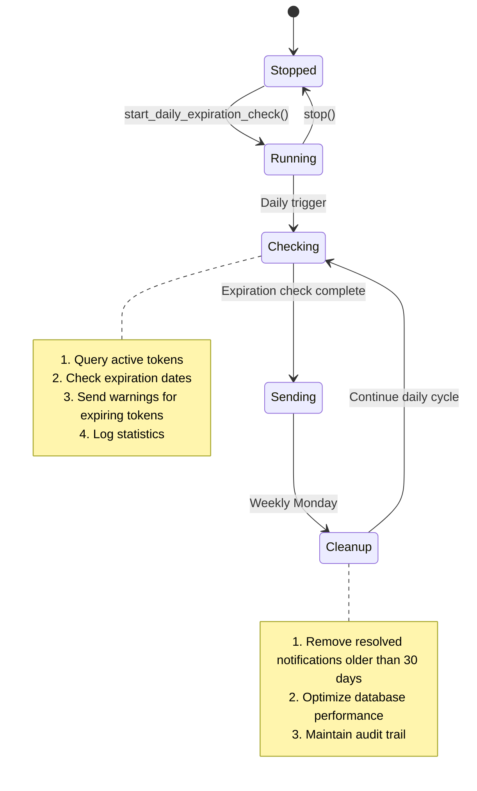

# Token Management

<cite>
**Referenced Files in This Document**
- [models.py](file://app/modules/token_monitoring/models.py)
- [token_monitoring_service.py](file://app/modules/token_monitoring/services/token_monitoring_service.py)
- [notification_manager.py](file://app/modules/token_monitoring/services/notification_manager.py)
- [token_expiration_service.py](file://app/modules/token_monitoring/services/token_expiration_service.py)
- [token_info_service.py](file://app/modules/token_monitoring/services/token_info_service.py)
- [scheduler.py](file://app/modules/token_monitoring/scheduler.py)
- [startup.py](file://app/modules/token_monitoring/startup.py)
- [integration.py](file://app/modules/token_monitoring/integration.py)
- [token_monitoring_demo.py](file://examples/token_monitoring_demo.py)
- [f8e1d9c2a3b4_add_token_notification_tracker_table.py](file://alembic/versions/f8e1d9c2a3b4_add_token_notification_tracker_table.py)
- [README.md](file://app/modules/token_monitoring/README.md)
</cite>

## Table of Contents
1. [Introduction](#introduction)
2. [System Architecture](#system-architecture)
3. [Core Components](#core-components)
4. [Token Status Management](#token-status-management)
5. [Expiration Monitoring](#expiration-monitoring)
6. [Notification System](#notification-system)
7. [Scheduler Integration](#scheduler-integration)
8. [Security and Best Practices](#security-and-best-practices)
9. [Implementation Guide](#implementation-guide)
10. [Troubleshooting](#troubleshooting)
11. [Conclusion](#conclusion)

## Introduction

The Token Management system is a comprehensive solution designed to monitor, track, and manage Wildberries API tokens within the adv-bot ecosystem. This system provides real-time visibility into token status, automatic detection of token deactivation events, and proactive expiration monitoring to prevent service disruptions caused by expired credentials.

The system operates on three core principles:
- **Proactive Monitoring**: Continuous surveillance of token health and expiration
- **Immediate Response**: Real-time detection and notification of token issues
- **Preventive Measures**: Automated warnings before tokens expire

## System Architecture

The token management system is built around a modular architecture that separates concerns into distinct services, each responsible for specific aspects of token monitoring and management.



**Diagram sources**
- [token_monitoring_service.py](file://app/modules/token_monitoring/services/token_monitoring_service.py#L1-L50)
- [token_info_service.py](file://app/modules/token_monitoring/services/token_info_service.py#L1-L50)
- [token_expiration_service.py](file://app/modules/token_monitoring/services/token_expiration_service.py#L1-L50)
- [notification_manager.py](file://app/modules/token_monitoring/services/notification_manager.py#L1-L50)

## Core Components

### TokenStatusReport Model

The `TokenStatusReport` serves as the central data structure for representing comprehensive token health information. This model aggregates data from multiple sources to provide a unified view of token status for any given shop.



**Diagram sources**
- [token_info_service.py](file://app/modules/token_monitoring/services/token_info_service.py#L40-L120)
- [models.py](file://app/modules/token_monitoring/models.py#L20-L80)

### Token Monitoring Service

The `TokenMonitoringService` provides real-time detection of token deactivation events by wrapping the existing HTTP request decorator. This service intercepts API calls and automatically detects when all tokens for a shop become invalid.

Key features include:
- **Decorator Wrapping**: Enhances existing retry logic without breaking functionality
- **Exception Detection**: Identifies `ApiForbiddenError` indicating token deactivation
- **Asynchronous Notifications**: Sends notifications without blocking API operations
- **Shop Context Preservation**: Maintains shop identification during error scenarios

**Section sources**
- [token_monitoring_service.py](file://app/modules/token_monitoring/services/token_monitoring_service.py#L1-L209)

### Token Info Service

The `TokenInfoService` performs comprehensive analysis of token permissions and validity across all tokens for a shop. It aggregates permissions from multiple tokens to determine overall service capability.



**Diagram sources**
- [token_info_service.py](file://app/modules/token_monitoring/services/token_info_service.py#L130-L180)

**Section sources**
- [token_info_service.py](file://app/modules/token_monitoring/services/token_info_service.py#L1-L354)

## Token Status Management

### Permission Validation

The system validates required permissions across all tokens for a shop. The `REQUIRED_RIGHTS` set defines the essential permissions needed for bot functionality:

```python
REQUIRED_RIGHTS = {
    "Контент",      # Content management
    "Статистика",   # Performance data access  
    "Аналитика",    # Advanced analytics
    "Продвижение",  # Advertising campaign management
}
```

The validation process aggregates permissions from all valid tokens and determines if the shop has sufficient access for all required functionalities.

### Token Lifecycle Management

The system tracks tokens through their complete lifecycle:

1. **Creation**: Tokens are added to the system with expiration dates
2. **Validation**: Regular checks ensure tokens remain valid and active
3. **Monitoring**: Continuous surveillance of token status and permissions
4. **Expiration**: Proactive warnings before tokens expire
5. **Replacement**: Guidance for token renewal and updates

**Section sources**
- [token_info_service.py](file://app/modules/token_monitoring/services/token_info_service.py#L15-L25)
- [token_info_service.py](file://app/modules/token_monitoring/services/token_info_service.py#L130-L200)

## Expiration Monitoring

### Multi-Stage Warning System

The `TokenExpirationService` implements a sophisticated multi-stage warning system that proactively notifies users before token expiration:



**Diagram sources**
- [token_expiration_service.py](file://app/modules/token_monitoring/services/token_expiration_service.py#L50-L120)

### Warning Stage Configuration

The system supports three configurable warning stages:

- **14-Day Warnings**: Early planning notifications for long-term token management
- **3-Day Warnings**: Urgent preparation reminders for imminent expiration
- **1-Day Warnings**: Critical alerts requiring immediate action

Each warning stage uses carefully crafted Russian-language messages designed to prompt timely action from users.

**Section sources**
- [token_expiration_service.py](file://app/modules/token_monitoring/services/token_expiration_service.py#L1-L314)

## Notification System

### Notification Manager Architecture

The `NotificationManager` coordinates all user communication through Telegram, providing robust error handling and duplicate prevention mechanisms.



**Diagram sources**
- [notification_manager.py](file://app/modules/token_monitoring/services/notification_manager.py#L60-L150)

### Message Templates and Localization

The notification system uses localized Russian messages tailored to different scenarios:

| Notification Type | Message Template |
|-------------------|------------------|
| **Token Deactivation** | "Токен истек или деактивирован, сделайте срочно новый и добавьте в магазин {shop_name}" |
| **14-Day Warning** | "Токен для магазина {shop_name} истекает через 2 недели ({expiry_date}). Подготовьте новый токен заранее" |
| **3-Day Warning** | "Внимание! Токен для магазина {shop_name} истекает через 3 дня ({expiry_date}). Срочно подготовьте новый токен" |
| **1-Day Warning** | "СРОЧНО! Токен для магазина {shop_name} истекает завтра ({expiry_date}). Добавьте новый токен сегодня" |

### Error Handling and Resilience

The notification system implements comprehensive error handling:

- **Telegram Forbidden Errors**: Silent failure when users block the bot
- **Database Constraints**: Unique notifications prevent spamming
- **Transaction Rollback**: Failed notifications don't corrupt data
- **Logging**: Comprehensive audit trail for troubleshooting

**Section sources**
- [notification_manager.py](file://app/modules/token_monitoring/services/notification_manager.py#L1-L336)

## Scheduler Integration

### TokenMonitoringScheduler

The `TokenMonitoringScheduler` orchestrates all periodic token monitoring tasks, ensuring consistent and reliable operation of the token management system.



**Diagram sources**
- [scheduler.py](file://app/modules/token_monitoring/scheduler.py#L20-L100)

### Task Orchestration

The scheduler manages several key tasks:

1. **Daily Expiration Checks**: Automated scanning of all active tokens
2. **Weekly Cleanup**: Maintenance of notification history
3. **Manual Override**: On-demand token status verification
4. **Health Monitoring**: System status reporting and alerting

**Section sources**
- [scheduler.py](file://app/modules/token_monitoring/scheduler.py#L1-L186)

## Security and Best Practices

### Token Data Protection

The system implements multiple layers of security for token data protection:

1. **Database Encryption**: Sensitive token information stored encrypted
2. **Access Control**: Role-based access to token management functions
3. **Audit Logging**: Complete audit trail of all token operations
4. **Secure Transmission**: Encrypted communication channels

### Best Practices for Token Rotation

The system recommends the following token rotation practices:

- **Regular Rotation**: Rotate tokens before expiration to minimize downtime
- **Backup Tokens**: Maintain backup tokens for seamless transitions
- **Permission Review**: Regular review of token permissions and scopes
- **Monitoring Integration**: Integrate with existing security monitoring systems

### Secure Implementation Guidelines

When implementing token monitoring in production environments:

1. **Environment Separation**: Use separate configurations for development and production
2. **Rate Limiting**: Respect API rate limits and implement exponential backoff
3. **Error Monitoring**: Implement comprehensive error tracking and alerting
4. **Backup Procedures**: Maintain procedures for token recovery and restoration

## Implementation Guide

### Quick Start Installation

The simplest way to integrate token monitoring is through the quick setup function:

```python
from app.modules.token_monitoring import install_all_token_monitoring

# Add to your application startup
install_all_token_monitoring()

# This enables:
# ✓ HTTP decorator monitoring for token deactivation
# ✓ Daily expiration checks at 9:00 AM
# ✓ Automatic notifications to users
```

### Custom Configuration

For more granular control, use the initialization function:

```python
from app.modules.token_monitoring import initialize_token_monitoring
from datetime import time

await initialize_token_monitoring(
    enable_decorator_monitoring=True,    # Enable deactivation detection
    enable_expiration_scheduler=True,    # Enable proactive monitoring
    daily_check_time=time(10, 30)       # Run checks at 10:30 AM
)
```

### Database Migration

Ensure the notification tracking table is created:

```bash
alembic upgrade head
```

### Graceful Shutdown

Implement proper cleanup during application shutdown:

```python
from app.modules.token_monitoring import shutdown_token_monitoring

# Add to your application shutdown
await shutdown_token_monitoring()
```

**Section sources**
- [startup.py](file://app/modules/token_monitoring/startup.py#L1-L120)
- [README.md](file://app/modules/token_monitoring/README.md#L50-L100)

## Troubleshooting

### Common Issues and Solutions

**Issue: No notifications sent**
- **Cause**: Shop has no associated users in `WBUserCabinet`
- **Solution**: Verify user associations and Telegram bot configuration
- **Debug**: Check logs for "No users found for shop" messages

**Issue: Duplicate notifications**
- **Cause**: Database unique constraint violation
- **Solution**: System automatically prevents duplicates via database constraints
- **Debug**: Monitor for `IntegrityError` in logs

**Issue: Missing token data**
- **Cause**: `WBToken` records lack `shop_id` or have invalid expiration dates
- **Solution**: Ensure proper token data population and validation
- **Debug**: Verify token records in database

### Debug Mode Configuration

Enable detailed logging for troubleshooting:

```python
import logging

logging.getLogger('app.modules.token_monitoring').setLevel(logging.DEBUG)
```

### Health Check Implementation

Verify system functionality with health checks:

```python
from app.modules.token_monitoring import (
    is_token_monitoring_installed,
    run_token_expiration_check
)

# Check installation status
if not is_token_monitoring_installed():
    logger.warning("Token monitoring not installed")

# Run manual check to verify functionality
stats = await run_token_expiration_check()
logger.info(f"System check: {stats}")
```

### Database Schema Verification

Ensure proper database schema setup:

```sql
-- Verify TokenNotificationTracker table exists
SELECT EXISTS (
    SELECT FROM information_schema.tables 
    WHERE table_name = 'token_notification_tracker'
);

-- Check unique constraint exists
SELECT EXISTS (
    SELECT FROM pg_constraint 
    WHERE conname = 'uq_token_notification_shop_user_type'
);
```

**Section sources**
- [README.md](file://app/modules/token_monitoring/README.md#L350-L400)

## Conclusion

The Token Management system provides a comprehensive solution for monitoring Wildberries API tokens within the adv-bot ecosystem. Through its multi-layered architecture combining real-time deactivation detection, proactive expiration monitoring, and automated user notifications, the system ensures continuous service availability and optimal user experience.

Key benefits of the system include:

- **Proactive Problem Detection**: Immediate identification of token deactivation events
- **Automated Warnings**: Multi-stage expiration notifications prevent service interruptions
- **Comprehensive Reporting**: Detailed token status and permission analysis
- **Robust Error Handling**: Graceful degradation and comprehensive logging
- **Scalable Architecture**: Modular design supports future enhancements

The system's design emphasizes reliability, security, and ease of integration, making it suitable for production deployment in enterprise environments. By following the implementation guidelines and best practices outlined in this documentation, developers can successfully integrate token monitoring into their Wildberries advertising automation solutions.

Future enhancements may include support for additional notification channels, advanced analytics capabilities, and integration with external token management systems. The modular architecture ensures that such extensions can be implemented without disrupting existing functionality.