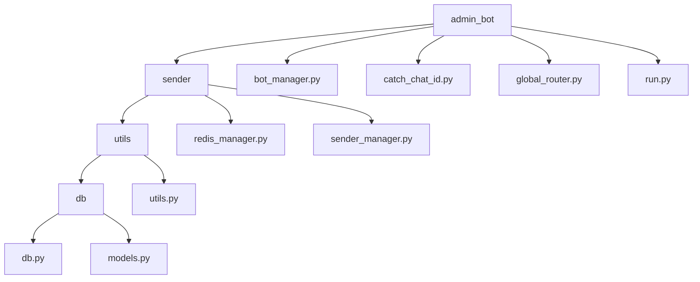
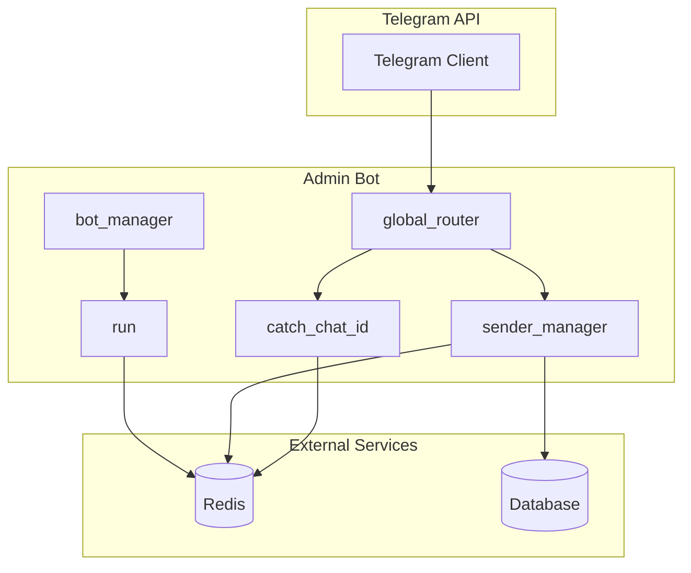
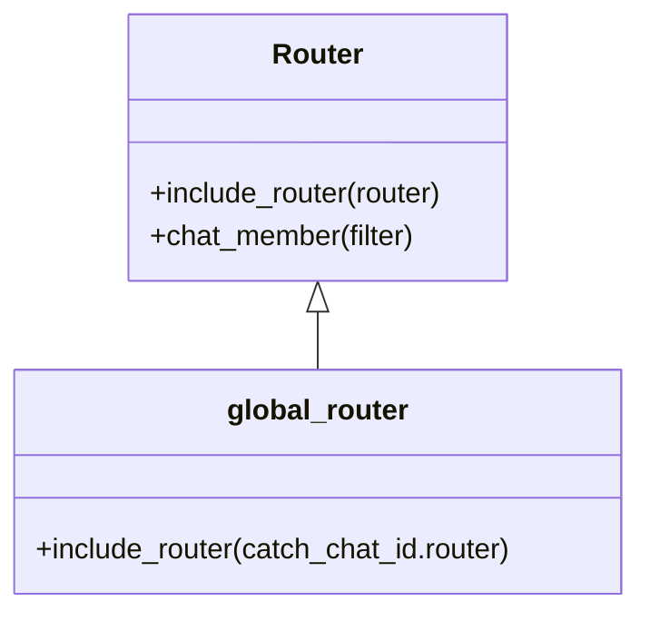
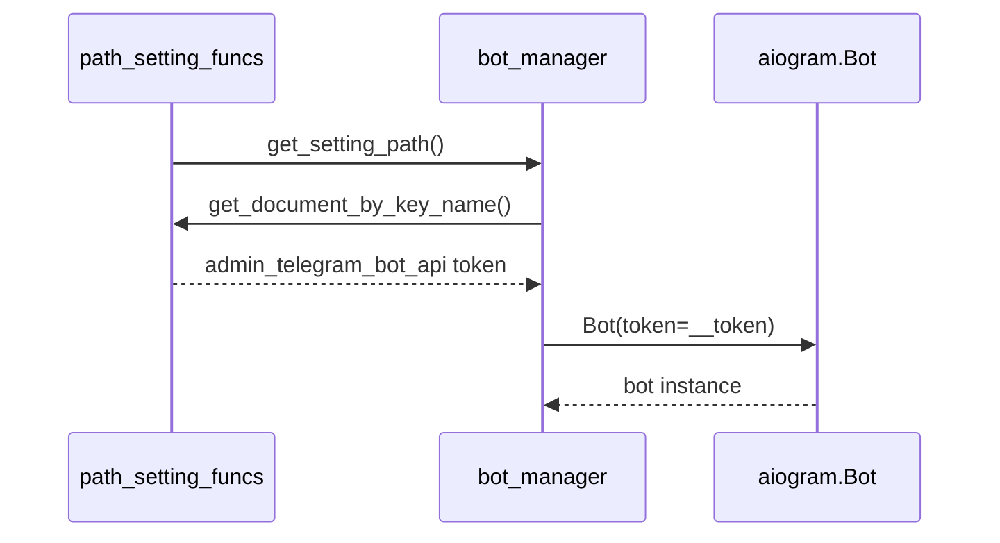
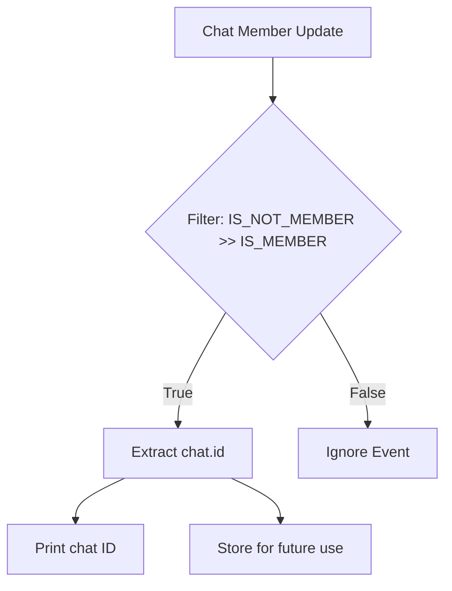
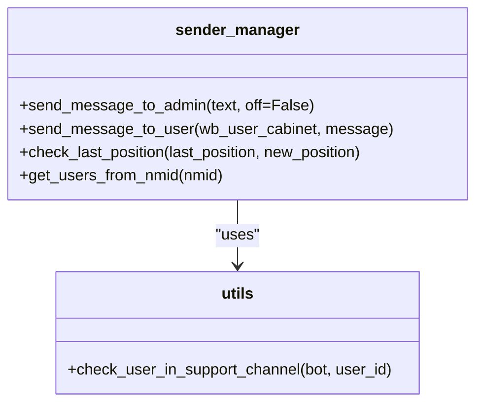

# Admin Interface

<cite>
**Referenced Files in This Document**   
- [global_router.py](file://app/admin_bot/global_router.py)
- [catch_chat_id.py](file://app/admin_bot/catch_chat_id.py)
- [bot_manager.py](file://app/admin_bot/bot_manager.py)
- [run.py](file://app/admin_bot/run.py)
- [sender_manager.py](file://app/admin_bot/sender/sender_manager.py)
- [utils.py](file://app/admin_bot/sender/utils/utils.py)
- [models.py](file://app/admin_bot/sender/utils/db/models.py)
</cite>

## Table of Contents
1. [Introduction](#introduction)
2. [Project Structure](#project-structure)
3. [Core Components](#core-components)
4. [Architecture Overview](#architecture-overview)
5. [Detailed Component Analysis](#detailed-component-analysis)
6. [Dependency Analysis](#dependency-analysis)
7. [Performance Considerations](#performance-considerations)
8. [Troubleshooting Guide](#troubleshooting-guide)
9. [Conclusion](#conclusion)

## Introduction
This document provides a comprehensive overview of the Admin Interface component in the adv-bot system, focusing on the Telegram-based admin bot implementation using aiogram. The documentation covers command routing, bot lifecycle management, chat ID capture mechanisms, security measures, and integration with backend services. It is designed to assist new developers in understanding the system architecture while providing technical depth for experienced developers.

## Project Structure

**Diagram sources**
- [app/admin_bot](file://app/admin_bot)

**Section sources**
- [app/admin_bot](file://app/admin_bot)

## Core Components

The Admin Interface consists of several core components that work together to provide administrative functionality through Telegram. These include the global router for command handling, bot manager for lifecycle control, chat ID capture mechanism, and message sender utilities.

**Section sources**
- [global_router.py](file://app/admin_bot/global_router.py)
- [bot_manager.py](file://app/admin_bot/bot_manager.py)
- [catch_chat_id.py](file://app/admin_bot/catch_chat_id.py)
- [run.py](file://app/admin_bot/run.py)

## Architecture Overview

**Diagram sources**
- [global_router.py](file://app/admin_bot/global_router.py)
- [bot_manager.py](file://app/admin_bot/bot_manager.py)
- [catch_chat_id.py](file://app/admin_bot/catch_chat_id.py)
- [sender_manager.py](file://app/admin_bot/sender/sender_manager.py)
- [run.py](file://app/admin_bot/run.py)

## Detailed Component Analysis

### Command Routing System

The command routing system is implemented through the global_router.py module, which serves as the central command dispatcher for the admin bot. It utilizes aiogram's Router class to organize and manage different types of administrative commands and events.

**Diagram sources**
- [global_router.py](file://app/admin_bot/global_router.py)

**Section sources**
- [global_router.py](file://app/admin_bot/global_router.py)

### Bot Lifecycle Management

The bot_manager.py module handles the initialization and configuration of the admin bot instance. It retrieves the bot token from configuration files and creates the Bot object used throughout the application.

**Diagram sources**
- [bot_manager.py](file://app/admin_bot/bot_manager.py)

**Section sources**
- [bot_manager.py](file://app/admin_bot/bot_manager.py)

### Chat ID Capture Mechanism

The catch_chat_id.py module implements a specialized handler that captures chat IDs when the bot is added to new channels or groups. This mechanism uses aiogram's chat member update filters to detect when the bot's membership status changes.

**Diagram sources**
- [catch_chat_id.py](file://app/admin_bot/catch_chat_id.py)

**Section sources**
- [catch_chat_id.py](file://app/admin_bot/catch_chat_id.py)

### Message Sending System

The sender module provides utilities for sending messages to both administrators and users. The sender_manager.py contains functions for administrative notifications and user communications, with proper error handling and logging.

**Diagram sources**
- [sender_manager.py](file://app/admin_bot/sender/sender_manager.py)
- [utils.py](file://app/admin_bot/sender/utils/utils.py)

**Section sources**
- [sender_manager.py](file://app/admin_bot/sender/sender_manager.py)
- [utils.py](file://app/admin_bot/sender/utils/utils.py)

## Dependency Analysis

```mermaid
graph TD
A[global_router.py] --> B[aiogram.Router]
A --> C[catch_chat_id.py]
D[catch_chat_id.py] --> B
D --> E[aiogram.filters]
F[bot_manager.py] --> G[aiogram.Bot]
F --> H[python_modules.path_setting_funcs]
I[run.py] --> J[aiogram.Bot]
I --> K[aiogram.Dispatcher]
I --> L[RedisStorage]
I --> M[global_router.py]
N[sender_manager.py] --> O[aiogram]
N --> P[app.client_bot.bot]
N --> Q[app.client_bot.utils.data_manager]
N --> R[python_modules.logger]
N --> S[app.utils.redis_manager]
N --> T[app.utils.db.models.User]
N --> U[app.client_bot.user_interface.views.messages]
```

**Diagram sources**
- [global_router.py](file://app/admin_bot/global_router.py)
- [catch_chat_id.py](file://app/admin_bot/catch_chat_id.py)
- [bot_manager.py](file://app/admin_bot/bot_manager.py)
- [run.py](file://app/admin_bot/run.py)
- [sender_manager.py](file://app/admin_bot/sender/sender_manager.py)

**Section sources**
- [global_router.py](file://app/admin_bot/global_router.py)
- [catch_chat_id.py](file://app/admin_bot/catch_chat_id.py)
- [bot_manager.py](file://app/admin_bot/bot_manager.py)
- [run.py](file://app/admin_bot/run.py)
- [sender_manager.py](file://app/admin_bot/sender/sender_manager.py)

## Performance Considerations

The admin interface is designed with performance in mind, utilizing Redis for fast data access and caching. The bot implementation uses asynchronous programming patterns to handle multiple requests efficiently. Message sending operations include rate limiting with asyncio.sleep() to prevent hitting Telegram API limits. Error handling is implemented to ensure that failures in one component don't affect the overall system stability.

## Troubleshooting Guide

Common issues with the admin interface typically involve authentication failures, message delivery problems, or configuration errors. When experiencing authentication issues, verify that the admin_telegram_bot_api token in the configuration file is correct and hasn't expired. For message delivery problems, check the Redis connection and ensure that the admin_chat_id is properly configured. Command timeout issues can often be resolved by checking network connectivity and ensuring that the bot has the necessary permissions in the target chat.

**Section sources**
- [bot_manager.py](file://app/admin_bot/bot_manager.py)
- [run.py](file://app/admin_bot/run.py)
- [sender_manager.py](file://app/admin_bot/sender/sender_manager.py)

## Conclusion

The Admin Interface component of the adv-bot system provides a robust Telegram-based administration system using aiogram. It features a modular architecture with clear separation of concerns between command routing, bot management, and message handling. The system effectively captures chat IDs, manages bot lifecycle, and communicates with both administrators and users. Security measures are implemented through configuration management and error handling, while integration with backend services enables comprehensive administrative control over the application.