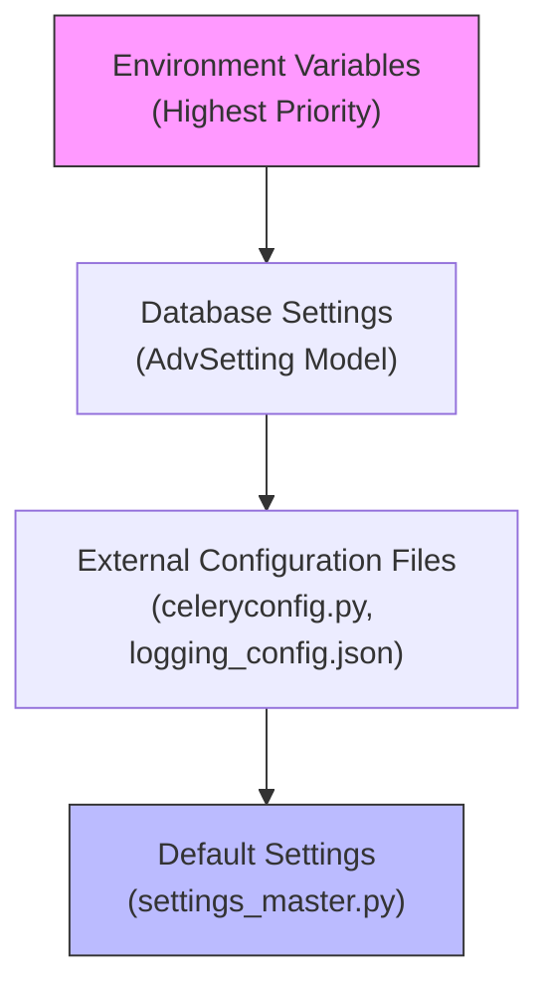
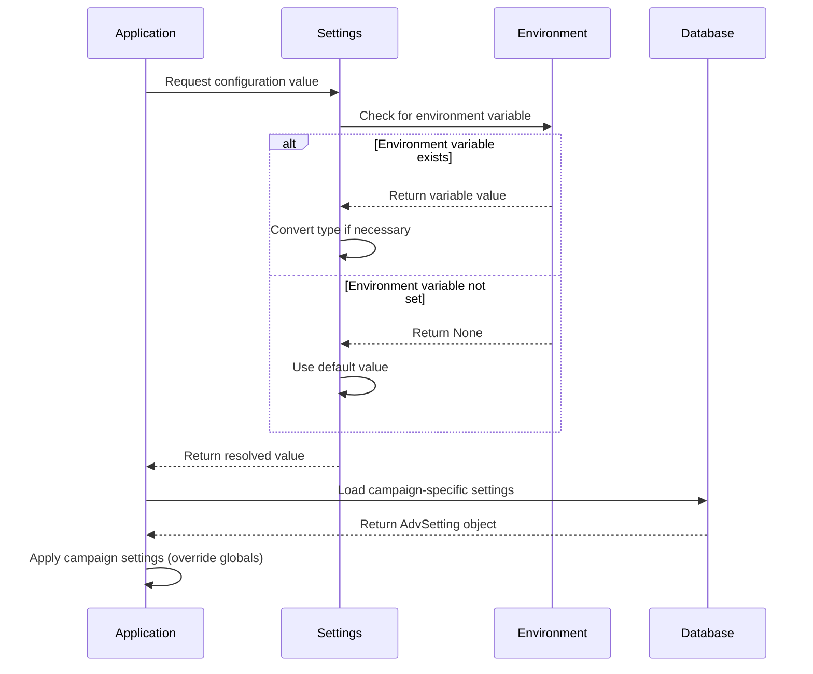
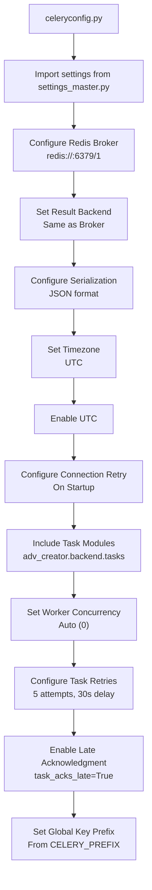
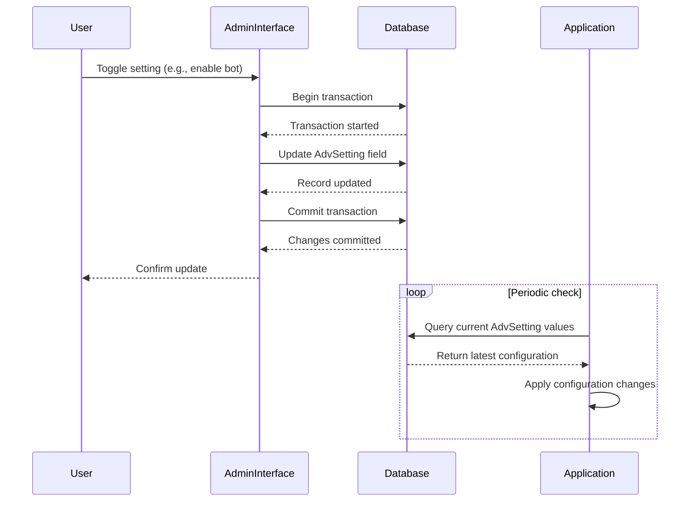

# Configuration Management

<cite>
**Referenced Files in This Document**   
- [settings_master.py](file://app/settings/settings_master.py)
- [celeryconfig.py](file://celeryconfig.py)
- [logging_config.json](file://logging_config.json)
- [models.py](file://app/modules/common_slaves/wildberries/models/models.py)
- [adv_setting.py](file://app/client_bot/user_interface/handlers/adv_setting.py)
</cite>

## Table of Contents
1. [Introduction](#introduction)
2. [Configuration Architecture](#configuration-architecture)
3. [Settings Hierarchy and Override Mechanisms](#settings-hierarchy-and-override-mechanisms)
4. [Runtime Configuration Management](#runtime-configuration-management)
5. [Background Worker Configuration](#background-worker-configuration)
6. [Logging Configuration](#logging-configuration)
7. [Service Timeout and Performance Settings](#service-timeout-and-performance-settings)
8. [Admin Interface for Dynamic Configuration](#admin-interface-for-dynamic-configuration)
9. [Best Practices for Configuration Management](#best-practices-for-configuration-management)
10. [Common Configuration Issues and Resolution](#common-configuration-issues-and-resolution)

## Introduction
The Configuration Management system in adv-bot provides a comprehensive framework for managing runtime settings across different environments. This document details how configuration values are organized, prioritized, and applied throughout the application lifecycle. The system supports multiple configuration sources including environment variables, external configuration files, database-stored settings, and runtime modifications through the admin interface. This layered approach enables flexible deployment strategies while maintaining security and consistency across development, testing, and production environments.

## Configuration Architecture
The adv-bot configuration system follows a hierarchical architecture with multiple layers of configuration sources. At the core is the `Settings` class in `settings_master.py` which serves as the central configuration manager, aggregating values from various sources and providing type-safe access to configuration parameters. The architecture implements a cascading override pattern where more specific configuration sources take precedence over general ones.

External configuration files like `celeryconfig.py` and `logging_config.json` provide service-specific settings that are integrated into the overall configuration system. Database-stored settings in the `AdvSetting` model allow for per-campaign configuration that can be modified at runtime without requiring application restarts. Environment variables serve as the outermost layer, enabling deployment-specific overrides without code changes.



**Diagram sources**
- [settings_master.py](file://app/settings/settings_master.py)
- [celeryconfig.py](file://celeryconfig.py)
- [logging_config.json](file://logging_config.json)

**Section sources**
- [settings_master.py](file://app/settings/settings_master.py#L1-L375)
- [celeryconfig.py](file://celeryconfig.py#L1-L38)
- [logging_config.json](file://logging_config.json#L1-L34)

## Settings Hierarchy and Override Mechanisms
The configuration system implements a well-defined hierarchy where settings are resolved from multiple sources with clear precedence rules. The override mechanism follows the principle that more specific and deployment-specific configurations take precedence over general defaults.

At the foundation are default values defined in the `Settings` class within `settings_master.py`. These defaults provide sensible values for all configuration parameters and ensure the application can run even when external configuration is minimal. When environment variables are present, they override these defaults, allowing deployment-specific customization without code changes.

Database-stored settings in the `AdvSetting` model provide another layer of configuration that can override both defaults and environment variables for specific advertising campaigns. This enables granular control over individual campaign behavior while maintaining consistent global settings. The configuration system evaluates these sources in order of specificity, ensuring that the most relevant settings are applied.

```mermaid
classDiagram
class Settings {
+PARSING_KEYWORDS_DELAY_BETWEEN_TASKS int
+postgres_replica_host str | None
+postgres_master_host str | None
+postgres_user str | None
+postgres_password str | None
+postgres_dbname str | None
+cv bool | None
+test_mode bool
+polling_mode bool
+version str | None
+WEBHOOK_URL str | None
+COUNT_SEMAPHORE_TO_POSTGRES int
+MAX_THREAD_FOR_PROXY int
+MAX_THREAD_PARSER int
+clickhouse_host str | None
+clickhouse_user str | None
+clickhouse_password str | None
+TELEGRAM_WEB_PORT int
+CH_MAX_THREAD int
+BIDDER_STEP int
+CLICKHOUSE_PORT int
+postgres_port int
+ssl_mode str | None
+postgres_hosts str | None
+CELERY_PREFIX str | None
+REDIS_MASTER_HOST str | None
+REDIS_REPLICA_HOST str | None
+YOOKASSA_TOKEN str
+MIN_SUM int
+SHOP_FILTER_LIST list[str]
+PAUSE_AFTER_PARSING int | None
+TIME_OUT_FOR_PARSER int | None
+PARSING_TIMEOUT int
+MAX_PARSING_PARALLEL_JOBS int
+TELEGRAM_BOT_TOKEN str
+WEBHOOK_SECRET str
+PARALLER_PARSE_TASKS int
+MAX_HOURS_PERIOD_FOR_PARSING_KEYWORDS int
+MAX_PAGE_LIMIT_PARSER_WORKER int
+MIN_DIFF_VIEWS_FOR_PARSING_KEYWORDS int
+FULL_STAT_THRESHOLD_DATES int
+LOG_LEVEL str
+PG_POOL_SIZE int
+PG_MAX_OVERFLOW int
+WHITE_LIST_AUTO_UPDATER_MONTH_TARIFF int
+AUTO_UPDATE_TARGET_PLACE_MONTH_TARIFF int
+SHOP_UPDATE_TIMEOUT_MINUTES int
+SHOPS_WORKS_TLL int
+DEFAULT_CTR_EXPONENTA int
+DEFAULT_MIN_CTR float
+START_AUCTION_ON_CREATING_ADV bool
}
class AdvSetting {
+favorite_users list[User]
+adv_id int
+name str
+wb_cabinet_id int
+active_status str
+bot_active bool
+nmids list[int]
+pass_days int
+boost float
+type int
+hard_min_ctr float
+max_cpc float
+min_views_for_ml_predict int
+parsing_active bool
+last_update DateTime
+bidder_active bool | None
+max_cpm int
+max_place int
+min_block_position int
+clusters_mode bool
+target_ctr_mode bool
+hide_small_query_keywords int
+target_ctr_mode_strategy str
+new_auto_min_ctr_mode bool
+reset_place bool
+bidder_step int
+exponent_predict_ctr float
+auction_boost_all_phrase_mode bool
+plan_for_sales_for_day int
+target_price_for_order float
+max_price_for_order float
+cpm int
+bidder_for_auto bool
+auto_update_white_list bool
+auto_update_target_place bool
+max_balance_adding_for_day int
+auto_adv_target_status bool
+auction_adv_target_status bool
+auto_add_only_relevant_phrase bool
}
Settings --> AdvSetting : "Provides default values"
AdvSetting --> Settings : "Can override global settings"
```



**Diagram sources**
- [settings_master.py](file://app/settings/settings_master.py#L1-L375)
- [models.py](file://app/modules/common_slaves/wildberries/models/models.py#L1-L654)

**Section sources**
- [settings_master.py](file://app/settings/settings_master.py#L1-L375)
- [models.py](file://app/modules/common_slaves/wildberries/models/models.py#L1-L654)

## Runtime Configuration Management
Runtime configuration in adv-bot is managed through a combination of the `settings_master.py` module and database-stored configuration values. The `Settings` class provides a unified interface for accessing configuration parameters, with properties that automatically resolve values from environment variables when available, falling back to defaults otherwise.

The configuration system uses Python's property decorators to implement lazy evaluation of settings, ensuring that environment variables are read at access time rather than initialization. This allows for dynamic updates to environment variables without requiring application restarts. Each property method first attempts to retrieve a value from `os.environ`, applies any necessary type conversion, and returns a default value if the environment variable is not set.

For database-stored settings, the `AdvSetting` model contains numerous configuration parameters that can be modified at runtime through the admin interface. These settings are automatically loaded by the application when processing advertising campaigns and take precedence over global configuration values. This enables campaign-specific behavior without affecting other campaigns or the overall application configuration.



**Diagram sources**
- [settings_master.py](file://app/settings/settings_master.py#L1-L375)
- [models.py](file://app/modules/common_slaves/wildberries/models/models.py#L1-L654)

**Section sources**
- [settings_master.py](file://app/settings/settings_master.py#L1-L375)
- [models.py](file://app/modules/common_slaves/wildberries/models/models.py#L1-L654)

## Background Worker Configuration
Background worker configuration is managed through the `celeryconfig.py` file, which integrates with the main configuration system to provide task-specific settings. The configuration file imports settings from `settings_master.py` to ensure consistency with the application's overall configuration while defining worker-specific parameters.

The Celery configuration establishes the broker URL and result backend using Redis, with the host obtained from the central settings system. This ensures that worker processes connect to the same Redis instance as the main application. The configuration also sets serialization formats, timezone settings, and connection retry policies to ensure reliable task processing.

Worker concurrency is configured to automatically determine the optimal number of processes based on available system resources. Task retry policies are defined with a maximum of 5 retry attempts and a 30-second delay between attempts, providing resilience against transient failures. The configuration also enables late acknowledgment of tasks, ensuring that tasks are only marked as complete after successful execution.



**Diagram sources**
- [celeryconfig.py](file://celeryconfig.py#L1-L38)
- [settings_master.py](file://app/settings/settings_master.py#L1-L375)

**Section sources**
- [celeryconfig.py](file://celeryconfig.py#L1-L38)

## Logging Configuration
Logging configuration is defined in the `logging_config.json` file, which specifies the logging hierarchy, formatters, handlers, and root logger settings. The configuration follows Python's standard logging module schema, allowing for flexible log output customization without code changes.

The logging system defines a custom formatter with detailed output including the logger name, timestamp, source file and line number, log level, and message. This comprehensive format aids in debugging and monitoring by providing context for each log entry. Two handlers are configured: a console handler that outputs DEBUG and higher level messages to stdout, and a file handler that captures ERROR and higher level messages in a rotating log file.

The root logger is configured with DEBUG level and both handlers, ensuring that all log messages are processed according to the defined rules. The file handler uses a rotating file approach with a maximum size of 10MB per file and up to 5 backup files, preventing log files from growing indefinitely while preserving recent error history.

```mermaid
erDiagram
LOGGING_CONFIG ||--o{ FORMATTERS : "contains"
LOGGING_CONFIG ||--o{ HANDLERS : "contains"
LOGGING_CONFIG ||--o{ ROOT_LOGGER : "defines"
FORMATTERS ||--o{ CUSTOM_FORMATTER : "custom"
HANDLERS ||--o{ CONSOLE_HANDLER : "console"
HANDLERS ||--o{ FILE_HANDLER : "error_to_file"
ROOT_LOGGER ||--o{ CONSOLE_HANDLER : "uses"
ROOT_LOGGER ||--o{ FILE_HANDLER : "uses"
class LOGGING_CONFIG {
version: 1
disable_existing_loggers: false
}
class FORMATTERS {
format: "%(name)s - %(asctime)s - %(pathname)s:%(lineno)d - %(levelname)s - %(message)s"
datefmt: "%Y-%m-%d %H:%M:%S"
}
class HANDLERS {
class: logging.StreamHandler or logging.handlers.RotatingFileHandler
level: DEBUG or ERROR
formatter: custom
filename: logs/errors.log (file only)
maxBytes: 10485760
backupCount: 5
}
class ROOT_LOGGER {
level: DEBUG
handlers: [console, error_to_file]
}
```

**Diagram sources**
- [logging_config.json](file://logging_config.json#L1-L34)

**Section sources**
- [logging_config.json](file://logging_config.json#L1-L34)

## Service Timeout and Performance Settings
The configuration system includes numerous timeout and performance-related settings that control various aspects of the application's behavior. These settings are crucial for maintaining system stability and responsiveness under varying load conditions.

Timeout settings include `PARSING_TIMEOUT` (default 4 hours) for keyword parsing operations, `TIME_OUT_FOR_PARSER` for individual parser operations, and `SHOP_UPDATE_TIMEOUT_MINUTES` (default 60 minutes) for shop update processes. These timeouts prevent individual operations from running indefinitely and allow the system to recover from stalled processes.

Performance settings control resource utilization across different components. `MAX_THREAD_PARSER` (default 30) and `MAX_PARSING_PARALLEL_JOBS` (default 10) limit the number of concurrent parsing operations to prevent system overload. Database connection pooling is configured with `PG_POOL_SIZE` (default 200) and `PG_MAX_OVERFLOW` (default 250) to balance connection availability with resource consumption.

Redis and ClickHouse settings include `CH_MAX_THREAD` for ClickHouse query threads and `SHOPS_WORKS_TLL` (default 5 minutes) for caching shop-related data. These settings optimize database interactions and reduce redundant operations. The `COUNT_SEMAPHORE_TO_POSTGRES` setting (default 10) limits concurrent database writes to prevent overwhelming the database server.

**Section sources**
- [settings_master.py](file://app/settings/settings_master.py#L1-L375)

## Admin Interface for Dynamic Configuration
The admin interface enables dynamic configuration updates without requiring application restarts, primarily through the management of `AdvSetting` model instances. The interface provides handlers that process user interactions and update configuration values directly in the database, where they are immediately available to the application.

The `adv_setting.py` handler module contains callback functions that respond to user actions in the admin interface. For example, the `turn_adv_on` and `turn_adv_off` functions modify the `bot_active` field of an `AdvSetting` record, effectively enabling or disabling campaign automation. Similarly, `turn_on_auto_min_ctr` and `turn_off_auto_min_ctr` functions update the `new_auto_min_ctr_mode` field to control minimum CTR automation.

These updates are performed within database transactions to ensure data consistency. After updating the relevant fields, the changes are committed to the database and become immediately effective. The application's runtime components periodically check these settings, ensuring that configuration changes are applied in a timely manner without requiring service interruption.



**Diagram sources**
- [adv_setting.py](file://app/client_bot/user_interface/handlers/adv_setting.py#L1-L308)
- [models.py](file://app/modules/common_slaves/wildberries/models/models.py#L1-L654)

**Section sources**
- [adv_setting.py](file://app/client_bot/user_interface/handlers/adv_setting.py#L1-L308)

## Best Practices for Configuration Management
Effective configuration management in adv-bot follows several best practices to ensure security, reliability, and maintainability. Sensitive configuration values such as database passwords, API tokens, and webhook secrets are stored exclusively in environment variables rather than in code or configuration files. This prevents accidental exposure in version control systems and allows for secure management through deployment platforms.

Configuration values are strongly typed and validated at access time, with appropriate default values provided for optional settings. This ensures that the application can start and operate even when certain configuration values are missing, while still alerting administrators to potential configuration issues through appropriate error handling.

Versioning of configuration changes is achieved through database migrations for schema changes and environment variable management for deployment-specific settings. This allows for tracking configuration evolution over time and facilitates rollback to previous configurations when necessary.

Deployment synchronization is maintained by ensuring that all instances of the application in a given environment share the same configuration sources. This is particularly important for distributed systems where inconsistency between instances could lead to unpredictable behavior. Configuration changes are applied systematically across all instances to maintain consistency.

**Section sources**
- [settings_master.py](file://app/settings/settings_master.py#L1-L375)
- [celeryconfig.py](file://celeryconfig.py#L1-L38)
- [logging_config.json](file://logging_config.json#L1-L34)

## Common Configuration Issues and Resolution
Several common configuration issues may arise in the adv-bot system, along with established resolution strategies. Configuration drift, where different instances have inconsistent settings, is prevented by centralizing configuration in environment variables and database settings that are shared across instances.

Invalid format errors in configuration values are handled through type conversion with appropriate error handling. For example, boolean values from environment variables are converted with case-insensitive comparison to "true" and "false" strings, with validation to ensure only valid values are accepted. Numeric values include error handling for invalid number formats.

Caching of stale settings is mitigated through the use of property decorators that read environment variables at access time rather than initialization. For database-stored settings, the application implements periodic refresh mechanisms or event-driven updates to ensure that configuration changes are applied in a timely manner.

Missing required configuration values are addressed through comprehensive default values for non-sensitive settings and strict validation for critical settings. For example, the `WEBHOOK_SECRET` environment variable raises a `ValueError` if not set, preventing the application from starting with insecure configuration.

**Section sources**
- [settings_master.py](file://app/settings/settings_master.py#L1-L375)