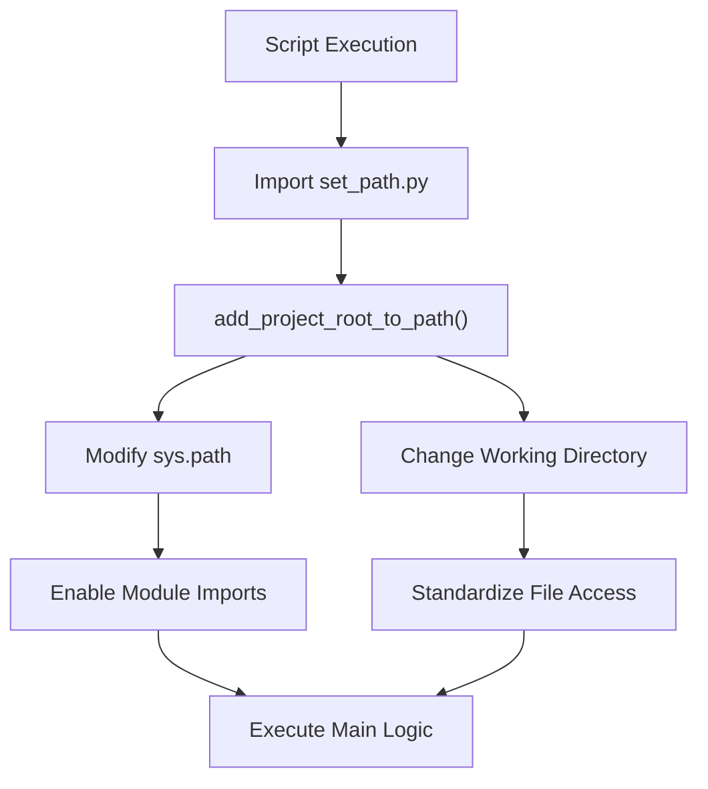
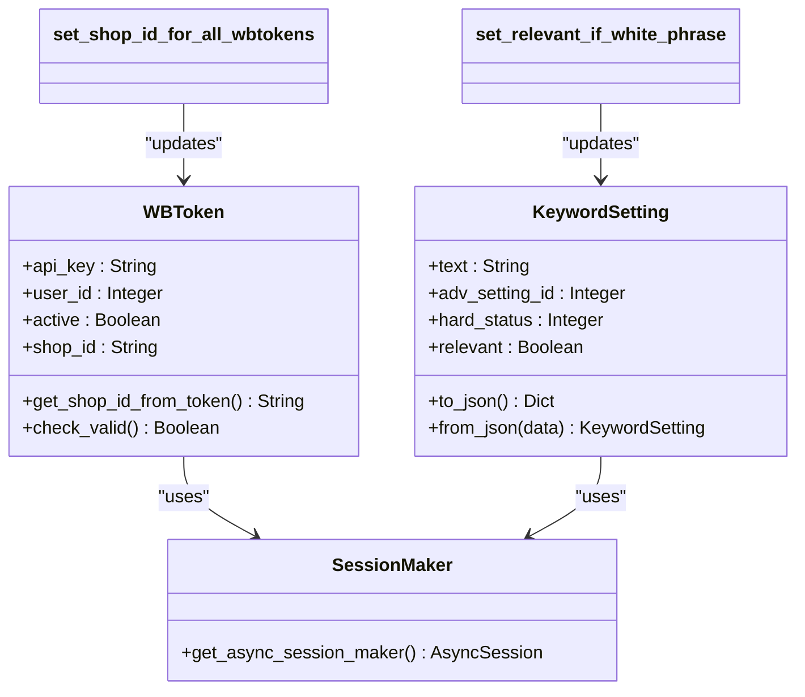

# Maintenance Tasks

<cite>
**Referenced Files in This Document**   
- [set_shop_id_for_all_wbtokens.py](file://scripts/set_shop_id_for_all_wbtokens.py)
- [set_relevant_if_white_phrase.py](file://scripts/set_relevant_if_white_phrase.py)
- [set_path.py](file://scripts/set_path.py)
- [template_script.py](file://scripts/template_script.py)
- [README.md](file://scripts/README.md)
- [models.py](file://app/modules/common_slaves/wildberries/models/models.py)
- [session_maker.py](file://app/utils/db/session_maker.py)
</cite>

## Table of Contents
1. [Introduction](#introduction)
2. [Scripts Directory Structure and Purpose](#scripts-directory-structure-and-purpose)
3. [Path Configuration and Execution Environment](#path-configuration-and-execution-environment)
4. [Core Maintenance Scripts](#core-maintenance-scripts)
5. [Database Integration and Shared Models](#database-integration-and-shared-models)
6. [Script Development Guidelines](#script-development-guidelines)
7. [Error Handling and Idempotency](#error-handling-and-idempotency)
8. [Common Issues and Mitigation Strategies](#common-issues-and-mitigation-strategies)
9. [Conclusion](#conclusion)

## Introduction
The Maintenance Tasks subsystem in the adv-bot application consists of standalone Python scripts designed to perform essential data normalization, consistency updates, and system integrity operations. These scripts operate outside the main application flow but share the same data models and configuration, ensuring seamless integration with the core system. They are critical for maintaining data quality, especially during schema migrations or when correcting inconsistencies across large datasets. This document details the architecture, execution patterns, and best practices for these maintenance scripts, with specific examples including `set_shop_id_for_all_wbtokens.py` for shop ID population and `set_relevant_if_white_phrase.py` for keyword relevance updates.

## Scripts Directory Structure and Purpose
The `scripts/` directory contains standalone maintenance utilities that can be executed independently from the main application. These scripts are designed for one-time or periodic execution to address specific data maintenance needs. The directory includes core scripts for data normalization, a path configuration module, a template for new scripts, and documentation. Each script is self-contained and follows a consistent pattern for environment setup, database access, and error reporting. The scripts support both direct execution from the scripts directory and invocation from the project root, making them flexible for different deployment and operational scenarios.

**Section sources**
- [README.md](file://scripts/README.md#L1-L69)
- [set_path.py](file://scripts/set_path.py#L1-L43)

## Path Configuration and Execution Environment
All scripts in the `scripts/` directory rely on `set_path.py` to configure the Python execution environment. This module adds the project root to `sys.path` and changes the current working directory to the project root, enabling consistent imports across the codebase. The `add_project_root_to_path()` function ensures that modules from the main application can be imported regardless of the script's execution location. Additionally, the `get_project_path()` utility allows scripts to resolve file paths relative to the project root, facilitating access to configuration files and resources. This standardized approach eliminates path-related errors and ensures reliable script behavior in different execution contexts.

**Diagram sources**
- [set_path.py](file://scripts/set_path.py#L1-L43)
- [template_script.py](file://scripts/template_script.py#L1-L42)

**Section sources**
- [set_path.py](file://scripts/set_path.py#L1-L43)
- [template_script.py](file://scripts/template_script.py#L1-L42)

## Core Maintenance Scripts

### set_shop_id_for_all_wbtokens.py
This script populates the `shop_id` field for all `WBToken` records that lack this value by extracting it from the JWT token payload. It iterates through all tokens in the database, attempts to decode the API key as a JWT token, and retrieves the `sid` claim which contains the shop ID. The script handles invalid tokens gracefully by catching `NotValidTokenError` exceptions and continues processing remaining tokens. It provides detailed logging of processed, updated, and invalid tokens, making it suitable for auditing and verification. This script was particularly important following the database migration that added the `shop_id` column to the `wbtoken` table.

**Section sources**
- [set_shop_id_for_all_wbtokens.py](file://scripts/set_shop_id_for_all_wbtokens.py#L1-L60)
- [models.py](file://app/modules/common_slaves/wildberries/models/models.py#L300-L330)
- [alembic/versions/30d489ece148_add_shop_id_ðto_wbtoken.py](file://alembic/versions/30d489ece148_add_shop_id_ðto_wbtoken.py#L1-L43)

### set_relevant_if_white_phrase.py
This script updates the `relevant` flag for all keywords in the `KeywordSetting` table that have a `hard_status` of 2 (white list). It uses SQLAlchemy's bulk update functionality to efficiently modify multiple records in a single transaction. The script sets `relevant=True` for all keywords in the white list, ensuring that these phrases are considered relevant in the advertising system. This operation is idempotent and can be safely rerun, as it only affects records matching the specific criteria. The script demonstrates a simple but effective pattern for batch data updates that maintain data consistency across the system.

**Section sources**
- [set_relevant_if_white_phrase.py](file://scripts/set_relevant_if_white_phrase.py#L1-L22)
- [models.py](file://app/modules/common_slaves/wildberries/models/models.py#L550-L580)

## Database Integration and Shared Models
Maintenance scripts integrate with the main application through shared database models and session management utilities. They import entity classes such as `WBToken` and `KeywordSetting` directly from the application's model modules, ensuring consistency with the current schema. Database access is managed through `get_async_session_maker` from `session_maker.py`, which provides properly configured async database sessions. This shared infrastructure guarantees that scripts operate on the same data abstractions as the main application, preventing schema mismatches and data integrity issues. The use of SQLAlchemy ORM also enables type safety and query validation, reducing the risk of database errors during maintenance operations.

**Diagram sources**
- [models.py](file://app/modules/common_slaves/wildberries/models/models.py#L300-L330)
- [models.py](file://app/modules/common_slaves/wildberries/models/models.py#L550-L580)
- [session_maker.py](file://app/utils/db/session_maker.py#L1-L113)

**Section sources**
- [models.py](file://app/modules/common_slaves/wildberries/models/models.py#L300-L330)
- [models.py](file://app/modules/common_slaves/wildberries/models/models.py#L550-L580)
- [session_maker.py](file://app/utils/db/session_maker.py#L1-L113)

## Script Development Guidelines
New maintenance scripts should follow the pattern established in `template_script.py`. Developers should begin by importing `add_project_root_to_path` and `get_project_path` from `set_path.py` to ensure proper environment configuration. Scripts should use async/await patterns for database operations to maintain consistency with the main application's asynchronous architecture. The main logic should be encapsulated in an async function and executed using `asyncio.run()`. Scripts should include comprehensive logging to track progress and errors, especially when processing large datasets. For complex operations, consider implementing batch processing to minimize memory usage and transaction duration. Always test scripts on a staging database before running in production.

**Section sources**
- [template_script.py](file://scripts/template_script.py#L1-L42)
- [set_path.py](file://scripts/set_path.py#L1-L43)

## Error Handling and Idempotency
Maintenance scripts implement robust error handling to ensure reliability during execution. The `set_shop_id_for_all_wbtokens.py` script demonstrates best practices by catching specific exceptions like `NotValidTokenError` and continuing processing despite individual failures. All scripts use database transactions to maintain atomicity, committing changes only when operations succeed. Scripts are designed to be idempotent, meaning they can be safely rerun without causing duplicate changes or data corruption. For example, `set_relevant_if_white_phrase.py` uses a WHERE clause that targets only records needing update, making repeated execution harmless. This idempotency is crucial for maintenance operations that may be interrupted and require resumption.

**Section sources**
- [set_shop_id_for_all_wbtokens.py](file://scripts/set_shop_id_for_all_wbtokens.py#L1-L60)
- [set_relevant_if_white_phrase.py](file://scripts/set_relevant_if_white_phrase.py#L1-L22)

## Common Issues and Mitigation Strategies

### Script Timeouts
Long-running scripts may encounter timeouts, especially when processing large datasets. Mitigation strategies include implementing batch processing with commit intervals, optimizing database queries with appropriate indexes, and using connection pooling settings that accommodate long-lived transactions.

### Data Corruption Risks
To prevent data corruption, all maintenance scripts should operate within database transactions and include validation checks before and after critical operations. Using ORM entities rather than raw SQL reduces the risk of schema-related errors.

### Concurrency Conflicts
When maintenance scripts run concurrently with the main application, race conditions may occur. Scripts should use appropriate transaction isolation levels and avoid long-running transactions on frequently updated tables. For critical operations, consider scheduling maintenance during low-traffic periods or implementing application-level locks.

**Section sources**
- [set_shop_id_for_all_wbtokens.py](file://scripts/set_shop_id_for_all_wbtokens.py#L1-L60)
- [set_relevant_if_white_phrase.py](file://scripts/set_relevant_if_white_phrase.py#L1-L22)

## Conclusion
The Maintenance Tasks subsystem provides essential capabilities for ensuring data integrity and consistency in the adv-bot application. By following standardized patterns for environment setup, database access, and error handling, these scripts effectively address data normalization needs while integrating seamlessly with the main application. The examples of `set_shop_id_for_all_wbtokens.py` and `set_relevant_if_white_phrase.py` demonstrate practical solutions for common maintenance scenarios. Adhering to the development guidelines and best practices outlined in this document will ensure that new maintenance scripts are reliable, efficient, and maintainable.