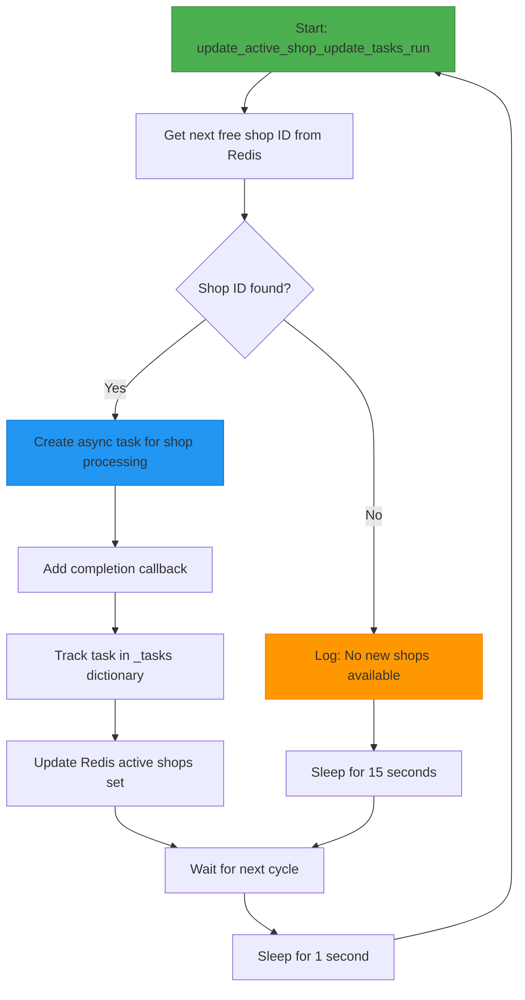
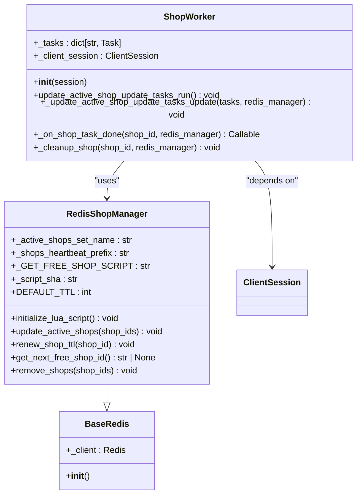
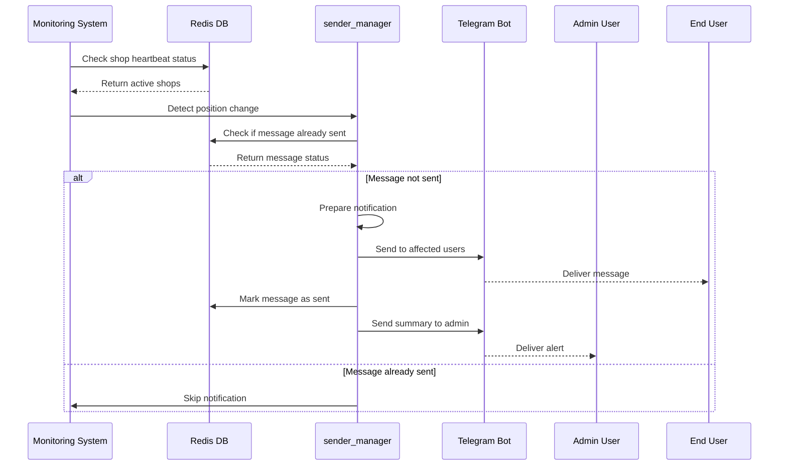
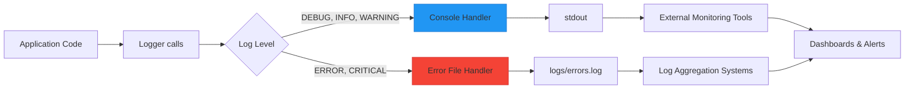

# Monitoring

<cite>
**Referenced Files in This Document**   
- [sender_manager.py](file://app/admin_bot/sender/sender_manager.py)
- [redis_manager.py](file://app/admin_bot/sender/redis_manager.py)
- [run_shop_update_worker.py](file://run_shop_update_worker.py)
- [worker.py](file://app/modules/shop_runner/shop_run_worker/worker/worker.py)
- [redis_manager.py](file://app/modules/shop_runner/shop_run_worker/redis_manager/redis_manager.py)
- [logging_config.json](file://logging_config.json)
- [logger.py](file://python_modules/logger.py)
- [workers.py](file://app/arq_workers/workers.py)
- [arq_redis_settings.py](file://app/arq_workers/arq_redis_settings.py)
</cite>

## Table of Contents
1. [Introduction](#introduction)
2. [System Health Monitoring](#system-health-monitoring)
3. [Task Execution Monitoring](#task-execution-monitoring)
4. [Worker Status and Lifecycle Management](#worker-status-and-lifecycle-management)
5. [Status Reporting via Redis and PostgreSQL](#status-reporting-via-redis-and-postgresql)
6. [Alert and Notification Dispatching](#alert-and-notification-dispatching)
7. [External Monitoring Integration](#external-monitoring-integration)
8. [Real-Time Status Updates](#real-time-status-updates)
9. [Monitoring Workflows](#monitoring-workflows)
10. [Performance Metrics and Log Analysis](#performance-metrics-and-log-analysis)
11. [Common Monitoring Issues and Solutions](#common-monitoring-issues-and-solutions)
12. [Best Practices](#best-practices)

## Introduction
The adv-bot platform implements a comprehensive monitoring system to track system health, task execution, and worker status across its distributed components. This documentation details the monitoring architecture, focusing on how Redis and PostgreSQL are used for status reporting, how alerts are dispatched through the sender_manager, and integration with external monitoring tools via standardized logging. The system is designed to provide real-time visibility into background job execution, detect stalled processes, and ensure reliable notification delivery to administrators and users.

## System Health Monitoring
The platform monitors system health through multiple mechanisms, primarily leveraging Redis for heartbeat tracking and state management. The shop update workers maintain their presence in Redis with TTL-based heartbeat keys, allowing the system to detect stalled or failed workers. Each active shop task is tracked in a Redis set, with individual heartbeat keys that are renewed during processing. This design enables quick identification of unresponsive workers by checking for expired heartbeat keys.

The ARQ worker framework also contributes to system health monitoring by tracking job execution status, retry counts, and timeouts. Workers register startup and shutdown events, providing lifecycle visibility. The system maintains job history for 24 hours, allowing post-mortem analysis of task execution patterns and failure modes.

**Section sources**
- [worker.py](file://app/modules/shop_runner/shop_run_worker/worker/worker.py#L0-L78)
- [redis_manager.py](file://app/modules/shop_runner/shop_run_worker/redis_manager/redis_manager.py#L0-L80)
- [workers.py](file://app/arq_workers/workers.py#L0-L49)

## Task Execution Monitoring
Task execution is monitored through a combination of Redis-based state tracking and structured logging. The `run_shop_update_worker.py` script orchestrates shop update tasks, continuously polling for new work and managing active tasks in memory. Each task is represented as an asyncio Task object, with completion callbacks that handle cleanup and error reporting.

The monitoring system tracks task progression through several states: queued, in-progress, completed, and failed. When a task completes (successfully or with error), the system automatically removes the shop from the active set and logs the outcome. Failed tasks generate detailed exception logs with stack traces, enabling rapid diagnosis of issues.

**Diagram sources**
- [run_shop_update_worker.py](file://run_shop_update_worker.py#L0-L22)
- [worker.py](file://app/modules/shop_runner/shop_run_worker/worker/worker.py#L0-L78)

**Section sources**
- [run_shop_update_worker.py](file://run_shop_update_worker.py#L0-L22)
- [worker.py](file://app/modules/shop_runner/shop_run_worker/worker/worker.py#L0-L78)

## Worker Status and Lifecycle Management
Worker status is managed through a sophisticated Redis-based coordination system that prevents duplicate processing and ensures fault tolerance. The `RedisShopManager` class uses Lua scripting to atomically claim shop update tasks, preventing race conditions in distributed environments. When a worker claims a task, it sets a heartbeat key with a configurable TTL, establishing its ownership of the task.

The lifecycle management system includes automatic cleanup of completed tasks and error handling for failed executions. When a task completes, the `_on_shop_task_done` callback triggers cleanup operations, including removal of the shop from active tracking. Unhandled exceptions in task execution are logged with full stack traces, providing visibility into worker failures.

**Diagram sources**
- [worker.py](file://app/modules/shop_runner/shop_run_worker/worker/worker.py#L0-L78)
- [redis_manager.py](file://app/modules/shop_runner/shop_run_worker/redis_manager/redis_manager.py#L0-L80)

**Section sources**
- [worker.py](file://app/modules/shop_runner/shop_run_worker/worker/worker.py#L0-L78)
- [redis_manager.py](file://app/modules/shop_runner/shop_run_worker/redis_manager/redis_manager.py#L0-L80)

## Status Reporting via Redis and PostgreSQL
The platform uses Redis as the primary medium for real-time status reporting, with PostgreSQL serving as the persistent storage layer. Redis is used for high-frequency, transient state data such as active tasks, heartbeat monitoring, and message deduplication. The system stores various status indicators in Redis, including:
- Active shop update tasks in a set
- Heartbeat keys with TTL for each processing shop
- Message send status to prevent duplicates
- File hash mappings for Telegram files

PostgreSQL stores the authoritative state of the system, including user accounts, cabinet configurations, and historical data. The monitoring system synchronizes critical status information between Redis and PostgreSQL, ensuring consistency across the platform. For example, when a shop update completes successfully, the results are written to PostgreSQL while the temporary Redis state is cleaned up.

**Section sources**
- [redis_manager.py](file://app/admin_bot/sender/redis_manager.py#L0-L28)
- [redis_manager.py](file://app/modules/shop_runner/shop_run_worker/redis_manager/redis_manager.py#L0-L80)
- [sender_manager.py](file://app/admin_bot/sender/sender_manager.py#L0-L126)

## Alert and Notification Dispatching
Alert and notification dispatching is handled by the `sender_manager.py` module, which coordinates message delivery to both administrators and end users. The system implements several key features to ensure reliable notification delivery:

- **Admin alerts**: Critical system events are sent to a designated admin chat ID with error details
- **User notifications**: Position change alerts are sent to users when their products enter or exit indexing
- **Message deduplication**: Redis is used to prevent duplicate message sending
- **Error handling**: Comprehensive exception handling ensures that notification failures don't crash the system

The `send_message_to_admin` function provides a simple interface for sending alerts to administrators, with an optional off switch for development environments. The `check_last_position` function monitors keyword positioning changes and triggers appropriate notifications when significant changes occur.

**Diagram sources**
- [sender_manager.py](file://app/admin_bot/sender/sender_manager.py#L0-L126)
- [redis_manager.py](file://app/admin_bot/sender/redis_manager.py#L0-L28)

**Section sources**
- [sender_manager.py](file://app/admin_bot/sender/sender_manager.py#L0-L126)
- [redis_manager.py](file://app/admin_bot/sender/redis_manager.py#L0-L28)

## External Monitoring Integration
External monitoring integration is achieved through standardized logging configurations that output structured data compatible with common monitoring tools. The `logging_config.json` file defines a custom formatter that includes timestamp, logger name, file path, line number, log level, and message content. This structured format enables easy parsing by log aggregation tools like ELK Stack, Splunk, or Datadog.

The system outputs logs to both console (for development and containerized environments) and rotating files (for persistent storage). Error logs are separated into a dedicated file with rotation to prevent disk space exhaustion. The log format includes the full pathname and line number, facilitating rapid issue diagnosis.

**Diagram sources**
- [logging_config.json](file://logging_config.json#L0-L33)
- [logger.py](file://python_modules/logger.py#L0-L33)

**Section sources**
- [logging_config.json](file://logging_config.json#L0-L33)
- [logger.py](file://python_modules/logger.py#L0-L33)

## Real-Time Status Updates
Real-time status updates are delivered to admin users through direct Telegram messages. The system monitors key metrics and events, pushing updates immediately when thresholds are crossed. This includes:
- Worker startup and shutdown events
- Task completion and failure notifications
- Position change alerts for monitored products
- System error reports

The update mechanism uses the Telegram Bot API to send messages directly to the admin chat ID configured in the system. Each message includes contextual information such as timestamps, affected entities, and error details when applicable. The system implements rate limiting and deduplication to prevent notification storms during periods of high activity.

**Section sources**
- [sender_manager.py](file://app/admin_bot/sender/sender_manager.py#L0-L126)
- [workers.py](file://app/arq_workers/workers.py#L0-L49)

## Monitoring Workflows
The platform implements several key monitoring workflows to ensure system reliability and responsiveness.

### Tracking run_shop_update_worker.py Execution
The shop update worker execution is monitored through a continuous loop that:
1. Checks for available shops in the active set
2. Claims a shop using atomic Redis operations
3. Spawns an async task for processing
4. Tracks task completion via callbacks
5. Cleans up state upon completion
6. Logs all state transitions

This workflow ensures that no shop is processed by multiple workers simultaneously and that failed tasks are detected through heartbeat expiration.

### Detecting Stalled Background Jobs
Stalled background jobs are detected through multiple mechanisms:
- Redis heartbeat keys with TTL that expire if a worker fails
- ARQ job timeout settings that terminate long-running tasks
- Periodic logging of active tasks to identify processing bottlenecks
- Exception monitoring for unhandled errors in task execution

The system automatically recovers from stalled jobs by allowing other workers to claim the task once the heartbeat expires, ensuring that no update tasks are permanently lost.

**Section sources**
- [run_shop_update_worker.py](file://run_shop_update_worker.py#L0-L22)
- [worker.py](file://app/modules/shop_runner/shop_run_worker/worker/worker.py#L0-L78)
- [workers.py](file://app/arq_workers/workers.py#L0-L49)

## Performance Metrics and Log Analysis
Performance metrics collection is integrated throughout the system, with key metrics exposed through logging and Redis. The platform captures:
- Task execution duration
- API call latencies
- Database query performance
- Memory usage patterns
- Queue processing rates

Log analysis is facilitated by the structured logging format, which includes timestamps, source files, and line numbers. The custom log formatter ensures that all entries have consistent structure, making them easily parseable by automated analysis tools. Error logs include full stack traces with `exc_info=True`, providing complete context for debugging.

Best practices for log analysis include:
- Monitoring error log frequency for anomaly detection
- Tracking task completion rates over time
- Analyzing execution duration distributions
- Correlating events across multiple log sources
- Setting up alerts for critical error patterns

**Section sources**
- [logger.py](file://python_modules/logger.py#L0-L33)
- [logging_config.json](file://logging_config.json#L0-L33)
- [worker.py](file://app/modules/shop_runner/shop_run_worker/worker/worker.py#L0-L78)

## Common Monitoring Issues and Solutions
The platform addresses several common monitoring challenges:

### False Positives
False positives in monitoring alerts are minimized through:
- State tracking in Redis to avoid duplicate notifications
- Confirmation of position changes before alerting
- Configurable thresholds for alert triggering
- Deduplication based on message hashes

### Delayed Alerts
Delayed alerts are prevented by:
- Real-time event processing rather than polling
- Immediate notification dispatch upon event detection
- Direct integration with the task execution pipeline
- Minimal processing overhead in the alerting path

### Data Inconsistency
Data inconsistency in monitoring outputs is addressed by:
- Atomic Redis operations for state changes
- Single source of truth for each data type
- Synchronization between Redis (temporary) and PostgreSQL (persistent)
- Idempotent operations that can be safely retried

**Section sources**
- [sender_manager.py](file://app/admin_bot/sender/sender_manager.py#L0-L126)
- [redis_manager.py](file://app/admin_bot/sender/redis_manager.py#L0-L28)
- [worker.py](file://app/modules/shop_runner/shop_run_worker/worker/worker.py#L0-L78)

## Best Practices
The following best practices are recommended for maintaining effective monitoring in the adv-bot platform:

### Log Analysis
- Regularly review error logs for emerging patterns
- Set up automated alerts for critical error types
- Monitor log volume for unusual spikes
- Use structured queries to analyze log data
- Retain logs for sufficient historical analysis

### Performance Metric Collection
- Track key performance indicators consistently
- Establish baselines for normal operation
- Monitor trends over time rather than isolated values
- Correlate metrics across system components
- Set up dashboards for real-time visibility

### Alert Threshold Configuration
- Set thresholds based on historical data and business requirements
- Implement escalating alerts for persistent issues
- Include sufficient context in alert messages
- Test alert configurations in staging environments
- Regularly review and adjust thresholds based on system evolution

**Section sources**
- [logging_config.json](file://logging_config.json#L0-L33)
- [logger.py](file://python_modules/logger.py#L0-L33)
- [sender_manager.py](file://app/admin_bot/sender/sender_manager.py#L0-L126)
- [workers.py](file://app/arq_workers/workers.py#L0-L49)