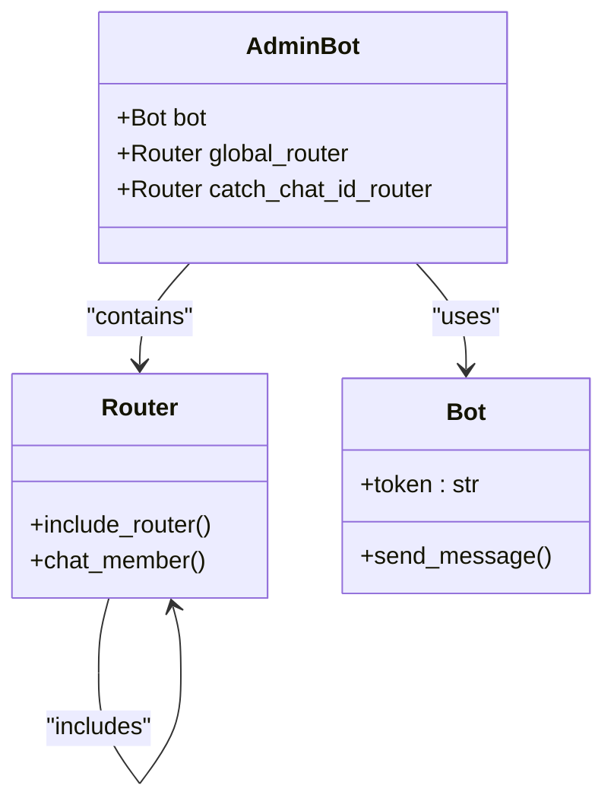
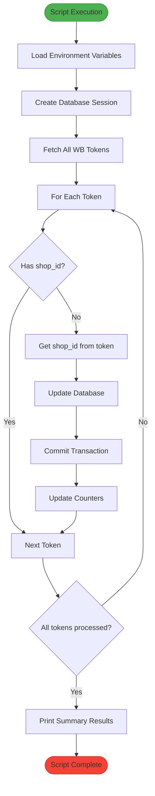
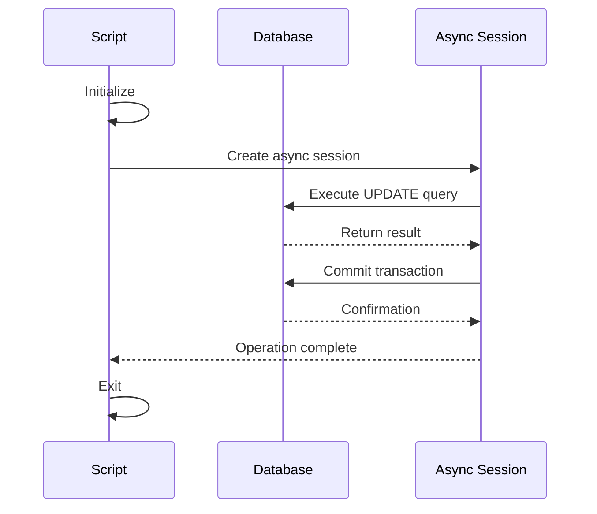
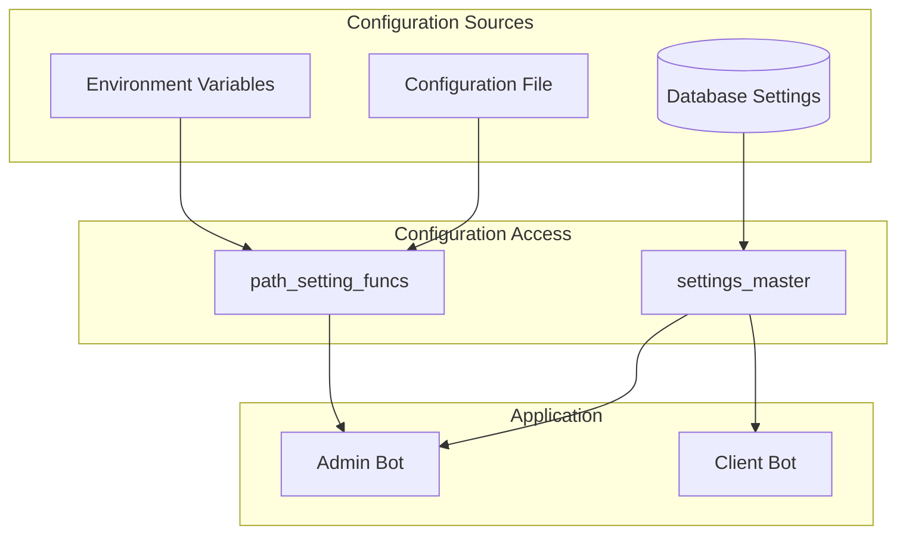
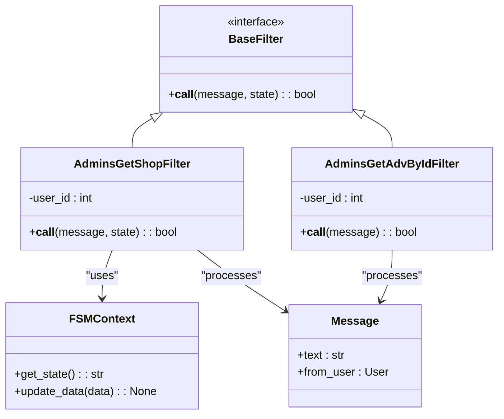
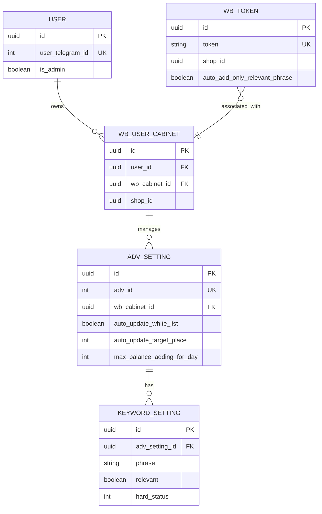
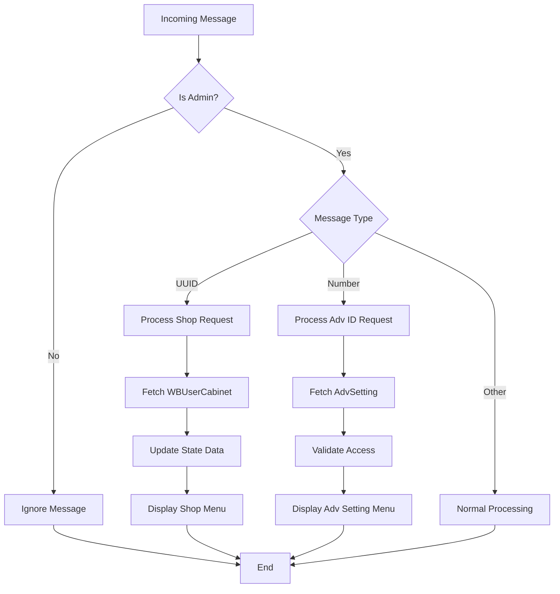
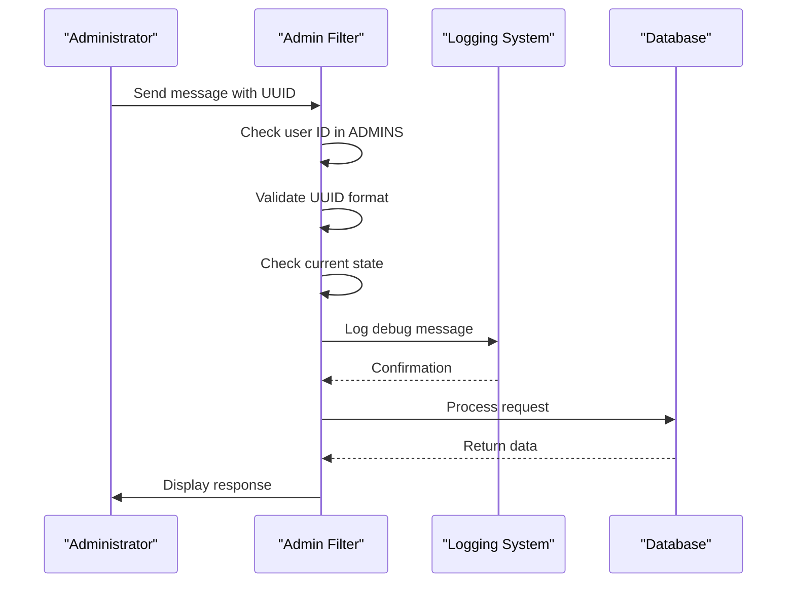

# System Administration

<cite>
**Referenced Files in This Document**   
- [global_router.py](file://app/admin_bot/global_router.py)
- [catch_chat_id.py](file://app/admin_bot/catch_chat_id.py)
- [bot_manager.py](file://app/admin_bot/bot_manager.py)
- [set_shop_id_for_all_wbtokens.py](file://scripts/set_shop_id_for_all_wbtokens.py)
- [set_relevant_if_white_phrase.py](file://scripts/set_relevant_if_white_phrase.py)
- [get_shop_for_admin.py](file://app/client_bot/user_interface/handlers/get_shop_for_admin.py)
- [base.py](file://app/client_bot/user_interface/message_templates/base.py)
</cite>

## Table of Contents
1. [Introduction](#introduction)
2. [Admin Interface Implementation](#admin-interface-implementation)
3. [Monitoring and Maintenance Scripts](#monitoring-and-maintenance-scripts)
4. [Configuration Management](#configuration-management)
5. [Administrative Control Interfaces](#administrative-control-interfaces)
6. [Domain Models for System Configuration](#domain-models-for-system-configuration)
7. [User Management and Bulk Operations](#user-management-and-bulk-operations)
8. [Common Issues and Solutions](#common-issues-and-solutions)
9. [Security and Audit Mechanisms](#security-and-audit-mechanisms)
10. [Performance Considerations](#performance-considerations)

## Introduction
The adv-bot platform provides comprehensive system administration capabilities through a combination of Telegram-based admin interfaces, maintenance scripts, and configuration management systems. The administration layer enables administrators to monitor system health, manage user accounts, perform bulk operations, and maintain system integrity. This document details the implementation of these administrative functions, focusing on the interaction between admin commands, system operations, and underlying domain models.

## Admin Interface Implementation

The admin interface is implemented as a Telegram bot that processes administrative commands through a routing system. The global router initializes the admin bot's command structure and includes specialized routers for handling specific administrative events.

**Diagram sources**
- [global_router.py](file://app/admin_bot/global_router.py#L1-L8)
- [bot_manager.py](file://app/admin_bot/bot_manager.py#L1-L8)

**Section sources**
- [global_router.py](file://app/admin_bot/global_router.py#L1-L8)
- [bot_manager.py](file://app/admin_bot/bot_manager.py#L1-L8)

## Monitoring and Maintenance Scripts

The platform includes maintenance scripts that perform critical system operations, particularly for data integrity and configuration updates. These scripts are designed to be run independently and address specific administrative needs.

### Shop ID Assignment Script
The `set_shop_id_for_all_wbtokens.py` script ensures all Wildberries tokens have their associated shop IDs properly configured. This maintenance task is crucial for linking advertising accounts to their respective shops.

**Diagram sources**
- [set_shop_id_for_all_wbtokens.py](file://scripts/set_shop_id_for_all_wbtokens.py#L1-L60)

**Section sources**
- [set_shop_id_for_all_wbtokens.py](file://scripts/set_shop_id_for_all_wbtokens.py#L1-L60)

### White Phrase Relevance Script
The `set_relevant_if_white_phrase.py` script updates the relevance status of keyword settings that are marked with a hard status of 2 (presumably white-listed phrases). This bulk operation ensures that approved phrases are properly flagged as relevant in the system.

**Diagram sources**
- [set_relevant_if_white_phrase.py](file://scripts/set_relevant_if_white_phrase.py#L1-L22)

**Section sources**
- [set_relevant_if_white_phrase.py](file://scripts/set_relevant_if_white_phrase.py#L1-L22)

## Configuration Management

Configuration management in the adv-bot platform is handled through a combination of environment variables, database-stored settings, and runtime configuration objects. The system uses a settings path configuration that allows for flexible deployment across different environments.

The admin bot retrieves its configuration through the `path_setting_funcs` module, which provides methods to locate and read configuration files. This approach enables centralized management of sensitive information like API tokens while maintaining separation between code and configuration.

**Diagram sources**
- [bot_manager.py](file://app/admin_bot/bot_manager.py#L1-L8)
- [settings/settings_master.py](file://app/settings/settings_master.py)

## Administrative Control Interfaces

The administrative control interfaces provide specialized filters and handlers that enable administrators to interact with the system through the Telegram bot. These interfaces include custom filters that validate administrative privileges and process specific types of administrative commands.

### Admin Filter Implementation
The `AdminsGetShopFilter` and `AdminsGetAdvByIdFilter` classes implement custom filtering logic to identify and process administrative commands. These filters check both the user's administrative status and the format of the message content to determine if it should be processed as an administrative command.

**Diagram sources**
- [get_shop_for_admin.py](file://app/client_bot/user_interface/handlers/get_shop_for_admin.py#L1-L138)

**Section sources**
- [get_shop_for_admin.py](file://app/client_bot/user_interface/handlers/get_shop_for_admin.py#L1-L138)

## Domain Models for System Configuration

The system's configuration is represented through several domain models that define the structure of advertising settings, user cabinets, and keyword configurations. These models are implemented as SQLAlchemy ORM classes and are used throughout the administration system.

Key domain models include:
- **AdvSetting**: Represents advertising campaign settings
- **WBToken**: Stores Wildberries API tokens with associated shop IDs
- **KeywordSetting**: Manages keyword configurations including relevance status
- **WBUserCabinet**: Links users to their Wildberries cabinets

The administration system interacts with these models through database sessions, allowing for CRUD operations on system configuration data. The models are designed to support both individual record operations and bulk updates.

**Diagram sources**
- [models.py](file://app/modules/common_slaves/wildberries/models.py)
- [get_shop_for_admin.py](file://app/client_bot/user_interface/handlers/get_shop_for_admin.py#L1-L138)

## User Management and Bulk Operations

User management in the adv-bot platform is primarily handled through administrative filters and database operations. Administrators can identify themselves through specific message patterns and gain access to privileged operations.

### User Identification Process
Administrators are identified by their Telegram user ID, which is checked against a list of authorized admin IDs stored in the `const` module. When an administrator sends a message containing a UUID (presumably a shop ID) or a numeric advertisement ID, the system validates their privileges and processes the request.

The bulk operations capability is demonstrated in the maintenance scripts, which can update multiple records in the database efficiently. These operations use asynchronous database sessions to process records without blocking the main application.

**Diagram sources**
- [get_shop_for_admin.py](file://app/client_bot/user_interface/handlers/get_shop_for_admin.py#L1-L138)

**Section sources**
- [get_shop_for_admin.py](file://app/client_bot/user_interface/handlers/get_shop_for_admin.py#L1-L138)

## Common Issues and Solutions

### Service Outages
Service outages can occur due to invalid Wildberries API tokens or database connectivity issues. The maintenance scripts include error handling for these scenarios:

- **Invalid Tokens**: The `set_shop_id_for_all_wbtokens.py` script catches `NotValidTokenError` exceptions and continues processing other tokens
- **Database Errors**: Database operations are wrapped in try-except blocks to prevent script termination on individual record errors

### Configuration Errors
Common configuration errors include missing shop IDs in WB tokens and incorrect relevance status for white-listed phrases. The platform provides specific scripts to address these issues:

- **Missing Shop IDs**: Run `set_shop_id_for_all_wbtokens.py` to populate shop IDs from tokens
- **Incorrect Relevance Status**: Run `set_relevant_if_white_phrase.py` to ensure white-listed phrases are marked as relevant

These maintenance scripts should be scheduled to run periodically to prevent configuration drift and ensure system integrity.

**Section sources**
- [set_shop_id_for_all_wbtokens.py](file://scripts/set_shop_id_for_all_wbtokens.py#L1-L60)
- [set_relevant_if_white_phrase.py](file://scripts/set_relevant_if_white_phrase.py#L1-L22)

## Security and Audit Mechanisms

The administration system implements several security mechanisms to protect against unauthorized access:

- **Admin ID Verification**: Only users with Telegram IDs in the `ADMINS` list can access administrative functions
- **Input Validation**: Message content is validated using regular expressions (UUID pattern) before processing
- **State Awareness**: The system checks the user's current state to avoid interfering with active workflows

Audit capabilities are implemented through logging statements that record administrative actions. The `logger.debug()` statements in the admin filters provide visibility into which messages are being processed as administrative commands and why others are being ignored.

**Diagram sources**
- [get_shop_for_admin.py](file://app/client_bot/user_interface/handlers/get_shop_for_admin.py#L1-L138)

## Performance Considerations

### Database Operations
Bulk operations should use efficient database queries to minimize load:

- Use `select()` statements with appropriate filters to retrieve only necessary data
- Process records in batches when possible to reduce memory usage
- Use asynchronous database sessions to avoid blocking other operations

### Script Optimization
Maintenance scripts can be optimized by:

- Adding progress indicators for long-running operations
- Implementing rate limiting when calling external APIs
- Using connection pooling for database operations

### Caching Strategies
The system can benefit from caching frequently accessed configuration data:

- Cache admin user IDs to avoid repeated database queries
- Cache shop ID mappings to reduce Wildberries API calls
- Implement TTL-based caching for configuration settings

These optimizations can significantly improve the responsiveness of administrative operations, especially when dealing with large datasets.

**Section sources**
- [set_shop_id_for_all_wbtokens.py](file://scripts/set_shop_id_for_all_wbtokens.py#L1-L60)
- [get_shop_for_admin.py](file://app/client_bot/user_interface/handlers/get_shop_for_admin.py#L1-L138)