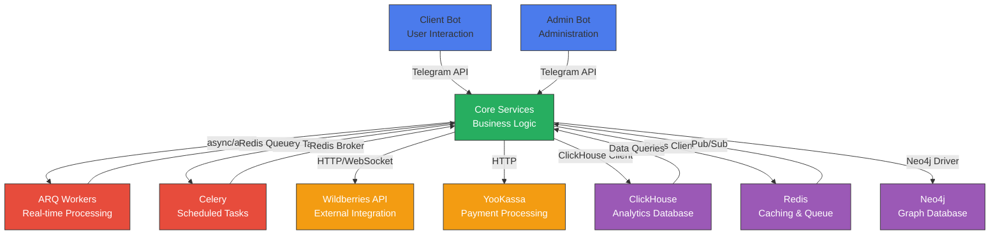
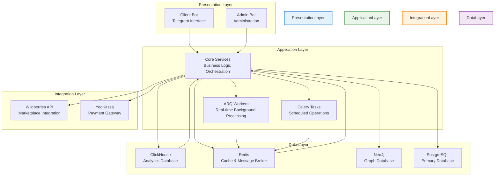
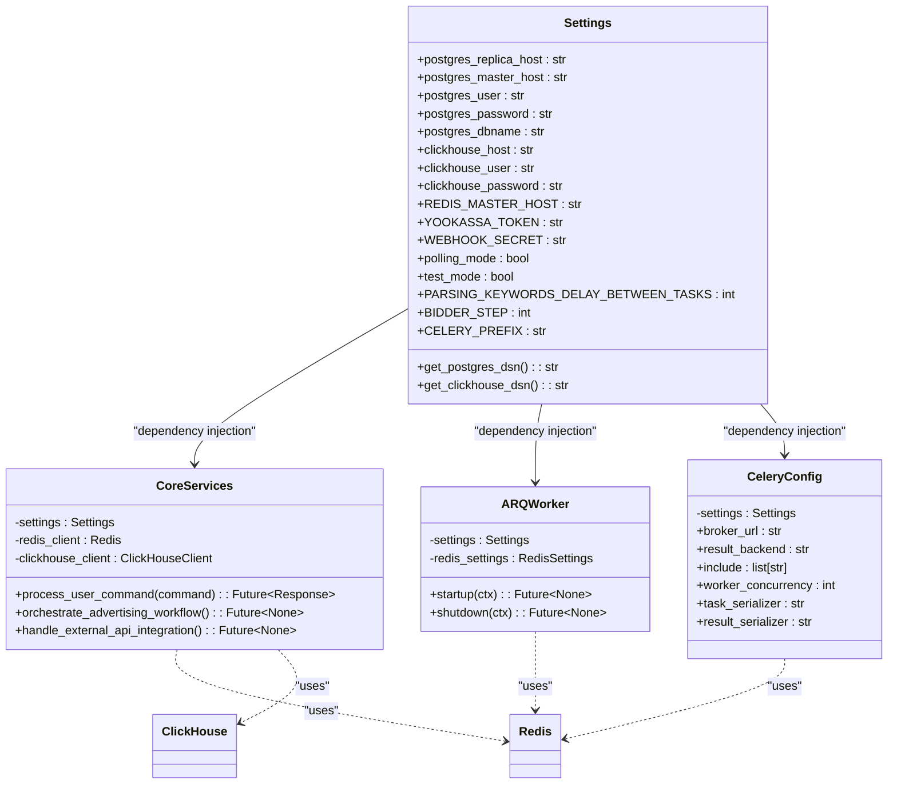

# Component Diagram

<cite>
**Referenced Files in This Document**   
- [client_bot_run.py](file://client_bot_run.py)
- [app/admin_bot/run.py](file://app/admin_bot/run.py)
- [app/arq_workers/workers.py](file://app/arq_workers/workers.py)
- [celeryconfig.py](file://celeryconfig.py)
- [app/settings/settings_master.py](file://app/settings/settings_master.py)
- [app/core/wb_api/base.py](file://app/core/wb_api/base.py)
- [app/modules/wb_adv_updater/bidder.py](file://app/modules/wb_adv_updater/bidder.py)
- [app/modules/shop_runner/service_manager/manager.py](file://app/modules/shop_runner/service_manager/manager.py)
- [app/modules/white_list_updater/backend/white_list_updater.py](file://app/modules/white_list_updater/backend/white_list_updater.py)
- [app/utils/redis_manager/exc.py](file://app/utils/redis_manager/exc.py)
- [app/utils/click_house/client.py](file://app/utils/click_house/client.py)
- [app/core/redis_manager/redis_client.py](file://app/core/redis_manager/redis_client.py)
- [app/modules/common_slaves/wildberries/ABC_WB_API.py](file://app/modules/common_slaves/wildberries/ABC_WB_API.py)
</cite>

## Table of Contents
1. [Introduction](#introduction)
2. [Component Overview](#component-overview)
3. [Component Responsibilities](#component-responsibilities)
4. [Component Interactions](#component-interactions)
5. [Architecture Diagram](#architecture-diagram)
6. [Design Patterns](#design-patterns)
7. [Scalability and Fault Tolerance](#scalability-and-fault-tolerance)
8. [Configuration Management](#configuration-management)
9. [Conclusion](#conclusion)

## Introduction
The adv-bot application is a sophisticated Telegram-based system designed to automate and optimize advertising campaigns on the Wildberries marketplace. This document provides a comprehensive architectural overview of the system's component diagram, detailing the high-level components, their responsibilities, interactions, and design patterns. The system integrates multiple technologies including Telegram bots, ARQ for real-time background processing, Celery for scheduled tasks, and various external services such as Wildberries API, YooKassa, ClickHouse, Redis, and Neo4j. The architecture is designed for scalability, fault tolerance, and maintainability through the use of asynchronous communication, dependency injection, and established design patterns.

## Component Overview
The adv-bot application consists of several key components that work together to provide a comprehensive advertising management solution. These components are organized into distinct layers and services, each with specific responsibilities and interfaces. The system is built on a microservices-like architecture within a monolithic codebase, with clear separation of concerns between different functional areas. The main components include Client Bot for user interaction, Admin Bot for administrative functions, ARQ Workers for real-time background processing, Celery Tasks for scheduled operations, Core Services for business logic orchestration, and various External Integrations for data persistence and third-party services.

**Section sources**
- [client_bot_run.py](file://client_bot_run.py#L0-L155)
- [app/admin_bot/run.py](file://app/admin_bot/run.py#L0-L30)
- [app/arq_workers/workers.py](file://app/arq_workers/workers.py#L0-L49)
- [celeryconfig.py](file://celeryconfig.py#L0-L37)

## Component Responsibilities
Each component in the adv-bot system has well-defined responsibilities that contribute to the overall functionality of the application. The Client Bot handles all user interactions through the Telegram interface, providing a conversational experience for managing advertising campaigns. The Admin Bot provides administrative capabilities and monitoring functions. ARQ Workers handle real-time background processing tasks that require immediate execution, such as complex ad creation. Celery Tasks manage scheduled operations like periodic data updates and maintenance jobs. Core Services orchestrate business logic and coordinate between different components. External Integrations provide connectivity to third-party services and data storage systems, including Wildberries API for marketplace operations, YooKassa for payment processing, ClickHouse for analytical data storage, Redis for caching and message queuing, and Neo4j for graph-based data relationships.

**Section sources**
- [client_bot_run.py](file://client_bot_run.py#L0-L155)
- [app/arq_workers/workers.py](file://app/arq_workers/workers.py#L0-L49)
- [celeryconfig.py](file://celeryconfig.py#L0-L37)
- [app/modules/wb_adv_updater/bidder.py](file://app/modules/wb_adv_updater/bidder.py#L0-L97)
- [app/modules/shop_runner/service_manager/manager.py](file://app/modules/shop_runner/service_manager/manager.py#L36-L77)

## Component Interactions
The components in the adv-bot system interact through well-defined interfaces using various communication patterns. Internal communication between components primarily uses async/await patterns for efficient resource utilization and non-blocking operations. The system leverages Python's asyncio library to handle concurrent operations without blocking the event loop. External API interactions with services like Wildberries API use HTTP/WebSocket protocols with appropriate authentication and error handling. The Client Bot communicates with Core Services through a dispatcher pattern, routing user commands to appropriate handlers. ARQ Workers and Celery Tasks interact with Core Services through message queues, allowing for decoupled and scalable background processing. Data flows between components are carefully managed to ensure consistency and reliability, with appropriate caching strategies implemented using Redis to reduce latency and database load.

**Diagram sources**
- [client_bot_run.py](file://client_bot_run.py#L0-L155)
- [app/arq_workers/workers.py](file://app/arq_workers/workers.py#L0-L49)
- [celeryconfig.py](file://celeryconfig.py#L0-L37)
- [app/core/wb_api/base.py](file://app/core/wb_api/base.py#L0-L112)

## Architecture Diagram
The following component diagram illustrates the high-level architecture of the adv-bot application, showing the main components, their boundaries, interfaces, and data flow directions. The diagram highlights how the system is organized into distinct layers with clear responsibilities and communication patterns.

**Diagram sources**
- [client_bot_run.py](file://client_bot_run.py#L0-L155)
- [app/arq_workers/workers.py](file://app/arq_workers/workers.py#L0-L49)
- [celeryconfig.py](file://celeryconfig.py#L0-L37)
- [app/settings/settings_master.py](file://app/settings/settings_master.py#L0-L375)
- [app/core/wb_api/base.py](file://app/core/wb_api/base.py#L0-L112)

## Design Patterns
The adv-bot application employs several design patterns to enhance code maintainability, flexibility, and testability. The factory pattern is implemented in the wb_api module to instantiate different API clients based on configuration and requirements. This allows the system to create appropriate API client instances without exposing the instantiation logic to the client code. The strategy pattern is used in the wb_adv_updater component to enable pluggable bidding algorithms, allowing different bidding strategies to be implemented and selected at runtime based on campaign requirements. Dependency injection is extensively used through the settings.py module, which decouples configuration from implementation and allows for easy configuration management across different environments. The system also employs the repository pattern for data access, abstracting the database operations and providing a clean interface for data manipulation. Additionally, the mediator pattern is used in the Core Services to coordinate interactions between different components, reducing direct dependencies and improving modularity.

**Section sources**
- [app/core/wb_api/base.py](file://app/core/wb_api/base.py#L0-L112)
- [app/modules/wb_adv_updater/bidder.py](file://app/modules/wb_adv_updater/bidder.py#L0-L97)
- [app/modules/shop_runner/service_manager/manager.py](file://app/modules/shop_runner/service_manager/manager.py#L36-L77)
- [app/settings/settings_master.py](file://app/settings/settings_master.py#L0-L375)

## Scalability and Fault Tolerance
The adv-bot application is designed with scalability and fault tolerance as key considerations. The system can scale horizontally by adding more worker instances for ARQ and Celery tasks, allowing it to handle increased loads during peak periods. The use of message queues (Redis) for background processing provides resilience against temporary failures, as tasks can be retried automatically when workers become available. The system implements comprehensive error handling and recovery mechanisms, with logging and monitoring integrated throughout the codebase. Critical operations are designed to be idempotent, allowing them to be safely retried without causing unintended side effects. The architecture supports graceful degradation, where non-essential features can be temporarily disabled to maintain core functionality during periods of high load or partial system failures. Health checks are implemented for all critical components, allowing monitoring systems to detect and respond to issues proactively. The system also includes circuit breaker patterns to prevent cascading failures when external services become unavailable.

**Section sources**
- [app/arq_workers/workers.py](file://app/arq_workers/workers.py#L0-L49)
- [celeryconfig.py](file://celeryconfig.py#L0-L37)
- [app/modules/wb_adv_updater/bidder.py](file://app/modules/wb_adv_updater/bidder.py#L0-L97)
- [app/modules/white_list_updater/backend/white_list_updater.py](file://app/modules/white_list_updater/backend/white_list_updater.py#L24-L42)

## Configuration Management
Configuration management in the adv-bot application is centralized through the settings.py module, which provides a clean separation between configuration and implementation. The Settings class uses environment variables to store configuration values, allowing for easy configuration across different environments (development, staging, production) without code changes. The property-based approach to configuration access ensures that values are loaded on-demand and can be easily overridden for testing purposes. Sensitive information such as API tokens and database credentials are stored in environment variables, enhancing security. The configuration system supports type conversion and default values, reducing the risk of configuration errors. This approach to dependency injection through settings decouples the configuration from the implementation, making the code more testable and maintainable. The system also supports configuration validation, with appropriate error handling for missing or invalid configuration values.

**Diagram sources**
- [app/settings/settings_master.py](file://app/settings/settings_master.py#L0-L375)
- [client_bot_run.py](file://client_bot_run.py#L0-L155)
- [app/arq_workers/workers.py](file://app/arq_workers/workers.py#L0-L49)
- [celeryconfig.py](file://celeryconfig.py#L0-L37)

## Conclusion
The adv-bot application demonstrates a well-architected system with clear component boundaries, well-defined responsibilities, and robust interaction patterns. The architecture effectively balances the need for real-time responsiveness with scheduled background processing, leveraging appropriate technologies for each concern. The use of design patterns such as factory, strategy, and dependency injection enhances the system's flexibility and maintainability. The component diagram illustrates how the system integrates various technologies to provide a comprehensive solution for Wildberries advertising management. The architecture supports scalability and fault tolerance through message queuing, horizontal scaling, and comprehensive error handling. Configuration management through dependency injection provides a clean separation between configuration and implementation, making the system adaptable to different environments. Overall, the architecture represents a solid foundation for a complex, mission-critical application with potential for further evolution and enhancement.