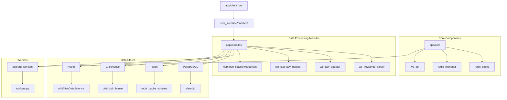
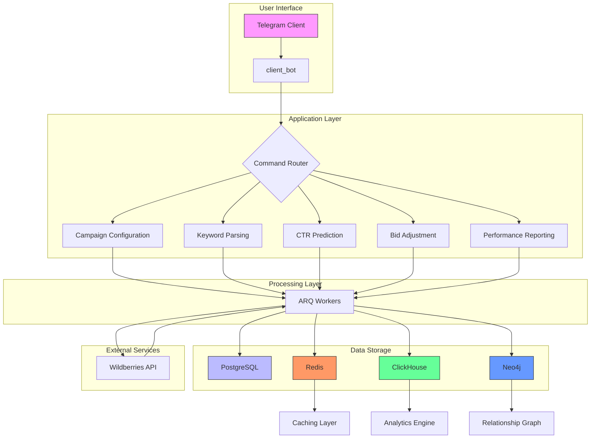
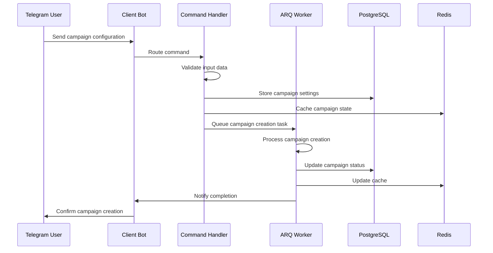
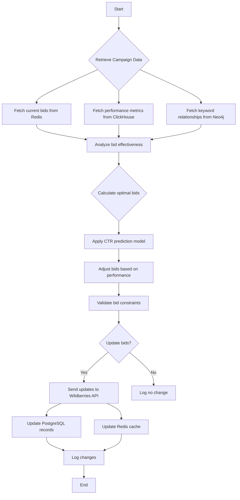
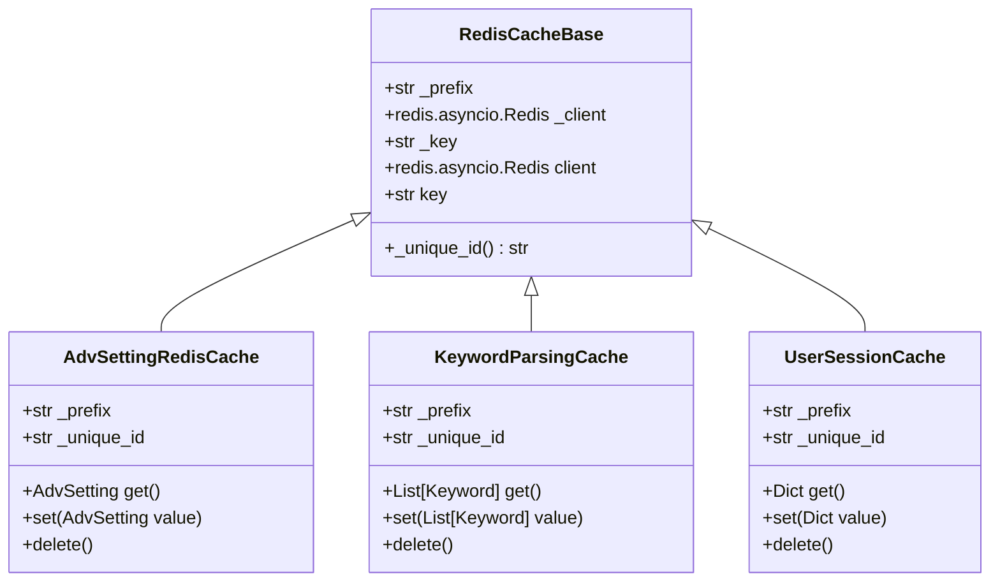
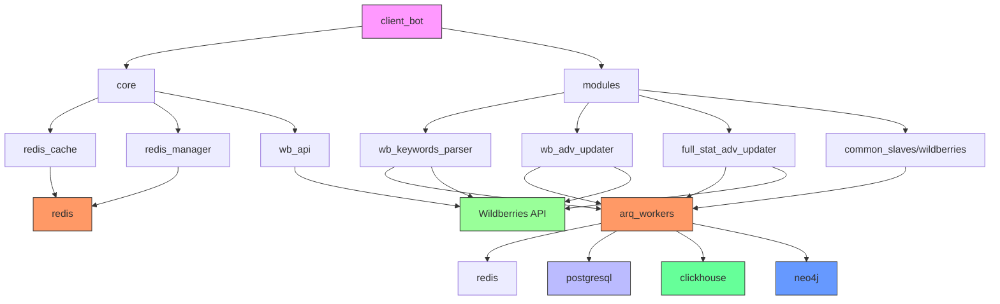

# Data Flow

<cite>
**Referenced Files in This Document**   
- [app/core/redis_cache/redis_cache_base.py](file://app/core/redis_cache/redis_cache_base.py)
- [app/core/redis_manager/base_redis_manager.py](file://app/core/redis_manager/base_redis_manager.py)
- [app/arq_workers/workers.py](file://app/arq_workers/workers.py)
- [app/modules/common_slaves/wildberries/api/api.py](file://app/modules/common_slaves/wildberries/api/api.py)
- [app/utils/click_house/client.py](file://app/utils/click_house/client.py)
- [app/utils/NeoDataScience/driver.py](file://app/utils/NeoDataScience/driver.py)
- [app/modules/wb_keywords_parser/parser.py](file://app/modules/wb_keywords_parser/wb_parser/parser.py)
- [app/modules/wb_adv_updater/bidder.py](file://app/modules/wb_adv_updater/bidder.py)
- [app/modules/wb_adv_updater/ML.py](file://app/modules/wb_adv_updater/ML.py)
- [app/client_bot/user_interface/handlers/adv_setting.py](file://app/client_bot/user_interface/handlers/adv_setting.py)
- [app/modules/full_stat_adv_updater/main.py](file://app/modules/full_stat_adv_updater/main.py)
</cite>

## Table of Contents
1. [Introduction](#introduction)
2. [Project Structure](#project-structure)
3. [Core Components](#core-components)
4. [Architecture Overview](#architecture-overview)
5. [Detailed Component Analysis](#detailed-component-analysis)
6. [Dependency Analysis](#dependency-analysis)
7. [Performance Considerations](#performance-considerations)
8. [Troubleshooting Guide](#troubleshooting-guide)
9. [Conclusion](#conclusion)

## Introduction
The adv-bot system is a comprehensive advertising management platform designed to optimize Wildberries marketplace advertising campaigns through intelligent data processing and machine learning. This document details the complete data flow lifecycle within the system, from user input through processing, storage, and output. The architecture integrates multiple data stores including PostgreSQL for persistent storage, Redis for caching and state management, ClickHouse for analytics, and Neo4j for keyword relationship modeling. The system employs an event-driven architecture with ARQ workers for asynchronous processing of long-running tasks such as keyword parsing and model updates. The data flow encompasses key scenarios including campaign configuration, keyword parsing from Wildberries search results, CTR prediction model execution, bid adjustment workflows, and performance reporting, with comprehensive data transformation, validation, and enrichment at each stage.

## Project Structure

**Diagram sources**
- [app/core](file://app/core)
- [app/modules](file://app/modules)
- [app/arq_workers](file://app/arq_workers)
- [app/client_bot](file://app/client_bot)

**Section sources**
- [app/core](file://app/core)
- [app/modules](file://app/modules)
- [app/arq_workers](file://app/arq_workers)
- [app/client_bot](file://app/client_bot)

## Core Components

The adv-bot system's data flow is built around several core components that handle different aspects of advertising campaign management. The system processes user commands from the Telegram interface, extracts and analyzes keyword data from Wildberries search results, executes CTR prediction models, manages bid adjustments, and generates performance reports. Key components include the Redis cache system for state management, ARQ workers for asynchronous processing, Wildberries API integration for data retrieval, ClickHouse for analytics storage, and Neo4j for modeling keyword relationships. The system uses PostgreSQL as its primary persistent storage with Alembic for database migrations, and implements comprehensive caching strategies to optimize performance.

**Section sources**
- [app/core/redis_cache/redis_cache_base.py](file://app/core/redis_cache/redis_cache_base.py)
- [app/arq_workers/workers.py](file://app/arq_workers/workers.py)
- [app/modules/common_slaves/wildberries/api/api.py](file://app/modules/common_slaves/wildberries/api/api.py)
- [app/utils/click_house/client.py](file://app/utils/click_house/client.py)
- [app/utils/NeoDataScience/driver.py](file://app/utils/NeoDataScience/driver.py)

## Architecture Overview

**Diagram sources**
- [app/client_bot](file://app/client_bot)
- [app/arq_workers/workers.py](file://app/arq_workers/workers.py)
- [app/modules](file://app/modules)
- [app/utils](file://app/utils)

## Detailed Component Analysis

### Data Flow Lifecycle

The data flow in the adv-bot system follows a comprehensive lifecycle from user input to processed output. When a user interacts with the Telegram bot, their command is received by the client_bot module, which routes it to the appropriate handler based on the command type. The system then validates the input data and transforms it into a format suitable for processing. For campaign configuration commands, the data is stored in PostgreSQL via SQLAlchemy models, with relevant state information cached in Redis for quick access. Keyword parsing requests trigger asynchronous workers that retrieve search results from the Wildberries API, extract relevant keywords, and store them in both PostgreSQL and Neo4j for relationship analysis. CTR prediction models are executed in ARQ workers that retrieve historical performance data from ClickHouse, apply machine learning algorithms, and store predictions in Redis for immediate access. Bid adjustment workflows analyze current performance against targets, calculate optimal bid values, and update campaigns through the Wildberries API, with all changes logged in PostgreSQL. Performance reports aggregate data from multiple sources, including real-time metrics from Redis, historical data from ClickHouse, and relationship insights from Neo4j, presenting a comprehensive view of campaign effectiveness.

**Section sources**
- [app/client_bot/user_interface/handlers](file://app/client_bot/user_interface/handlers)
- [app/modules/wb_keywords_parser](file://app/modules/wb_keywords_parser)
- [app/modules/wb_adv_updater](file://app/modules/wb_adv_updater)
- [app/modules/full_stat_adv_updater](file://app/modules/full_stat_adv_updater)

#### Campaign Creation Flow

**Diagram sources**
- [app/client_bot/user_interface/handlers/adv_setting.py](file://app/client_bot/user_interface/handlers/adv_setting.py)
- [app/modules/wb_adv_updater/bidder.py](file://app/modules/wb_adv_updater/bidder.py)
- [app/arq_workers/workers.py](file://app/arq_workers/workers.py)

#### Bid Optimization Workflow

**Diagram sources**
- [app/modules/wb_adv_updater/bidder.py](file://app/modules/wb_adv_updater/bidder.py)
- [app/modules/wb_adv_updater/ML.py](file://app/modules/wb_adv_updater/ML.py)
- [app/modules/common_slaves/wildberries/api/api.py](file://app/modules/common_slaves/wildberries/api/api.py)

### Redis Cache System

The Redis cache system in adv-bot serves as a critical component for state management and performance optimization. The system implements a hierarchical caching strategy with different cache types for various data categories. The base RedisCacheBase class provides a foundation for all cache implementations, defining common patterns for key generation, data serialization, and expiration policies. Cache prefixes are used to organize data by functional area, with separate namespaces for campaign settings, keyword data, user sessions, and temporary processing results. The system employs time-based expiration for volatile data and event-driven invalidation for related data updates. For campaign configuration data, the system caches both the complete settings object and individual parameters to support both bulk operations and targeted updates. Keyword parsing results are cached with sliding expiration to ensure freshness while maintaining performance. The cache system integrates with the ARQ worker framework, allowing workers to store intermediate processing results and resume operations after failures. Cache consistency is maintained through a combination of write-through patterns for critical data and periodic reconciliation with the PostgreSQL database.

**Diagram sources**
- [app/core/redis_cache/redis_cache_base.py](file://app/core/redis_cache/redis_cache_base.py)
- [app/core/redis_cache/mixins/main_objects_mixins/adv_setting_redis_cache.py](file://app/core/redis_cache/mixins/main_objects_mixins/adv_setting_redis_cache.py)

### Data Storage and Retrieval

The adv-bot system utilizes a multi-database architecture to optimize data storage and retrieval for different use cases. PostgreSQL serves as the primary persistent store for structured data, including campaign configurations, user accounts, and transactional records. The system uses Alembic for database migrations, with versioned migration scripts that track schema changes over time. ClickHouse is employed for analytics and time-series data, providing high-performance aggregation of advertising metrics across large datasets. The system writes raw performance data to ClickHouse in batches, then generates pre-aggregated views for common reporting scenarios. Neo4j models the complex relationships between keywords, products, and categories, enabling sophisticated recommendation algorithms and semantic analysis. Redis provides low-latency access to frequently used data and serves as a message broker for the ARQ worker system. Data consistency across these stores is maintained through a combination of transactional integrity in PostgreSQL, event sourcing patterns, and periodic reconciliation processes. The system implements a data access layer that abstracts the underlying storage mechanisms, providing a unified interface for data operations regardless of the target store.

**Section sources**
- [app/utils/click_house/client.py](file://app/utils/click_house/client.py)
- [app/utils/NeoDataScience/driver.py](file://app/utils/NeoDataScience/driver.py)
- [app/core/db](file://app/core/db)
- [alembic](file://alembic)

## Dependency Analysis

**Diagram sources**
- [app/client_bot](file://app/client_bot)
- [app/core](file://app/core)
- [app/modules](file://app/modules)
- [app/arq_workers](file://app/arq_workers)
- [app/utils](file://app/utils)

## Performance Considerations

The adv-bot system implements several performance optimization strategies to handle high-volume data processing efficiently. The primary optimization is the use of Redis caching to reduce database load and improve response times for frequently accessed data. The system employs a multi-level caching strategy with different expiration policies based on data volatility and access patterns. For high-frequency operations like bid adjustments, the system caches both input parameters and calculation results to minimize redundant processing. The ARQ worker framework enables parallel processing of independent tasks, with configurable worker pools to balance resource utilization and throughput. Data retrieval from external APIs is optimized through batching and pagination, reducing the number of network requests required for large datasets. The system implements connection pooling for database access, reusing connections to minimize overhead. For analytics queries on ClickHouse, the system leverages pre-aggregated materialized views and appropriate indexing strategies to ensure fast query performance. The Neo4j graph database is optimized with appropriate relationship indexing and query planning to support efficient traversal of keyword relationships. Error handling and retry mechanisms are designed to be non-blocking, allowing the system to continue processing other tasks while handling transient failures.

**Section sources**
- [app/core/redis_cache](file://app/core/redis_cache)
- [app/arq_workers/workers.py](file://app/arq_workers/workers.py)
- [app/utils/click_house/client.py](file://app/utils/click_house/client.py)
- [app/utils/NeoDataScience/driver.py](file://app/utils/NeoDataScience/driver.py)

## Troubleshooting Guide

Common issues in the adv-bot data flow typically relate to connectivity, data consistency, or processing failures. Connectivity issues with Redis may manifest as slow response times or failed cache operations; these can be diagnosed by checking Redis server status and network connectivity. PostgreSQL connection problems often result from connection pool exhaustion or authentication failures; monitoring connection counts and reviewing authentication credentials can resolve these issues. ClickHouse query performance problems may indicate suboptimal indexing or insufficient resources; reviewing query execution plans and system resource utilization can identify bottlenecks. Neo4j graph traversal issues may arise from missing indexes or data inconsistencies; verifying index existence and running data validation checks can address these problems. ARQ worker failures may occur due to task timeouts or resource constraints; adjusting worker configuration and monitoring system resources can prevent these issues. Data consistency problems between stores may require running reconciliation processes or verifying event processing pipelines. Monitoring logs from all components and using distributed tracing can help identify the root cause of complex issues spanning multiple system components.

**Section sources**
- [app/core/redis_manager/base_redis_manager.py](file://app/core/redis_manager/base_redis_manager.py)
- [app/utils/click_house/client.py](file://app/utils/click_house/client.py)
- [app/utils/NeoDataScience/driver.py](file://app/utils/NeoDataScience/driver.py)
- [app/arq_workers/workers.py](file://app/arq_workers/workers.py)

## Conclusion

The adv-bot system implements a sophisticated data flow architecture that integrates multiple data stores and processing paradigms to optimize Wildberries advertising campaigns. The system effectively leverages PostgreSQL for persistent storage, Redis for caching and state management, ClickHouse for analytics, and Neo4j for relationship modeling, creating a comprehensive platform for advertising optimization. The event-driven architecture with ARQ workers enables efficient processing of long-running tasks while maintaining responsiveness to user interactions. The system's modular design allows for independent scaling of different components based on workload characteristics. Data consistency is maintained through careful coordination between storage systems and robust error handling. Performance is optimized through strategic caching, connection pooling, and parallel processing. The architecture provides a solid foundation for future enhancements, including additional machine learning models, expanded analytics capabilities, and integration with additional advertising platforms.