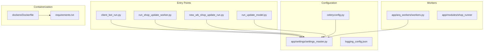
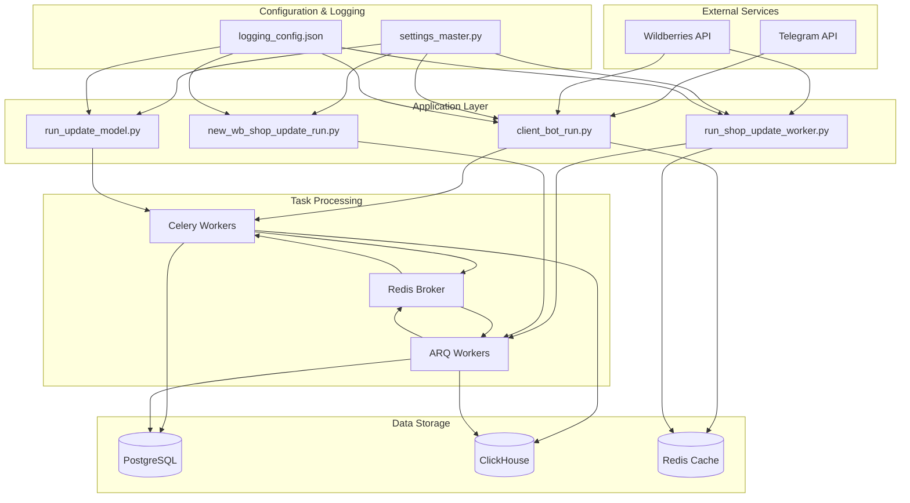
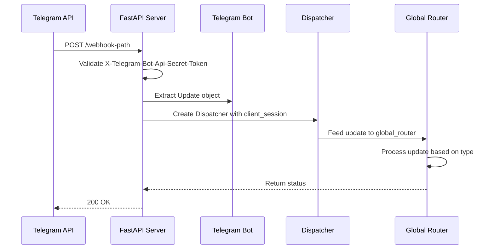
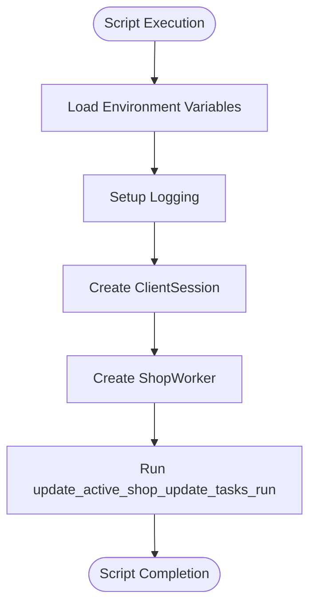
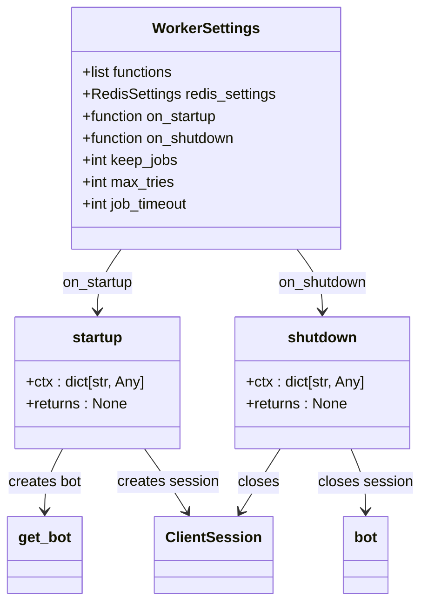
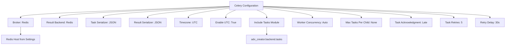
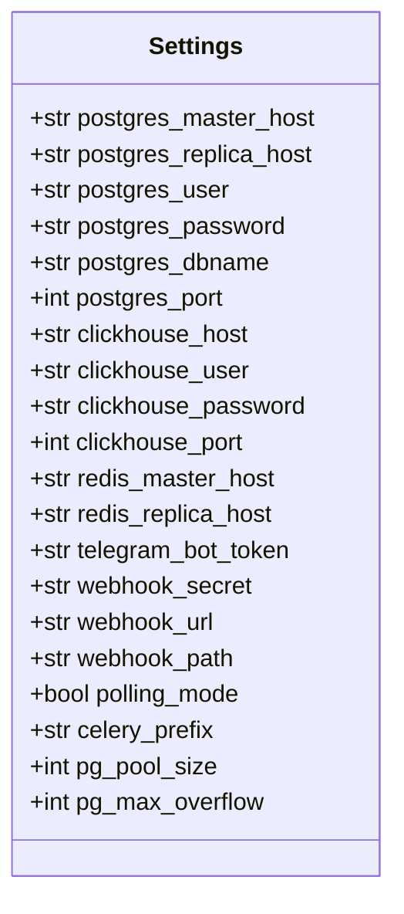
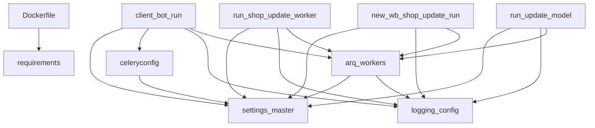

# Deployment Architecture

<cite>
**Referenced Files in This Document**   
- [client_bot_run.py](file://client_bot_run.py)
- [run_shop_update_worker.py](file://run_shop_update_worker.py)
- [app/arq_workers/workers.py](file://app/arq_workers/workers.py)
- [celeryconfig.py](file://celeryconfig.py)
- [logging_config.json](file://logging_config.json)
- [app/settings/settings_master.py](file://app/settings/settings_master.py)
- [dockers/Dockerfile](file://dockers/Dockerfile)
- [requirements.txt](file://requirements.txt)
- [new_wb_shop_update_run.py](file://new_wb_shop_update_run.py)
- [run_update_model.py](file://run_update_model.py)
</cite>

## Table of Contents
1. [Introduction](#introduction)
2. [Project Structure](#project-structure)
3. [Core Components](#core-components)
4. [Architecture Overview](#architecture-overview)
5. [Detailed Component Analysis](#detailed-component-analysis)
6. [Dependency Analysis](#dependency-analysis)
7. [Performance Considerations](#performance-considerations)
8. [Troubleshooting Guide](#troubleshooting-guide)
9. [Conclusion](#conclusion)

## Introduction
The adv-bot application is a sophisticated system designed to manage advertising campaigns on the Wildberries platform through automated Telegram interactions, shop synchronization, and scheduled background tasks. This document details the deployment architecture of the application, focusing on its containerized services, task queuing mechanisms, database clusters, and configuration management. The system leverages Docker for containerization, Celery and ARQ for task processing, and multiple databases including PostgreSQL, ClickHouse, and Redis for data storage and caching. The architecture supports thousands of concurrent Wildberries accounts through distributed workers and load balancing, with comprehensive logging and monitoring in place.

## Project Structure

**Diagram sources**
- [client_bot_run.py](file://client_bot_run.py)
- [run_shop_update_worker.py](file://run_shop_update_worker.py)
- [new_wb_shop_update_run.py](file://new_wb_shop_update_run.py)
- [run_update_model.py](file://run_update_model.py)
- [app/settings/settings_master.py](file://app/settings/settings_master.py)
- [celeryconfig.py](file://celeryconfig.py)
- [logging_config.json](file://logging_config.json)
- [app/arq_workers/workers.py](file://app/arq_workers/workers.py)
- [dockers/Dockerfile](file://dockers/Dockerfile)
- [requirements.txt](file://requirements.txt)

**Section sources**
- [client_bot_run.py](file://client_bot_run.py)
- [run_shop_update_worker.py](file://run_shop_update_worker.py)
- [new_wb_shop_update_run.py](file://new_wb_shop_update_run.py)
- [run_update_model.py](file://run_update_model.py)
- [app/settings/settings_master.py](file://app/settings/settings_master.py)
- [celeryconfig.py](file://celeryconfig.py)
- [logging_config.json](file://logging_config.json)
- [app/arq_workers/workers.py](file://app/arq_workers/workers.py)
- [dockers/Dockerfile](file://dockers/Dockerfile)
- [requirements.txt](file://requirements.txt)

## Core Components

The adv-bot application consists of multiple entry points that serve different purposes in the system. The `client_bot_run.py` script handles Telegram interactions, serving as the primary interface for users. The `run_shop_update_worker.py` script manages shop synchronization tasks, ensuring that shop data remains current. Additional scripts like `new_wb_shop_update_run.py` and `run_update_model.py` handle specialized background processes for shop updates and model updates respectively. These components work in concert with the configuration system defined in `settings_master.py`, which manages environment-specific settings across development, staging, and production environments.

**Section sources**
- [client_bot_run.py](file://client_bot_run.py)
- [run_shop_update_worker.py](file://run_shop_update_worker.py)
- [new_wb_shop_update_run.py](file://new_wb_shop_update_run.py)
- [run_update_model.py](file://run_update_model.py)
- [app/settings/settings_master.py](file://app/settings/settings_master.py)

## Architecture Overview

**Diagram sources**
- [client_bot_run.py](file://client_bot_run.py)
- [run_shop_update_worker.py](file://run_shop_update_worker.py)
- [new_wb_shop_update_run.py](file://new_wb_shop_update_run.py)
- [run_update_model.py](file://run_update_model.py)
- [app/arq_workers/workers.py](file://app/arq_workers/workers.py)
- [celeryconfig.py](file://celeryconfig.py)
- [app/settings/settings_master.py](file://app/settings/settings_master.py)
- [logging_config.json](file://logging_config.json)

## Detailed Component Analysis

### Client Bot Analysis

The `client_bot_run.py` script serves as the main entry point for Telegram interactions. It implements both webhook and polling modes for receiving Telegram updates, with the mode determined by the `POLLING_MODE` environment variable. In webhook mode, the application uses FastAPI to receive updates from Telegram, while in polling mode, it actively retrieves updates from the Telegram API. The script includes health check endpoints (`/health`, `/readiness`) and a webhook information endpoint for monitoring purposes.

**Diagram sources**
- [client_bot_run.py](file://client_bot_run.py#L1-L155)

**Section sources**
- [client_bot_run.py](file://client_bot_run.py#L1-L155)

### Shop Update Worker Analysis

The `run_shop_update_worker.py` script is responsible for updating active shop tasks. It initializes an asynchronous client session and creates a `ShopWorker` instance to manage the update process. This worker operates as a standalone script that can be executed independently, making it suitable for scheduling with cron or similar tools. The worker uses environment variables loaded via `dotenv` for configuration, ensuring separation of configuration from code.

**Diagram sources**
- [run_shop_update_worker.py](file://run_shop_update_worker.py#L1-L23)

**Section sources**
- [run_shop_update_worker.py](file://run_shop_update_worker.py#L1-L23)

### ARQ Workers Configuration

The ARQ worker configuration in `app/arq_workers/workers.py` defines a worker class with startup and shutdown hooks. During startup, the worker initializes a Telegram bot instance and an aiohttp client session, storing them in the context for use by tasks. The shutdown process properly closes these resources. The worker is configured to process tasks from a Redis broker, with settings for job retention, retry limits, and timeouts. The primary task handled by this worker is `create_complex_advs` from the adv_creator module.

**Diagram sources**
- [app/arq_workers/workers.py](file://app/arq_workers/workers.py#L1-L50)

**Section sources**
- [app/arq_workers/workers.py](file://app/arq_workers/workers.py#L1-L50)

### Celery Configuration Analysis

The `celeryconfig.py` file configures Celery to use Redis as both the message broker and result backend. The configuration includes settings for task serialization (JSON), timezone (UTC), and worker concurrency (auto-detect). It specifies that tasks from the `app.modules.adv_creator.backend.tasks` module should be included. The configuration also sets retry parameters, with tasks being retried up to 5 times with a 30-second delay between attempts. Tasks are acknowledged only after successful completion to prevent data loss.

**Diagram sources**
- [celeryconfig.py](file://celeryconfig.py#L1-L38)

**Section sources**
- [celeryconfig.py](file://celeryconfig.py#L1-L38)

### Settings Management

The `settings_master.py` file implements a comprehensive configuration system using environment variables. The `Settings` class provides properties for accessing various configuration values, with appropriate type conversion and default values. This includes database connection parameters for PostgreSQL and ClickHouse, Redis host information, Telegram bot credentials, and numerous application-specific settings. The configuration supports different environments through environment variables, allowing for seamless transitions between development, staging, and production.

**Diagram sources**
- [app/settings/settings_master.py](file://app/settings/settings_master.py#L1-L376)

**Section sources**
- [app/settings/settings_master.py](file://app/settings/settings_master.py#L1-L376)

## Dependency Analysis

**Diagram sources**
- [client_bot_run.py](file://client_bot_run.py)
- [run_shop_update_worker.py](file://run_shop_update_worker.py)
- [new_wb_shop_update_run.py](file://new_wb_shop_update_run.py)
- [run_update_model.py](file://run_update_model.py)
- [app/arq_workers/workers.py](file://app/arq_workers/workers.py)
- [celeryconfig.py](file://celeryconfig.py)
- [app/settings/settings_master.py](file://app/settings/settings_master.py)
- [logging_config.json](file://logging_config.json)
- [dockers/Dockerfile](file://dockers/Dockerfile)
- [requirements.txt](file://requirements.txt)

**Section sources**
- [client_bot_run.py](file://client_bot_run.py)
- [run_shop_update_worker.py](file://run_shop_update_worker.py)
- [new_wb_shop_update_run.py](file://new_wb_shop_update_run.py)
- [run_update_model.py](file://run_update_model.py)
- [app/arq_workers/workers.py](file://app/arq_workers/workers.py)
- [celeryconfig.py](file://celeryconfig.py)
- [app/settings/settings_master.py](file://app/settings/settings_master.py)
- [logging_config.json](file://logging_config.json)
- [dockers/Dockerfile](file://dockers/Dockerfile)
- [requirements.txt](file://requirements.txt)

## Performance Considerations

The adv-bot application is designed with performance and scalability in mind. The use of asynchronous programming with asyncio and aiohttp allows for efficient handling of I/O operations, particularly when interacting with external APIs like Telegram and Wildberries. The application leverages connection pooling for database access, with configurable pool sizes (PG_POOL_SIZE) and overflow limits (PG_MAX_OVERFLOW) to balance resource usage and performance.

For task processing, the system employs both Celery and ARQ, allowing different types of tasks to be handled by the most appropriate worker system. Celery is used for longer-running tasks with complex retry logic, while ARQ handles shorter, more frequent tasks with lower latency requirements. Redis serves as a shared cache and message broker, reducing database load and enabling efficient inter-process communication.

The configuration system allows for environment-specific tuning of performance parameters, such as the number of parallel parsing tasks (PARALLER_PARSE_TASKS) and maximum parsing parallel jobs (MAX_PARSING_PARALLEL_JOBS). These settings can be adjusted based on the available hardware resources and expected workload.

**Section sources**
- [app/settings/settings_master.py](file://app/settings/settings_master.py)
- [celeryconfig.py](file://celeryconfig.py)
- [client_bot_run.py](file://client_bot_run.py)

## Troubleshooting Guide

When troubleshooting issues with the adv-bot application, consider the following common scenarios:

1. **Telegram Webhook Issues**: Verify that the WEBHOOK_URL and WEBHOOK_PATH environment variables are correctly set and accessible from the internet. Check that the WEBHOOK_SECRET token matches between the application and Telegram.

2. **Database Connection Problems**: Ensure that the PostgreSQL and ClickHouse connection parameters (host, port, credentials) are correct. Verify network connectivity between the application and database servers.

3. **Redis Connectivity**: Confirm that the Redis master and replica hosts are reachable and that the Redis server is running. Check that the CELERY_PREFIX is correctly configured.

4. **Worker Failures**: Examine the logs for specific error messages. Common issues include missing environment variables, network timeouts, or authentication failures with external services.

5. **Performance Bottlenecks**: Monitor resource usage (CPU, memory, network) and adjust configuration parameters like PG_POOL_SIZE, MAX_THREAD_PARSER, and PARALLER_PARSE_TASKS accordingly.

6. **Task Processing Delays**: Check the Redis queue lengths and worker utilization. Consider scaling the number of worker instances if tasks are backing up.

**Section sources**
- [client_bot_run.py](file://client_bot_run.py)
- [app/settings/settings_master.py](file://app/settings/settings_master.py)
- [celeryconfig.py](file://celeryconfig.py)
- [logging_config.json](file://logging_config.json)

## Conclusion

The adv-bot application features a robust and scalable deployment architecture designed to handle the demands of managing advertising campaigns for thousands of Wildberries accounts. By leveraging containerization with Docker, asynchronous programming with asyncio, and distributed task processing with Celery and ARQ, the system achieves high performance and reliability. The comprehensive configuration system allows for seamless operation across different environments, while the detailed logging configuration enables effective monitoring and troubleshooting. The architecture's modular design, with clear separation of concerns between entry points, workers, and data storage, facilitates maintenance and future enhancements.