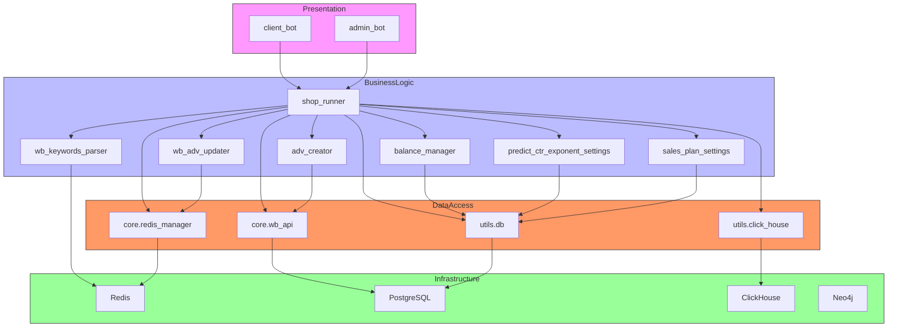
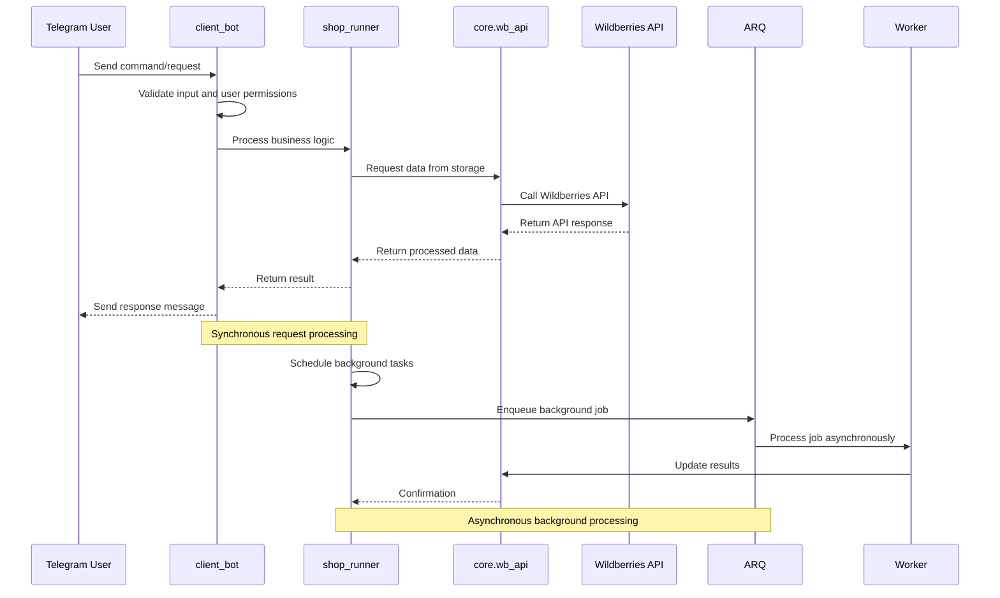
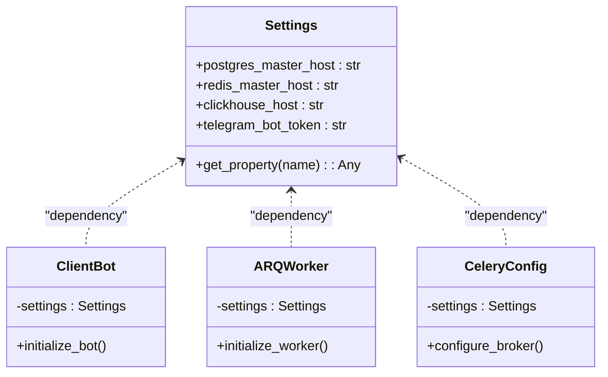
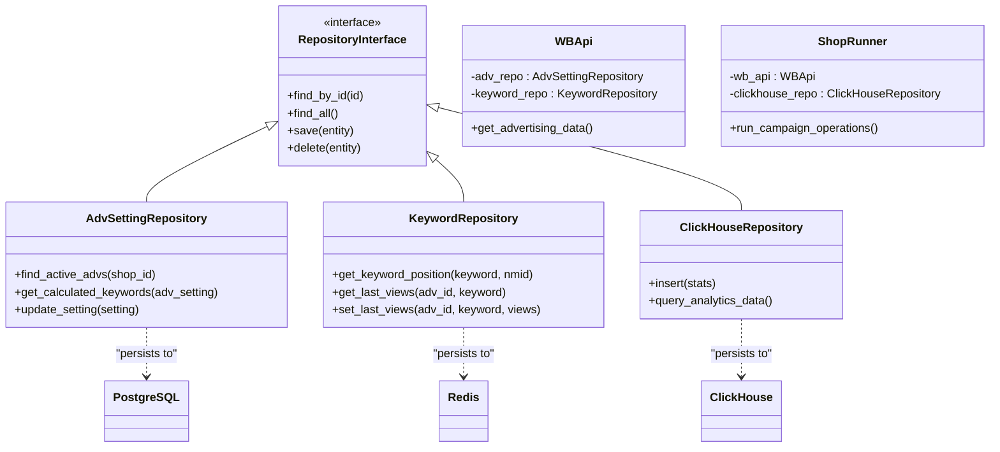
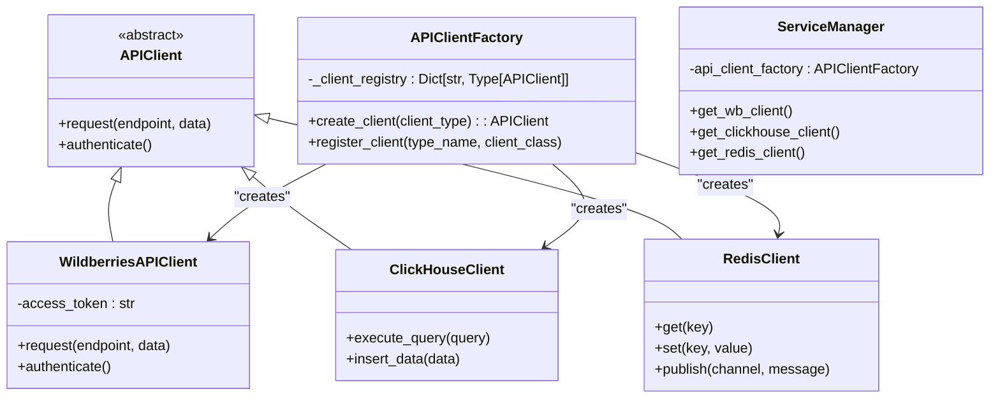
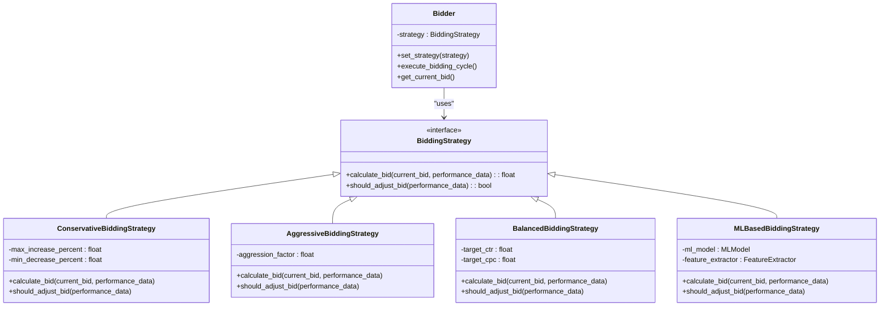
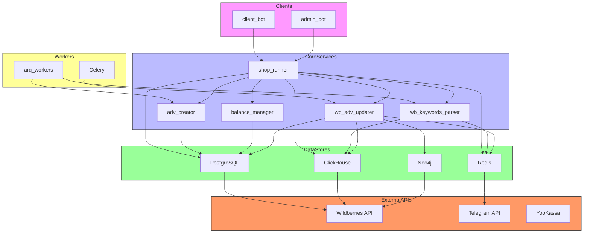
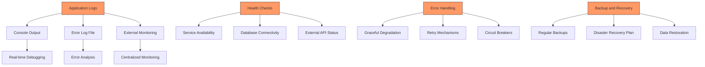

# System Architecture

<cite>
**Referenced Files in This Document**   
- [settings_master.py](file://app/settings/settings_master.py)
- [logging_config.json](file://logging_config.json)
- [celeryconfig.py](file://celeryconfig.py)
- [bot.py](file://app/client_bot/bot.py)
- [run.py](file://app/admin_bot/run.py)
- [workers.py](file://app/arq_workers/workers.py)
- [manager.py](file://app/modules/shop_runner/service_manager/manager.py)
- [parsing_keywords_from_wb.py](file://app/modules/shop_runner/service_manager/services/parsing_keywords_from_wb/__init__.py)
- [arq_redis_settings.py](file://app/arq_workers/arq_redis_settings.py)
</cite>

## Table of Contents
1. [Introduction](#introduction)
2. [Project Structure](#project-structure)
3. [Core Components](#core-components)
4. [Architecture Overview](#architecture-overview)
5. [Detailed Component Analysis](#detailed-component-analysis)
6. [Dependency Analysis](#dependency-analysis)
7. [Performance Considerations](#performance-considerations)
8. [Troubleshooting Guide](#troubleshooting-guide)
9. [Conclusion](#conclusion)

## Introduction
The adv-bot application is a sophisticated Telegram-based automation system designed to manage advertising campaigns on the Wildberries marketplace. The system follows a modular microservices architecture with clear separation of concerns between presentation (Telegram bots), business logic (core services and modules), and data access layers. This documentation provides a comprehensive overview of the system's architectural design, patterns, component interactions, and infrastructure requirements.

## Project Structure

The project follows a well-organized directory structure that reflects its modular architecture:

```mermaid
graph TD
A[adv-bot] --> B[app]
A --> C[alembic]
A --> D[dockers]
A --> E[models]
A --> F[python_modules]
A --> G[scripts]
A --> H[tests]
B --> B1[admin_bot]
B --> B2[arq_workers]
B --> B3[client_bot]
B --> B4[core]
B --> B5[modules]
B --> B6[settings]
B --> B7[utils]
B1 --> B1a[sender]
B1 --> B1b[bot_manager.py]
B1 --> B1c[run.py]
B2 --> B2a[arq_redis_settings.py]
B2 --> B2b[workers.py]
B3 --> B3a[middlewars]
B3 --> B3b[user_interface]
B3 --> B3c[bot.py]
B4 --> B4a[redis_cache]
B4 --> B4b[redis_manager]
B4 --> B4c[wb_api]
B5 --> B5a[adv_creator]
B5 --> B5b[balance_manager]
B5 --> B5c[shop_runner]
B5 --> B5d[wb_keywords_parser]
B5 --> B5e[wb_adv_updater]
C --> C1[versions]
C --> C2[versions_old]
C --> C3[env.py]
F --> F1[logger.py]
F --> F2[path_setting_funcs.py]
G --> G1[run_shop_update_worker.py]
G --> G2[run_keywords_parsing.py]
G --> G3[run_predict_ctr.py]
```



**Diagram sources**
- [app](file://app)
- [alembic](file://alembic)
- [dockers](file://dockers)

**Section sources**
- [app](file://app)
- [alembic](file://alembic)
- [scripts](file://scripts)

## Core Components

The adv-bot application consists of several core components that work together to provide comprehensive advertising campaign management for Wildberries:

- **client_bot**: The primary Telegram interface for end users, handling user interactions, commands, and providing campaign analytics
- **admin_bot**: Administrative interface for system management, monitoring, and control
- **arq_workers**: Background task processing using ARQ for CPU-intensive operations
- **shop_runner**: Core service manager that orchestrates campaign operations for individual shops
- **wb_keywords_parser**: Module responsible for parsing and analyzing keyword data from Wildberries
- **wb_adv_updater**: Service for updating advertising campaign parameters and settings
- **common_slaves**: Shared Wildberries API integration layer used across multiple modules

These components are organized in a modular fashion, with clear separation between presentation, business logic, and data access layers.

**Section sources**
- [app](file://app)
- [app/client_bot](file://app/client_bot)
- [app/admin_bot](file://app/admin_bot)
- [app/modules](file://app/modules)

## Architecture Overview

The adv-bot application follows a modular microservices architecture with three distinct layers:



**Diagram sources**
- [app/client_bot](file://app/client_bot)
- [app/admin_bot](file://app/admin_bot)
- [app/modules](file://app/modules)
- [app/core](file://app/core)
- [app/utils](file://app/utils)

The architecture implements a clear separation of concerns with the presentation layer (Telegram bots) communicating with the business logic layer (core services and modules), which in turn interacts with the data access layer to retrieve and persist data in various storage systems.

## Detailed Component Analysis

### Client-Server Interaction Analysis

The client-server interaction in the adv-bot application follows a typical request-response pattern with additional event-driven components:



**Diagram sources**
- [app/client_bot/bot.py](file://app/client_bot/bot.py)
- [app/modules/shop_runner/service_manager/manager.py](file://app/modules/shop_runner/service_manager/manager.py)
- [app/core/wb_api](file://app/core/wb_api)
- [app/arq_workers/workers.py](file://app/arq_workers/workers.py)

### Architectural Patterns

The adv-bot application employs several key architectural patterns to ensure maintainability, scalability, and flexibility:

#### Dependency Injection through Settings
The application uses a dependency injection pattern through the settings module, where configuration is centralized and injected into components as needed:



**Diagram sources**
- [app/settings/settings_master.py](file://app/settings/settings_master.py)
- [app/client_bot/bot.py](file://app/client_bot/bot.py)
- [app/arq_workers/workers.py](file://app/arq_workers/workers.py)
- [celeryconfig.py](file://celeryconfig.py)

#### Repository Pattern for Data Access
The application implements the repository pattern for data access, abstracting database operations behind service interfaces:



**Diagram sources**
- [app/modules/common_slaves/wildberries/models.py](file://app/modules/common_slaves/wildberries/models.py)
- [app/utils/redis_manager.py](file://app/utils/redis_manager.py)
- [app/utils/click_house/client.py](file://app/utils/click_house/client.py)
- [app/modules/shop_runner/service_manager/manager.py](file://app/modules/shop_runner/service_manager/manager.py)

#### Factory Pattern for API Clients
The application uses a factory pattern to create appropriate API clients based on configuration:



**Diagram sources**
- [app/core/wb_api/base.py](file://app/core/wb_api/base.py)
- [app/utils/click_house/client.py](file://app/utils/click_house/client.py)
- [app/core/redis_manager/redis_client.py](file://app/core/redis_manager/redis_client.py)

#### Observer Pattern for Event-Driven Updates
The application implements an observer pattern for event-driven updates and notifications:

```mermaid
graph TD
subgraph Subjects
A[ShopUpdateSubject]
B[CampaignStatusSubject]
C[KeywordPositionSubject]
D[BidUpdateSubject]
end
subgraph Observers
E[TelegramNotificationObserver]
F[AnalyticsUpdateObserver]
G[DatabaseUpdateObserver]
H[CacheInvalidationObserver]
I[ExternalAPIObserver]
end
A --> E
A --> F
A --> G
A --> H
B --> E
B --> F
B --> G
C --> E
C --> F
C --> G
C --> H
D --> F
D --> G
style Subjects fill:#f9f,stroke:#333
style Observers fill:#bbf,stroke:#333
Note over Subjects,Observers: When subject state changes, all registered observers are notified and updated automatically
```

**Diagram sources**
- [app/core/telegram/event_send_message_manager/events.py](file://app/core/telegram/event_send_message_manager/events.py)
- [app/modules/shop_runner/service_manager/manager.py](file://app/modules/shop_runner/service_manager/manager.py)

#### Strategy Pattern for Bidding Strategies
The application uses the strategy pattern to implement different bidding strategies:



**Diagram sources**
- [app/modules/shop_runner/bidder/bidder_func.py](file://app/modules/shop_runner/bidder/bidder_func.py)
- [app/modules/wb_adv_updater/bidder.py](file://app/modules/wb_adv_updater/bidder.py)

## Dependency Analysis

The adv-bot application has a complex dependency graph that enables its functionality across multiple services and data stores:



**Diagram sources**
- [app](file://app)
- [app/settings/settings_master.py](file://app/settings/settings_master.py)
- [celeryconfig.py](file://celeryconfig.py)
- [app/arq_workers/arq_redis_settings.py](file://app/arq_workers/arq_redis_settings.py)

The application uses both ARQ and Celery for background processing, with ARQ handling CPU-intensive tasks and Celery managing distributed task queues. This dual approach allows for optimal resource utilization and scalability.

## Performance Considerations

The adv-bot application is designed with performance and scalability in mind, particularly for handling multiple Wildberries accounts simultaneously:

- **Concurrency**: The application uses asyncio for asynchronous operations, allowing it to handle multiple requests concurrently without blocking
- **Caching**: Redis is used extensively for caching frequently accessed data, reducing database load and improving response times
- **Batch Processing**: Operations are batched where possible to minimize API calls and database transactions
- **Connection Pooling**: Database connections are pooled to reduce connection overhead
- **Rate Limiting**: The application implements rate limiting to prevent overwhelming external APIs
- **Background Processing**: CPU-intensive tasks are offloaded to background workers using both ARQ and Celery

The system is designed to scale horizontally by adding more worker instances, and can handle increased load by adjusting the number of concurrent tasks and worker processes.

**Section sources**
- [app/settings/settings_master.py](file://app/settings/settings_master.py)
- [app/utils/db/session_maker.py](file://app/utils/db/session_maker.py)
- [app/core/redis_manager/redis_client.py](file://app/core/redis_manager/redis_client.py)

## Troubleshooting Guide

The adv-bot application includes comprehensive monitoring and logging capabilities to facilitate troubleshooting:



**Diagram sources**
- [logging_config.json](file://logging_config.json)
- [app/user_backend_errors_handler/error_handler.py](file://app/user_backend_errors_handler/error_handler.py)
- [app/modules/shop_runner/service_manager/manager.py](file://app/modules/shop_runner/service_manager/manager.py)

Key troubleshooting considerations:
- Check logs in logs/errors.log for error details
- Verify Redis and PostgreSQL connectivity
- Monitor worker queue lengths for processing bottlenecks
- Check rate limits on external APIs
- Validate configuration settings in environment variables
- Ensure proper authentication tokens are configured

**Section sources**
- [logging_config.json](file://logging_config.json)
- [app/user_backend_errors_handler/error_handler.py](file://app/user_backend_errors_handler/error_handler.py)

## Conclusion

The adv-bot application demonstrates a well-architected microservices design with clear separation of concerns between presentation, business logic, and data access layers. The system effectively leverages multiple architectural patterns including dependency injection, repository pattern, factory pattern, observer pattern, and strategy pattern to create a flexible and maintainable codebase.

Key architectural strengths include:
- Modular design enabling independent development and deployment of components
- Use of both ARQ and Celery for optimized background processing
- Comprehensive monitoring and logging through centralized configuration
- Scalable architecture capable of handling multiple Wildberries accounts
- Robust error handling and disaster recovery mechanisms

The application is well-positioned to accommodate future enhancements and scale to meet growing demands, with its solid architectural foundation and adherence to best practices in software design.