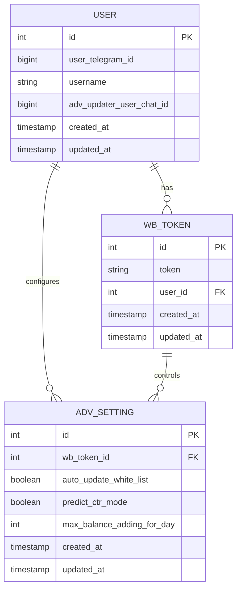
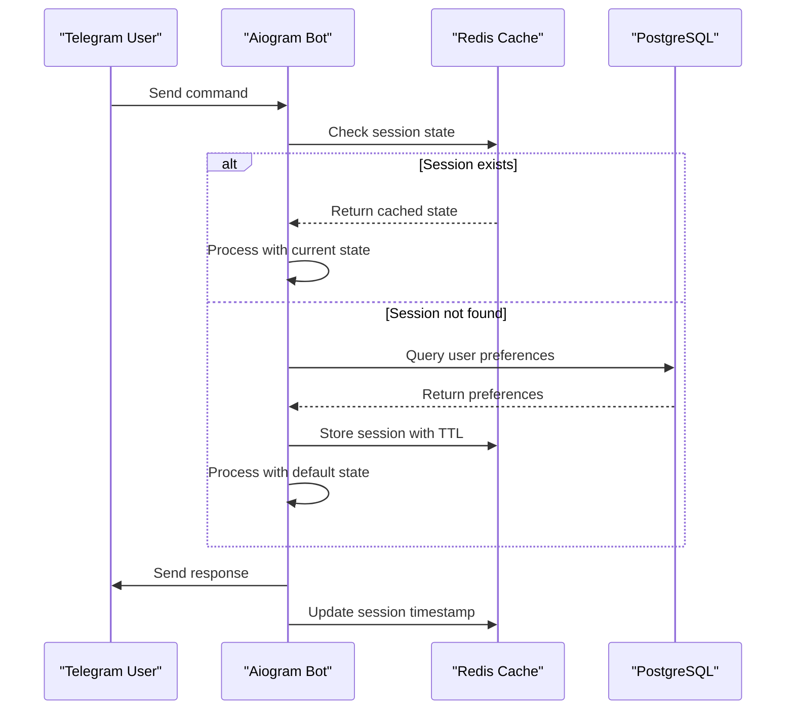
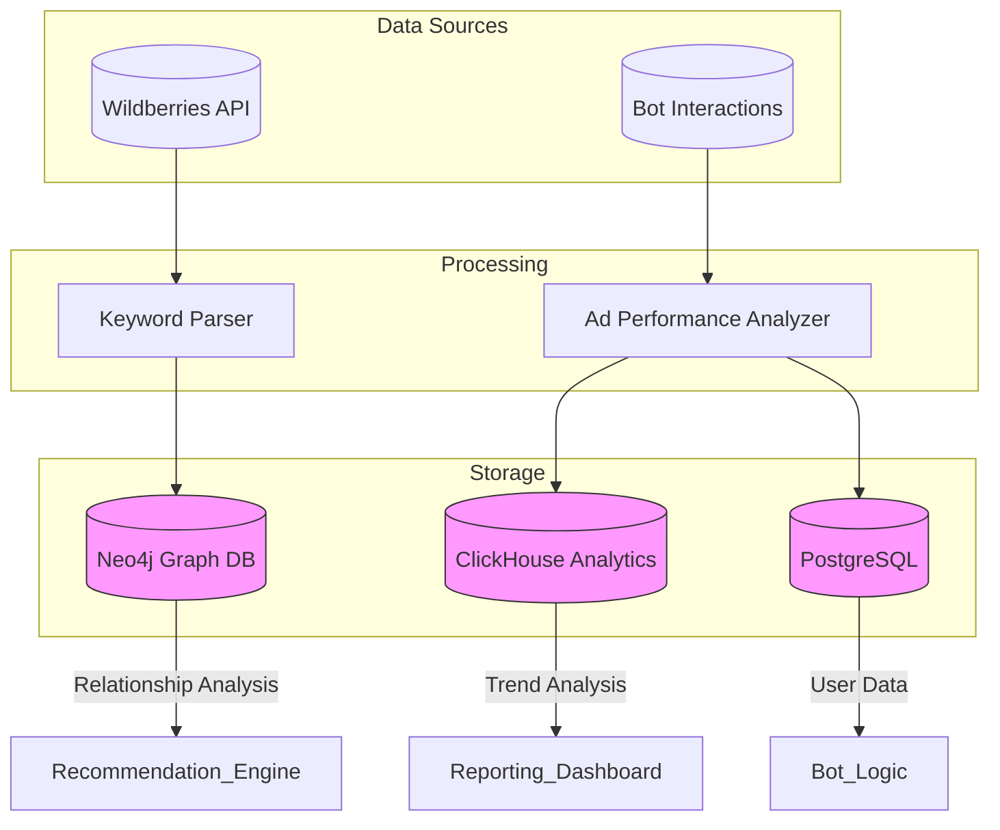
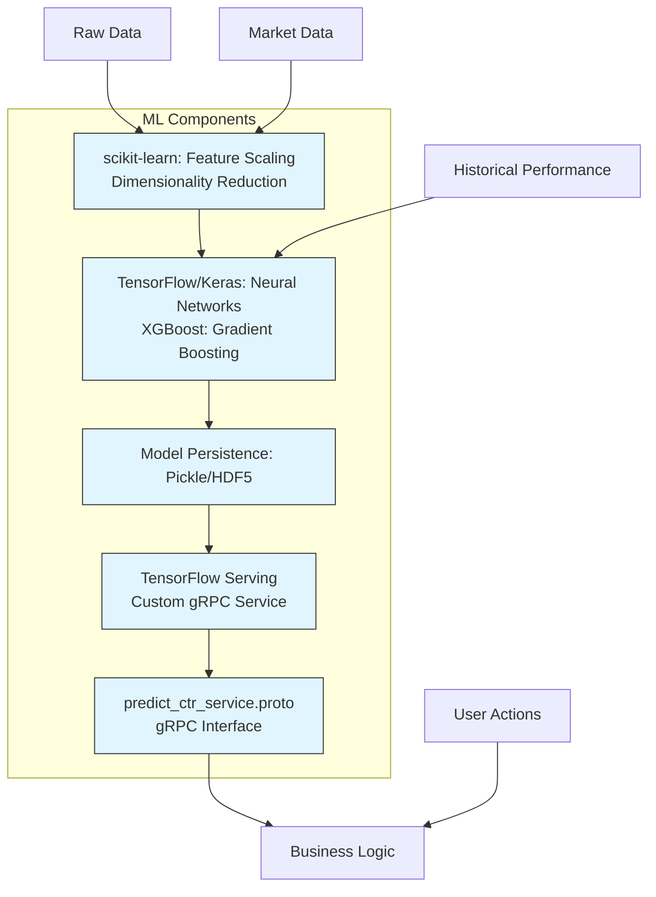

# Technology Stack & Dependencies

<cite>
**Referenced Files in This Document**   
- [pyproject.toml](file://pyproject.toml)
- [package.json](file://package.json)
- [bot.py](file://app/client_bot/bot.py)
- [models.py](file://app/utils/db/models.py)
- [redis_config.py](file://app/configs/infrastructure_config/redis_config.py)
- [neo4j_config.py](file://app/configs/infrastructure_config/neo4j_config.py)
- [predict_ctr_service.proto](file://app/modules/grpcs/predict_ctr_service/grpc_service/predict_ctr_service.proto)
- [client.py](file://app/utils/click_house/client.py)
- [faiss_index.py](file://app/utils/faiss_manager/faiss_index.py)
- [settings_master.py](file://app/settings/settings_master.py)
- [app_container.py](file://app/core/di/app_container.py)
- [redis.py](file://app/core/di/databases/redis.py)
- [neo4j.py](file://app/core/di/databases/neo4j.py)
</cite>

## Table of Contents
1. [Introduction](#introduction)
2. [Core Frameworks & Libraries](#core-frameworks--libraries)
3. [Database & Persistence Layer](#database--persistence-layer)
4. [Caching & State Management](#caching--state-management)
5. [Graph Database & Analytics](#graph-database--analytics)
6. [Machine Learning & AI Components](#machine-learning--ai-components)
7. [Configuration & Environment Management](#configuration--environment-management)
8. [Dependency Management with Poetry](#dependency-management-with-poetry)
9. [Testing & Development Tools](#testing--development-tools)
10. [Version Compatibility & Integration Points](#version-compatibility--integration-points)

## Introduction
The adv-bot project is a sophisticated Telegram-based advertising automation system designed for Wildberries marketplace integration. It leverages a modern Python technology stack with specialized components for bot functionality, data persistence, machine learning, and real-time analytics. This document provides a comprehensive overview of the technology stack, detailing the role of each major dependency, configuration practices, and development tooling. The system is built to handle complex workflows including keyword position tracking, automated bidding, predictive analytics, and multi-platform integrations.

## Core Frameworks & Libraries

The adv-bot project is built on a robust foundation of modern Python frameworks and libraries that enable scalable, asynchronous, and maintainable code. The primary framework is **aiogram 3.4.1**, which provides the core Telegram bot functionality. Aiogram is an asynchronous framework that allows the bot to handle thousands of concurrent users efficiently through its event-driven architecture. It integrates seamlessly with the asyncio ecosystem, enabling non-blocking I/O operations for API calls and database interactions.

The project also utilizes **FastAPI 0.110.0** for building RESTful APIs and webhook endpoints, providing automatic OpenAPI documentation and Pydantic-based request validation. FastAPI works in conjunction with **Uvicorn 0.27.1** as the ASGI server, ensuring high-performance HTTP handling. For background task processing, the system employs **Celery 5.4.0** with **Redis** as the message broker, enabling distributed task execution for computationally intensive operations like keyword parsing and ad optimization.

Additional core libraries include **aiohttp 3.9.3** for asynchronous HTTP requests to external APIs, **SQLAlchemy 2.0.32** as the primary ORM for relational database operations, and **dependency-injector 4.41.0** for implementing dependency injection patterns that enhance testability and modularity. The **arq 0.26.3** library is used for lightweight async task queues, complementing Celery for specific use cases requiring minimal overhead.

**Section sources**
- [pyproject.toml](file://pyproject.toml#L35-L36)
- [bot.py](file://app/client_bot/bot.py#L1-L10)

## Database & Persistence Layer

The persistence layer of the adv-bot project is designed with a multi-database architecture that combines relational, graph, and analytical databases to meet diverse data storage and retrieval requirements. At the core of the relational data model is **SQLAlchemy 2.0.32**, which serves as the Object-Relational Mapper (ORM) for PostgreSQL interactions. SQLAlchemy provides a powerful and flexible way to define database models, execute queries, and manage transactions while abstracting away much of the raw SQL complexity.

Database schema evolution is managed through **Alembic 1.13.1**, which provides version control for database migrations. The project contains numerous migration scripts in the `alembic/versions` directory, each representing incremental changes to the database schema. These migrations ensure that the database structure can evolve over time while maintaining data integrity across different deployment environments.

The primary relational database is PostgreSQL, configured with both master and replica instances for high availability and read scaling. Database connections are managed through connection pooling with configurable thread limits, and the system supports SSL encryption for secure database communications. The ORM models are defined in various locations throughout the codebase, with core user and payment models located in `app/utils/db/models.py`.

**Diagram sources**
- [pyproject.toml](file://pyproject.toml#L180-L181)
- [models.py](file://app/utils/db/models.py#L1-L50)

**Section sources**
- [pyproject.toml](file://pyproject.toml#L180-L181)
- [models.py](file://app/utils/db/models.py#L1-L50)
- [alembic.ini](file://alembic.ini#L1-L50)

## Caching & State Management

The adv-bot project implements a sophisticated caching and state management system centered around **Redis 5.1.0b4**, which serves multiple critical functions across the application. Redis is used not only as a traditional cache but also as a distributed state store, message broker, and session manager. The system leverages Redis for storing user session data, caching frequently accessed database queries, and maintaining real-time state for active bot interactions.

Configuration for Redis is managed through Pydantic settings models in `app/configs/infrastructure_config/redis_config.py`, which reads environment variables with the `REDIS_` prefix. This allows for flexible configuration across different deployment environments. The Redis client is integrated into the dependency injection container through `app/core/di/databases/redis.py`, ensuring that all components receive properly configured and lifecycle-managed Redis connections.

The project implements a multi-layered Redis architecture with different databases (configured via the `db` parameter) for separating concerns such as user sessions, temporary data, and persistent caches. The system also employs Redis for distributed locking mechanisms to prevent race conditions in critical operations like balance updates and token management. Additionally, Redis is used in conjunction with **aiocache 0.12.2** for higher-level caching patterns and TTL management.

**Diagram sources**
- [redis_config.py](file://app/configs/infrastructure_config/redis_config.py#L1-L15)
- [redis.py](file://app/core/di/databases/redis.py#L1-L36)
- [app_container.py](file://app/core/di/app_container.py#L1-L50)

**Section sources**
- [pyproject.toml](file://pyproject.toml#L135)
- [redis_config.py](file://app/configs/infrastructure_config/redis_config.py#L1-L15)
- [redis.py](file://app/core/di/databases/redis.py#L1-L36)

## Graph Database & Analytics

The adv-bot project incorporates **Neo4j 5.18.0** as its graph database engine to model and analyze complex relationships between products, keywords, and advertising performance metrics. Neo4j is particularly well-suited for this use case as it can efficiently represent and query the intricate network of relationships in advertising data, such as how specific keywords influence the visibility of multiple products across different categories.

The Neo4j configuration is defined in `app/configs/infrastructure_config/neo4j_config.py`, which extends Pydantic's BaseSettings to read connection parameters from environment variables with the `NEO4J_` prefix. The connection to Neo4j is managed through the dependency injection system in `app/core/di/databases/neo4j.py`, where the AsyncGraphDatabase driver is created and its lifecycle is controlled through a dedicated Neo4jLifecycle resource that handles initialization and graceful shutdown.

For analytical workloads, the project utilizes **ClickHouse 0.7.18** as its column-oriented database for storing and querying large volumes of advertising performance data. ClickHouse is optimized for fast aggregation queries over massive datasets, making it ideal for generating reports on ad spend, click-through rates, and conversion metrics. The ClickHouse client implementation in `app/utils/click_house/client.py` includes sophisticated connection pooling and monitoring capabilities, with detailed logging of connection usage by function and caller to prevent resource exhaustion.

**Diagram sources**
- [neo4j_config.py](file://app/configs/infrastructure_config/neo4j_config.py#L1-L16)
- [neo4j.py](file://app/core/di/databases/neo4j.py#L1-L44)
- [client.py](file://app/utils/click_house/client.py#L1-L199)

**Section sources**
- [pyproject.toml](file://pyproject.toml#L134)
- [neo4j_config.py](file://app/configs/infrastructure_config/neo4j_config.py#L1-L16)
- [client.py](file://app/utils/click_house/client.py#L1-L199)

## Machine Learning & AI Components

The adv-bot project integrates a comprehensive machine learning stack to enable predictive analytics and intelligent advertising optimization. At the foundation of this stack is **TensorFlow 2.20.0**, which provides the core deep learning capabilities for building and training models that predict click-through rates (CTR) and optimize bidding strategies. TensorFlow is complemented by **Keras 3.10.0** as the high-level API for model development, enabling rapid prototyping and deployment of neural networks.

For traditional machine learning tasks, the project utilizes **scikit-learn 1.4.1.post1**, which provides implementations of various algorithms for classification, regression, and clustering. Scikit-learn is used for feature engineering, model evaluation, and implementing simpler predictive models where deep learning would be overkill. The system also incorporates **XGBoost 2.0.3** for gradient boosting tasks, particularly in scenarios requiring high-performance tree-based models for ranking and classification.

A critical component of the ML infrastructure is **faiss-cpu 1.8.0**, which is used for efficient similarity search and clustering of high-dimensional vectors. Faiss enables the system to quickly find similar products and keywords by computing vector similarities in embedding space. The implementation in `app/utils/faiss_manager/faiss_index.py` demonstrates how Faiss is used to create persistent indexes that map product and keyword vectors to their database IDs, allowing for fast nearest-neighbor searches.

The predictive capabilities are exposed through a gRPC service defined in `app/modules/grpcs/predict_ctr_service/grpc_service/predict_ctr_service.proto`, which provides a standardized interface for requesting CTR predictions. This service-oriented approach allows the prediction logic to be scaled independently and accessed by multiple components of the system.

**Diagram sources**
- [pyproject.toml](file://pyproject.toml#L177-L178)
- [faiss_index.py](file://app/utils/faiss_manager/faiss_index.py#L1-L105)
- [predict_ctr_service.proto](file://app/modules/grpcs/predict_ctr_service/grpc_service/predict_ctr_service.proto#L1-L19)

**Section sources**
- [pyproject.toml](file://pyproject.toml#L177-L178)
- [faiss_index.py](file://app/utils/faiss_manager/faiss_index.py#L1-L105)
- [predict_ctr_service.proto](file://app/modules/grpcs/predict_ctr_service/grpc_service/predict_ctr_service.proto#L1-L19)

## Configuration & Environment Management

The adv-bot project employs a robust configuration management system built on **Pydantic Settings Management** that provides type-safe, environment-aware configuration with automatic validation. The core configuration is defined in `app/settings/settings_master.py`, which uses Python properties to access environment variables with appropriate type conversion and default values. This approach ensures that configuration values are always properly typed and validated at runtime.

For infrastructure-specific configurations, the project uses Pydantic models in the `app/configs/infrastructure_config` directory, including dedicated classes for Redis, Neo4j, and Wildberries API settings. These models leverage Pydantic's `BaseSettings` with custom configuration that reads from environment variables using prefixes (e.g., `REDIS_`, `NEO4J_`), allowing for clear separation of configuration concerns and easy management across different environments.

The system also incorporates **python-dotenv 1.0.1** for loading environment variables from `.env` files during development, making it easy to manage configuration without hardcoding sensitive values. The configuration system is integrated with the dependency injection container in `app/core/di/app_container.py`, ensuring that all components receive properly configured services and clients.

Security-sensitive configuration values such as database passwords, API tokens, and encryption keys are never stored in the codebase but are instead injected through environment variables or secure configuration management systems in production environments.

**Section sources**
- [settings_master.py](file://app/settings/settings_master.py#L1-L199)
- [redis_config.py](file://app/configs/infrastructure_config/redis_config.py#L1-L15)
- [app_container.py](file://app/core/di/app_container.py#L1-L50)

## Dependency Management with Poetry

The adv-bot project uses **Poetry 1.6+** as its primary dependency management and packaging tool, as evidenced by the `pyproject.toml` configuration file. Poetry provides a modern approach to Python dependency management with deterministic dependency resolution, isolated virtual environments, and comprehensive package metadata management.

The `pyproject.toml` file defines both main dependencies and development dependencies in separate groups. Main dependencies include all packages required for production operation, while development dependencies include testing frameworks, linters, and type checkers. This separation allows for lean production deployments while providing developers with a rich set of tools for code quality assurance.

Poetry's lock file (`poetry.lock`) ensures reproducible builds by pinning exact versions of all dependencies and their transitive dependencies. The project specifies a Python version constraint of `>=3.11,<3.12`, ensuring compatibility with modern Python features while maintaining stability by avoiding potential breaking changes in future Python releases.

The configuration also includes Ruff settings to exclude certain directories (like Alembic migration scripts) from linting, recognizing that generated or migration code may not need to adhere to the same standards as application code. This pragmatic approach to code quality tools demonstrates an understanding of real-world development workflows.

**Section sources**
- [pyproject.toml](file://pyproject.toml#L1-L184)

## Testing & Development Tools

The adv-bot project incorporates a comprehensive suite of testing and development tools to ensure code quality, maintainability, and reliability. The primary testing framework is **pytest 8.0.2**, which provides a powerful and flexible platform for writing unit, integration, and functional tests. Pytest is extended with **pytest-asyncio 0.21.0** to support testing asynchronous code, which is essential given the async nature of the Telegram bot and database operations.

For code quality and style enforcement, the project uses **ruff 0.1.0** as a fast Python linter and code formatter. Ruff replaces multiple traditional tools (like flake8, isort, and pydocstyle) with a single, high-performance solution that can check and fix code style issues. The configuration in `pyproject.toml` shows that ruff is set up to exclude certain directories like Alembic migrations, recognizing that generated code may not need to adhere to the same standards as application code.

Static type checking is performed using **mypy *** (latest version), which helps catch type-related errors before runtime. The project also includes `types-psutil` and other type stub packages to improve the accuracy of type checking for third-party libraries. This commitment to type safety enhances code maintainability and reduces runtime errors.

Additional development tools include **debugpy** for debugging, **poetry-types** for better type support in Poetry-managed projects, and **no-implicit-optional** to enforce explicit typing of optional values. The test suite is organized in the `tests/` directory with a clear structure mirroring the application's architecture, making it easy to locate and extend tests for specific components.

**Section sources**
- [pyproject.toml](file://pyproject.toml#L186-L193)
- [pytest.ini](file://pytest.ini#L1-L10)

## Version Compatibility & Integration Points

The adv-bot project maintains careful attention to version compatibility across its extensive dependency tree, with particular consideration for the Python version requirement of `>=3.11,<3.12`. This constraint ensures access to modern Python features like improved error messages, enhanced typing capabilities, and performance optimizations while avoiding potential breaking changes in future Python releases.

The system integrates with several third-party services and platforms through well-defined interfaces. The primary external integration is with the **Wildberries marketplace API**, which is accessed through custom client implementations in the `app/modules/common_slaves/wildberries/api/` directory. These clients handle authentication, rate limiting, and data transformation between the Wildberries API format and the application's internal data models.

For monitoring and observability, the project includes configuration for **Filebeat** and **Promtail**, suggesting integration with Elasticsearch and Grafana for centralized logging and monitoring. The presence of `smithery-cli` in `package.json` indicates integration with a deployment or infrastructure management platform, likely for CI/CD automation.

The gRPC service definition in `predict_ctr_service.proto` establishes a clear contract for machine learning model serving, allowing for language-agnostic integration with prediction services. This service-oriented architecture enables the system to scale prediction workloads independently and potentially integrate with models written in other languages.

All third-party integrations follow a consistent pattern of configuration through environment variables, separation of concerns via dedicated modules, and error handling that gracefully degrades functionality when external services are unavailable.

**Section sources**
- [pyproject.toml](file://pyproject.toml#L3)
- [package.json](file://package.json#L1-L6)
- [settings_master.py](file://app/settings/settings_master.py#L1-L199)
- [predict_ctr_service.proto](file://app/modules/grpcs/predict_ctr_service/grpc_service/predict_ctr_service.proto#L1-L19)