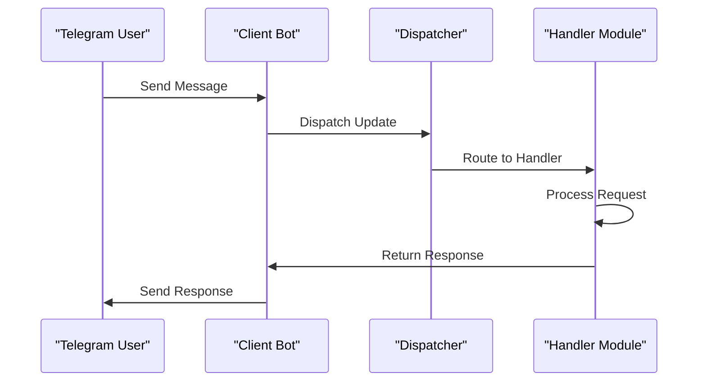
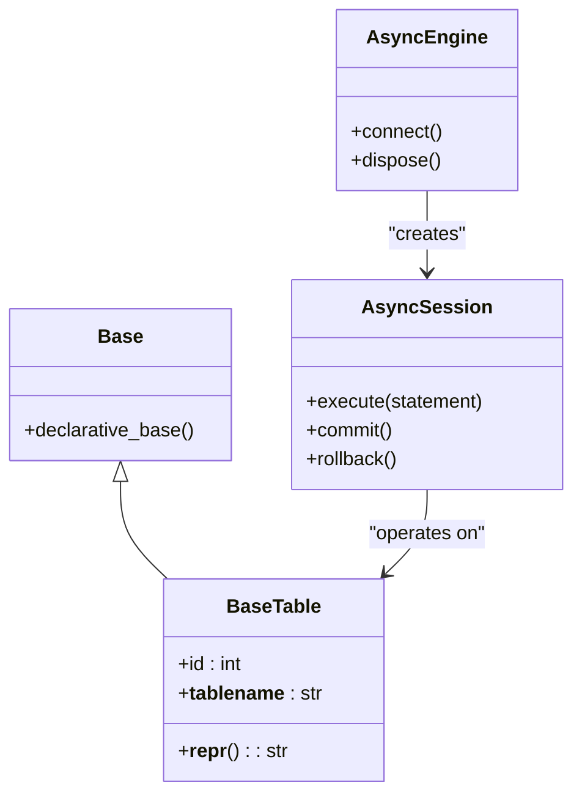
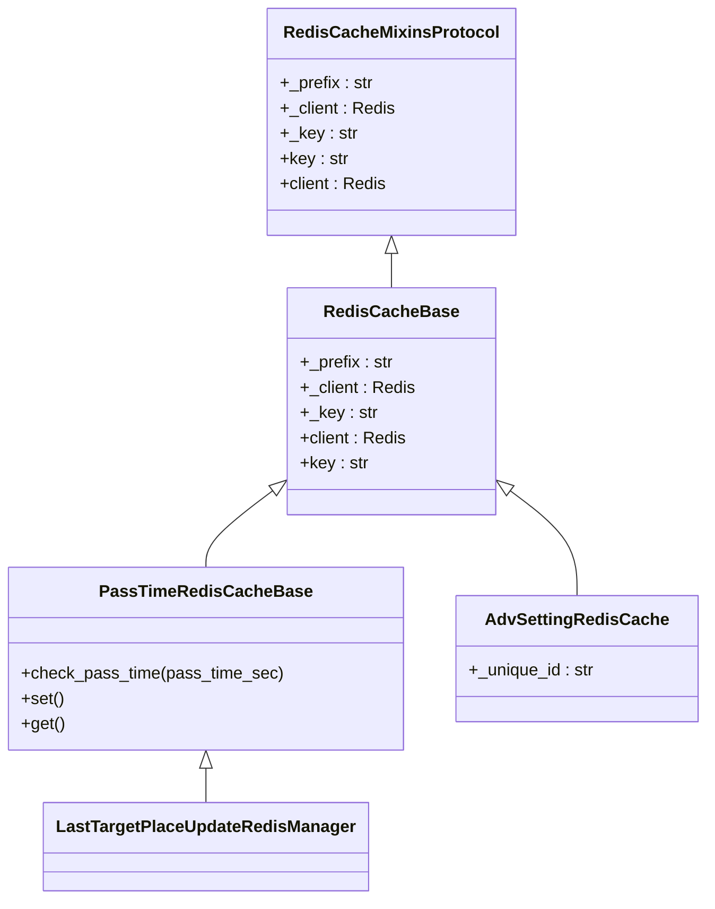
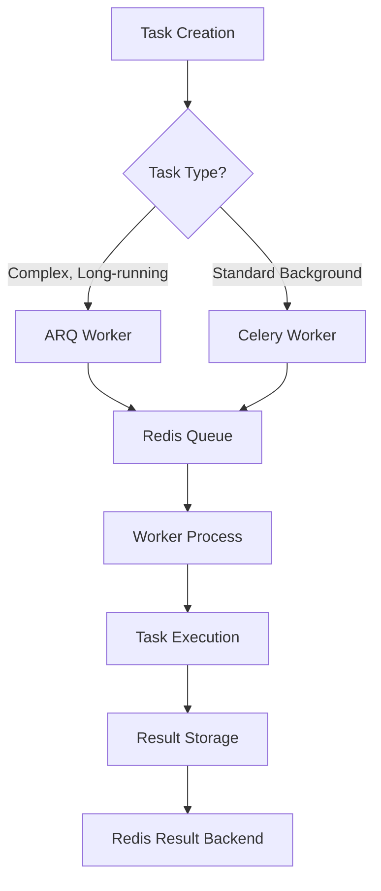
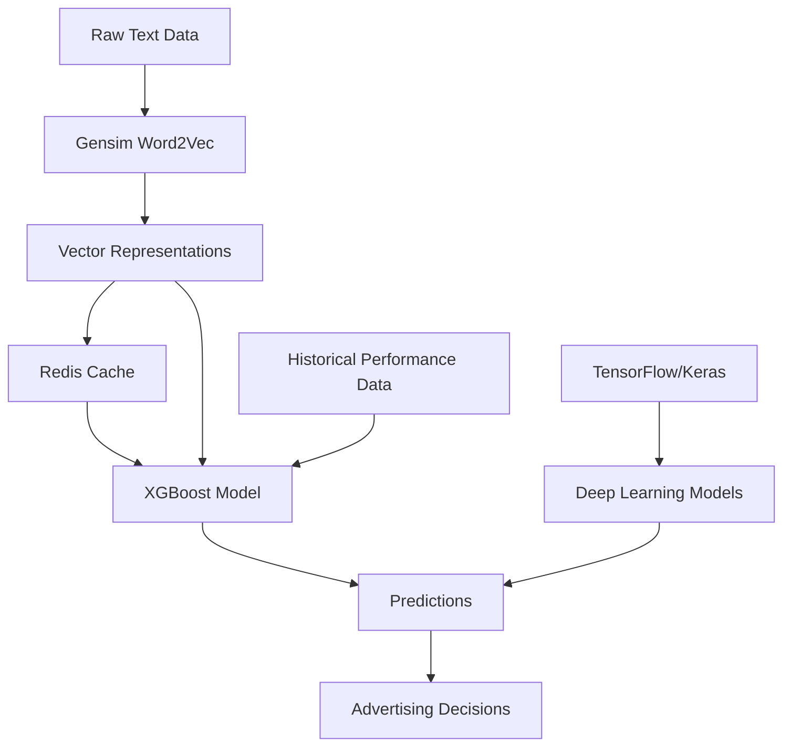

# Technology Stack & Dependencies

<cite>
**Referenced Files in This Document**   
- [requirements.txt](file://requirements.txt)
- [pyproject.toml](file://pyproject.toml)
- [bot.py](file://app/client_bot/bot.py)
- [session_maker.py](file://app/utils/db/session_maker.py)
- [arq_redis_settings.py](file://app/arq_workers/arq_redis_settings.py)
- [celeryconfig.py](file://celeryconfig.py)
- [client.py](file://app/utils/click_house/client.py)
- [redis_cache_base.py](file://app/core/redis_cache/redis_cache_base.py)
- [ml_common_funcs.py](file://app/modules/wb_adv_updater/ml_common_funcs.py)
- [word_to_vec_object.py](file://app/modules/wb_adv_updater/word_to_vec_object.py)
- [gds_object.py](file://app/modules/wb_adv_updater/gds_object.py)
</cite>

## Table of Contents
1. [Introduction](#introduction)
2. [Core Technology Stack](#core-technology-stack)
3. [Telegram Bot Framework: aiogram](#telegram-bot-framework-aiogram)
4. [Web Services Framework: FastAPI](#web-services-framework-fastapi)
5. [Database ORM: SQLAlchemy](#database-orm-sqlalchemy)
6. [PostgreSQL Async Driver: asyncpg](#postgresql-async-driver-asyncpg)
7. [Caching & Message Brokering: redis](#caching--message-brokering-redis)
8. [Analytics Database: clickhouse-connect](#analytics-database-clickhouse-connect)
9. [Background Task Processing: arq and celery](#background-task-processing-arq-and-celery)
10. [Machine Learning Libraries](#machine-learning-libraries)
11. [Dependency Management & Configuration](#dependency-management--configuration)
12. [Integration Patterns & Architecture](#integration-patterns--architecture)
13. [Performance Considerations](#performance-considerations)
14. [Common Issues & Solutions](#common-issues--solutions)
15. [Conclusion](#conclusion)

## Introduction
The adv-bot system is a sophisticated Python-based application designed for automated advertising management on the Wildberries platform. This document provides a comprehensive analysis of the technology stack and dependencies that power the system, detailing how each component contributes to the overall architecture and functionality. The system leverages modern Python frameworks and libraries to deliver a robust, scalable solution for Telegram bot interactions, database operations, background processing, and machine learning capabilities.

## Core Technology Stack
The adv-bot system is built on Python as its primary programming language, utilizing a modern stack of frameworks and libraries that enable asynchronous operations, efficient database interactions, and advanced machine learning capabilities. The architecture follows a microservices-inspired pattern with clear separation of concerns between different components, including Telegram bot interfaces, background workers, database services, and machine learning models.

The system's design emphasizes asynchronous processing to handle high volumes of concurrent operations, particularly in the context of web scraping, API interactions, and real-time bot responses. This approach is facilitated by the use of async/await patterns throughout the codebase, with careful coordination between different asynchronous components to ensure data consistency and system reliability.

**Section sources**
- [requirements.txt](file://requirements.txt)
- [pyproject.toml](file://pyproject.toml)

## Telegram Bot Framework: aiogram
The aiogram library (version 3.4.1) serves as the foundation for all Telegram bot functionality in the adv-bot system. It provides a modern, asynchronous framework for building Telegram bots with support for the latest Telegram Bot API features. The framework is used extensively across multiple bot instances within the system, including both client-facing and administrative bots.

The client bot is initialized in `app/client_bot/bot.py`, where the Bot instance is created using the Telegram bot token from the application settings. This bot instance is then made available throughout the application via the `get_bot()` function, enabling dependency injection and centralized bot management. The framework's router system is used to organize handlers into modular components, with the global router in `app/client_bot/global_router.py` serving as the central dispatch point for all incoming messages and callbacks.

Additional aiogram functionality is imported and re-exported in `app/core/telegram/aiogram_objects/__init__.py`, creating a centralized import point for commonly used aiogram components such as CallbackData, Router, Bot, StateFilter, FSMContext, CallbackQuery, and Message. This pattern promotes consistency across the codebase and simplifies imports for developers working on different parts of the system.

The admin bot, located in `app/admin_bot/`, follows a similar pattern but with additional functionality for administrative tasks and message broadcasting. It uses RedisStorage for FSM (Finite State Machine) persistence, allowing state to be maintained across bot restarts and enabling complex multi-step interactions with users.

**Diagram sources**
- [bot.py](file://app/client_bot/bot.py)
- [global_router.py](file://app/client_bot/global_router.py)

**Section sources**
- [bot.py](file://app/client_bot/bot.py)
- [aiogram_objects/__init__.py](file://app/core/telegram/aiogram_objects/__init__.py)
- [admin_bot/bot_manager.py](file://app/admin_bot/bot_manager.py)

## Web Services Framework: FastAPI
FastAPI (version 0.110.0) is used as the web services framework for the adv-bot system, providing a modern, high-performance API layer that integrates seamlessly with the asynchronous nature of the application. The framework is particularly important for webhook-based bot operation, where incoming Telegram updates are received via HTTP POST requests.

In `client_bot_run.py`, FastAPI is used to create an application instance that manages the bot's webhook configuration. The application uses an async context manager for lifespan management, ensuring proper initialization and cleanup of resources. When operating in webhook mode (determined by the POLLING_MODE setting), the bot registers its webhook URL with Telegram, directing all incoming updates to the FastAPI endpoint.

The integration between FastAPI and aiogram is carefully orchestrated to handle the asynchronous nature of both frameworks. The Dispatcher instance is created within the FastAPI lifespan context, and the global router is included to ensure all bot handlers are properly registered. This integration allows the system to efficiently handle both health-check requests for the API and incoming bot updates through the same HTTP server.

Uvicorn (version 0.27.1) is used as the ASGI server to run the FastAPI application, providing high-performance HTTP/1.1 and HTTP/2 support with asyncio-based concurrency. The combination of FastAPI and Uvicorn enables the system to handle thousands of concurrent connections with minimal resource overhead.

**Section sources**
- [client_bot_run.py](file://client_bot_run.py)
- [requirements.txt](file://requirements.txt)

## Database ORM: SQLAlchemy
SQLAlchemy (version 2.0.28) serves as the primary ORM (Object-Relational Mapper) for the adv-bot system, providing a powerful and flexible interface for database operations. The system uses SQLAlchemy's modern asyncio-compatible API to perform asynchronous database operations, which is essential for maintaining high performance in a concurrent environment.

The base model classes are defined in `app/utils/db/base.py`, where a declarative base class is created with an abstract `BaseTable` that includes common functionality such as auto-incrementing primary keys and dynamic table name generation based on class names. This pattern promotes consistency across all database models and reduces boilerplate code.

The system implements a sophisticated session management system in `app/utils/db/session_maker.py`, which creates separate async engines for read-only and read-write operations. This separation allows for optimal routing of database queries to appropriate database instances (master for writes, replicas for reads), improving performance and scalability. The session maker also includes comprehensive logging and monitoring capabilities, with slow query detection (queries taking longer than 1 second) and detailed logging of query execution times and locations.

Alembic (version 1.13.1) is used for database migrations, with migration scripts located in the `alembic/versions` directory. The migration environment is configured in `alembic/env.py`, which integrates with the application's settings to connect to the appropriate database instance. The migration system supports both offline and online modes, allowing schema changes to be generated and applied in various deployment scenarios.

**Diagram sources**
- [base.py](file://app/utils/db/base.py)
- [session_maker.py](file://app/utils/db/session_maker.py)
- [env.py](file://alembic/env.py)

**Section sources**
- [base.py](file://app/utils/db/base.py)
- [session_maker.py](file://app/utils/db/session_maker.py)
- [env.py](file://alembic/env.py)

## PostgreSQL Async Driver: asyncpg
asyncpg (version 0.29.0) is the PostgreSQL driver used by the adv-bot system, providing high-performance asynchronous database connectivity. It is integrated with SQLAlchemy through the `postgresql+asyncpg://` dialect, enabling efficient non-blocking database operations that are essential for the system's performance requirements.

In `app/utils/db/session_maker.py`, the database connection strings are constructed to use asyncpg as the driver. The `get_alchemy_row` function generates connection URLs that are then modified to use the asyncpg dialect by replacing `postgresql://` with `postgresql+asyncpg://`. This configuration allows SQLAlchemy to leverage asyncpg's performance advantages while maintaining compatibility with the ORM's API.

The system configures separate connection pools for read-only and read-write operations, with configurable pool size and overflow settings controlled by environment variables (PG_POOL_SIZE and PG_MAX_OVERFLOW). This allows the system to adapt to different deployment environments and traffic patterns. The connection pools are configured with `pool_pre_ping=True` to ensure connection validity before use, reducing the likelihood of errors due to stale connections.

The integration of asyncpg with SQLAlchemy's asyncio support enables the system to handle thousands of concurrent database operations efficiently, which is critical for the bot's functionality that involves frequent database reads and writes for user data, advertising settings, and analytics.

**Section sources**
- [session_maker.py](file://app/utils/db/session_maker.py)

## Caching & Message Brokering: redis
Redis is a critical component of the adv-bot system, serving multiple roles including caching, message brokering, and distributed state management. The system uses redis-py (version 5.1.0b4) as the primary Redis client, with additional integration through aiocache for higher-level caching patterns.

The core Redis functionality is implemented in `app/core/redis_cache/`, where a base `RedisCacheBase` class provides common functionality for Redis operations. This base class is extended by various mixins that add specific functionality, such as timestamp-based expiration checking in `PassTimeRedisCacheBase`. The system uses Redis for storing frequently accessed data, such as user settings, advertising configurations, and temporary state information, significantly reducing database load and improving response times.

aiocache is configured in `app/utils/redis_func_cache.py` to provide a higher-level caching interface with features like hit/miss ratio tracking and timing metrics. The cache configuration points to a Redis instance named "wbgram_bot_redis" on the default port, with PickleSerializer for storing complex Python objects. This configuration enables the system to cache function results and other computed data efficiently.

Redis is also used as a message broker for both ARQ and Celery task queues, providing reliable message delivery and persistence. The system uses separate Redis databases for different purposes (e.g., database 5 for admin bot FSM storage), allowing for logical separation of concerns and easier management.

**Diagram sources**
- [redis_cache_base.py](file://app/core/redis_cache/redis_cache_base.py)
- [mixins_protocol.py](file://app/core/redis_cache/mixins/mixins_protocol.py)
- [pass_time_redis_cache_base.py](file://app/core/redis_cache/mixins/data_types/pass_time_redis_cache_base.py)
- [adv_setting_redis_cache.py](file://app/core/redis_cache/mixins/main_objects_mixins/adv_setting_redis_cache.py)

**Section sources**
- [redis_cache_base.py](file://app/core/redis_cache/redis_cache_base.py)
- [redis_func_cache.py](file://app/utils/redis_func_cache.py)
- [last_target_place_update_redis_manager.py](file://app/modules/shop_runner/service_manager/old_modules/auto_updater_target_place/last_target_place_update_redis_manager.py)

## Analytics Database: clickhouse-connect
clickhouse-connect (version 0.7.18) provides the interface between the adv-bot system and ClickHouse, a column-oriented database management system optimized for online analytical processing (OLAP). This integration is crucial for the system's analytics capabilities, enabling efficient storage and querying of large volumes of advertising performance data.

The ClickHouse client is implemented in `app/utils/click_house/client.py`, where a context manager `get_clickhouse_client` manages the lifecycle of ClickHouse connections. The implementation includes sophisticated connection tracking and monitoring, with counters for total connections and connections per function. This is particularly important in a multiprocessing environment where connection limits must be carefully managed to avoid resource exhaustion.

The system uses ClickHouse for storing detailed advertising statistics, with tables designed for high-performance aggregation queries. The `full_wb_adv_stat.py` module demonstrates typical usage patterns, with complex SQL queries that aggregate spending data across multiple dimensions (advertising IDs, dates, and text variations). These queries leverage ClickHouse's strengths in handling large datasets and performing fast aggregations.

The client implementation includes a `track_connections` decorator that automatically manages ClickHouse client instances for decorated functions, ensuring proper cleanup and connection reuse. This pattern simplifies the use of ClickHouse in various parts of the system while maintaining resource efficiency.

**Section sources**
- [client.py](file://app/utils/click_house/client.py)
- [full_wb_adv_stat.py](file://app/modules/shop_runner/wb_stat_manager/clickhouse_manager/full_wb_adv_stat.py)

## Background Task Processing: arq and celery
The adv-bot system employs both ARQ and Celery for background task processing, leveraging the strengths of each framework for different use cases. This dual approach allows the system to optimize task processing based on specific requirements such as latency, reliability, and resource utilization.

ARQ (version 0.26.3) is configured in `app/arq_workers/`, with worker settings defined in `workers.py` and Redis connection settings in `arq_redis_settings.py`. ARQ is used for tasks that require high reliability and sophisticated retry mechanisms, such as creating complex advertising campaigns. The worker configuration includes a 24-hour job timeout and retention period, with up to 10 retry attempts. The `clear_queues.py` script provides administrative functionality for managing ARQ queues, allowing operators to clear stuck tasks when necessary.

Celery (version 5.4.0) is configured through `celeryconfig.py`, using Redis as both the message broker and result backend. Celery is used for more traditional background tasks that benefit from its mature ecosystem and extensive feature set. The configuration includes settings for task serialization (JSON), retry behavior (5 attempts with 30-second delays), and worker concurrency (auto-determined based on system resources).

The system uses both frameworks in parallel, with different modules registering tasks with the appropriate system based on their requirements. This hybrid approach provides flexibility in task processing while maintaining separation of concerns between different types of background operations.

**Diagram sources**
- [arq_redis_settings.py](file://app/arq_workers/arq_redis_settings.py)
- [workers.py](file://app/arq_workers/workers.py)
- [celeryconfig.py](file://celeryconfig.py)

**Section sources**
- [arq_redis_settings.py](file://app/arq_workers/arq_redis_settings.py)
- [workers.py](file://app/arq_workers/workers.py)
- [celeryconfig.py](file://celeryconfig.py)

## Machine Learning Libraries
The adv-bot system incorporates several machine learning libraries to enable intelligent advertising optimization and content analysis. These libraries work together to provide predictive capabilities that enhance the system's automation features.

TensorFlow is included in the requirements (without a specific version, indicating the latest stable release) and serves as the foundation for deep learning models in the system. It is used alongside Keras (version 3.1.1) for building and training neural networks that can analyze advertising performance patterns and make predictions about optimal bidding strategies.

XGBoost (version 2.0.3) is used for gradient boosting tasks, particularly in the prediction of click-through rates (CTR) and other advertising metrics. The implementation in `app/modules/wb_adv_updater/ml_common_funcs.py` shows how XGBoost models are saved and loaded using joblib, with thread-safe operations protected by a Lock to prevent race conditions during model updates. The system uses XGBoost for its efficiency and performance in structured data prediction tasks.

Gensim (version 4.3.2) is employed for natural language processing tasks, particularly in the analysis of advertising keywords and product descriptions. It is used in conjunction with Word2Vec models to create vector representations of text that can be used for similarity calculations and clustering. The `word_to_vec_object.py` module initializes a Word2Vec model from `app/utils/text_master/Transformers`, demonstrating the integration of gensim's capabilities into the system's text analysis pipeline.

The machine learning components are tightly integrated with the system's data storage, retrieving feature data from both Redis and Neo4j (via the DataScience driver). This allows the models to leverage both fast-access cached data and richly connected graph data for their predictions.

**Diagram sources**
- [ml_common_funcs.py](file://app/modules/wb_adv_updater/ml_common_funcs.py)
- [word_to_vec_object.py](file://app/modules/wb_adv_updater/word_to_vec_object.py)
- [gds_object.py](file://app/modules/wb_adv_updater/gds_object.py)

**Section sources**
- [ml_common_funcs.py](file://app/modules/wb_adv_updater/ml_common_funcs.py)
- [word_to_vec_object.py](file://app/modules/wb_adv_updater/word_to_vec_object.py)
- [gds_object.py](file://app/modules/wb_adv_updater/gds_object.py)

## Dependency Management & Configuration
The adv-bot system uses a comprehensive dependency management strategy with multiple requirements files to support different deployment environments. The primary dependencies are specified in `requirements.txt`, which includes all production dependencies with pinned versions for stability and reproducibility.

Additional requirements files include `req_win.txt` for Windows development environments and `linux_requirements.txt` for Linux production deployments. These files contain platform-specific dependencies and version constraints that ensure compatibility across different operating systems. The use of separate requirements files allows the development team to manage platform-specific dependencies without affecting the core dependency set.

Configuration is managed through environment variables and the `app/settings/settings_master.py` file, which provides a centralized interface for accessing configuration values. The settings class uses environment variables for sensitive information like database credentials and API tokens, with sensible defaults for non-critical settings. This approach enables flexible configuration across different deployment environments (development, staging, production) without requiring code changes.

The `pyproject.toml` file contains configuration for development tools like pytest, black, and ruff, ensuring consistent code style and testing practices across the development team. The configuration includes settings for line length, target Python version, and specific linting rules, promoting code quality and maintainability.

**Section sources**
- [requirements.txt](file://requirements.txt)
- [req_win.txt](file://req_win.txt)
- [linux_requirements.txt](file://linux_requirements.txt)
- [settings_master.py](file://app/settings/settings_master.py)
- [pyproject.toml](file://pyproject.toml)

## Integration Patterns & Architecture
The adv-bot system demonstrates several sophisticated integration patterns that enable its complex functionality. The architecture follows a layered approach with clear separation between presentation (Telegram bots), business logic (modules), data access (database and caching), and machine learning components.

One key integration pattern is the use of dependency injection for shared resources like the Bot instance, Redis client, and database sessions. This pattern is evident in the `get_bot()` function and the various manager classes that provide access to shared resources. This approach promotes loose coupling between components and makes the system more testable and maintainable.

Another important pattern is the use of mixins and abstract base classes to share functionality across different components. The Redis cache system, for example, uses a combination of base classes and mixins to provide common functionality while allowing for specialization. This pattern reduces code duplication and makes it easier to add new features that require similar functionality.

The system also demonstrates effective use of asynchronous programming patterns, with careful coordination between different async frameworks (aiogram, FastAPI, SQLAlchemy asyncio, ARQ, Celery). The use of async context managers for resource management ensures proper cleanup of connections and other resources, preventing resource leaks in long-running processes.

**Section sources**
- [bot.py](file://app/client_bot/bot.py)
- [session_maker.py](file://app/utils/db/session_maker.py)
- [redis_cache_base.py](file://app/core/redis_cache/redis_cache_base.py)

## Performance Considerations
The adv-bot system incorporates several performance optimization strategies to handle its demanding workload. The most significant performance consideration is the use of asynchronous programming throughout the stack, which allows the system to handle thousands of concurrent operations efficiently.

Database performance is optimized through the use of connection pooling, read/write separation, and query monitoring. The SQLAlchemy session maker configures pools with appropriate sizes and overflow limits, while the asyncpg driver provides high-performance PostgreSQL connectivity. The system also includes slow query detection, logging queries that take longer than 1 second for further analysis and optimization.

Caching is extensively used to reduce database load and improve response times. Redis is used for both data caching and distributed state management, with TTL-based expiration and timestamp checking to ensure data freshness. The aiocache configuration includes performance monitoring features like hit/miss ratio tracking and timing metrics, allowing developers to measure the effectiveness of caching strategies.

For machine learning operations, the system uses joblib for model persistence and includes thread-safe operations with Lock to prevent race conditions during model updates. The ClickHouse client implementation includes sophisticated connection tracking and monitoring to prevent resource exhaustion in multiprocessing environments.

**Section sources**
- [session_maker.py](file://app/utils/db/session_maker.py)
- [redis_func_cache.py](file://app/utils/redis_func_cache.py)
- [client.py](file://app/utils/click_house/client.py)
- [ml_common_funcs.py](file://app/modules/wb_adv_updater/ml_common_funcs.py)

## Common Issues & Solutions
The adv-bot system addresses several common issues in complex Python applications through thoughtful design and implementation. One common issue is circular imports, which is mitigated through careful package organization and the use of lazy imports where necessary. The system's modular structure, with clear separation between different functional areas, helps prevent circular dependencies.

Async/await coordination is another common challenge that the system addresses through consistent use of async context managers and proper error handling. The lifespan management in FastAPI ensures proper initialization and cleanup of async resources, while the various worker systems (ARQ, Celery) handle the complexities of async task execution.

Database connection management is handled through the sophisticated session maker implementation, which includes connection pooling, read/write separation, and slow query detection. This helps prevent common issues like connection exhaustion and slow database performance.

The system also addresses configuration management challenges through the use of environment variables and a centralized settings class, making it easier to deploy the application in different environments without code changes.

**Section sources**
- [session_maker.py](file://app/utils/db/session_maker.py)
- [settings_master.py](file://app/settings/settings_master.py)
- [client_bot_run.py](file://client_bot_run.py)

## Conclusion
The adv-bot system demonstrates a sophisticated technology stack that combines modern Python frameworks and libraries to create a powerful advertising automation platform. The careful selection and integration of components like aiogram, FastAPI, SQLAlchemy, asyncpg, Redis, ClickHouse, ARQ, Celery, and machine learning libraries enable the system to deliver complex functionality with high performance and reliability.

The architecture emphasizes asynchronous operations, separation of concerns, and efficient resource management, allowing the system to handle high volumes of concurrent operations while maintaining responsiveness. The use of multiple specialized databases (PostgreSQL for transactional data, Redis for caching and messaging, ClickHouse for analytics) demonstrates a thoughtful approach to data storage that optimizes each component for its specific use case.

Overall, the technology stack and dependencies of the adv-bot system represent a well-considered balance between functionality, performance, and maintainability, providing a solid foundation for the system's advanced advertising automation capabilities.