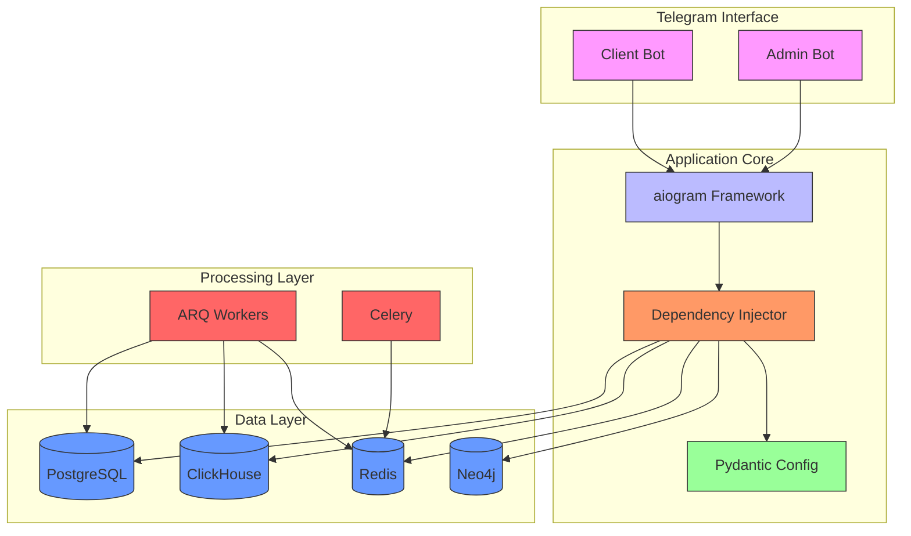
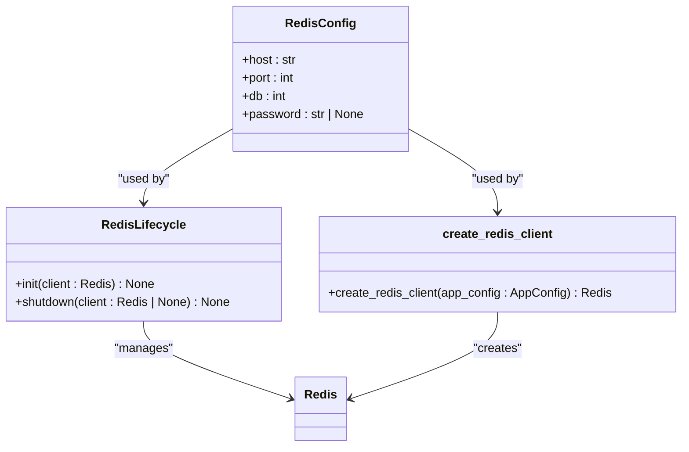
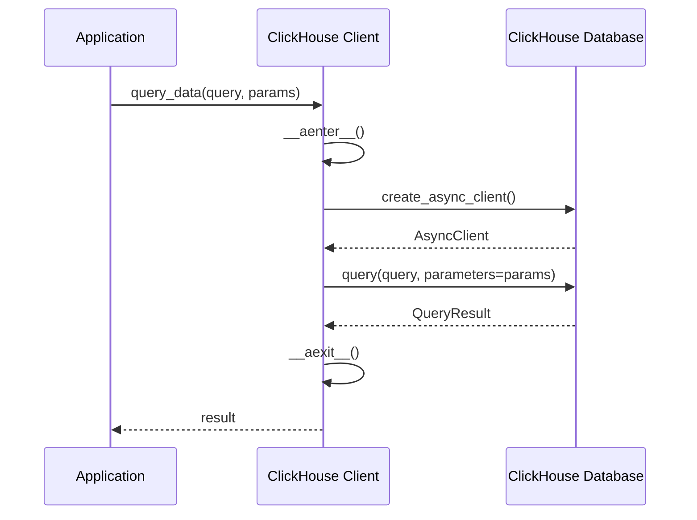
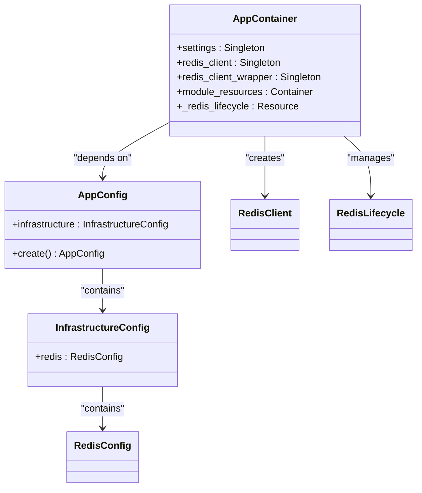
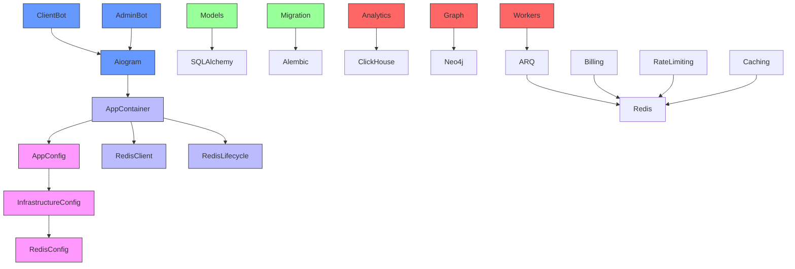

# Technology Stack

<cite>
**Referenced Files in This Document**   
- [linux_requirements.txt](file://linux_requirements.txt)
- [app_config.py](file://app/configs/app_config.py)
- [infrastructure_config.py](file://app/configs/infrastructure_config/infrastructure_config.py)
- [redis_config.py](file://app/configs/infrastructure_config/redis_config.py)
- [app_container.py](file://app/core/di/app_container.py)
- [redis.py](file://app/core/di/databases/redis.py)
- [bot.py](file://app/client_bot/bot.py)
- [bot_manager.py](file://app/admin_bot/bot_manager.py)
- [models.py](file://app/utils/db/models.py)
- [client.py](file://app/utils/click_house/client.py)
- [common_stat_manager.py](file://app/modules/shop_runner/wb_statistic_manager/backend/common_stat_manager.py)
- [setting_auto_updater.py](file://app/modules/shop_runner/service_manager/old_modules/setting_auto_updater/setting_auto_updater.py)
</cite>

## Table of Contents
1. [Introduction](#introduction)
2. [Core Components](#core-components)
3. [Architecture Overview](#architecture-overview)
4. [Detailed Component Analysis](#detailed-component-analysis)
5. [Dependency Analysis](#dependency-analysis)
6. [Performance Considerations](#performance-considerations)
7. [Troubleshooting Guide](#troubleshooting-guide)
8. [Conclusion](#conclusion)

## Introduction
The adv-bot project implements a sophisticated technology stack designed for high-performance Telegram-based advertising automation with advanced analytics and distributed task processing. This document details the critical components that form the foundation of the system: aiogram for Telegram interaction, SQLAlchemy 2.0 for ORM, Alembic for migrations, Redis for caching and queuing, ClickHouse for analytics, Neo4j for graph relationships, and ARQ for async task processing. The architecture leverages Pydantic for configuration management through AppConfig and dependency injection via dependency_injector, ensuring type safety and modular design. Version compatibility is maintained through linux_requirements.txt, which specifies precise package versions for reproducible deployments. The integration patterns between these technologies enable complex workflows such as Redis-managed rate limiting for aiogram handlers and ClickHouse-stored campaign performance data.

**Section sources**
- [linux_requirements.txt](file://linux_requirements.txt)
- [app_config.py](file://app/configs/app_config.py)

## Core Components

The technology stack of the adv-bot project consists of several critical components that work together to provide a robust advertising automation platform. At the core of Telegram interaction is aiogram 3.4.1, which handles all bot communications with the Telegram API. For data persistence, the system uses SQLAlchemy 2.0.28 as its ORM layer, providing a modern Pythonic interface to the PostgreSQL database. Database schema evolution is managed through Alembic 1.13.1, with migration scripts organized in the alembic/versions directory. Caching and queuing are handled by Redis 5.1.0b4, configured through environment variables with host, port, database, and optional password settings. Analytical workloads are offloaded to ClickHouse 0.7.18, which stores campaign performance data and enables fast aggregation queries. Graph relationships between advertising entities are managed by Neo4j 5.18.0, allowing for complex relationship queries. Asynchronous task processing is implemented using ARQ 0.26.3, which coordinates background jobs across distributed workers. Configuration management is centralized through Pydantic's BaseModel, with the AppConfig class serving as the main configuration entry point that composes infrastructure settings.

**Section sources**
- [linux_requirements.txt](file://linux_requirements.txt#L14-L15)
- [app_config.py](file://app/configs/app_config.py#L1-L20)
- [infrastructure_config.py](file://app/configs/infrastructure_config/infrastructure_config.py#L1-L15)
- [redis_config.py](file://app/configs/infrastructure_config/redis_config.py#L1-L15)

## Architecture Overview

The system architecture follows a layered approach with clear separation of concerns between components. The application is structured around a dependency injection container that manages the lifecycle of services and their dependencies. Configuration is loaded at startup through Pydantic Settings, with environment variables providing runtime configuration values. The client_bot and admin_bot modules handle Telegram interactions through aiogram, with each bot instance configured with its respective token. Database access is abstracted through SQLAlchemy models defined in app/utils/db/models.py, which include User, RefLink, and associated relationships. Redis is used extensively for caching, rate limiting, and inter-process communication, with connections managed through the dependency_injector framework. ClickHouse serves as the analytical database, with a dedicated client implementation that manages connection pooling and query execution. Neo4j stores graph relationships between advertising entities, enabling complex relationship queries. ARQ workers process background tasks asynchronously, with Redis serving as the message broker. The architecture supports horizontal scaling of worker processes while maintaining data consistency through distributed locking mechanisms implemented in Redis.

**Diagram sources**
- [bot.py](file://app/client_bot/bot.py#L1-L15)
- [bot_manager.py](file://app/admin_bot/bot_manager.py#L1-L12)
- [app_container.py](file://app/core/di/app_container.py#L1-L46)
- [models.py](file://app/utils/db/models.py#L1-L49)

## Detailed Component Analysis

### aiogram for Telegram Interaction
The aiogram framework (version 3.4.1) serves as the primary interface for Telegram bot interactions in the adv-bot project. The client_bot module implements the main user-facing bot functionality, while the admin_bot module handles administrative commands and monitoring. Each bot instance is initialized with its respective API token loaded from environment variables or configuration files. The framework's asynchronous architecture enables handling thousands of concurrent user interactions with minimal resource overhead. Middleware components implement rate limiting and user state management, preventing abuse and ensuring smooth user experiences. The bot.py file in the client_bot directory creates the main Bot instance, which is then used throughout the application to send and receive messages. Error handling is implemented at multiple levels to ensure message delivery reliability even during temporary network disruptions.

**Section sources**
- [bot.py](file://app/client_bot/bot.py#L1-L15)
- [bot_manager.py](file://app/admin_bot/bot_manager.py#L1-L12)

### SQLAlchemy 2.0 and Alembic for Data Management
The data persistence layer is built on SQLAlchemy 2.0.28, which provides a modern ORM interface to the PostgreSQL database. The models.py file in app/utils/db defines the core data structures, including User, RefLink, and their relationships. SQLAlchemy's declarative base pattern is used to define table schemas with proper type annotations and constraints. The ORM layer abstracts database operations, allowing for database-agnostic code that can be easily tested with different backends. Alembic 1.13.1 manages database schema migrations, with versioned migration scripts stored in the alembic/versions directory. Each migration script represents an atomic change to the database schema, enabling safe evolution of the data model in production environments. The combination of SQLAlchemy 2.0's improved async support and Alembic's robust migration capabilities ensures data integrity while supporting the application's evolving requirements.

**Section sources**
- [models.py](file://app/utils/db/models.py#L1-L49)
- [alembic/versions](file://alembic/versions)

### Redis for Caching and Queuing
Redis 5.1.0b4 plays a central role in the adv-bot architecture, serving multiple purposes including caching, rate limiting, distributed locking, and message queuing. The redis_config.py file defines the connection parameters, which are loaded from environment variables with the REDIS_ prefix. The dependency_injector framework manages Redis client lifecycle, ensuring proper connection pooling and error handling. Multiple modules use Redis for different purposes: the client_bot implements rate limiting to prevent abuse of bot commands, the billing module uses Redis locks to prevent race conditions during balance updates, and the ARQ workers use Redis as a message broker for task distribution. The redis.py file in the DI module implements a lifecycle resource that validates Redis connectivity at startup and gracefully closes connections during shutdown. This multi-faceted use of Redis enables high-performance operations while maintaining data consistency across distributed components.

**Diagram sources**
- [redis_config.py](file://app/configs/infrastructure_config/redis_config.py#L1-L15)
- [redis.py](file://app/core/di/databases/redis.py#L1-L36)

### ClickHouse for Analytics
ClickHouse 0.7.18 serves as the analytical database for the adv-bot project, storing high-volume advertising performance data that would be inefficient to query in the primary PostgreSQL database. The client.py file in app/utils/click_house implements a connection manager that handles connection pooling and query execution. The get_clickhouse_client context manager ensures proper resource cleanup and implements connection counting for monitoring purposes. Analytical queries are optimized for fast aggregation over large datasets, such as calculating campaign performance metrics over time periods. The track_connections decorator automatically injects the ClickHouse client into functions that require it, reducing boilerplate code. The system uses ClickHouse to store detailed advertising statistics in the wb_common_stat table, which is queried to generate performance reports and inform bidding decisions. This separation of operational and analytical workloads allows the system to scale efficiently as data volumes grow.

**Diagram sources**
- [client.py](file://app/utils/click_house/client.py#L1-L210)
- [common_stat_manager.py](file://app/modules/shop_runner/wb_statistic_manager/backend/common_stat_manager.py#L1-L176)

### Neo4j for Graph Relationships
Neo4j 5.18.0 is used to store and query complex graph relationships between advertising entities that would be difficult to represent efficiently in a relational database. The infrastructure_config.py file includes a commented-out reference to Neo4jConfig, indicating that Neo4j is configured similarly to Redis but is currently disabled or conditionally enabled. The system likely uses Neo4j to model relationships between keywords, products, and advertising campaigns, enabling sophisticated recommendation engines and competitive analysis. Graph queries can efficiently traverse multiple hops to identify patterns and relationships that would require complex joins in a relational database. The choice of Neo4j over alternatives like Amazon Neptune or JanusGraph reflects the project's need for a mature, open-source graph database with strong Python driver support and ACID transaction guarantees.

**Section sources**
- [infrastructure_config.py](file://app/configs/infrastructure_config/infrastructure_config.py#L1-L15)

### ARQ for Async Task Processing
ARQ 0.26.3 provides asynchronous task processing capabilities, enabling the system to handle long-running operations without blocking the main application threads. The arq_workers directory contains the worker implementations that process tasks from Redis queues. ARQ's lightweight design and Redis backend make it well-suited for the existing Redis infrastructure, avoiding the complexity of introducing a separate message broker. Tasks include updating advertising campaigns, processing keyword data, and generating performance reports. The clear_queues.py script suggests that queue management is an important operational consideration, likely used to handle failed tasks or reset processing state. ARQ's support for job retries, timeouts, and result storage enables reliable task processing even in the face of transient failures.

**Section sources**
- [arq_workers](file://app/arq_workers)

### Pydantic and Dependency Injector for Configuration and DI
The configuration and dependency injection system is built on Pydantic's BaseModel and the dependency_injector library. The AppConfig class serves as the main configuration entry point, composing infrastructure settings from separate configuration classes. Pydantic's validation ensures that configuration values are correct and complete at startup, preventing runtime errors due to misconfiguration. The dependency_injector framework manages the lifecycle of services and their dependencies, implementing inversion of control to reduce coupling between components. The AppContainer class defines providers for key services like the Redis client and database connections, ensuring consistent initialization and resource management. This approach enables easy testing by allowing dependencies to be mocked or replaced in test environments. The wiring configuration automatically injects dependencies into modules that require them, reducing boilerplate code and configuration errors.

**Diagram sources**
- [app_config.py](file://app/configs/app_config.py#L1-L20)
- [infrastructure_config.py](file://app/configs/infrastructure_config/infrastructure_config.py#L1-L15)
- [app_container.py](file://app/core/di/app_container.py#L1-L46)

## Dependency Analysis

The dependency relationships between components in the adv-bot project follow a clear hierarchy with well-defined interfaces. The dependency_injector framework serves as the central coordination point, managing dependencies between services and ensuring proper initialization order. Configuration dependencies flow from the environment variables through Pydantic settings to the AppContainer, which then injects configuration values into dependent services. Database dependencies are abstracted through the ORM layer, with SQLAlchemy models depending on the database connection but not on specific implementation details. Redis is a pervasive dependency, used by multiple components for different purposes but accessed through a consistent interface provided by the dependency injector. ClickHouse dependencies are limited to analytical modules that require high-performance querying capabilities. Neo4j dependencies are isolated to graph-specific functionality, minimizing the impact of its conditional availability. The ARQ workers depend on Redis for task queuing but are otherwise decoupled from the main application, allowing them to scale independently. This dependency structure enables modular development and testing, as components can be replaced or mocked without affecting the entire system.

**Diagram sources**
- [app_config.py](file://app/configs/app_config.py#L1-L20)
- [infrastructure_config.py](file://app/configs/infrastructure_config/infrastructure_config.py#L1-L15)
- [app_container.py](file://app/core/di/app_container.py#L1-L46)

## Performance Considerations

The technology stack choices in the adv-bot project reflect careful consideration of performance characteristics and scalability limits. aiogram's asynchronous architecture enables handling thousands of concurrent Telegram connections with minimal memory overhead, making it well-suited for bot applications with large user bases. SQLAlchemy 2.0's improved async support allows database operations to proceed without blocking the event loop, maintaining responsiveness even under heavy load. Redis serves as a high-performance cache and message broker, with in-memory operations enabling microsecond response times for critical paths like rate limiting and distributed locking. ClickHouse's columnar storage and vectorized query execution enable fast aggregation over billions of advertising performance records, with query performance scaling linearly with cluster size. Neo4j's native graph storage provides millisecond response times for complex relationship queries, even with deep traversals. ARQ's lightweight design minimizes overhead for task processing, with Redis providing sub-millisecond message delivery. The system's operational considerations include connection pooling limits, memory usage monitoring, and queue backlog management to prevent task processing delays.

**Section sources**
- [client.py](file://app/utils/click_house/client.py#L1-L210)
- [redis.py](file://app/core/di/databases/redis.py#L1-L36)

## Troubleshooting Guide

Common issues in the adv-bot technology stack typically relate to configuration, connectivity, and resource limits. Configuration errors can occur when environment variables are missing or incorrectly formatted, particularly for database and service connection parameters. Connectivity issues may arise between the application and external services like Redis, PostgreSQL, ClickHouse, or Neo4j, often due to network configuration or authentication problems. Resource limits can be encountered with Redis memory usage, ClickHouse query complexity, or database connection pools. The system provides several diagnostic tools: the get_clickhouse_client implementation includes connection counting and logging to monitor ClickHouse usage; the RedisLifecycle class validates connectivity at startup; and the dependency_injector framework provides clear error messages when dependencies cannot be resolved. Monitoring should focus on Redis memory usage, ClickHouse query performance, and ARQ worker queue lengths to identify potential bottlenecks before they impact service availability.

**Section sources**
- [client.py](file://app/utils/click_house/client.py#L1-L210)
- [redis.py](file://app/core/di/databases/redis.py#L1-L36)
- [app_container.py](file://app/core/di/app_container.py#L1-L46)

## Conclusion

The adv-bot project's technology stack represents a thoughtful selection of tools optimized for advertising automation with Telegram integration. The combination of aiogram, SQLAlchemy 2.0, Redis, ClickHouse, Neo4j, and ARQ provides a comprehensive foundation for handling high-volume user interactions, complex data relationships, and intensive analytical workloads. The use of Pydantic for configuration and dependency_injector for dependency management ensures type safety and modularity throughout the codebase. Version pinning in linux_requirements.txt guarantees reproducible deployments across environments. The integration patterns between components demonstrate a deep understanding of each technology's strengths: Redis for ephemeral data and coordination, ClickHouse for analytical workloads, Neo4j for graph relationships, and ARQ for distributed task processing. This architecture enables the system to scale efficiently while maintaining reliability and performance, making it well-suited for its intended purpose as an advertising automation platform.